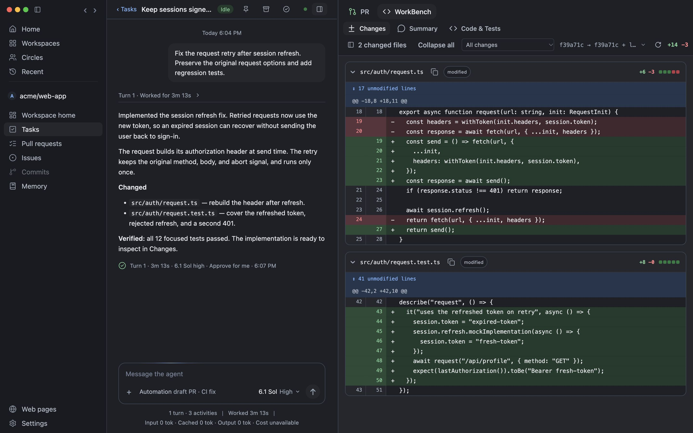
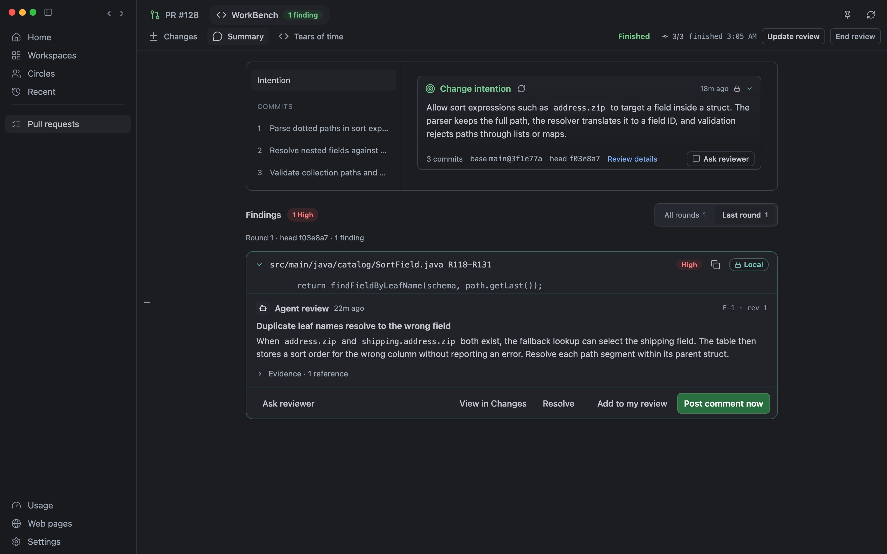
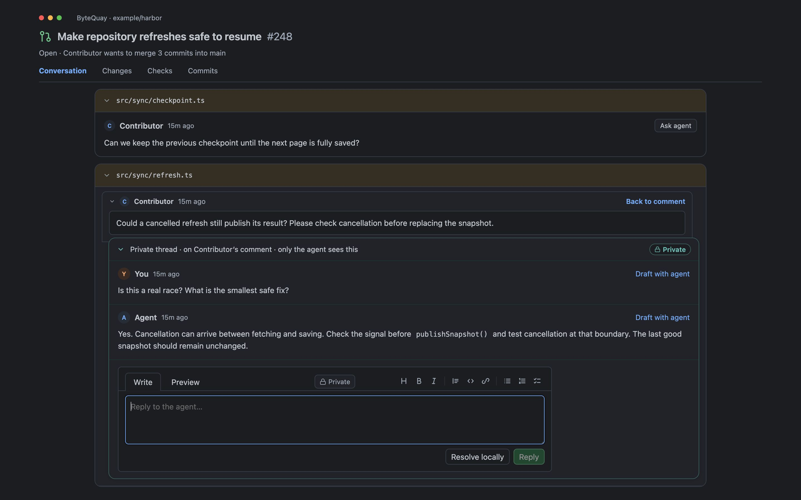
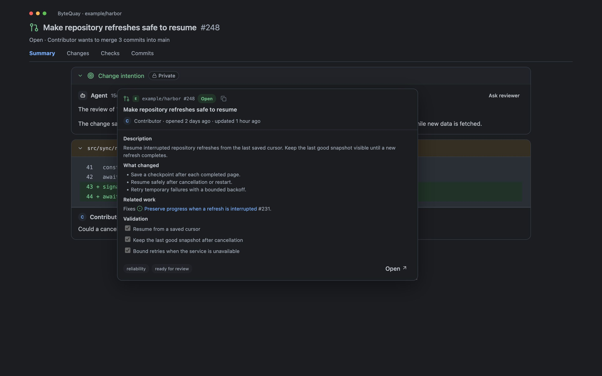
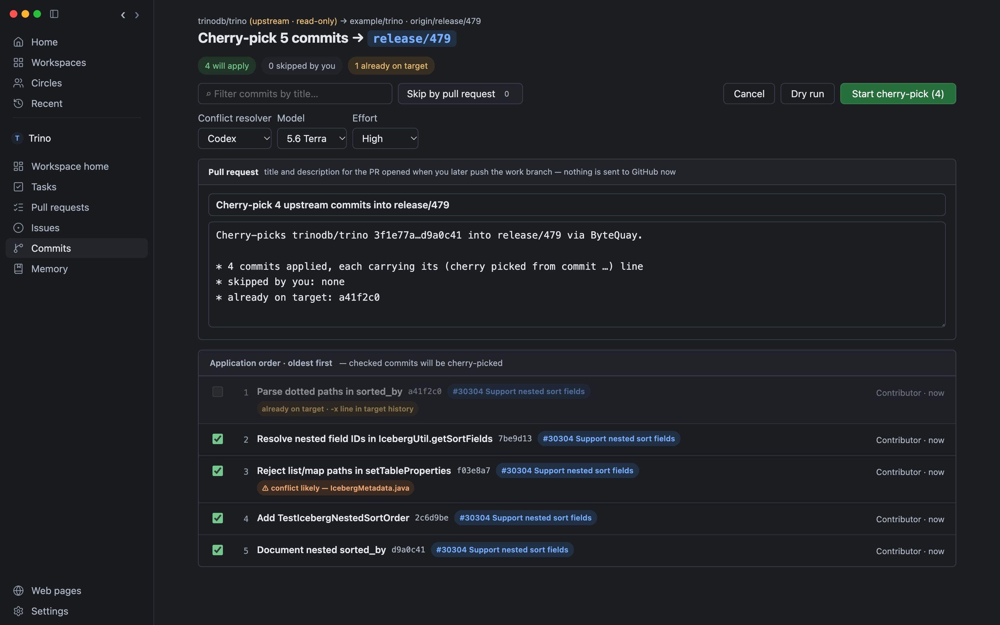
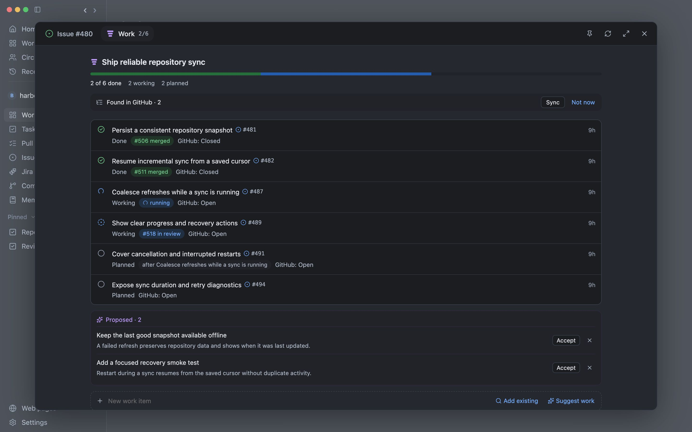
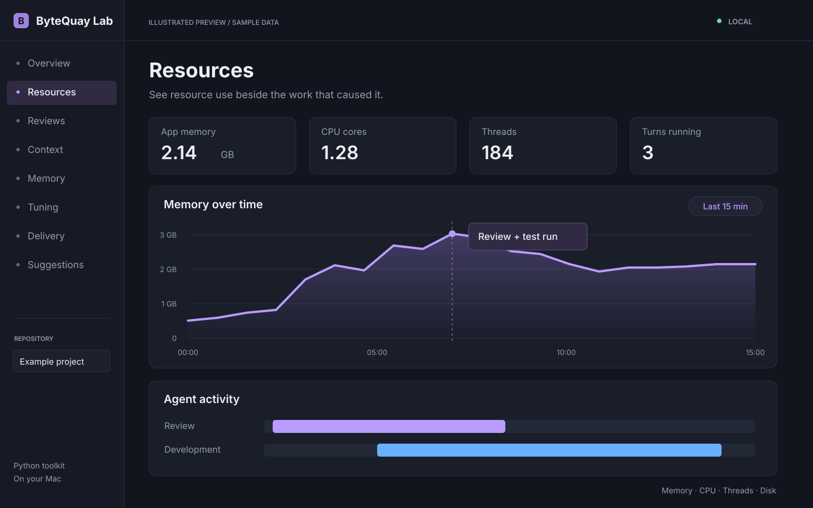

<p align="center">
  <a href="https://bytequay.github.io/bytequay/">
    <picture>
      <source media="(prefers-color-scheme: dark)" srcset="assets/wordmark-dark.svg">
      
    </picture>
  </a>
</p>

<p align="center">
  <strong>Don’t lose your understanding.</strong><br>
  As your agents do more, your confidence should grow.
</p>

<p align="center">
  <a href="https://bytequay.github.io/bytequay/">Website</a> ·
  <a href="https://bytequay.github.io/bytequay/documentation.html">Docs</a> ·
  <a href="https://bytequay.github.io/bytequay/lab.html">ByteQuay Lab</a> ·
  <a href="https://bytequay.github.io/bytequay/design.html">Design</a> ·
  <a href="https://github.com/bytequay/bytequay/releases">Download</a>
</p>

<p align="center">
  <a href="LICENSE"></a>
  <a href="https://github.com/bytequay/bytequay/actions/workflows/ci.yml"></a>
</p>

ByteQuay is a desktop app that brings GitHub reviews and local coding agents
together. Let agents build and guide you, choose how much detail to explore,
and discuss any part of the work before you merge.

macOS is the first supported platform, with Linux support planned.

App data stays on your computer. GitHub and model requests use the services you
connect; publishing requires your action or explicitly accepted automation.

ByteQuay is open source and pre-1.0. The guides cover the development version;
check your release notes for feature availability.

## What you can do

Click a preview or title to open its guide, or
[take the full app tour →](https://bytequay.github.io/bytequay/#the-app)

<table>
  <tr>
    <td width="50%" valign="top">
      <a href="https://bytequay.github.io/bytequay/guide-agents.html#agent-tasks">
        <br>
        <strong>Build with agents →</strong>
      </a><br>
      Use Codex, Claude Code, or your agent API, such as DeepSeek. Guide the work and inspect the result.
    </td>
    <td width="50%" valign="top">
      <a href="https://bytequay.github.io/bytequay/guide-reviews.html#private-review">
        <br>
        <strong>Review with context →</strong>
      </a><br>
      Read the reasoning and findings before deciding what to publish.
    </td>
  </tr>
  <tr>
    <td width="50%" valign="top">
      <a href="https://bytequay.github.io/bytequay/guide-reviews.html#ask-from-review">
        <br>
        <strong>Ask from a review card →</strong>
      </a><br>
      Discuss a comment and draft a reply privately before posting.
    </td>
    <td width="50%" valign="top">
      <a href="https://bytequay.github.io/bytequay/guide-reviews.html#link-previews">
        <br>
        <strong>Preview PR and issue links →</strong>
      </a><br>
      Follow the context without losing your place.
    </td>
  </tr>
  <tr>
    <td width="50%" valign="top">
      <a href="https://bytequay.github.io/bytequay/guide-agents.html#commits-and-backports">
        <br>
        <strong>Carry changes across branches →</strong>
      </a><br>
      Plan cherry-picks, inspect conflicts, and review before delivery.
    </td>
    <td width="50%" valign="top">
      <a href="https://bytequay.github.io/bytequay/guide-planning.html#epics">
        <br>
        <strong>Keep larger work connected →</strong>
      </a><br>
      Follow work items, tasks, dependencies, and outcomes in an Epic.
    </td>
  </tr>
</table>

The [Goals experiment](https://bytequay.github.io/bytequay/guide-planning.html#goals)
is still under implementation, is not a supported feature, and is hidden in
packaged releases.

## ByteQuay Lab

ByteQuay Lab is a separate Python toolkit for measuring resource use, testing
skills and review guidance, and examining context and memory use. Compare
results before and after a change to understand which features help.

[](https://bytequay.github.io/bytequay/lab.html)

[Explore the Lab →](https://bytequay.github.io/bytequay/lab.html) ·
[Run the Lab →](https://bytequay.github.io/bytequay/lab-guide.html)

## Install

Download the latest `.dmg` from
[GitHub Releases](https://github.com/bytequay/bytequay/releases), open it, and
drag **ByteQuay.app** to **Applications**.

Current macOS builds require macOS 14+. The app bundles Java 25; no separate JDK
installation is required.

Follow the [quickstart](https://bytequay.github.io/bytequay/guide-get-started.html#getting-started)
to connect GitHub, watch a repository, and open your first PR.
For common problems, see [Get help](https://bytequay.github.io/bytequay/guide-help.html).

Current releases are not notarized. If macOS reports that ByteQuay is damaged
after downloading it from the official Releases page, run:

```sh
xattr -dr com.apple.quarantine /Applications/ByteQuay.app
```

## Develop

See [CONTRIBUTING.md](CONTRIBUTING.md) for prerequisites, setup, and verification.

```sh
git clone https://github.com/bytequay/bytequay.git
cd bytequay
nvm install
./dev.sh
```

Read the [design overview](https://bytequay.github.io/bytequay/design.html),
[product design](docs/design.md), and [architecture](docs/architecture.md)
for product intent and system boundaries. The [website source](website/README.md)
and [Markdown user guide](website/documentation.md) live in this repository.

## License

ByteQuay is released under the [Apache License 2.0](LICENSE).
