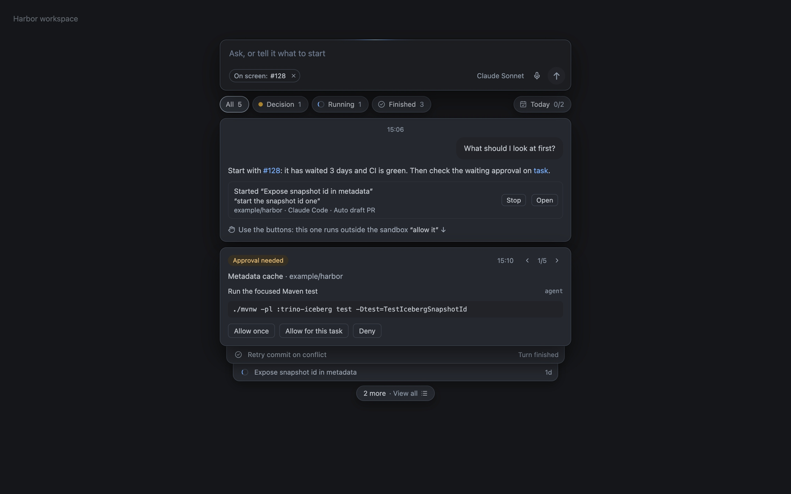

  <a href="https://bytequay.github.io/bytequay/">
    <picture>
      <source media="(prefers-color-scheme: dark)" srcset="assets/wordmark-dark.svg">
      
    </picture>
  </a>

  <strong>Don’t lose your understanding.</strong> 
  As your agents do more, your confidence should grow.

  <a href="https://bytequay.github.io/bytequay/"><strong>Explore ByteQuay →</strong></a> 
  Built for macOS · Open source · Pre-1.0

  
  

ByteQuay brings GitHub work and coding agents into one desktop workspace.
Let agents build. Explore the intent, code, and tests as deeply as you need.
Ask questions along the way, then merge with confidence.

  <a href="https://bytequay.github.io/bytequay/"><strong>See ByteQuay in action →</strong></a>

Use Codex, Claude Code, or your agent API, such as DeepSeek. Keep Claude Code
accounts isolated and choose the account for each repository.

## One workspace. The whole picture.

Click any preview to explore the ByteQuay website.

<table>
  <tr>
    <td width="50%" valign="top">
      <a href="https://bytequay.github.io/bytequay/">
         
        <strong>Review with context →</strong>
      </a> 
      Inspect findings, ask an agent from a review card, and choose what to publish.
    </td>
    <td width="50%" valign="top">
      <a href="https://bytequay.github.io/bytequay/">
         
        <strong>Your next step, one shortcut away →</strong>
      </a> 
      Open the Assistant with ⌘J to ask about your work and see what needs you.
    </td>
  </tr>
  <tr>
    <td width="50%" valign="top">
      <a href="https://bytequay.github.io/bytequay/">
         
        <strong>Carry changes across branches →</strong>
      </a> 
      Plan cherry-picks, inspect conflicts, and review before delivery.
    </td>
    <td width="50%" valign="top">
      <a href="https://bytequay.github.io/bytequay/">
         
        <strong>Keep larger work connected →</strong>
      </a> 
      Follow work items, tasks, dependencies, and outcomes in an Epic.
    </td>
  </tr>
</table>

PR and issue previews keep context close wherever you work. ByteQuay Lab helps
you measure resource use and compare whether skills, guidance, and context help.

## Your work, on your Mac.

Conversations, reviews, settings, and working copies stay on your computer.
GitHub and model requests go to the services you connect.

**[Visit the ByteQuay website →](https://bytequay.github.io/bytequay/)**

Explore the app tour, downloads, Lab, and guides from the home page.

---

Building from source or contributing? See [CONTRIBUTING.md](CONTRIBUTING.md).
Released under the [Apache License 2.0](LICENSE).
