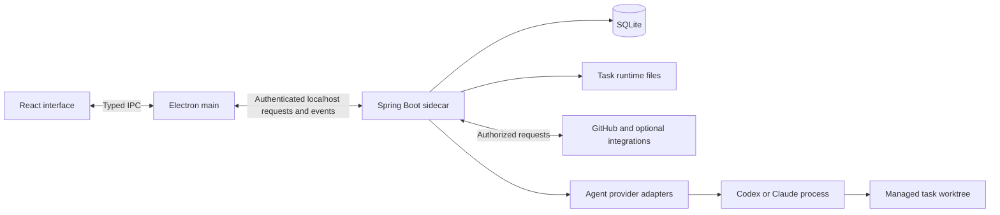

# ByteQuay architecture

ByteQuay has one desktop shell, one local application backend, one SQLite
application database, and provider processes that execute agent work. The
[product design](design.md) describes why these pieces exist; the
[user guide](../website/documentation.md) describes what people can do with them.

## Runtime boundaries



React and TypeScript render the application. Electron main owns native windows,
embedded browser views, authenticated backend access, and event transport. The
renderer requests application objects through typed IPC rather than choosing
arbitrary filesystem locations or receiving backend secrets.

The Spring Boot sidecar binds to localhost. One backend process owns the SQLite
database, enforced by an operating-system lock. Desktop browser surfaces use
Electron `WebContentsView`; external web sessions stay separate from the
application's privileged bridge and backend credentials.

Packaged apps own their Java runtime alongside the backend JAR. The release
build creates it from JDK 25 for the target Mac architecture, and Electron
starts that bundled executable directly. Installed system Java does not
determine app startup; runtime updates ship with ByteQuay releases.
The IDE's Java language server uses a suitable installed JDK when available
and otherwise shares the backend's Java runtime, avoiding a second bundled JRE.

Artifacts are conversations about a workspace's repository. Each turn is a
read-only agent session on the workspace's Development model in a scratch
checkout of the default branch, recorded as the same agent events a task
records. The pages the agent saves are stored in SQLite with their versions and
shown in a sandboxed `WebContentsView` with its own in-memory partition and no
preload. Each page is its own origin on the `bytequay-artifact` scheme, served
from its stored HTML under a content security policy that allows only inline
scripts and styles and the app theme; navigation and new windows are refused, so
a page reaches nothing outside itself.

App notices project existing task, turn, approval, and queue state through the
authenticated `/agent/notices` endpoint. Electron polls this local snapshot and
keeps delivery deduplication and recent notices in memory for the session.
Explicitly dismissed notice IDs are atomically saved in Electron's local app data
before removing the card and restored before the first notice snapshot is applied.
The Assistant panel lists the current notices and answers approvals and questions
with each task's own buttons. While the panel is closed, a separate sandboxed
`WebContentsView` shows one short alert at the bottom right, above browser and
editor views. Its restricted bridge can read, dismiss, resize, and open the panel
at a notice or navigate to a validated task; it cannot approve or execute task
actions. Recovery notices wait for ordinary shutdown cleanup to settle before
announcing a block. While another app is in front, Electron also shows a new
alert as a macOS notification whose click takes the alert's own path, and the
Dock badge counts the notices that need the user.

Dictation runs in a bundled Swift helper that Electron main starts per command,
one dictation at a time; the backend takes no part. The helper records the
microphone and turns speech into text, and optionally into another language,
with Apple's on-device speech and translation frameworks, so audio never leaves
the Mac. Because ByteQuay starts it, macOS charges microphone access to
ByteQuay. Events go only to the window that started the dictation, and only the
finished text enters that composer's draft, where the user still sends it. A
recording stays in the app's data folder only until its text is inserted, it is
discarded, or ByteQuay quits. Apple supplies the speech models and translation
pairs; a pair downloads only after the user agrees in Apple's own sheet, which
the helper shows in a small window of its own. The Voice switch and languages
are a per-Mac setting kept by Electron main.

## Backend organization

The backend is a sixteen-module Maven application. Modules define dependency and
ownership boundaries; they are not independently deployed services.

| Module | Responsibility |
| --- | --- |
| `core` | Shared domain values and feature storage contracts. |
| `agent-spi` | Provider capabilities, session contracts, and normalized events. |
| `agent-core` | Task and turn coordination, approvals, queues, lifecycle rules, and agent storage contracts. |
| `agent-cli` | Provider protocols, process ownership, and translation into the shared agent contract. |
| `persistence-sqlite` | Hibernate entities, repositories, credential persistence, and implementations of storage contracts. |
| `plugins/google` | Google connector processes, accounts, and bounded in-memory mail/calendar caches. |
| `plugins/jira` | Jira authentication, remote API operations, mapping, and cached provider data. |
| `plugins/github`, `plugins/gitlab` | Hosting account verification, repository resolution and normalized request metadata reads. |
| `app-base` | Agent workflow helpers, model settings, text helpers, the Git command runner, configuration, and shared utilities. |
| `app-github` | Existing GitHub API and Actions clients, hosting connections and credentials, repository services and recent items. |
| `app-git` | Git history, workspaces and task worktrees, and pull-request snapshots and refresh. |
| `app-review` | Agent and local reviews, discussions, context and spec checks, memory, and artifacts. |
| `app-delivery` | CI Autofix, cherry-picks, rebases, and their remote delivery. |
| `app-work` | Agent task flows, work items, Jira links, agenda, assistant, teams, epics, backports, and schedules. |
| `app` | Spring composition, HTTP and event endpoints, and the tests that start the whole application. |

```text
app -> app-work, persistence-sqlite, integration-github, integration-gitlab
app-work -> app-review, app-delivery, integration-google, integration-jira
app-review -> app-git
app-delivery -> app-git
app-git -> app-github
app-github -> app-base
app-base -> core, agent-core, agent-cli
persistence-sqlite -> core, agent-core
agent-spi -> core
agent-core -> agent-spi
agent-cli -> agent-spi, core
integration-google -> core
integration-jira -> core
integration-github -> core
integration-gitlab -> core
```

Dependencies point toward framework-free contracts. No module depends on `app`;
it is the composition root and executable. The application modules between
`app-base` and `app` each use only modules below them, so a change runs the
tests of its own module and those above it; `app-review` and `app-delivery` do
not depend on each other, so Maven can build and test them in parallel. Where
lower code must reach a higher feature, such as stopping an editor before a
worktree is removed, it names a small interface that the higher feature
implements. Persistence details stay behind storage contracts, and provider
adapters do not own application tables or user-interface transport. Integration
APIs and domain values live in `com.bytequay.integration.google` and
`com.bytequay.integration.jira`; concrete implementations stay in each module's
`impl` package. The application explicitly assembles integrations and retains
HTTP authentication, task authorization, agenda coordination, local work-item
workflows, and background refresh policy. Jira operations and task admission
share the same issue locks across this boundary.

The frontend is an npm workspace. `plugins/google`, `plugins/jira`, and
`plugins/lab` expose separate contracts, renderer, preload, and Electron main
entry points. Each package builds and tests against its declared dependencies;
implementations cannot import the application source tree. Existing neutral UI
primitives live in `packages/ui`. The desktop shell supplies application-aware
rendering, navigation, task/work-item actions, backend access, and lifecycle
coordination through concrete integration contracts. It composes the typed
preload bridge and preserves the existing IPC authorization checks.

These are bundled, first-party modules with one ByteQuay release version. Build
independence does not change activation or consent: Lab starts on Open Lab,
connected Jira scopes keep their background refresh, and Google agenda/task
access still requires its existing consent. Lab's separately locked Python
project remains under `scripts/review-calibration`; its database and task-file
readers are verified with the matching application release.

## Git hosting boundary

GitHub and GitLab share the contracts in `core.hosting`. The adapters in
`plugins/github` and `plugins/gitlab` own HTTP requests, typed response records,
provider-specific URLs and normalization. Application services select an adapter
from the configured server; `app` composes the concrete implementations. The
adapters depend on `core`, not application services or persistence.

The implemented contracts cover account verification, repository resolution and
paginated repository PR/MR listing and metadata reads. GitLab.com and company GitLab servers use the same adapter
with configured web/API base URLs, including path prefixes and ports. Credentials
are encrypted separately from retained object identities. Redirects cannot
forward tokens, and native GitHub operations reject other hosting servers before
sending credentials.

Connected credentials retain whether they came from a personal token or a CLI.
GitLab CLI owns browser authorization and OAuth refresh; its adapter supplies
current credentials through the shared hosting connection flow. Each CLI-backed
read verifies the remote account before using the selected account's cache.
Tokens stay in the backend, and disconnect removes ByteQuay's connection without
changing the CLI's login.
GitLab setup checks local CLI readiness without authenticating. An explicit
installation click runs the fixed Homebrew command, verifies readiness, then
continues to browser sign-in. Installation state is not persisted.

### Accounts, identity and storage

A hosting instance is identified by provider and server coordinates. Accounts
belong to an instance and retain the remote user ID. Repositories belong to an
instance and retain the remote repository/project ID; namespace paths and URLs
can change without creating a new identity. GitLab namespace paths may contain
multiple groups.

PRs and MRs use the existing `pull_requests` table, keyed by local hosting
repository ID and request number, with the remote request ID retained separately.
`pr_metadata_snapshots` stores normalized summary/detail data and ETags for each
observing account. Credential source distinguishes connected-account, global and
workspace credentials. List refresh stores summaries without loading full detail
or advancing its validation time; cached lists are paged within that account,
repository and credential source. Cache eviction keeps request identity and local work.
Hibernate owns the current schema; no migration framework is maintained.

Legacy desktop rows remain separate because matching repository paths cannot
establish historical remote identity. Shared metadata is projected onto existing
desktop PR IDs so drafts, reviews and local timeline events keep their references.
Legacy lookups and mutations exclude hosted rows. Account changes clear remote
legacy detail/diff projections while retaining local timeline events.

Workspace repository numbers are scoped by the configured server. A GitLab
workspace retains that server and its selected hosting account/repository binding;
GitHub workspaces keep their existing routing. Setup resolves the chosen project
through its account before saving a direct-clone workspace. Selecting another
account re-verifies the same project on the same server. GitLab-only sign-in can
reach workspace setup without a GitHub credential.

### Routing and refresh

Workspace reads use their explicit hosting binding when present, otherwise the
workspace token override, then the global GitHub credential. A read session holds
the selected account, credential source and access details. It is a passive value;
it does not lock reads or reject results if selection changes during a request.
Desktop entry points use the same session and shared metadata cache, without a
separate desktop hosting adapter. Cached local reads do not require remote account
verification.

Metadata refresh reads the scoped cache, calls the selected adapter with its ETag,
and saves the normalized response. An unchanged response updates validation time.
Authentication and access failures discard the affected account's remote snapshot.
There are no credential generations, refresh generations, or additional read/write
coordination around this flow. Existing refresh coalescing and Git revision checks
remain where they predate this integration.

Scheduled refresh visits each watched workspace so explicit account bindings work
without a global credential, including workspaces for the same repository using
different accounts. Publication follow-up and backport reads use the selected
workspace account. Bound workspaces resolve repository changes and authenticate
Git clone/fetch through that account. Git credentials are passed through the
existing per-command environment, scoped to the selected server and path prefix,
with redirects disabled for bound accounts. Repository discovery uses the shared paginated reader, ordered
by update time. The first pass reads recent changes and all open requests; later
passes stop at the last successful refresh cutoff. Each page is saved as it arrives,
and the checkpoint advances only after discovery completes. Existing GitHub
workspaces retain their desktop projection and GitHub card enrichment; GitLab
refresh writes only the shared cache.
Remote writes still require direct user action.

Workspace request lists read the shared cache without credentials or remote
verification. Explicit bindings select their account directly; unbound GitHub
workspaces retain the last verified cache target for local reads after restart.
The list uses shared summaries for remote facts and attaches existing GitHub
local projections for monitoring and enriched cards. Workspace metadata reads
use the same local cache target, with a separate refresh through the selected
account. GitHub rows retain their review surface; GitLab rows show the normalized
metadata in a read-only overview and open their provider URL for remote actions.

### Remaining integration

Shared metadata storage and backend connection endpoints support both providers.
The desktop still uses GitHub readers for personal discovery, discussions, checks and diffs,
and GitHub implementations for remote writes. GitLab diffs, discussions, checks and review actions are not yet
implemented. GitLab workspaces expose account selection, direct cloning,
code synchronization, cached merge-request lists and metadata overviews; the UI keeps unported features unavailable, and native
GitHub consumers exclude GitLab workspaces before reading path- or ID-based data. Extend contracts as those consumers are migrated; keep provider
protocol details inside each adapter and reuse the shared UI and storage.

GitLab.com Free and a company-style self-managed test instance are the intended
live test environments. Live testing and supported-version qualification remain
outstanding; fixture tests do not establish full GitLab UI support.

## Data ownership

SQLite stores durable application facts such as repository snapshots, settings,
source associations, accepted planning outcomes, and task state. Task-owned files
hold detailed runtime history, attachments, and bounded output. Git supplies
commits, branches, patches, and working-copy state. Derived caches can be rebuilt.

Views use local snapshots while independent refresh paths contact external
services. Failed or partial refreshes preserve useful data and disclose missing
coverage. Cached metadata and the availability of a local working copy are
separate facts.

Hibernate owns the current schema. Migration-history machinery requires a real
released-data migration contract. Developer setup and operational commands live
in [CONTRIBUTING](../CONTRIBUTING.md), not in this architecture overview.

The work-item catalog projects cached GitHub issues, workspace-assigned Jira tickets,
and local work through one contract. Remote identities already linked to local work
appear once. Local work owns its description, planning membership, history, and task
attempts independently of remote publication or Epic membership. Confirmed spec
findings retain their complete evidence in that same local model.

Context links are separate, non-owning references stored with a local work item.
They preserve the target identity and title, resolve source identities to retained
local items within the same workspace, and remain removable when a cached target
is unavailable. They do not reserve source/task identities or affect planning and
execution state. Add/remove operations check the item revision and retain history;
reads expose direct summaries without recursively expanding reference cycles.

Needs attention marks, the items the user acknowledged or snoozed, are SQLite rows
under the list's item keys, so every build shares one set. Each row keeps the
list's own fingerprint of the item and, for a timed snooze, the list's copy of
it; the backend stores both without reading them. A mark the assistant adds has
neither until a list first draws the item and fills them in. A build's first
start brings along the marks it kept in its own browser storage. Each detail
refresh dates a pull request's latest activity that ends an acknowledgment from
its cached timeline and description, leaving out pushes, labels, bot comments
and other reviewers' requests, so those stay in the timeline only.

Agent work-item access is a task-scoped capability: reads stay within the task's
workspace and creation always saves locally. The desktop publication action binds a
previewed revision to an explicit provider destination before sending it. Its durable
receipt links the remote identity to the existing item. An uncertain outcome blocks
another create until the user reconciles the existing issue or ticket.

Google Apps uses the installed Workspace extension's local MCP server. The
backend owns bounded read and explicit mail-write processes. Account metadata
is durable, but each account's mail page and calendar selection live only in
memory. Manual refresh verifies identity before replacing a cache; failures
preserve existing data. Task tools, when explicitly enabled, can read only the
selected account's cache and bind consent to that account. Their ordinary task
conversation retention still applies to shared content. The daily agenda, when the
user turns its calendar on, reads that account's busy times for today directly,
without replacing the cached view, and keeps start and end times only. Its consent
is saved apart from task access because it runs while nobody is there to approve.

The extension owns OAuth and token refresh. ByteQuay isolates its credential
namespace and encrypted-file fallback per account without changing the shared
terminal installation. The bootstrap verifies the expected upstream credential
and email-scope layout and rejects unsupported bundles. Connector processes do not inherit
model credentials or the desktop session token.

Electron owns the Google Apps Gemini conversation through CLI ACP. It reads the
model key from macOS Keychain and supplies it over the provider protocol. Each
account has its own process and conversation, only the admitted Google tools,
and one-time approvals for writes. Stop kills that process group; restarting a
stopped session requires clearing it, so cancelled sends are never replayed.
Conversation state is in memory. Gemini's temporary on-disk runtime is isolated
and removed on quit or the next startup after a crash. The normal Gemini CLI
configuration is unchanged. External account sign-in, Google project creation,
and billing remain with Google.

## Agent execution

Application features reuse the current agent service. Provider adapters translate
Codex and Claude activity into a common conversation, while retaining meaningful
differences in capabilities and permissions.

Task tools support live discovery: `bytequay_list_tools` returns names and
descriptions, `bytequay_get_tool` returns current usage and parameter schemas,
and `bytequay_call_tool` invokes a tool within the task's existing permissions.
Codex conversations persist the stable dispatcher instead of individual review
write-tool schemas, so resumed turns can discover changed capabilities. Child
agents retain their read-only review scope. Conversations created with the old
fixed tool contract must be replaced once; their saved provider tool list cannot
be updated on resume.

Codex can retain one idle process for its own task after a quiet, successful
conversation turn. Reuse keeps the native thread but replaces the turn's event
sink, approval handler, and root tool registration. Mutating tools require the
current native root thread and turn; the shared HTTP token remains read-only
and never acquires another turn's write authority.
Changes to credentials, configuration, model, instructions, tool contract, or
worktree identity require a fresh process. Approvals, subagents, shell activity,
failures, cancellation, and delivery automation also end the process.

An idle process still owns its launch receipt and excludes other worktree
writers. Rename, local runs, shared-worktree handoff, and cleanup reserve
shutdown under the worktree owner's lock and verify it outside that lock before
mutating the checkout. Idle retention is bounded by time and count. Startup
recovery examines launch receipts even when the last turn completed; an
unverifiable process continues to block its worktree. A lost turn acknowledgement
is never automatically resent.

Each turn keeps a short name for its session's setup: a digest of ByteQuay's
own instructions for the session, and one of the tools it was given. A task's
own context, such as its pull request, is left out of the name. Turns with one
name ran with the same setup, so a change to either can be judged by the turns
before and after it.

Review composer choices are saved as defaults for future turns. Acceptance captures
provider, model, effort, and service tier; queued input keeps its own captured choice.
The executing provider changes only while the task is idle and its previous runtime
is verified stopped. A provider change drops the native session reference, while
retaining the task, working copy, review evidence, and application conversation.

Agent tasks use managed local worktrees. The application retains ownership of
those working copies, execution lifetimes, approvals, and queued input. Provider
completion and process cleanup are separate facts: an uncertain cleanup must not
erase a known result or permit another writer to take over prematurely. An
interactive task completes by itself once every pull request it owns is merged
or closed on GitHub, as read from the stored pull requests at startup, after
each list refresh, and when one pull request's refresh finds it merged or
closed; an open review of the task's own changes ends first, as End does. Completion keeps its refusals, so a running turn, queued input,
uncommitted changes or a review that cannot end yet keep the task open until a
later refresh.

Interactive creation uses a prompt-derived title and a unique local branch immediately.
An optional naming session runs after the first turn is accepted; its title can replace
only a provisional title. Once the agent knows the actual change, it can rename the task
during that first turn; its title applies at once and replaces any generated one, but a
person's rename is final. Branch suggestions from that helper or the agent are applied
only after a successful turn reports readiness for delivery and its processes are verified
stopped, before automatic publication.
The active agent keeps its original branch and permission grants for the entire turn.
Imported, published, and borrowed branches stay stable. A late suggestion never delays
Send or publication; it can be considered at the next successful idle boundary.

A branch rename records a durable intent outside the checkout before changing Git.
Recovery reconciles only the recorded old/new branch pair at the recorded commit, under
the task and workspace locks. Admission, completion, and cleanup reload the reconciled
task before using its branch; unrelated refs or changed commits remain blocked for
inspection. Code fingerprints exclude branch names, so renaming alone is not unfinished
development work.

Each supervised provider starts in its own operating-system process session.
Cleanup checks every process group in that session and the recorded identities
of observed descendants, including children reparented after a shell exits.
Failed session inspection keeps cleanup unverified. This is lifecycle ownership:
code deliberately creating a fresh session before observation can still escape
tracking. Provider filesystem and network sandboxes remain separate boundaries.

The IDE, local tests, private review, and development work remain associated with
the relevant task and working copy. They reuse existing services rather than
creating a separate task engine for each feature. User-started local tools and
provider-sandboxed tools have different execution boundaries.

A development task's private-review tools also read the findings that reviews
saved about that task's changes and its pull request, and record the agent's
replies on them. The application selects those reviews from the task, so a later
task on the same pull request reads them without a copy in its conversation. A
task's agent cannot name another task or review. It resolves only a finding it fixed and
answered, the finding records which task did, and a resolution the user made is
not an agent's to undo.

Inline feedback stays in the development task's existing scope and uses its normal
turn and queue admission. Private comments do not turn a developer into a reviewer
or disable authorized delivery. Review permissions belong to separate review tasks.
A development review borrows its source task's exact worktree; it does not provision
another checkout. Provider review sessions are read-only. Turn, local-run, and
cleanup admission share the worktree owner's lock and check all borrowers' durable
claims and running reviews, so developer and reviewer execution cannot overlap, even
between a review's steps. Ending or deleting a
review only removes its own runtime resources. The developer owns checkout removal.
Reviews freeze committed and uncommitted files in Git tree objects with a temporary
index; HEAD, branch history, and the user's staging area stay unchanged. Retained
trees support stable source reads and anchors. Reviews with local edits cannot be
published as reviews of a GitHub commit. A review of a GitHub pull request ends by
itself once a refresh finds the pull request merged or closed; a running turn or
saved edits keep it open until a later refresh.

Private question sessions receive a read-only context capability scoped to their
selected discussion or comment batch. The prompt carries the question and a short
passage; the capability pages through source material, earlier messages, and saved
history. Passage history comes from its retained snapshot, so deleting runtime
logs does not remove the discussion's premise. Session tokens cannot select another
discussion, and closing the session revokes its access. Task write tools remain
withheld on both provider lanes.

Imported PR tasks carry a short PR reference alongside the user's request, including
when their provider session is recovered. A read-only, task-bound context tool pages
through the retained assignment snapshot or cached PR description and discussion;
it labels missing, incomplete and possibly stale data. Each read rechecks the open
task and workspace association. CI tools reuse that PR identity even when the local
branch has a different name, without granting rerun or publication permissions.

Private review requests name the frozen scope and retrieve pass guidance through
`review_get_context`. Saved development intent and replay descriptions are paged
reference data. The independent review pass receives its own read-only instance
of that tool, limited to captured assignment, scope, description, facts and rules.
It cannot read the main review's hypotheses or write findings or evidence. Its
access ends when the pass completes, stops or is replaced; closing the provider
session also revokes its token. Replay cutoff restrictions still apply. Generated
review cards show a short summary and disclose the exact sent prompt separately.

The daily agenda runs one disposable read-only session in an empty scratch folder,
after the user's set time on a working day or when the user asks for it again. Its
only tool, `agenda_context`, pages a snapshot of stored data gathered before the
session starts: what moved, the user's own pull requests, tasks waiting on them,
what others ask of them, Epic work ready to start, and earlier agendas. Each kind
names its fields; bodies, diffs, commit messages, logs and transcripts stay out.
The reply keeps only references a page handed out, and stored facts decide whether
an item is done. Each run records its tool calls and refused items, so the pages
can be judged against real mornings. Nothing in the session writes to GitHub,
starts a task or changes work. A row that suggests starting work offers Start,
the user's own click, which starts the task as the item's own Start does, through
the same path the Assistant uses: the item's first message, the repository's
development model and the saved automation, one task per row a day.

When a pull request of an Epic's work merges, the Epic's ready work is ranked as
the agenda ranks it. With more than one candidate, a single tool-free turn on the
workspace's development model receives the titles, states, priorities and
excerpted criteria of that Epic's work and picks one; an unusable answer keeps
the first. The pick lives in memory as a notice on the merged work's task and
starts nothing.

The Assistant panel keeps a conversation for each topic, each with its own
tools-only session and folder, resumed when the user goes back to it from the
history. The panel names a new conversation itself, so a message sent twice
still begins it once. A session has no shell, file or web tools, only
`assistant_context`, which reads the agenda's stored data plus what runs now,
what is on screen and what a search of stored items finds, `assistant_act`, and
`assistant_show`, which changes no data. A list it shows holds only references
the user could see, on screen or handed out in that conversation, and the panel
draws each row from the app's own stores, so titles stay data. It opens a page
or such an item only on the user's own words, checked as for an action, and
leaves a receipt. A pull request's card carries Approve, Merge, Comment and
Close, which are the user's clicks through the pull request page's own paths:
the review draft, the merge sheet's check on the pull request read again with
its head commit, and close. A new GitHub issue as an Epic is only a draft there:
the user edits it, and their click creates the work item, marks it as a local
Epic and pushes it with the work item's own publish path, which refuses a second
push while one's outcome is unknown. It is the one agent that names other tasks,
and only through `assistant_act`: in a run the user's own message started, on
cards visible when that message was sent or on references handed out in its
conversation. A task it starts or replies to receives only the user's own words,
beside the first message the app already builds for an item, and task automation
comes from the user's saved settings. A reply to a task at work waits in its
queue behind the current turn; steering it into that turn stays the task page's
button. Words the message says not to do, such as "push to main" in "don't push
to main", are refused, and each receipt shows the exact words acted on. By words
it answers only Claude shell commands that stay in the sandbox, with Allow once
or Deny, and question cards; everything else stays a button. It may also mark an
Epic, add work to one, create a work item titled with the user's words, and
acknowledge or snooze a Needs attention item, all of it local. Each call is
logged and leaves a receipt in the conversation, and the switches that let it
act are off by default.

## Trust and external services

Local-first means local application state and execution; it does not mean offline
model inference. GitHub, selected model providers, and optional integrations
receive the requests required for their features. Optional hosted authentication
components retain their own secrets outside the desktop application.

Open Lab asks Electron to refresh the Lab's saved statistics and serve its
Insights dashboard as an ordinary page in the embedded browser. The packaged
app owns the Lab's Python runtime and dependencies. Electron chooses an available
loopback port, waits for readiness, reuses the dashboard on subsequent opens,
and stops it on quit; a managed dashboard also exits when its parent disappears.
The renderer stores only whether to show its sidebar shortcut. Pinned Lab pages
resolve their temporary local address through the current managed dashboard
when selected. Refresh reads task runtime files, the database and bounded existing
backend logs read-only and saves results in the separate Lab data folder. Log
summaries retain counters and fixed labels rather than messages or credentials.
The health view distinguishes missing or partial evidence from observed health
and supplies local, evidence-backed task briefs. Optional resource sampling tracks
observed process identities across reparenting and separates app sessions when
comparing growth. Opening Lab does not start model runs or install a background monitor.
The Lab measures how the app and its agents work, so product changes can be
chosen from its numbers and then checked against them. A link the dashboard
opens under its own per-launch address can hand ByteQuay a task brief; Electron
takes that link instead of loading it and fills the composer of the workspace
that watches the brief's repository. The user still reads and sends the task.

GitHub writes require a direct user action or an explicitly accepted automation
scope. Repository content, model output, and a private discussion cannot grant
that authority. An Assistant action counts as the user's direct action only within
the bounds above: the user's own words, in the message that asked for it. Preview and execution must remain bound to the accepted target;
uncertain remote outcomes are reconciled instead of blindly repeated.

A development task's automation level is that scope for its delivery, accepted
when the task starts and fixed afterwards; each level includes the ones before
it. Review fix posts the task agent's replies to reviewers only once the fix
they describe is the pull request's pushed head, and resolves only threads the
agent reported fixed. Auto-merge merges only the head it checked, after the
user's delay. Both record a post or merge as started before sending it, so an
uncertain outcome is shown to the user rather than sent again.

Starting a cherry-pick from Commits is that scope for its delivery: it pushes the
work branch, opens one draft pull request, lets CI Autofix push repairs, and
force-pushes rebases onto a moved target, each with a lease on the head it last
saw. Fixups stay separate commits until the user approves folding them, and the
user merges. Every rewrite is checked from Git before it is pushed: one copy per
applied source in plan order, at most one fixup directly after each, and a fold
that leaves the tree unchanged. Abort closes the pull request and deletes the
branch; the target branch is never written. A backport chain's executions stop
after applying and leave publication to the chain.

Provider login profiles live outside repositories. Named Claude profiles have
either global or repository ownership. Model catalogs filter repository-owned
profiles by workspace, and the provider registry checks that ownership before
task creation and every resumed turn. Restricting an existing global profile
preserves its login identity while denying later work in other repositories.
Tears of time terminal launches resolve the owning task's Claude profile in the backend
and pass its path only to Electron main. The shell inherits that profile rather than
the desktop's Claude login or API credentials. Existing shells retain their environment.
Stored application credentials
are not agent prompt context or ambient task secrets. Native sandboxing,
application authorization, and same-user filesystem access are distinct
boundaries; a worktree alone is not a security sandbox.

Claude sessions that build and test can reach the local Docker daemon through
its standard macOS sockets. Containers and host bind mounts managed through that
daemon are outside the provider's filesystem sandbox. Restricted sessions and
cherry-pick sessions do not receive this socket allowance.

Claude development and CI repair sessions run bare Maven commands outside the
provider sandbox, because Maven cannot authenticate to the sandbox's network
proxy. Auto mode still reviews each command, but the build, its plugins, and its
tests run with the user's file and network access. Reviews and restricted
sessions keep Maven sandboxed.

Normal cleanup preserves uncommitted, active, mismatched, or unverifiable work;
ignored files such as build output go with the worktree. Removing a clean
worktree does not imply permission to delete its generated branch.
Destructive deletion is a separate explicit action. Cleanup after the retention
period keeps a task's event log and the blobs it refers to, so its conversation
still opens; deleting the task removes them.

## Architectural tradeoffs

A local sidecar keeps application services and persistence together while the
desktop shell owns the operating-system interface. SQLite avoids a separately
managed database. Provider contracts support a shared task experience without
pretending all providers behave identically.

Keep single-consumer feature orchestration in the application. Add abstractions,
modules, or services when a real consumer or ownership boundary justifies them.
Do not restore the removed task-agent or staged development-flow systems.

Feature behavior is described in the [user guide](../website/documentation.md).
Implementation details and verification belong with code and tests. Update this
document when ownership or system boundaries change, not for each UI iteration.
