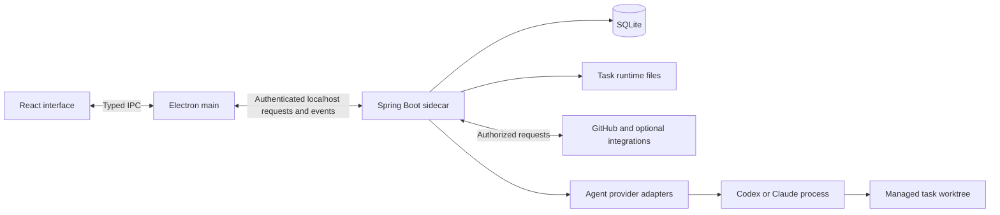

# ByteQuay architecture

ByteQuay has one desktop shell, one local application backend, one SQLite
application database, and provider processes that execute agent work. The
[product design](design.md) describes why these pieces exist; the
[user guide](../website/documentation.md) describes what people can do with them.

## Runtime boundaries



React and TypeScript render the application. Electron main owns native windows,
embedded browser views, authenticated backend access, and event transport. The
renderer requests application objects through typed IPC rather than choosing
arbitrary filesystem locations or receiving backend secrets.

The Spring Boot sidecar binds to localhost. One backend process owns the SQLite
database, enforced by an operating-system lock. Desktop browser surfaces use
Electron `WebContentsView`; external web sessions stay separate from the
application's privileged bridge and backend credentials.

Packaged apps own their Java runtime alongside the backend JAR. The release
build creates it from JDK 25 for the target Mac architecture, and Electron
starts that bundled executable directly. Installed system Java does not
determine app startup; runtime updates ship with ByteQuay releases.
The IDE's Java language server uses a suitable installed JDK when available
and otherwise shares the backend's Java runtime, avoiding a second bundled JRE.

Goals are a development-only experiment. Packaged renderers omit their controls,
and the packaged sidecar disables Goal endpoints and automatic guidance. Shared
work-item services and saved Goal data remain available for continuity.

App notices project existing task, turn, approval, and queue state through the
authenticated `/agent/notices` endpoint. Electron polls this local snapshot and
keeps delivery deduplication and recent notices in memory for the session.
Explicitly dismissed notice IDs are atomically saved in Electron's local app data
before removing the card and restored before the first notice snapshot is applied.
The Assistant panel lists the current notices and answers approvals and questions
with each task's own buttons. While the panel is closed, a separate sandboxed
`WebContentsView` shows one short alert at the bottom right, above browser and
editor views. Its restricted bridge can read, dismiss, resize, and open the panel
at a notice or navigate to a validated task; it cannot approve or execute task
actions. Recovery notices wait for ordinary shutdown cleanup to settle before
announcing a block.

## Backend organization

The backend is an eight-module Maven application. Modules define dependency and
ownership boundaries; they are not independently deployed services.

| Module | Responsibility |
| --- | --- |
| `core` | Shared domain values and feature storage contracts. |
| `agent-spi` | Provider capabilities, session contracts, and normalized events. |
| `agent-core` | Task and turn coordination, approvals, queues, lifecycle rules, and agent storage contracts. |
| `agent-cli` | Provider protocols, process ownership, and translation into the shared agent contract. |
| `persistence-sqlite` | Hibernate entities, repositories, credential persistence, and implementations of storage contracts. |
| `plugins/google` | Google connector processes, accounts, and bounded in-memory mail/calendar caches. |
| `plugins/jira` | Jira authentication, remote API operations, mapping, and cached provider data. |
| `app` | Spring composition, HTTP and event endpoints, GitHub, cross-feature workflows, and Git/worktree operations. |

```text
app -> core, persistence-sqlite, agent-core, agent-cli, integration-google, integration-jira
persistence-sqlite -> core, agent-core
agent-spi -> core
agent-core -> agent-spi
agent-cli -> agent-spi, core
integration-google -> core
integration-jira -> core
```

Dependencies point toward framework-free contracts. No module depends on `app`;
it is the composition root and executable. Persistence details stay behind
storage contracts, and provider adapters do not own application tables or
user-interface transport. Integration APIs and domain values live in
`com.bytequay.integration.google` and `com.bytequay.integration.jira`; concrete
implementations stay in each module's `impl` package. The application explicitly
assembles integrations and retains HTTP authentication, task authorization,
agenda coordination, local work-item workflows, and background refresh policy.
Jira operations and task admission share the same issue locks across this boundary.

The frontend is an npm workspace. `plugins/google`, `plugins/jira`, and
`plugins/lab` expose separate contracts, renderer, preload, and Electron main
entry points. Each package builds and tests against its declared dependencies;
implementations cannot import the application source tree. Existing neutral UI
primitives live in `packages/ui`. The desktop shell supplies application-aware
rendering, navigation, task/work-item actions, backend access, and lifecycle
coordination through concrete integration contracts. It composes the typed
preload bridge and preserves the existing IPC authorization checks.

These are bundled, first-party modules with one ByteQuay release version. Build
independence does not change activation or consent: Lab starts on Open Lab,
connected Jira scopes keep their background refresh, and Google agenda/task
access still requires its existing consent. Lab's separately locked Python
project remains under `scripts/review-calibration`; its database and task-file
readers are verified with the matching application release.

## Data ownership

SQLite stores durable application facts such as repository snapshots, settings,
source associations, accepted planning outcomes, and task state. Task-owned files
hold detailed runtime history, attachments, and bounded output. Git supplies
commits, branches, patches, and working-copy state. Derived caches can be rebuilt.

Views use local snapshots while independent refresh paths contact external
services. Failed or partial refreshes preserve useful data and disclose missing
coverage. Cached metadata and the availability of a local working copy are
separate facts.

Hibernate owns the current schema. Migration-history machinery requires a real
released-data migration contract. Developer setup and operational commands live
in [CONTRIBUTING](../CONTRIBUTING.md), not in this architecture overview.

The work-item catalog projects cached GitHub issues, workspace-assigned Jira tickets,
and local work through one contract. Remote identities already linked to local work
appear once. Local work owns its description, planning membership, history, and task
attempts independently of remote publication or Epic membership. Confirmed spec
findings retain their complete evidence in that same local model.

Context links are separate, non-owning references stored with a local work item.
They preserve the target identity and title, resolve source identities to retained
local items within the same workspace, and remain removable when a cached target
is unavailable. They do not reserve source/task identities or affect planning and
execution state. Add/remove operations check the item revision and retain history;
reads expose direct summaries without recursively expanding reference cycles.

Agent work-item access is a task-scoped capability: reads stay within the task's
workspace and creation always saves locally. The desktop publication action binds a
previewed revision to an explicit provider destination before sending it. Its durable
receipt links the remote identity to the existing item. An uncertain outcome blocks
another create until the user reconciles the existing issue or ticket.

Google Apps uses the installed Workspace extension's local MCP server. The
backend owns bounded read and explicit mail-write processes. Account metadata
is durable, but each account's mail page and calendar selection live only in
memory. Manual refresh verifies identity before replacing a cache; failures
preserve existing data. Task tools, when explicitly enabled, can read only the
selected account's cache and bind consent to that account. Their ordinary task
conversation retention still applies to shared content. The daily agenda, when the
user turns its calendar on, reads that account's busy times for today directly,
without replacing the cached view, and keeps start and end times only. Its consent
is saved apart from task access because it runs while nobody is there to approve.

The extension owns OAuth and token refresh. ByteQuay isolates its credential
namespace and encrypted-file fallback per account without changing the shared
terminal installation. The bootstrap verifies the expected upstream credential
and email-scope layout and rejects unsupported bundles. Connector processes do not inherit
model credentials or the desktop session token.

Electron owns the Google Apps Gemini conversation through CLI ACP. It reads the
model key from macOS Keychain and supplies it over the provider protocol. Each
account has its own process and conversation, only the admitted Google tools,
and one-time approvals for writes. Stop kills that process group; restarting a
stopped session requires clearing it, so cancelled sends are never replayed.
Conversation state is in memory. Gemini's temporary on-disk runtime is isolated
and removed on quit or the next startup after a crash. The normal Gemini CLI
configuration is unchanged. External account sign-in, Google project creation,
and billing remain with Google.

## Agent execution

Application features reuse the current agent service. Provider adapters translate
Codex and Claude activity into a common conversation, while retaining meaningful
differences in capabilities and permissions.

Task tools support live discovery: `bytequay_list_tools` returns names and
descriptions, `bytequay_get_tool` returns current usage and parameter schemas,
and `bytequay_call_tool` invokes a tool within the task's existing permissions.
Codex conversations persist the stable dispatcher instead of individual review
write-tool schemas, so resumed turns can discover changed capabilities. Child
agents retain their read-only review scope. Conversations created with the old
fixed tool contract must be replaced once; their saved provider tool list cannot
be updated on resume.

Each turn keeps a short name for its session's setup: a digest of ByteQuay's
own instructions for the session, and one of the tools it was given. A task's
own context, such as its pull request, is left out of the name. Turns with one
name ran with the same setup, so a change to either can be judged by the turns
before and after it.

Review composer choices are saved as defaults for future turns. Acceptance captures
provider, model, effort, and service tier; queued input keeps its own captured choice.
The executing provider changes only while the task is idle and its previous runtime
is verified stopped. A provider change drops the native session reference, while
retaining the task, working copy, review evidence, and application conversation.

Agent tasks use managed local worktrees. The application retains ownership of
those working copies, execution lifetimes, approvals, and queued input. Provider
completion and process cleanup are separate facts: an uncertain cleanup must not
erase a known result or permit another writer to take over prematurely. An
interactive task completes by itself once every pull request it owns is merged
or closed on GitHub, as read from the stored pull requests after each list
refresh; completion keeps its refusals, so a running turn, queued input or
uncommitted changes keep the task open until a later refresh.

Each supervised provider starts in its own operating-system process session.
Cleanup checks every process group in that session and the recorded identities
of observed descendants, including children reparented after a shell exits.
Failed session inspection keeps cleanup unverified. This is lifecycle ownership:
code deliberately creating a fresh session before observation can still escape
tracking. Provider filesystem and network sandboxes remain separate boundaries.

The IDE, local tests, private review, and development work remain associated with
the relevant task and working copy. They reuse existing services rather than
creating a separate task engine for each feature. User-started local tools and
provider-sandboxed tools have different execution boundaries.

A development task's private-review tools also read the findings that reviews
saved about that task's changes and its pull request, and record the agent's
replies on them. The application selects those reviews from the task, so a later
task on the same pull request reads them without a copy in its conversation. A
task's agent cannot name another task or review. It resolves only a finding it fixed and
answered, the finding records which task did, and a resolution the user made is
not an agent's to undo.

Inline feedback stays in the development task's existing scope and uses its normal
turn and queue admission. Private comments do not turn a developer into a reviewer
or disable authorized delivery. Review permissions belong to separate review tasks.
A development review borrows its source task's exact worktree; it does not provision
another checkout. Provider review sessions are read-only. Turn, local-run, and
cleanup admission share the worktree owner's lock and check all borrowers' durable
claims and running reviews, so developer and reviewer execution cannot overlap, even
between a review's steps. Ending or deleting a
review only removes its own runtime resources. The developer owns checkout removal.
Reviews freeze committed and uncommitted files in Git tree objects with a temporary
index; HEAD, branch history, and the user's staging area stay unchanged. Retained
trees support stable source reads and anchors. Reviews with local edits cannot be
published as reviews of a GitHub commit. A review of a GitHub pull request ends by
itself once a refresh finds the pull request merged or closed; a running turn or
saved edits keep it open until a later refresh.

Private question sessions receive a read-only context capability scoped to their
selected discussion or comment batch. The prompt carries the question and a short
passage; the capability pages through source material, earlier messages, and saved
history. Passage history comes from its retained snapshot, so deleting runtime
logs does not remove the discussion's premise. Session tokens cannot select another
discussion, and closing the session revokes its access. Task write tools remain
withheld on both provider lanes.

Imported PR tasks carry a short PR reference alongside the user's request, including
when their provider session is recovered. A read-only, task-bound context tool pages
through the retained assignment snapshot or cached PR description and discussion;
it labels missing, incomplete and possibly stale data. Each read rechecks the open
task and workspace association. CI tools reuse that PR identity even when the local
branch has a different name, without granting rerun or publication permissions.

Private review requests name the frozen scope and retrieve pass guidance through
`review_get_context`. Saved development intent and replay descriptions are paged
reference data. The independent review pass receives its own read-only instance
of that tool, limited to captured assignment, scope, description, facts and rules.
It cannot read the main review's hypotheses or write findings or evidence. Its
access ends when the pass completes, stops or is replaced; closing the provider
session also revokes its token. Replay cutoff restrictions still apply. Generated
review cards show a short summary and disclose the exact sent prompt separately.

The daily agenda runs one disposable read-only session in an empty scratch folder,
after the user's set time on a working day or when the user asks for it again. Its
only tool, `agenda_context`, pages a snapshot of stored data gathered before the
session starts: what moved, the user's own pull requests, tasks waiting on them,
what others ask of them, Epic work ready to start, and earlier agendas. Each kind
names its fields; bodies, diffs, commit messages, logs and transcripts stay out.
The reply keeps only references a page handed out, and stored facts decide whether
an item is done. Each run records its tool calls and refused items, so the pages
can be judged against real mornings. Nothing in the session writes to GitHub,
starts a task or changes work.

The Assistant panel holds one conversation per local day with a tools-only
session: it has no shell, file or web tools, only `assistant_context`, which reads
the agenda's stored data plus what runs now, what is on screen and what a search
of stored items finds, `assistant_act`, and `assistant_show`, which changes no
data. A list it shows holds only references the user could see, on screen or
handed out that day, and the panel draws each row from the app's own stores, so
titles stay data. It opens a page or such an item only on the user's own words,
checked as for an action, and leaves a receipt. It is the one agent that names
other tasks, and only through
`assistant_act`: in a run the user's own message started, on cards visible when
that message was sent or on references handed out that day. A task it starts or
replies to receives only the user's own words, beside the first message the app
already builds for an item, and task automation comes from the user's saved
settings. Words the message says not to do, such as "push to main" in "don't
push to main", are refused, and each receipt shows the exact words acted on. By words it answers only Claude shell commands that stay in the
sandbox, with Allow once or Deny, and question cards; everything else stays a
button. Each call is logged and leaves a receipt in the conversation, and the
two switches that let it act are off by default.

## Trust and external services

Local-first means local application state and execution; it does not mean offline
model inference. GitHub, selected model providers, and optional integrations
receive the requests required for their features. Optional hosted authentication
components retain their own secrets outside the desktop application.

Open Lab asks Electron to refresh the Lab's saved statistics and serve its
Insights dashboard as an ordinary page in the embedded browser. The packaged
app owns the Lab's Python runtime and dependencies. Electron chooses an available
loopback port, waits for readiness, reuses the dashboard on subsequent opens,
and stops it on quit; a managed dashboard also exits when its parent disappears.
The renderer stores only whether to show its sidebar shortcut. Refresh reads task
runtime files and the database read-only and saves results in the separate Lab
data folder. Opening Lab does not start model runs or install a background monitor.
The Lab measures how the app and its agents work, so product changes can be
chosen from its numbers and then checked against them.

GitHub writes require a direct user action or an explicitly accepted automation
scope. Repository content, model output, and a private discussion cannot grant
that authority. An Assistant action counts as the user's direct action only within
the bounds above: the user's own words, in the message that asked for it. Preview and execution must remain bound to the accepted target;
uncertain remote outcomes are reconciled instead of blindly repeated.

Provider login profiles live outside repositories. Named Claude profiles have
either global or repository ownership. Model catalogs filter repository-owned
profiles by workspace, and the provider registry checks that ownership before
task creation and every resumed turn. Restricting an existing global profile
preserves its login identity while denying later work in other repositories.
Tears of time terminal launches resolve the owning task's Claude profile in the backend
and pass its path only to Electron main. The shell inherits that profile rather than
the desktop's Claude login or API credentials. Existing shells retain their environment.
Stored application credentials
are not agent prompt context or ambient task secrets. Native sandboxing,
application authorization, and same-user filesystem access are distinct
boundaries; a worktree alone is not a security sandbox.

Claude sessions that build and test can reach the local Docker daemon through
its standard macOS sockets. Containers and host bind mounts managed through that
daemon are outside the provider's filesystem sandbox. Restricted sessions and
cherry-pick sessions do not receive this socket allowance.

Claude development and CI repair sessions run bare Maven commands outside the
provider sandbox, because Maven cannot authenticate to the sandbox's network
proxy. Auto mode still reviews each command, but the build, its plugins, and its
tests run with the user's file and network access. Reviews and restricted
sessions keep Maven sandboxed.

Normal cleanup preserves uncommitted, active, mismatched, or unverifiable work;
ignored files such as build output go with the worktree. Removing a clean
worktree does not imply permission to delete its generated branch.
Destructive deletion is a separate explicit action. Cleanup after the retention
period keeps a task's event log and the blobs it refers to, so its conversation
still opens; deleting the task removes them.

## Architectural tradeoffs

A local sidecar keeps application services and persistence together while the
desktop shell owns the operating-system interface. SQLite avoids a separately
managed database. Provider contracts support a shared task experience without
pretending all providers behave identically.

Keep single-consumer feature orchestration in the application. Add abstractions,
modules, or services when a real consumer or ownership boundary justifies them.
Do not restore the removed task-agent or staged development-flow systems.

Feature behavior is described in the [user guide](../website/documentation.md).
Implementation details and verification belong with code and tests. Update this
document when ownership or system boundaries change, not for each UI iteration.
