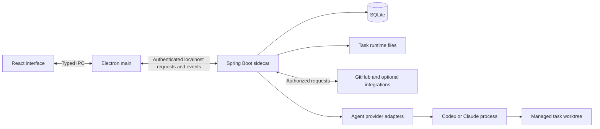

# ByteQuay architecture

ByteQuay has one desktop shell, one local application backend, one SQLite
application database, and provider processes that execute agent work. The
[product design](design.md) describes why these pieces exist; the
[user guide](../website/documentation.md) describes what people can do with them.

## Runtime boundaries



React and TypeScript render the application. Electron main owns native windows,
embedded browser views, authenticated backend access, and event transport. The
renderer requests application objects through typed IPC rather than choosing
arbitrary filesystem locations or receiving backend secrets.

The Spring Boot sidecar binds to localhost. One backend process owns the SQLite
database, enforced by an operating-system lock. Desktop browser surfaces use
Electron `WebContentsView`; external web sessions stay separate from the
application's privileged bridge and backend credentials.

## Backend organization

The backend is a six-module Maven application. Modules define dependency and
ownership boundaries; they are not independently deployed services.

| Module | Responsibility |
| --- | --- |
| `core` | Shared domain values and feature storage contracts. |
| `agent-spi` | Provider capabilities, session contracts, and normalized events. |
| `agent-core` | Task and turn coordination, approvals, queues, lifecycle rules, and agent storage contracts. |
| `agent-cli` | Provider protocols, process ownership, and translation into the shared agent contract. |
| `persistence-sqlite` | Hibernate entities, repositories, credential persistence, and implementations of storage contracts. |
| `app` | Spring composition, HTTP and event endpoints, external integrations, application workflows, and Git/worktree operations. |

```text
app -> core, persistence-sqlite, agent-core, agent-cli
persistence-sqlite -> core, agent-core
agent-core -> agent-spi
agent-cli -> agent-spi
```

Dependencies point toward framework-free contracts. No module depends on `app`;
it is the composition root and executable. Persistence details stay behind
storage contracts, and provider adapters do not own application tables or
user-interface transport. The frontend remains a separate npm project.

## Data ownership

SQLite stores durable application facts such as repository snapshots, settings,
source associations, accepted planning outcomes, and task state. Task-owned files
hold detailed runtime history, attachments, and bounded output. Git supplies
commits, branches, patches, and working-copy state. Derived caches can be rebuilt.

Views use local snapshots while independent refresh paths contact external
services. Failed or partial refreshes preserve useful data and disclose missing
coverage. Cached metadata and the availability of a local working copy are
separate facts.

Hibernate owns the current schema. Migration-history machinery requires a real
released-data migration contract. Developer setup and operational commands live
in [CONTRIBUTING](../CONTRIBUTING.md), not in this architecture overview.

The work-item catalog projects cached GitHub issues, workspace-assigned Jira tickets,
and local work through one contract. Remote identities already linked to local work
appear once. Local work owns its description, planning membership, history, and task
attempts independently of remote publication or Epic membership. Confirmed spec
findings retain their complete evidence in that same local model.

Agent work-item access is a task-scoped capability: reads stay within the task's
workspace and creation always saves locally. The desktop publication action binds a
previewed revision to an explicit provider destination before sending it. Its durable
receipt links the remote identity to the existing item. An uncertain outcome blocks
another create until the user reconciles the existing issue or ticket.

Google app reads run through the installed Gemini CLI Workspace extension's local
MCP server. The backend owns each bounded connector process and admits only
identity, Gmail search/read, and Calendar list/read calls. The extension owns its
shared Gemini CLI login and hosted OAuth exchange; tokens never enter ByteQuay's
SQLite snapshots, renderer, or agent prompts. Connector processes do not inherit
the desktop session token or model credentials.

Google snapshots are one saved mail page and one bounded agenda selection, with
account identity, query/range and capture time. Refresh verifies the shared login
still belongs to that account before replacing data. Failures preserve the last
snapshot. Explicitly enabled interactive task tools read only these local
snapshots and recheck consent on every call. Disconnect clears ByteQuay's data
and access without revoking the extension's shared login.

Optional Gemini terminal setup belongs to Electron's native integration boundary.
The desktop checks a user-supplied model key with Google's model-list endpoint
and stores it in a ByteQuay-owned macOS Keychain entry. A private launcher reads
the key into its environment at execution, outside repositories; the launcher
contains no secret. This opens an independent Gemini CLI session with the user's
installed extensions, rather than a ByteQuay task or saved-snapshot tool. Its
provider permissions govern live Google access. Google project creation, terms,
and billing remain in AI Studio; removing the local key does not revoke it or
terminate existing terminal sessions.

## Agent execution

Application features reuse the current agent service. Provider adapters translate
Codex and Claude activity into a common conversation, while retaining meaningful
differences in capabilities and permissions.

Task tools support live discovery: `bytequay_list_tools` returns names and
descriptions, `bytequay_get_tool` returns current usage and parameter schemas,
and `bytequay_call_tool` invokes a tool within the task's existing permissions.
Codex conversations persist the stable dispatcher instead of individual review
write-tool schemas, so resumed turns can discover changed capabilities. Child
agents retain their read-only review scope. Conversations created with the old
fixed tool contract must be replaced once; their saved provider tool list cannot
be updated on resume.

Agent tasks use managed local worktrees. The application retains ownership of
those working copies, execution lifetimes, approvals, and queued input. Provider
completion and process cleanup are separate facts: an uncertain cleanup must not
erase a known result or permit another writer to take over prematurely.

The IDE, local tests, private review, and development work remain associated with
the relevant task and working copy. They reuse existing services rather than
creating a separate task engine for each feature. User-started local tools and
provider-sandboxed tools have different execution boundaries.

## Trust and external services

Local-first means local application state and execution; it does not mean offline
model inference. GitHub, selected model providers, and optional integrations
receive the requests required for their features. Optional hosted authentication
components retain their own secrets outside the desktop application.

GitHub writes require a direct user action or an explicitly accepted automation
scope. Repository content, model output, and a private discussion cannot grant
that authority. Preview and execution must remain bound to the accepted target;
uncertain remote outcomes are reconciled instead of blindly repeated.

Provider login profiles live outside repositories. Stored application credentials
are not agent prompt context or ambient task secrets. Native sandboxing,
application authorization, and same-user filesystem access are distinct
boundaries; a worktree alone is not a security sandbox.

Claude sessions that build and test can reach the local Docker daemon through
its standard macOS sockets. Containers and host bind mounts managed through that
daemon are outside the provider's filesystem sandbox. Restricted sessions and
cherry-pick sessions do not receive this socket allowance.

Normal cleanup preserves dirty, active, mismatched, or unverifiable work. Removing
a clean worktree does not imply permission to delete its generated branch.
Destructive deletion is a separate explicit action.

## Architectural tradeoffs

A local sidecar keeps application services and persistence together while the
desktop shell owns the operating-system interface. SQLite avoids a separately
managed database. Provider contracts support a shared task experience without
pretending all providers behave identically.

Keep single-consumer feature orchestration in the application. Add abstractions,
modules, or services when a real consumer or ownership boundary justifies them.
Do not restore the removed task-agent or staged development-flow systems.

Feature behavior is described in the [user guide](../website/documentation.md).
Implementation details and verification belong with code and tests. Update this
document when ownership or system boundaries change, not for each UI iteration.
