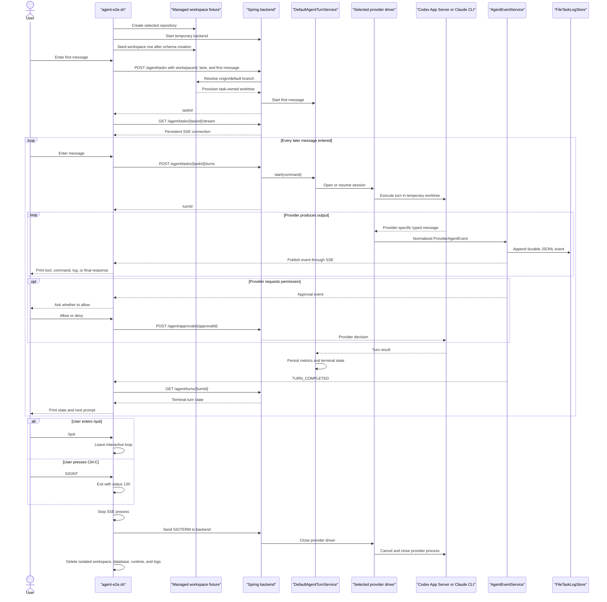

# Agent Shell End-to-End Test

> **Current behavior:** the script creates an isolated managed-workspace
> fixture and submits only its workspace ID. The backend resolves the selected
> repository and provisions the task worktree through the shared
> [Managed Worktree Service](worktree-service.md). Choose either the `codex` or
> `claude` public lane; the temporary backend enables only that lane.

The agent shell exercises the selected real provider through the public backend
path. The shell sends task, turn, approval, event, and status
requests only to the temporary Spring Boot backend. The backend owns the
provider process and converts its output into provider-neutral agent events.

## Run the shell

Run from the repository root. The selected CLI must already be installed and
authenticated. The script also requires `curl`, `git`, `java`, `jq`, Maven,
`sqlite3`, `uuidgen`, and `rsync` for the default full-worktree mode. Codex is
the default lane:

```bash
./scripts/agent-e2e.sh --interactive
```

Codex runs from ByteQuay's own Codex home, `~/Library/Application
Support/ByteQuay/codex-home` unless `BYTEQUAY_AGENT_E2E_CODEX_HOME` names
another, so the shell needs the login ByteQuay holds there rather than the one
in `~/.codex`.

To exercise Claude instead:

```bash
./scripts/agent-e2e.sh --interactive --provider claude
```

Claude uses the caller's `HOME` by default so its provider-owned login remains
with the Claude CLI. `BYTEQUAY_AGENT_E2E_CLAUDE_HOME` may name another home
whose `.claude` data owns the intended test login. The driver still supplies
empty inherited setting sources, strict MCP configuration, and generated
task-local sandbox settings; changing the home does not opt into its ordinary
settings. Override a selected executable with
`BYTEQUAY_AGENT_E2E_CODEX_EXECUTABLE` or
`BYTEQUAY_AGENT_E2E_CLAUDE_EXECUTABLE`.
The task defaults come from that lane's own model-catalog entry; optional
`BYTEQUAY_AGENT_E2E_MODEL` and `BYTEQUAY_AGENT_E2E_EFFORT` values override the
selection for a targeted smoke test and are still validated by the backend.

The shell never asks for or copies a provider token. It generates an independent
temporary backend session secret, passes it to the backend through the process
environment, and keeps the matching request header in an owner-only temporary
curl configuration rather than process arguments. User messages and approval
decisions also reach curl over standard input, not its argument list. Normal
output contains normalized backend events and typed readiness. The explicit
`/backend-log` diagnostic is capped at 30 lines and 32 KiB, then secondarily
scrubs the session secret and credential-shaped environment values; provider
drivers remain responsible for redacting their diagnostics before logging.
The shell deletes its curl configuration, database, runtime, and logs at exit.
Provider credentials remain owned by the selected CLI.

By default, the script copies the current checkout into a temporary Git
repository under an isolated ByteQuay workspace. The backend creates a second,
task-owned worktree from that managed repository. Use a minimal repository when
testing conversation and transport behavior without the project files:

```bash
./scripts/agent-e2e.sh --interactive --provider codex --minimal-worktree
```

The first prompt creates the task and its first turn through `POST /agent/tasks`.
After that, enter as many messages as needed. Each prompt waits for the current
turn to finish, prints its events and final response, and then accepts the next
message. Available commands are:

- `/events` — print all persisted normalized events for the task.
- `/backend-log` — print the bounded, scrubbed tail of the backend log.
- `/help` — print the shell help.
- `/quit` — exit; `Ctrl-C`, `quit`, and `exit` also stop the shell.

The shell intentionally has no deterministic mode. Automated HTTP, replay,
SSE, idempotency, completion, and cleanup coverage lives in
`TestAgentHttpApi`; this script exercises a real provider only. It is a
credentialed diagnostic, not evidence that a packaged release journey passed.

## Message and shutdown flow



The shell does not simulate renderer reload and has no cancel or Complete
command. Exiting the test shell does not call
`POST /agent/tasks/{taskId}/complete`. Its exit trap removes the isolated test
environment immediately, so shell shutdown does not exercise completion
summaries or seven-day retention cleanup.

The fixture owns and removes its outer temporary application-data root, but it
does not create or submit the agent worktree itself. It seeds a saved workspace
after the temporary backend has created its schema and creates the task with
`workspaceId`. Normal completion and shared worktree cleanup shipped in CP3
and are covered by backend tests; the shell must not pretend that deleting its
isolated outer fixture exercises that product path.
