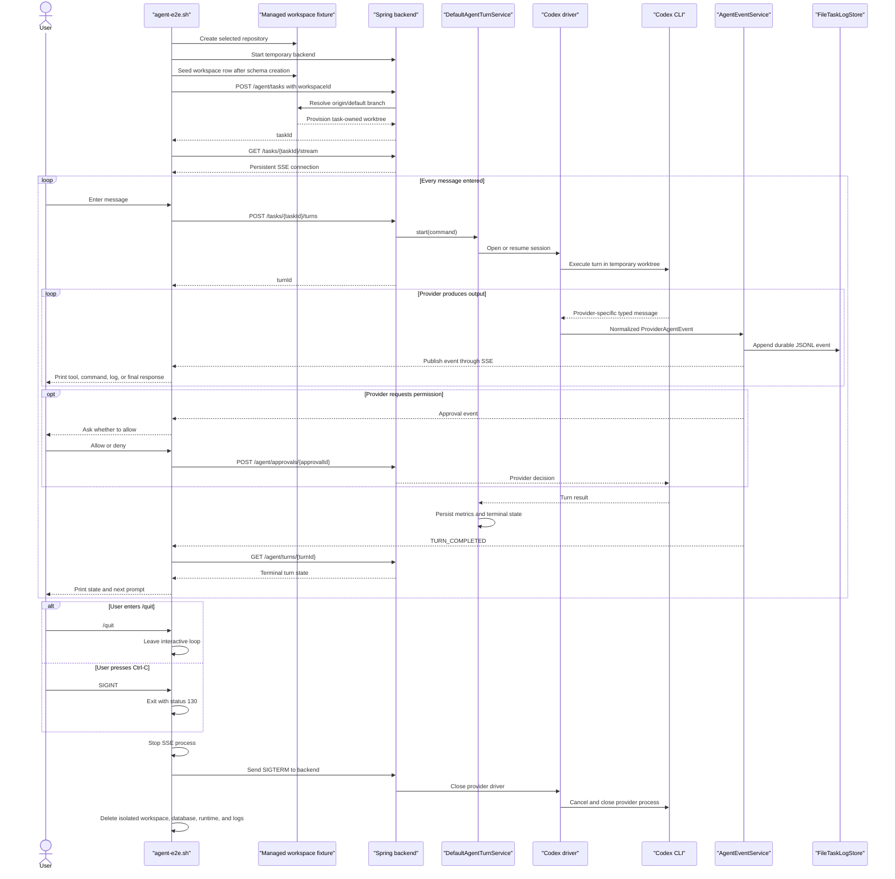

# Agent Shell End-to-End Test

> **Current behavior:** the script creates an isolated managed-workspace
> fixture and submits only its workspace ID. The backend resolves the selected
> repository and provisions the task worktree through the shared
> [Managed Worktree Service](worktree-service.md). Interactive creation is
> currently Codex-only; Claude returns when its parity contract is enabled.

The agent shell exercises the complete Codex backend path. The shell sends
task, turn, approval, event, and status
requests only to the temporary Spring Boot backend. The backend owns the
provider process and converts its output into provider-neutral agent events.

## Run the shell

Run from the repository root. Codex must already be installed and
authenticated. The script also requires `curl`, `git`, `java`, `jq`, Maven,
`sqlite3`, and `rsync` for the default full-worktree mode.

```bash
./scripts/agent-e2e.sh --interactive
```

By default, the script copies the current checkout into a temporary Git
repository under an isolated ByteQuay workspace. The backend creates a second,
task-owned worktree from that managed repository. Use a minimal repository when
testing conversation and transport behavior without the project files:

```bash
./scripts/agent-e2e.sh --interactive --provider codex --minimal-worktree
```

Enter as many messages as needed. The prompt waits for the current turn to
finish, prints its events and final response, and then accepts the next
message. Available commands are:

- `/events` — print all persisted normalized events for the task.
- `/backend-log` — print the latest backend log lines.
- `/help` — print the shell help.
- `/quit` — exit; `Ctrl-C`, `quit`, and `exit` also stop the shell.

The shell intentionally has no deterministic mode. Automated HTTP, replay,
SSE, idempotency, completion, and cleanup coverage lives in
`TestAgentHttpApi`; this script exercises a real provider only.

## Message and shutdown flow



Exiting the test shell does not call
`POST /agent/tasks/{taskId}/complete`. Its exit trap removes the isolated test
environment immediately, so shell shutdown does not exercise completion
summaries or seven-day retention cleanup.

The fixture owns and removes its outer temporary application-data root, but it
does not create or submit the agent worktree itself. It seeds a saved workspace
after the temporary backend has created its schema and creates the task with
`workspaceId`. Normal completion and shared worktree cleanup shipped in CP3
and are covered by backend tests; the shell must not pretend that deleting its
isolated outer fixture exercises that product path.
