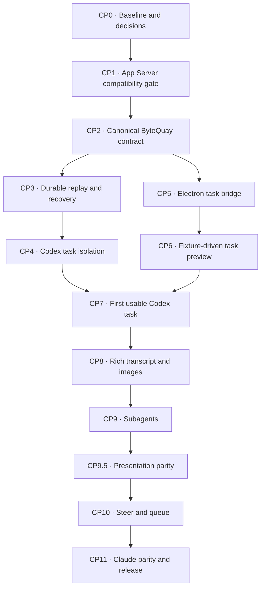

# Agent Service Implementation Checkpoints

> Completed delivery record. This file preserves the reviewed implementation
> sequence and release evidence for
> [Agent Service Design](agent-service.md) and
> [Agent Task UI Design](agent-task-ui.md). The canonical documents own the
> continuing product contract; this checklist records how CP0 through CP11
> closed.

## 1. Outcome

Build ByteQuay's agent-task desktop surface on the agent service that already
exists. Do not build another agent harness.

The existing interactive shell is the executable reference client:

```text
scripts/agent-e2e.sh
    -> AgentController REST/SSE
    -> agent-core task and turn services
    -> Codex App Server or Claude CLI
    -> normalized events -> JSONL -> SSE
```

At the client boundary, the desktop replaces the shell's
`curl + jq + terminal` presentation:

```text
React UI
    <-> typed preload IPC
    <-> Electron main authenticated REST/SSE
    <-> existing and extended agent service
```

The desktop does not reproduce the shell's temporary backend, database, or
worktree operations. CP2–CP4 extended the production backend's contract,
durability, isolation, and recovery before the live UI shipped. Leaving a task
screen unsubscribes that renderer only; it does not cancel or complete the
backend task.

## 2. Progress legend and checkpoint rule

- `[x]` is implemented/verified, or is a decision that has been explicitly
  resolved. Only Section 3 uses it specifically to mean already implemented in
  the current repository.
- `[ ]` is required work or an unaccepted decision.
- A checkpoint is complete only when every implementation and exit-gate box in
  that checkpoint is checked.
- Backend and frontend work may run in parallel after the shared contract is
  frozen, but a backend-only or renderer-only half-checkpoint does not count as
  complete. CP9.5 is the one deliberate exception, and only for its
  presentation work: restyling data an earlier checkpoint already emits has no
  backend half that could be missing. Its two contract additions still land
  end to end.
- Each checkpoint must leave its affected modules buildable and must include
  the smallest automated check that would fail if its contract regressed.
- Java checkpoint changes pass collection arguments directly to Guava
  immutable `copyOf` operations without a redundant `requireNonNull` wrapper,
  following the project-wide rule in `CONTRIBUTING.md`.

## 3. Current baseline

Already implemented and to be reused:

- [x] One task-owned Codex App Server over stdio at a time, relaunched at each
  accepted turn boundary so its model-selected child profile cannot go stale,
  and verified stopped before that turn releases its claim.
- [x] Codex root-thread start/resume and multiple turns on one durable provider
  thread across task-process relaunches.
- [x] A separate Claude `stream-json` driver.
- [x] Provider-neutral message, plan, command, file, tool, approval, usage,
  lifecycle, and error mapping.
- [x] SQLite task, turn, metrics, completion, and cleanup facts.
- [x] Turn idempotency and one active turn per task.
- [x] Clean-worktree validation and an in-process exclusive lease.
- [x] Task JSONL, monotonic task sequence, replay, and SSE publication.
- [x] Cancel, approval resolution, completion, retention, and provider-status
  HTTP endpoints.
- [x] `scripts/agent-e2e.sh --interactive --provider codex|claude` as the real
  backend diagnostic for both shipped providers.
- [x] Existing automated regression floors for task/turn services, JSONL,
  replay/SSE, provider mapping, SQLite stores, HTTP security, and completion.

Implemented for the reviewed rich-task design:

- [x] Workspace-owned public task creation instead of renderer-selected paths.
- [x] Production adoption of the CP1 reference projection and
  version-tolerant decoding across the required App Server surface.
- [x] A task-owned App Server process per active turn, rooted at its managed worktree, replacing
  the rejected executor/environment and loopback-listener design.
- [x] Model-advertised no-child, V1-only, and V2-only launch profiles, recursive
  V1/V2 discovery through `thread/items/list`, and quiescence through verified
  per-turn process stop.
- [x] Canonical event IDs plus root/child/turn/item source identities.
- [x] Persisted steer/queue input delivery; direct turn start reuses the durable
  turn row instead of adding a parallel delivery state machine.
- [x] Atomic SQLite state plus event-outbox persistence.
- [x] Immutable task-worktree ownership facts, mutation claims, approvals, and
  provider recovery facts.
- [x] Model, effort, and permission defaults with immutable per-turn snapshots.
- [x] An authenticated Electron task/event bridge.
- [x] React task routes, reducer, transcript, composer, and task controls.
- [x] Safe images, subagent inspection, steering, queueing, and Claude parity.

## 4. Fixed scope

These are scope rules, not claims that current code already enforces them:

- The new interactive task surface adds no ByteQuay model-callable business
  tool, commit tool, Git hook, or post-turn workflow. Existing workflow-specific
  adapters remain unchanged unless a checkpoint explicitly updates their
  shared agent contract.
- There is no generic workflow abstraction combining interactive agent,
  cherry-pick, CI Autofix, and rebase state machines. They do share the approved
  [Managed Worktree Service](worktree-service.md) because all three top-level
  agent workflows need the same owned filesystem operations; Branch Rebase
  borrows its caller's worktree.
- Prefer stateless service boundaries. This is not a ban on state: add the
  smallest durable state when a concrete coordination, recovery, or
  user-visible requirement needs it, but do not add lifecycle states or
  recovery paths for hypothetical future cases.
- There is no arbitrary executable/script provider. The shell is a reference
  client; production providers remain the Codex and Claude drivers.
- There is no custom Code Mode host or undocumented App Server queue API.
- First-release interactive Codex tasks proved in CP1/CP4 that inherited MCP
  servers, apps/plugins, dynamic tools, exec-policy allow rules, and lifecycle
  hooks are absent or disabled. They also proved that no managed requirements
  apply; a missing field, non-null value, request failure, or undecodable
  response continues to fail closed until a narrower contract has exact
  executable evidence.
- The renderer receives no raw provider JSON, backend log stream, credential,
  or hidden reasoning.
- The UI does not copy Codex Desktop assets or promise pixel parity.
- The frontend adds no component framework, CSS framework, or state library.
- The queue has no priorities, reordering, schedules, or per-child stop/steer
  UI.

## 5. Ownership

| Role | Owns |
| --- | --- |
| Runtime owner | App Server protocol and reference fixtures, Codex/Claude adapters, task-owned provider-process supervision, routing, and quiescence |
| Service/storage owner | Task/turn/event/approval contracts, managed-worktree boundary, SQLite task lifecycle, outbox, provider recovery, and HTTP/SSE DTOs |
| Desktop owner | Electron REST/SSE client, preload API, React reducer, routes, task UI, accessibility, and plain CSS |
| Product/release owner | Experimental dependency decision, same-host trust decision, capability policy, and release gate |

One desktop owner should carry the first visible slice across Electron main,
preload, and React. Splitting those layers before the first vertical slice adds
handoff cost around one small event contract. Runtime and service owners supply
one checked-in fixture for that contract so desktop work can proceed in
parallel.

## 6. Delivery shape



Checkpoint 2 is the parallel-work cut: service/runtime work continues through
checkpoints 3 and 4 while the desktop owner builds checkpoints 5 and 6 from
the same recorded event fixtures. Checkpoint 7 is the convergence gate; it
must use the real runtime rather than fixtures.

## [x] CP0 — Freeze the baseline and release decisions

**Owners:** product/release owner with runtime owner

**Depends on:** nothing

**Visible UI:** no

Purpose: preserve the working backend path and decide whether the proposed
experimental dependency is acceptable before extending it.

**Status (2026-08-31): COMPLETE.** The engineering baseline is verified.
Product accepted the experimental App Server dependency, the stock executor's
same-host trust boundary, a separate ByteQuay-owned worktree per task, and a
development-only UI gate through CP11. The canonical worktree contract and
approved static UI prototype are recorded. The deterministic HTTP integration
test now verifies a sanitized golden create -> two turns -> replay/SSE ->
completion transcript.

Implementation and decisions:

- [x] Accept shipping the first product surface over Codex App
  Server while the official documentation describes the command as
  experimental and unsupported for production workloads. This decision was
  recorded on 2026-08-31 and does not waive the compatibility release gate.
- [x] Accept the unauthenticated same-host boundary of the reviewed stock task
  executor for the first release. This decision was recorded on
  2026-08-31 and does not describe the loopback listener as authenticated.
- [x] Choose Codex CLI/App Server `0.151.0` for the compatibility spike;
  this exact version and its hashes are reference-only and do not gate the
  production CLI.
- [x] Give every repository-scoped agent task a separately provisioned
  ByteQuay-owned worktree; no development agent edits the managed checkout.
- [x] Record one shared synchronous create/inspect/cleanup contract for interactive
  tasks, cherry-pick, and CI Autofix in
  [Managed Worktree Service](worktree-service.md). Branch Rebase reuses its
  caller's worktree. Cleanup is non-forcing, refuses dirty or open Git state,
  removes only the verified worktree, and always retains its generated branch.
- [x] Keep automatic Codex startup self-update enabled and use the
  user-managed installed CLI. The production probe records detected version text
  for diagnostics but never treats that output, including an unparseable
  string, as a readiness gate.
- [x] Kept the new task UI behind a development-only gate through CP10; CP11
  removed it after the release checks. Commit
  `84af81c73cea7ae2cf7a53681827f550c598b706` is the approved static visual and
  state artifact; this approval does not enable a live route or provider.
- [x] Capture a sanitized request/event fixture from the current task -> two
  turns -> replay/SSE -> completion flow. `TestAgentHttpApi` compares the full
  normalized journey with `agent-http-baseline.json`.
- [x] Keep `TestAgentHttpApi` as the deterministic Spring HTTP integration
  regression test.
- [x] Remove the stale non-interactive branch from `agent-e2e.sh` and its docs,
  rather than restoring a test-only deterministic driver to production.
- [x] Kept `--interactive --provider codex|claude` through the CP0 reference
  baseline. CP3's workspace-owned public route later narrowed the shell to
  Codex, and CP11 activated the reviewed Claude request contract.

Exit gate:

- [x] `cd backend && mvn verify` passes before contract changes begin: 518
  tests passed with no failures or errors.
- [x] `./scripts/agent-e2e.sh --interactive --provider codex --minimal-worktree`
  completes two turns against the current backend.
- [x] A Claude interactive run either completes or records one actionable
  readiness/authentication limitation. On this development host, Claude CLI
  `2.1.251` reports `loggedIn: false`; run `claude auth login` before its real
  provider shell can pass.
- [x] The latest-CLI update policy, reference-fixture version,
  experimental-risk decision, same-host trust decision, separate-worktree
  strategy, and shared worktree-service contract are recorded in the canonical
  design.

Primary files:

- `scripts/agent-e2e.sh`
- `docs/design/agent-e2e.md`
- `docs/design/Agent Task UI.html`
- `backend/app/src/test/resources/com/bytequay/app/web/agent/agent-http-baseline.json`
- `backend/app/.../AgentCliUpdateJob.java`
- `backend/agent-cli/.../CodexCliDriver.java`

The real Codex reference run used one temporary task and returned
`first-turn-ok` and `second-turn-ok` from consecutive completed turns. The
shell then stopped the backend and removed its temporary repository, database,
runtime, and logs.

## [x] CP1 — Prove the v0.151.0 reference contract

**Owner:** runtime owner

**Depends on:** CP0

**Visible UI:** no

Purpose: fail fast before persistence and UI depend on an experimental runtime
shape.

**Status (2026-08-31):** CP1's technical evidence is complete. The checked-in
offline fixture and both explicit local subscription-backed live gates passed with
`codex-cli 0.151.0` and `gpt-5.6-sol`. The no-child run proved one real command
approval, bounded Git-worktree writes, a yielded background terminal with
targeted termination, two-task event/approval/command/filesystem isolation,
credential-free executor process environments, and disk-backed history
recovery after an App Server restart. The recursive run proved the advertised V2 root/child/
grandchild graph, including the observed supplementary V1 collaboration item,
with clean worktree and terminal state.
Production adoption of the shared isolation guards and a CP1-approved
child-capable launch profile belongs to CP4. See
[Codex App Server compatibility fixture](codex-app-server-compat.md).

**Go/no-go (2026-08-31): GO.** The reviewed experimental App Server shape is
technically sufficient for CP2 provider-neutral contract work, and CP0's
product decisions and baseline evidence are complete. This is not
production-release approval or a general same-user filesystem-confinement
claim.

**Progress (2026-08-31):** the offline gate now projects and codec-tests the
v0.151.0 modern approval methods, top-level fields, requiredness, both command
kinds, every command/file decision shape, and the opaque permission payload
with its response scope. Legacy `applyPatchApproval` and
`execCommandApproval` requests are deliberately unsupported and fail closed.
The current runtime bridge still handles only command/file one-time
`accept`/`decline` and fails closed for unrepresented scope or stale decisions;
preserving every product-permitted decision offered by the provider in the
provider-neutral contract and UI begins in CP2. That set is the intersection of
the provider's legal choices and ByteQuay's immutable safety ceiling; an empty
set fails closed, and `acceptWithExecpolicyAmendment` is never product-permitted
in the first release. The gate also checks the background-terminal
list/terminate and `thread/resume` contracts and derives one compact committed
projection manifest instead of committing 413 schemas or 820 generated
TypeScript files. The normal fixture command verifies the manifest;
`--update-bindings` regenerates it intentionally. This remains reference-only
and never gates the production user-managed CLI. The safe live path proved one
real parent-command approval, one bounded mutation per repository, a yielded
command with targeted termination, and disk-backed history recovery through a
fresh App Server. Both live modes passed using an explicitly selected,
fixture-only 0700 `CODEX_HOME` signed into ChatGPT directly with file-backed
credential storage. They use the remote provider and are deliberately absent
from default and CI execution. API-key support is deferred.

The auth-free offline gate now also proves the proposed first-release
exec-policy source and managed-requirements absence guards. It first validates
that a poison isolated-user `.rules` file is a real `allow` rule with the
documented `codex execpolicy check` command.
`config/read(includeLayers: true)` exposes that active isolated user layer, and
the guard rejects it before any thread or model turn. After the poison file is
removed, the clean workspace passes only after the guard checks the `rules/`
directory beside every returned system, user, or project policy-bearing source
and finds no `.rules` file. `packagedDefaults` and
`legacyManagedConfigTomlFromFile` layers are not exec-policy sources. The
behavioral poison control exercises the isolated user source without claiming
every source type is present. The live isolation path calls `config/read` for
every temporary task cwd. The exact App Server has no public `--ignore-rules`
option or rule-inventory RPC, so the later CP4 production integration adopted
this conservative source inspection; a per-thread config override cannot
disable rules. The same keyless
App Server call pins the
`configRequirements/read` response shape, requires its
`requirements` field to be present and null, and fails for an omitted or
non-null value.

The same pre-thread gate now proves three configured launch profiles are
effective, not merely present in command arguments: no child features,
`multi_agent` only, and `multi_agent_v2` only. Each separate App Server must
report one active `sessionFlags` layer and matching effective values for the
selected multi-agent shape plus every disabled optional feature, disabled web
search, empty MCP configuration, host-skill-discovery disable, and the minimal
shell environment. The V1 profile additionally sets and verifies
`agents.max_depth=2`, which is the bounded depth required for its grandchild
proof. `hooks/list` must be empty and error-free for the requested cwd.
`skills/list` may return only bundled system skills whose canonical paths
remain beneath the isolated `CODEX_HOME/skills/.system`; it rejects every host,
repository, plugin-owned, or out-of-root skill without pinning names or count.
Synthetic poison cases exercise those rejection branches. This proves profile
selection and repairs evidence behind the existing capability-isolation
checks; without a model turn it did not by itself close the then-open live
child-recursion gate. The later subscription-backed run closed that gate.

The offline schema gate now also pins the child-thread facts required by the
later recursive live proof. Stable schema must expose subagent source kinds,
parent/session/status metadata, `thread/status/changed`, V1
`collabAgentToolCall` sender/receiver/state fields, and V2
`subAgentActivity` identity/path/lifecycle fields. The direct-parent and
ancestor filters on `thread/list` must remain available only in the
experimental schema. They are an optional discovery aid; the fixed-point
history algorithm does not depend on them. This schema evidence adds no
production child router and did not by itself close the live recursion gate.

The compact Java projection now preserves an optional model
`multiAgentVersion`, V1 sender/receiver/agent-state identity and optional state
message, V2 agent thread, logical path, and lifecycle kind, plus the
parent/session/turn/item history
needed by recursive reconciliation. Optional capability fields remain absent
when omitted, additive fields remain ignorable, and future enum values decode
as `UNKNOWN`. At CP1 this was codec evidence only; the later completed
checkpoints added provider-neutral routing and the task graph.

The [official App Server page](https://learn.chatgpt.com/docs/app-server)
documents version-specific schema generation, experimental opt-in,
`environment/info`, background-terminal APIs, steering, and streamed events.
It does not currently document `environment/add` on that page. Therefore the
per-task environment design is a go/no-go compatibility question, not an
assumption.

Implementation:

- [x] Generate JSON Schema from the exact selected binary, verify that the
  required experimental definitions are present, and preserve the generation
  command/version in the fixture metadata.
- [x] Make the generated compact reference projection authoritative for the
  fields ByteQuay consumes. The normal fixture verifies the committed manifest,
  `--update-bindings` regenerates it, and Java reflection/codec conformance keeps
  production decoding tolerant of additive fields and future enum values. An
  incompatible required shape fails the affected operation and reports the
  detected running version instead of failing a version-text gate.
- [x] Initialize with `capabilities.experimentalApi: true`, wait for the
  response, and send `initialized` before any other request.
- [x] Prove the exact schema/binary exposes and accepts `environment/add` with
  the fields required by the reviewed design.
- [x] Prove commands selected through environments A and B report distinct
  executor-only `HOME` values and canonical working directories rather than
  falling back to the App Server's ambient process.
- [x] Launch the version-matched official task executor on loopback and prove
  its reported endpoint and handshake behavior.
- [x] Register the task environment, call `environment/info`, and verify its
  canonical working directory and shell.
- [x] Start one thread and turn selecting only that environment; run one
  built-in command in a temporary executor directory and observe typed
  command-start, command-completion-with-output, and final-agent-message events.
- [x] Repeat a bounded filesystem action inside a disposable Git worktree with
  the proposed production sandbox shape.
- [x] Project and codec-test the modern approval methods, top-level fields,
  requiredness, both command kinds, every command/file wire decision shape,
  and the opaque permission payload plus response scope from v0.151.0.
- [x] Reject legacy `applyPatchApproval` and `execCommandApproval` server
  requests with a fail-closed JSON-RPC error.
- [x] Exercise one representative real command approval request and typed
  `accept` response through the live App Server path. Exhaustive modern wire
  coverage remains an offline schema/codec gate; richer product decision
  matrices begin in CP2 only after ByteQuay defines its finite immutable safety
  ceiling.
- [x] Exercise background-terminal list and clean with an empty result.
- [x] Exercise a non-empty yielded background terminal and targeted terminate.
- [x] Inspect `model/list` effort choices, text input support, and advertised
  multi-agent protocol version, then run the advertised default effort.
- [x] Exercise `thread/read(includeTurns: true)` with command history.
- [x] Pin the stable V1/V2 child item, child status, source-kind, and parent
  metadata schema plus the experimental-only parent/ancestor list filters.
- [x] Project and codec-test model multi-agent capability, V1/V2 child
  identity, and recursive thread/turn/item history without enabling routing.
- [x] Start separate credential-free no-child, V1-only, and V2-only launch
  profiles and repeat the pre-thread config, managed-policy, rule, skill, and
  hook isolation assertions for each one.
- [x] Add a separate subscription-backed `--live-children` path that discovers
  the model's V1/V2 profile under the no-child baseline, restarts with only
  that feature, sets and verifies the V1 depth-two requirement when applicable,
  and fail-closed checks a bounded root/child/grandchild history,
  markers, item types, approvals, worktree state, and background terminals.
- [x] Exercise recursive child discovery needed by the later quiescence
  barrier. Select only the child-capable profile advertised by the live model,
  then prove root, child, and grandchild history; profile selection alone
  cannot satisfy this item.
- [x] Call `thread/resume` for the still-loaded root and complete a second turn.
- [x] Restart App Server and prove disk-backed thread recovery.
- [x] Run two task environments through one App Server and prove event,
  approval, command, and filesystem separation.
- [x] Prove inherited MCP servers, lifecycle hooks, project config, and the
  caller's ambient user config are absent. The fixture requires exactly one
  fixture-selected App Server user layer, calls `config/read` for every
  temporary task cwd, accepts only isolated bundled system skills, and runs
  MCP/skill/hook/config assertions before the first model turn. The offline
  profile is temporary; a live profile is separate, persistent, and never the
  normal `~/.codex`.
- [x] Launch with apps/plugins and related optional features explicitly
  disabled, empty dynamic tools, and empty capability roots. The keyless gate
  proves the feature flags, web-search mode, empty MCP map, host-skill setting,
  and complete shell-environment policy are active session flags for the
  no-child, V1-only, and V2-only profiles. Exactly one multi-agent feature is
  enabled in each child-capable profile.
- [x] Give every offline/default compatibility subprocess and every live task
  executor a separate credential-free `CODEX_HOME` and minimal allowlisted
  process environment. Only the live App Server receives the explicitly
  selected profile. Configure every model-requested shell environment to omit
  `CODEX_HOME`, `CODEX_API_KEY`, `OPENAI_API_KEY`, and the App Server-only
  sentinel. Never copy `auth.json` or use the normal `~/.codex`.
- [x] Require `BYTEQUAY_CODEX_COMPAT_HOME` for an explicit live invocation,
  reject a missing, non-absolute, non-0700, default, ambient, repository-local, or
  non-ChatGPT profile before App Server starts, reject linked credentials and
  credentials that match or reuse the current ambient profile, reject stale
  runtime/config state and persistent Codex-home instructions, and require App Server
  `account/read` to report `requiresOpenaiAuth: true` and `chatgpt`.
- [x] Hold an exclusive profile-local lock across each live gate. Keep database
  state in a temporary `CODEX_SQLITE_HOME`, reuse database plus run-scoped
  rollout state for the App Server restart/reload proof, then remove exact
  runtime/config artifacts and release the lock without deleting `auth.json`
  or the persistent authentication profile.
- [x] Require the exact structured command action before returning the live
  approval `accept`, and keep failure diagnostics free of raw command text and
  output. This proves environment stripping, not same-user filesystem-read
  confinement of the dedicated profile.
- [x] Start App Server without credentials, inspect every returned config
  layer, reject a real rule-bearing isolated user source before any model turn,
  and accept a clean isolated home/workspace only after every returned system,
  user, or project policy-bearing source's `rules/` directory contains no
  `.rules` file.
- [x] Call `configRequirements/read` without credentials and prove that the
  isolated launch has no applicable managed requirements. A missing
  `requirements` field, non-null value, request failure, or undecodable response
  must make the lane unavailable. The response must contain exactly that one
  top-level key; an unknown sibling policy field also fails closed.
- [x] Make a reference-fixture version, generated-bundle hash, or required
  method/field mismatch an actionable fixture failure.

Exit gate:

- [x] The checked-in offline compatibility fixture passes for the exact
  version.
- [x] The checked-in `--live` fixture passes when invoked locally with the
  explicitly selected ChatGPT-subscription profile.
- [x] The checked-in `--live-children` fixture passes when invoked locally with
  the explicitly selected ChatGPT-subscription profile.
- [x] The reference compatibility fixture rejects a different version and
  rejects changed schema bundle hashes or required fields.
- [x] The executable fixture proves no managed requirements apply before the
  source guard is considered complete.
- [x] No tested command falls back to App Server's ambient/default executor;
  the exact recorded action expands both executor-specific `HOME` markers, an
  unset command-level `CODEX_HOME`, and an unset App Server-only sentinel.
- [x] The subscription-backed live runs prove App Server `account/read`
  reports `requiresOpenaiAuth: true` and `chatgpt`; executor tools have no
  `CODEX_API_KEY`, `OPENAI_API_KEY`, `CODEX_HOME`, or App Server-only sentinel;
  and restart recovery uses disposable SQLite plus run-scoped rollout state.
- [x] A yielded/background command remains observable and cleanable.
- [x] Multi-task routing contains no cross-task event or approval.
- [x] The checkpoint has the written GO result above and CP0 is complete.

Primary files:

- `scripts/codex-app-server-compat.mjs`
- `backend/agent-cli/src/test/resources/.../app-server-v0.151.0-bindings.json`
- `backend/agent-cli/.../codex/TestCodexProtocolReferenceBindings.java`
- `backend/agent-cli/.../codex/CodexAppServerClient.java`
- `backend/agent-cli/.../codex/CodexProtocol.java`
- `backend/agent-cli/.../codex/CodexProtocolCodec.java`
- `backend/agent-cli/.../codex/CodexCliDriver.java`
- Codex protocol/driver compatibility fixtures

## [x] CP2 — Freeze the ByteQuay task, worktree, and event contract

**Owners:** service/storage owner with runtime and desktop review

**Depends on:** CP1

**Visible UI:** no; desktop fixture work may start after completion

Purpose: establish one safe, versioned, provider-neutral contract for JSONL,
REST/SSE, Electron IPC, and React.

**Progress (2026-09-01):** CP2 has frozen the provider-neutral task, turn,
readiness, approval, and schema-v2 event contracts. Interactive tasks have one
workspace discriminator and immutable requested defaults; each accepted turn
retains its exact requested settings and opaque attachment references. Provider
source identity is carried through the SPI, user input and approval lifecycle
are durable event variants, legacy rows/schema-v1 logs remain readable, and one
strict TypeScript fixture covers every CP2 payload family. At CP2 the
workspace-safe request/narrow response and managed CI replacement records were
frozen but not yet active; CP3 subsequently supplied the durable worktree
implementation and crash-safe event outbox and activated them. CP4 then applied
the snapshotted settings to the real App Server runtime. The full backend reactor,
frontend lint and type checks, all 230 frontend tests, and the packaged desktop
build passed on 2026-09-01.

The managed-worktree boundary remains deliberately small. `agent-core` owns
only synchronous `provision(command)`, `inspect(worktree)`, and
`cleanup(worktree)`. There is no allocation state machine, store, recovery API,
cleanup disposition, or cleanup authority. CP3 subsequently supplied the one
application implementation.

Implementation:

- [x] Add `workspaceId` to interactive `AgentTask` and SQLite task rows.
- [x] Add the smallest durable interactive-surface discriminator needed to keep
  workspace task lists from including cherry-pick, CI Autofix, or rebase agent
  tasks. Do not turn it into a generic workflow hierarchy.
- [x] Froze the replacement task-creation request as `workspaceId`, title,
  lane, and task defaults, with no renderer-selected worktree or repository
  fields. CP3 later switched the production route with the durable worktree
  implementation.
- [x] Add and freeze the CP0-approved `WorktreeService` contract and values in
  `agent-core`, including synchronous provision/inspect/cleanup, deterministic
  immutable ownership facts, and failure semantics. CP3 later supplied its one
  production implementation and activation without a temporary adapter.
- [x] Define its repository identity as the physical workspace selected
  repository/`origin`; cherry-pick and CI keep logical monitored/upstream
  identities in their own workflow records.
- [x] Freeze the creation order: readiness first, then exact-commit resolution,
  verified worktree provisioning, task resources, and finally task publication
  as `OPEN`.
- [x] List interactive tasks by `workspaceId` and reject a route/task workspace
  mismatch.
- [x] Keep legacy/internal workflow tasks readable without silently listing
  unknown-workspace tasks as interactive tasks.
- [x] Add task defaults and per-turn requested snapshots for model, effort, permission,
  effective sandbox/runtime policy, and attachment references.
- [x] For CI Autofix, freeze distinct remote-head and generated-local-branch
  facts. Local validation and rebase use the generated branch returned by the
  task's `TaskWorktree`; push still targets the authorized remote head ref.
- [x] Reuse the existing model catalog; do not create a second registry.
- [x] Expand backend readiness to typed states: ready, authentication required,
  CLI missing, unsupported, degraded, and temporarily unavailable, with
  actionable reason metadata. `checking` remains renderer request state. For
  Codex, `unsupported` requires a detected protocol/capability failure and
  includes detected version text; no reported version text, including unparseable
  output, produces it by itself.
- [x] Applied that readiness allocation gate only to lanes enabled at CP2.
  Interactive Claude creation stayed backend-disabled until CP11 supplied its
  exact authentication preflight and parity contract.
- [x] Define explicit `AgentEventPayload` variants in `agent-core`; stop using a
  serialized `ProviderAgentEvent` as the public/persisted shape.
- [x] Add `schemaVersion`, globally unique `eventId`, task sequence, task/turn
  IDs, provider root/child/turn/item IDs, timestamps, and typed payload.
- [x] Preserve provider source/item IDs when supplied. Derive a synthetic key
  only from deterministic provider fields with replay-stability fixtures;
  otherwise only display-only facts may omit source identity and render as a
  standalone/root-level event. An execution item, approval, delivery, or child
  relation without stable routing/reconciliation identity fails closed or
  makes that lane unavailable.
- [x] Add a durable user-message event shape, including attachment references
  and delivery kind.
- [x] Removed renderer-supplied attachment paths from `StartTurnRequest`. At
  CP2 public interactive turns rejected attachments; CP8 later activated only
  opaque task-owned attachment references. Trusted internal workflow
  attachments remain an internal command boundary.
- [x] Add typed approval request/resolution/expiry variants and the
  product-permitted subset of their provider-offered decisions. An empty subset
  fails closed.
- [x] Preserve completed items as authoritative replacements for deltas sharing
  the same source/item identity.
- [x] Keep Codex wire DTOs, the compact generated reference projection, and raw
  Claude blocks inside `agent-cli`.
- [x] Keep a schema-v1 JSONL reader: absent source fields render as an explicit
  root-level legacy stream rather than invented child identity.
- [x] Froze narrowed task/turn response records so the renderer never receives
  a worktree path, provider session reference, backend URL, or credential. CP3
  later activated those records with the workspace-owned routes.
- [x] Check in one valid monotonic frontend fixture containing create, user
  message, partial and final assistant messages, plan, command/output,
  file/tool activity, approval request/resolution, usage, lifecycle, and
  error. Derive separate transport tests that duplicate or omit an envelope.
- [x] Freeze the envelope/common-source evolution rule: later checkpoints may
  add versioned payload variants and optional fields compatibly, but may not
  reinterpret an existing tag. Reserve the direct-parent/logical-agent-path
  metadata needed for CP9.

Exit gate:

- [x] TypeScript models the fixture as a discriminated union without `any` or
  provider-payload inspection.
- [x] The frozen replacement interactive request schema cannot submit a
  worktree, repository, or attachment filesystem path; CP3 activation removed
  those fields from the production route.
- [x] The frozen replacement cherry-pick and CI Autofix request schemas resolve
  worktree roots from `workspaceId`; CI never receives or adopts a cherry-pick
  worktree. CP3 activated those schemas.
- [x] Workspace-scoped list/read and mismatch behavior is covered at the
  core/storage boundary. CP3 activated the route and added its HTTP test rather
  than exposing a path-trusting half-migration.
- [x] Logged-out or incompatible providers allocate no task row, runtime
  directory, or worktree ownership.
- [x] Two turns retain their exact requested model, effort, permission,
  sandbox/runtime policy, and attachment-reference snapshots.
- [x] Existing logs/rows remain readable under explicit legacy behavior.
- [x] Existing cherry-pick, CI Autofix, and rebase callers still compile and
  their focused suites pass.

Primary files:

- `backend/agent-spi/...`
- `backend/agent-core/...`
- `backend/persistence-sqlite/.../AgentTaskEntity.java`
- `backend/persistence-sqlite/.../AgentTurnEntity.java`
- `backend/app/.../web/agent/AgentController.java`
- `backend/app/.../web/agent/AgentHttpModels.java`
- `backend/app/.../web/agent/InteractiveAgentHttpContract.java`
- `backend/app/.../web/ci/ManagedCiAutofixHttpContract.java`
- `frontend/src/agents/events.ts`
- `frontend/src/agents/fixtures/agent-events-v2.json`

## [x] CP3 — Implement worktrees and make replay crash-safe

**Owner:** service/storage owner

**Depends on:** CP2

**Visible UI:** no

Purpose: implement the synchronous worktree boundary and make the event stream
an authoritative reconstruction source rather than a best-effort activity log.

**Completed (2026-09-01):** every repository-scoped task now owns one
persisted immutable `TaskWorktree` created by the stateless synchronous
`WorktreeService`. Interactive tasks, cherry-pick, CI Autofix, Branch Rebase,
pull-request activation, and the CI shell entry point all use that boundary;
the former checkout lease and cherry-pick-only worktree implementations are
removed. Clean completion removes only the verified worktree and retains its
generated branch. Dirty, open-operation, mismatched, or uncertain work is
preserved without adding a worktree lifecycle state or destructive fallback.

SQLite atomically commits each event-bearing lifecycle boundary with its
bounded outbox event: accepted input and `TURN` claim, first session reference,
delivery start, definite turn terminalization and claim release, restart
interruption, approval request/resolution, legacy task failure, and task
completion. JSONL, SSE, provider, and Git I/O stay outside the transaction.
The outbox drains before provider delivery, provider callback resumption, or
the startup serving gate opens. After terminal state commits, the completed
provider handle remains only as an in-process retry token until terminal-event
drain and pending-approval denial both succeed; a turn read or the next start
retries those idempotent actions. Replay is idempotent across the JSONL
flush/outbox-mark crash window and repairs an unterminated tail.

The one optional task-local mutation claim is an ownership token, not a task
state machine. A definite terminal result releases it in the same transaction
as the lifecycle event. A send that crossed the provider invocation boundary
without a durable provider reference remains an active uncertain turn with its
`TURN` claim after restart and is never resent automatically. At CP3, provider
process quiescence remained assigned to CP4 and the independent queue/steer
facts to CP10; both later checkpoints are complete.

Implementation:

- [x] Add `AgentUnitOfWork` backed by one SQLite transaction.
- [x] Add `AgentEventOutboxStore` and its SQLite entity/store.
- [x] Make `TaskLogStore` find/append idempotently by `eventId`.
- [x] Commit every event-bearing lifecycle mutation and its bounded
  unsequenced event together. Metrics, defaults, cancellation intent, and
  retention bookkeeping do not manufacture unrelated lifecycle events.
- [x] Drain the committed outbox to JSONL before SSE publication or provider
  callback completion.
- [x] Drain pending outbox rows before agent endpoints become ready at startup.
- [x] Add an explicit agent-serving gate: either complete recovery before the
  web layer serves agent data or have every agent task/turn/event/approval read,
  mutation, and SSE endpoint reject until recovery is ready. Provider-status
  diagnostics may remain available. `ApplicationReadyEvent` alone is too late
  because the HTTP server is already listening.
- [x] For `turn/start`, write bounded user-message bytes to a task-owned blob
  before the SQLite transaction, fsync both the file and its containing
  directory, then persist only bounded metadata and its blob reference with the
  accepted turn before attempting provider delivery.
  CP10 applies the same rule to `turn/steer`.
- [x] For direct `turn/start`, derive known-unsent, sending, delivered, and
  unknown as projections of the existing turn state, `startedAt`, and provider
  reference; do not persist a second enum or automatically resend an uncertain
  turn.
- [x] Keep steering and queue delivery facts outside CP3. CP10 adds only their
  independently required fact and does not reintroduce a parallel delivery row
  for a direct start.
- [x] Persist approval requests before publishing cards and persist
  resolution/expiry before resuming the provider callback.
- [x] Deny pending approvals durably on timeout, cancellation, terminal turn,
  or provider loss.
- [x] Persist the immutable `TaskWorktree` ownership/path/branch/start-commit
  facts with the owning task; do not add an allocation table or lifecycle.
- [x] Implement the one production `ManagedWorktreeService` in `app` with
  `WorkspacePaths` and direct argv-based Git commands. Do not add a new module,
  temporary implementation, allocation store, or recovery scanner.
- [x] Make `inspect(worktree)` revalidate the exact managed repository, path,
  generated branch, and required HEAD before returning dirty/open-operation
  facts.
- [x] Make `cleanup(worktree)` revalidate those facts, refuse dirty or open Git
  state, use non-forced removal, remove only the worktree, and always retain the
  generated branch.
- [x] Activate workspace-owned interactive task creation: probe readiness,
  validate the catalogued model and effort, resolve the exact start commit,
  provision and verify the worktree, allocate task resources, then publish the
  task as `OPEN`. If provisioning reports a half-finished or mismatched orphan,
  preserve it and return an actionable diagnostic; do not adopt or delete it
  automatically.
- [x] Activate workspace-scoped task list/read routes with the frozen narrowed
  CP2 response records. Reject a route/task workspace mismatch and remove the
  old renderer path/repository plus provider-session/turn-reference fields
  from the public route in the same change.
- [x] Re-probe readiness before every accepted turn; a failed probe creates no
  turn or delivery and leaves the ready worktree unchanged.
- [x] Replace `AgentWorkspaceService` and cherry-pick's private
  `CherryPickWorkspace` creation/removal with the shared service.
- [x] Keep cherry-pick and CI cancellation non-destructive: dirty or uncertain
  work remains in place, and the shared worktree service exposes no force or
  branch-delete operation.
- [x] Change CI Autofix to accept `workspaceId`, provision a fresh worktree at
  the verified PR head, and stop adopting the cherry-pick worktree. Branch
  Rebase continues to borrow the CI task's `TaskWorktree`.
- [x] Change completed cherry-pick delivery to push the retained verified branch
  from the managed repository so the worktree can be removed at range
  completion.
- [x] Update `WorkspaceBranchPusher`, `ManagedWorkspaceGit`, and
  `DefaultWorkspacePullRequestService` to verify and push that retained local
  ref without requiring a live checked-out worktree.
- [x] Remove both remaining CI path-adoption entry points: pull-request delivery
  starts CI from `workspaceId`, and `scripts/ci-autofix` selects a managed
  workspace instead of submitting its current checkout. Update the shell docs
  and tests with that contract.
- [x] Update CI local-branch validation and Branch Rebase calls to use the
  generated branch from the task's `TaskWorktree` and Git facts from
  `WorktreeService.inspect(worktree)`, while exact-lease
  push continues to target the authorized remote PR branch.
- [x] Serialize worktree add/remove per managed repository while allowing
  distinct verified worktrees to run concurrently.
- [x] Add one task-local worktree mutation claim acquired by turn start, later
  queue claims, or completion. Recovery preserves and reconciles the existing
  claim; it does not invent a separate recovery-claim kind.
- [x] Serialize workspace unwatch against worktree provisioning so no
  task worktree can be provisioned after removal begins; add service/controller
  race coverage rather than relying on a query-only busy check.
- [x] Convert `scripts/agent-e2e.sh` from raw worktree submission to a managed
  workspace fixture before activating the new public request.
- [x] Keep provider delivery/process uncertainty in the active turn and its
  retained `TURN` claim while the task stays `OPEN`. A worktree ownership
  mismatch is an operation error: preserve the path and report it without
  creating another task or worktree state.
- [x] Never release a recovered `TURN` claim solely because its matching turn
  row is terminal; only the later provider-quiescence proof can make that
  ownership safe to release.
- [x] Refuse task terminalization while its worktree is dirty or has an open Git
  operation. Leave the task `OPEN`, release a failed completion claim, and
  preserve the worktree without adding an `ACTION_REQUIRED` state.
- [x] Keep task terminalization free of filesystem removal. Workflow callers
  keep both task and workflow terminal facts durable before worktree cleanup.
  Success paths persist `task terminal -> workflow FINISHED -> cleanup`;
  cherry-pick cancellation first ensures the exact preassigned task exists,
  then persists its explicit `CANCELLED` result before attempting to complete
  the task, so a restart never has to infer cancellation from task state or
  pending-item count. A post-write completion
  refusal is logged without failing the already-durable cancellation response;
  the worktree is preserved. Successful physical removal records one nullable
  task fact. Policy-scoped workflow monitors cross-check `FINISHED` before
  retrying a live task or cleanup, apply their batch limit only after that
  cross-check so an absent or nonterminal workflow cannot starve a later
  finished one, and use the task's existing `updatedAt` for one-minute failure
  backoff. Both cleanup entry points drain pending task outbox events before
  physical removal. Generic retention excludes managed workflow-policy tasks
  until their monitor has recorded successful worktree removal, then retries
  cleanup before deleting runtime resources. Do not add a cleanup lifecycle
  state or global startup scan that could cross this crash barrier.
- [x] Keep provider, Git, JSONL, and SSE calls outside SQLite transactions.
- [x] Preassign and durably link the task ID before CI Autofix or cherry-pick
  task provisioning. Persist the original physical repository and starting
  commit/path facts, and let start and monitor use one idempotent ensure path.
  A concurrent creator is adopted only after every frozen fact matches; a
  legacy row missing both task and routing facts is preserved and rejected.
  Paused CI monitor passes and both workflow cancellation paths also run that
  same ensure operation before terminalizing, so the row-to-task crash gap
  remains retryable without another lifecycle state. CI HTTP reads project the
  gap as `PREPARING_AGENT` with no task metrics or generated branch.
  An ordinary CI task-provisioning failure is surfaced while the inserted run
  remains `ACTIVE` with its exact task ID; it does not write a terminal or
  paused result across an unverified gap. Repeated start or monitor advance
  retries ensure and then continues the normal flow.
- [x] Scope direct interactive completion and cleanup by both `workspaceId`
  and `getInteractive(...)`, so workflow-owned tasks cannot bypass their
  workflow `FINISHED` barrier through the generic controller.

Exit gate:

- [x] Crash tests around state commit, JSONL flush, and outbox mark yield one
  `eventId` and one sequence with no missing state event.
- [x] Replay always contains the accepted user input before provider output.
- [x] Reconnect from the last sequence loses and duplicates no event.
- [x] A resolved/expired approval never reappears as pending after reload.
- [x] Two live tasks derive distinct canonical worktree paths and branches.
- [x] Provisioning tests prove success returns only a fully verified worktree;
  a half-finished or mismatched orphan is preserved and reported.
- [x] Cleanup tests prove ownership mismatch, dirty state, or an open Git
  operation fails without removal; clean cleanup uses no force, removes only
  the verified worktree, and retains the generated branch.
- [x] Cherry-pick success and CI-green regressions prove task completion
  precedes durable workflow `FINISHED`; cancellation regressions prove the
  explicit `FINISHED/CANCELLED` result may be written first. Every path proves
  worktree cleanup runs only after both records are terminal.
- [x] Crash regressions prove an active green CI run with an already-completed
  task and a finished cancelled cherry-pick with a still-live task reconcile to
  the same terminal result. Workflow monitors retry task completion or cleanup
  until successful removal is recorded, with a one-minute `updatedAt` backoff
  so a persistent failure neither hot-loops nor starves another candidate.
- [x] Cleanup regressions prove committed terminal outbox events drain before
  workflow worktree or retention removal, failed drain preserves both worktree
  and runtime files, workflow batching cannot be blocked by an unmatched older
  task, and generic retention cannot cross a workflow's `FINISHED` barrier.
- [x] Retention cleanup uses the same existing update timestamp for a bounded
  retry delay and oldest-eligible ordering, so a failed batch head cannot
  starve a later due task.
- [x] Completed cherry-pick delivery works from the retained branch after its
  worktree is gone, and CI Autofix uses a fresh worktree at the verified PR
  head.
- [x] Start-crash regressions prove CI Autofix and cherry-pick recover their
  preassigned task without allocating another identity, reject a changed
  selected repository, and tolerate a create race by rereading and validating
  the exact winning task.
- [x] Cancellation regressions prove both workflows close the row-to-task
  start-crash gap before writing a terminal result, while an unverifiable gap
  keeps the workflow retryable. A paused dirty CI worktree remains paused
  instead of attempting a second pause transition.
- [x] HTTP regressions prove wrong-workspace and noninteractive task IDs cannot
  call direct complete or cleanup.
- [x] Competing Send and Complete observations yield exactly one mutation claim;
  the optimistic task row rejects the stale claimant.
- [x] Startup serves no agent task/event read, mutation, or SSE endpoint before
  outbox, approval, active-turn, and mutation-claim reconciliation finishes.
  There is no worktree startup scan. Owned provider-process recovery remains
  the CP4 gate.
- [x] HTTP tests prove workspace-scoped list/read, route/task mismatch rejection,
  path-free creation, and narrowed task/turn responses after activation.
- [x] Backend verification plus shared workflow regression suites pass.

Primary files:

- `backend/agent-core/.../DefaultAgentEventService.java`
- `backend/agent-core/.../DefaultAgentTaskService.java`
- `backend/agent-core/.../DefaultAgentTurnService.java`
- `backend/agent-core/.../DefaultAgentApprovalService.java`
- `backend/agent-core/.../FileTaskLogStore.java`
- `backend/persistence-sqlite/...`
- `backend/app/.../workspace/ManagedWorktreeService.java`
- `backend/app/.../workspace/WorkspaceBranchPusher.java`
- `backend/app/.../workspace/ManagedWorkspaceGit.java`
- `backend/app/.../workspace/DefaultWorkspacePullRequestService.java`
- `backend/app/.../workspace/DefaultWorkspaceRepositoryService.java`
- `backend/app/.../cherrypick/CherryPickExecutionService.java`
- `backend/app/.../ci/DefaultCiAutofixService.java`
- `backend/app/.../AgentMaintenanceJob.java`
- `scripts/agent-e2e.sh`
- `scripts/ci-autofix`
- `docs/ci-autofix-shell.md`

## [x] CP4 — Integrate task isolation and quiescent recovery

**Owner:** runtime owner with service/storage owner

**Depends on:** CP1 and CP3

**Visible UI:** no

Purpose: turn the CP1 compatibility proof into the production Codex execution
path and prevent one task or old process from mutating another task's worktree.

**Status (2026-09-04): COMPLETE.** The launch protocol, model-advertised V1/V2
profiles, per-turn process isolation, recursive child surfacing, quiescence,
durable ownership, and fail-closed process recovery are implemented and
verified. The owning row was deliberately narrowed to one fact after review;
see [Agent Service Design](agent-service.md) section 5.1.

The task boundary was then rebuilt: ByteQuay now runs **one task-owned App
Server process per active turn**, never more than one for a task, rooted at that
task's worktree, instead of one shared process plus a per-task exec-server.
Measured against codex-cli 0.151.0, a process rooted at
the worktree already confines writes under `workspace-write` — an in-worktree
write landed with zero approvals and an outside write was escalated and
declined — so `TaskExecServerManager`, `environment/add`, `environment/info`,
the `environments` fields, and the five environment protocol records were
deleted. `capabilities.experimentalApi` is true solely for the
background-terminal inventory and termination methods used by quiescence and
cancellation; it does not restore the environment family. Cross-task thread
routing was deleted with the shared process: every thread in a task's process
belongs to that task.

That rebuild also fixed a measured defect. A live subagent run produced 33
notifications on its child thread; 29 carried the child's own turn id and were
dropped by `CodexSession`'s turn filter, and the remaining 4 mapped to
`UnknownNotification`, which emits nothing. **All subagent activity was
invisible.** The session now accepts every thread in its process while gating
turn completion on the root thread, because the subagent's `turn/completed`
arrives before the root's and would otherwise end the task's turn early.

Opening that filter needed three further guards, each found by adversarial
review of the change and each with a test that fails without it:

- A subagent keeps its **own cumulative token counter**. Feeding it to the root
  turn fed two unrelated running totals into one accumulator, and because
  `cumulativeMetrics` keeps the larger value, the task's real usage was then
  discarded for the rest of the turn. Non-root notifications now pass a positive
  allowlist of activity rather than an exclusion list.
- A subagent's **`FINAL_ANSWER`** was published as a `FINAL` `ANSWER` event, and
  `AgentFinalResponseReader` derives the task's recorded final response by
  scanning the log for exactly that. `CodexEventMapper.map` now takes whether a
  notification speaks for the turn, and only the root thread's answer is `FINAL`.
- **`turn/completed` was shed-eligible.** A turn that streams thousands of
  deltas could fill the backlog and lose its own completion, wedging the turn
  forever. Only streamed text is shed now; everything else is always queued.

**Quiescence (2026-09-02).** A turn no longer completes when its root thread
says so. The root reporting completion is necessary but not sufficient, so the
turn stays live until the process is shown quiet.

Quiescence closes over history as CP4 specifies. `thread/read(includeTurns:
true)` is unimplemented, but `thread/items/list` works and is not experimental on
either 0.151.0 or 0.152.1; concluding from that one refusal that no history
existed was a mistake, corrected the same day. Each pass uses:

- the **live item stream**, which is now sound for this purpose: item
  notifications are never shed (only streamed text is), and subagent items
  reach the session at all;
- **`thread/backgroundTerminals/list`**, the only inventory that reports a
  yielded command still running after the item that started it went terminal.

That method is experimental, so `capabilities.experimentalApi` is declared true
again, now for exactly one method rather than the environment family.

On root completion a virtual thread — never the message consumer, whose queue
holds the very notifications that would end the wait — polls until two whole
passes in a row find no live item, no background terminal on any observed
thread, and no thread that appeared mid-pass. A turn that cannot be shown quiet
within its bound is reported `FAILED` with what was still outstanding, so the
task keeps its worktree and its claim rather than being told the work is done.

Cancellation now terminates a yielded terminal rather than waiting for it, using
`thread/backgroundTerminals/terminate`.

**Regenerating the pinned projection needs exactly `codex-cli 0.151.0` on PATH.**
The compatibility script asserts that version before it will regenerate, and the
local CLI moved to `0.152.1` mid-session — ByteQuay's own startup update did it,
which is why that update is now a floor rather than a refresh. Regeneration runs
against a side-by-side `0.151.0` install without touching the machine's default:

```
npm install --prefix <dir> @openai/codex@0.151.0
PATH="<dir>/node_modules/.bin:$PATH" node scripts/codex-app-server-compat.mjs --update-bindings
```

Verified that way: regeneration reproduced the committed projection byte for
byte before any record was added, and the records added since were generated
through it. Note the version pin only gates regeneration — the bindings test
compares Java to the committed JSON and never runs the CLI, and the app itself
runs against whatever CLI the user has. Measured 0.151.0 against 0.152.1, the
bound projection is identical; only the whole-bundle hashes differ.

Implementation:

- [x] Implement the gated launch sequence from the canonical service design:
  fsynced `PREPARED` marker, committed launch intent, gated
  launcher identity, `RELEASE_PENDING`, gate release, `RUNNING`, terminal
  receipt, then durable acknowledgement. The owning row records whether the
  owner committed to spawning rather than mirroring the marker's phases.
- [x] Record executable identity and OS start token and verify directly owned
  process-tree termination during recovery; a root PID exit is insufficient.
  An unreadable start token or executable is `UNVERIFIABLE`, never death.
- [x] Persist launch ownership and opaque owner for each Codex and Claude turn.
  The App Server owner id is the task id, so a recovered orphan is attributable
  to the task that leaked it.
- [x] Give each task its own execution boundary. Superseded in favour of one
  task-owned App Server process per active turn rooted at the task worktree: the
  process default environment confines the turn, so no executor is launched and
  no environment is registered. `TaskExecServerManager` and the five environment
  records were deleted and the reference projection regenerated (78 records to 73).
- [x] Close every session's process at turn completion and require
  `VERIFIED_STOPPED`; the next turn resumes the durable thread in a new process.
  `AgentRuntimeRegistry` is also `AutoCloseable` and wired as the bean's destroy
  method, because backend shutdown is another path that
  releases a session.
- [x] Surface subagent activity. Every thread in a task's process belongs to
  that task, and turn completion is gated on the root thread so a subagent
  finishing first does not end the task's turn.
- [x] Apply canonical worktree roots, workspace-write sandbox, model/effort
  snapshot, and the reviewed Auto approval behavior. The snapshot reaches the
  provider because `AgentTurnCommand` carries it, which it previously did not, so
  a selected model was silently dropped for Codex.

  Approval policy and sandbox are sent once per thread rather than per turn, and
  that is equivalent rather than partial: `AgentSandboxPolicy` has exactly one
  constant and the Codex lane advertises exactly one permission policy, so a
  per-turn value could not differ from the thread's. `turn/start` does accept
  `approvalPolicy` and `sandboxPolicy`, so the change is available the moment a
  second value of either exists — until then it would plumb two compile-time
  constants through four modules. What was genuinely missing was coverage: the
  driver fixture never read `sandbox` at all, so nothing asserted which one is
  sent. It does now.
- [x] Adopt the CP1-proven isolated subprocess environment, pre-turn
  child-capable launch profile plus the skill-origin, hook, config-layer
  rule-source, and managed-requirements guards in the production runtime path.
  Do not claim a per-thread override disables exec-policy rules; v0.151 exposes
  none.

  App Server previously launched with no arguments at all, so it matched none of
  the verified profiles, not even the no-child baseline. It now launches with the
  profile the compatibility gate exercises: every inheritable capability disabled
  by name, the shell environment reduced to a fixed allowlist, host skill
  discovery skipped, strict config, and web search off. Subagents are enabled at
  multi-agent v1 depth two, since a depth of one allows a root child but not that
  child's own child. Enabling them waited until child routing existed, because
  before that a subagent's activity would have been discarded.

  All four guards run before every turn and fail closed. Once per session is not
  enough: a turn runs under workspace-write and can leave a hook, skill, or
  policy file behind that a later turn would inherit, so skill discovery is
  forced rather than cached. The managed-requirements check reads the raw
  response on purpose, because its rule is about unknown sibling fields and a
  decoded record would ignore exactly the field that must fail it.
- [x] Verify inherited capabilities remain disabled after start and resume.
  `skills/list` is issued with `forceReload`, and the guard runs immediately
  before every `turn/start`. Resume is the case worth pinning, because a hook
  can appear while a task is unloaded and the process serving the resumed thread
  is a different one
  (`rechecksInheritedCapabilitiesOnTheFirstTurnAfterResume`).
- [x] Route root and child events/approvals by provider thread and turn identity
  without cross-task fallback. Achieved by topology rather than by routing: one
  per-turn App Server process serves one task, so every thread reaching a
  connection belongs to that task and there is no other task to fall back to. The thread
  map, the `thread/read` ancestry walk, the adoption bookkeeping, and the
  unowned-thread report were deleted with the shared process.

  The dispatch path still never runs handlers on the reader thread: a
  `CodexMessageDispatcher` hands each message to a single ordered consumer, so a
  handler may call back into App Server, and `request` fails fast if it is ever
  called from the reader rather than stalling until its timeout. That is the same
  prerequisite any future ByteQuay tool call needs, since answering one means
  doing work before replying.

  What the session does with a child thread was the actual defect, and it was
  measured on 2026-09-02 against the running v0.151.0 CLI. A model asked to
  delegate spawned one child thread that produced 33 notifications; 29 carried
  the child's own turn id and were dropped by `CodexSession`'s turn filter, and
  the remaining 4 decoded to `UnknownNotification`, which maps to no event at
  all. Adoption delivered every one of them and the session discarded all of
  them. The session now accepts every thread in its process, gates turn
  completion and final-answer observation on the root thread, and drops a
  non-root turn lifecycle notification, because the child's `turn/completed`
  arrived fourteen messages before the root's and would otherwise have ended the
  task's turn early with the subagent's payload.
- [x] Run one combined fixed-point reconciliation. Each pass first closes over
  `thread/items/list`, restricting root entries to the current provider turn,
  so terminal history can reconcile a missed live completion before the live
  and background-terminal inventories are checked. It stops only after a whole
  pass changes nothing and discovers no new thread. An item whose status cannot
  be read counts as still running. This is relationship and item-history
  closure, not descendant-turn termination: `thread/items/list` carries no
  child turn status.
- [x] Treat root answer/turn completion as necessary but not sufficient for
  quiescence. After the stable item/background pass, close the per-turn App
  Server and require its complete owned process tree to be `VERIFIED_STOPPED`.
  A reconciliation error makes the turn failed but still triggers shutdown; it
  is quiescent only when that shutdown is verified.
- [x] Retain the mutation claim and task worktree when a turn's provider could not
  be shown stopped. `AgentTurnResult` carries `providerQuiescent`, and
  `persistTerminalTurn` releases the claim only when it is true, so a task whose
  provider may still be writing blocks every later turn instead of handing one a
  worktree it does not own. For Codex and Claude, only `VERIFIED_STOPPED` sets
  that fact; exceptional completion or an unverifiable stop retains the claim.
  The retained session/process identity lets a later confirmed Stop explicitly
  retry termination and verification. Only a later `VERIFIED_STOPPED` releases
  the stale claim and permits a new turn or paused queue retry; the old turn is
  never resent.
- [x] Add a guarded mark-failed operation. `AgentCompletionService.abandon` is
  the task-level way out when the user chooses not to continue; it refuses an
  active turn and retains the worktree in core. The interactive
  `POST /agent/tasks/{taskId}/mark-failed` endpoint then attempts only normal,
  clean-worktree cleanup and preserves dirty or unverifiable work for inspection.
- [x] Before enabling a model, prove child discovery, routing, and quiescence
  for the exact multi-agent protocol it advertises. The catalog is read under a
  no-child profile; a task then enables only V1 `multi_agent` with
  `agents.max_depth=2`, only V2 `multi_agent_v2`, or neither for a model with no
  child support. Unknown advertised versions fail closed. Paginated
  `thread/items/list` recursively discovers V1 `spawnAgent` and V2 `started`
  relationships to a fixed point, so a missed child or grandchild notification
  is still checked; V2 upward/interacted activity never creates an edge. A live
  `thread/started` establishes lineage only with an explicit `parentThreadId`.
  V2 initializes the root path as `/`; paths are absolute, normalized, stable
  per thread, and every `started` descendant is strictly nested beneath its
  direct parent's canonical path. A lineage-only `thread/started` cannot publish
  the child before that V2 path arrives.
- [x] After reconciliation and a verified per-turn process stop, atomically
  finalize the turn and release its `TURN` claim. `persistTerminalTurn` finishes
  the turn, releases the claim, and writes the lifecycle event in one unit of
  work. A failed reconciliation may still finalize as a quiescent failed turn
  after `VERIFIED_STOPPED`; an unverifiable stop retains the claim. The task
  remains `OPEN` and its derived projection becomes idle only when safe.

Exit gate:

- [x] Two concurrent tasks get separate App Server processes rooted at their
  own worktrees, with no event, approval, command, or filesystem cross-talk
  (`bindsEachTaskToItsOwnAppServerProcess`).
- [x] Writes outside the task worktree are escalated rather than performed,
  measured live against codex-cli 0.151.0 with no environment registered.
- [x] A subagent's activity reaches the event sink and its turn completing does
  not end the task's turn (`surfacesSubagentActivityWithoutEndingTheTasksTurn`).
- [x] A second turn resumes the same root only after its process is relaunched
  in the same worktree, under the same task owner
  (`relaunchesTheAppServerInTheSameWorktreeOnResume`).
- [x] A two-turn driver test changes model/effort defaults between
  turns and proves each App Server `turn/start` receives exactly the immutable
  CP2 snapshot stored for that turn
  (`appliesEachTurnsOwnSettingsSnapshotToTurnStart`). Permission and sandbox are
  not varied because neither can vary — both enums are single-valued — but both
  are asserted per turn at the layer that builds the snapshot, by
  `preservesEachTurnsEffectiveSettingsAndOpaqueAttachmentReferences`, and the
  sandbox actually sent is now asserted at the driver.
- [x] Root completion while an item or background terminal runs cannot produce
  a successful turn. Before any claim releases, the per-turn App Server closes
  and its owned tree is `VERIFIED_STOPPED`; an unverifiable stop keeps Send and
  Complete blocked through the retained claim.
- [x] A missed live child, a child-created grandchild, and live/history overlap
  converge through model-version-aware `thread/items/list` closure without
  duplicate routing. Every newly discovered descendant joins the same paginated
  fixed point; overlap is harmless because item identities are deduplicated.
- [x] Cancellation lists and terminates background terminals and reaches the same
  process-stop barrier. A cancelled turn is not waiting for its work, it is
  stopping it, so a yielded command is terminated rather than watched until the
  bound expires (`terminatesAYieldedCommandWhenTheTurnIsCancelled`). Only the
  first completion report starts the wait, because an interrupt and a natural
  finish can both arrive and the second would terminate a process twice. The
  cancellation is quiescent only after the complete owned tree is verified
  stopped.
- [x] Backend restart proves the old owned process tree stopped, verified
  against a live Codex App Server, and an unverifiable tree now blocks one task
  rather than everything. An App Server launch names its task, so an unverifiable
  one holds that task's worktree mutation claim under a new
  `WorktreeMutationClaim.Kind.RECOVERY` keyed by the launch id, and the serving
  gate still opens for every other task
  (`blocksOnlyTheTaskThatLeftAnUnverifiableProcess`).

  Classification runs before any write, because a task can leak more than one
  launch and hold only one claim, so deciding per launch as it is read would
  release a block another launch still needs. The owner comes from the launch
  marker when it survived and from the durable `agent_process_launch` row when it
  did not — which is the case that most needs attributing, since a missing marker
  is itself a reason to be unverifiable.

  What still blocks globally, deliberately: a Claude turn names a turn rather than
  a task, a CLI probe names neither and runs in the backend's own directory, and a
  task that is gone or already terminal cannot hold a claim. Those leave something
  writing somewhere nobody can name, so nothing may be served
  (`keepsBlockingEverythingWhenAnUnverifiableProcessNamesNoLiveTask`).
- [x] Missing/corrupt process receipts fail closed. Marker loss, an
  uninspectable process, an unrecognized executable, a committed launch whose
  marker vanished, and process facts that could not have followed the committed
  intent are all `UNVERIFIABLE`.
- [x] No fixture leaves a writer outside both ByteQuay's ownership and App
  Server's registry. Measured 2026-09-02 against the shipped topology (one
  task-owned App Server for the active turn, rooted at the task worktree, with
  no exec-server or environment): a
  turn told to yield `exec /bin/sleep 300` left exactly one writer, and it
  appeared in **both** the app-server's descendant tree and
  `thread/backgroundTerminals/list`; no matching process existed outside that
  ownership. `thread/backgroundTerminals/terminate` returned `terminated: true`
  and the writer was actually gone afterwards, which is what cancellation now
  depends on.

  **The old shared-process portions of the two `--live` gates are stale and are
  not what closed this.** Assertions such as "task B inherited task A's
  terminal" are true by construction with one task-owned process per active
  turn, so porting them
  unchanged would produce coverage that passes for the wrong reason. The
  historical child fixture proved the model-advertised V1/V2 profiles and a
  bounded root/child/grandchild topology. Production does not depend on its
  unsupported `thread/read(includeTurns: true)` history path: the shipped
  driver and regression tests use recursive paginated `thread/items/list` for
  both versions.

  The release rule this item states — reject the Codex lane outright rather than
  leaving one `OPEN` task blocked — is satisfied because no escape was found. It
  is a release decision, not code: if a future fixture does escape, the lane is
  ineligible until it does not.

Runtime facts proven against the real v0.151.0 CLI while implementing this,
which the generated schema alone does not state:

- Every environment method fails with `-32600` unless the client declares the
  `experimentalApi` capability at initialize.
- `environment/info` reports `cwd` as a canonicalized `file://` URI, so it must
  be compared as a real path rather than as text.
- The executor announces its loopback listener as one `ws://127.0.0.1:<port>`
  line on stdout.

Known gaps in the landed part:

- A descendant that calls `setsid()` escapes the owned process group and cannot
  be detected. This is the release-gate item at the end of this checkpoint, not
  something more supervisor code can close.
- Startup blocking is global rather than per task; the claim binding belongs
  with the quiescence work below.

Primary files:

- `backend/agent-cli/.../process/...` and `.../process/impl/launcher.sh`
- `backend/agent-cli/.../codex/...`
- new task-executor manager and fixtures in `agent-cli`
- `backend/agent-core/.../AgentProcessLaunch.java` and its SQLite store
- `backend/app/.../agent/StoredLaunchIntentRecorder.java`

## [x] CP5 — Add the authenticated Electron task bridge

**Owner:** desktop owner

**Depends on:** CP2; may run in parallel with CP3 and CP4

**Visible UI:** no standalone product UI

Purpose: replace the reference shell's HTTP/SSE client without exposing
localhost secrets or provider wire data to React.

Implementation:

- [x] Define narrowed task, turn, event, readiness, approval, and completion
  DTOs plus bridge methods in `frontend/src/types.ts`. Shapes are taken from the
  golden wire baseline the backend asserts against, not inferred.
- [x] Add Electron-main operations for list/create/get task, read events,
  start/get/cancel turn, resolve approval, and complete task.
- [x] Do not scaffold defaults, attachments, steering, or queue methods before
  their checkpoints. Turn start sends an empty attachment list because the
  backend rejects a non-empty one.
- [x] Attach `X-ByteQuay-Session` only in Electron main, through one `agentHeaders`
  helper rather than the literal repeated per handler.
- [x] Implement one authenticated fetch-based SSE reader with standard
  `AbortController`; no dependency added and no renderer `EventSource`. It lives in
  `src/agents/sse.ts` because main cannot be imported under vitest.
- [x] Parse events split across network chunks and reconnect with the last
  delivered task sequence. Frames are reassembled by an incremental parser, and the
  cursor advances only on delivered events, so a drop mid-page neither repeats nor
  skips.
- [x] Report `connecting`, `open`, `reconnecting`, and terminal `failed`
  connection states.
- [x] Include subscription ID and task ID in pushed IPC so late events from a
  previous screen are ignored.
- [x] Abort on explicit unsubscribe, replacement subscription, renderer
  destruction, and backend shutdown. Re-subscribing the same renderer to the same
  task replaces the old reader rather than running two, which would push every
  event twice into one screen and hold two connections open.
- [x] Make authentication, not-found, workspace mismatch, and incompatible
  schema terminal instead of reconnecting forever. A 4xx other than 408/429 is an
  answer; a payload the contract cannot read fails rather than retrying.
- [x] Expose one typed preload subscribe operation that returns unsubscribe.

Exit gate:

- [x] Tests cover chunk splitting, replay/live overlap, duplicate sequence,
  reconnect cursor, explicit unsubscribe, late subscription events, and
  terminal HTTP failure (`src/agents/sse.test.ts`).
- [x] A test renderer receives ordered fixtures without knowing the backend URL
  or session token.
- [x] No raw Codex/Claude payload, agent worktree/attachment path, or credential
  crosses the agent bridge. Replay and stream events go through
  `parseAgentEventSequence`; task, turn, approval and completion responses go
  through `src/agents/contracts.ts`, which reads only the fields the contract
  names. Nothing added upstream reaches the renderer until it is added there on
  purpose, which a test pins by feeding a task carrying a worktree path and a
  provider payload and asserting neither survives.
- [x] Existing frontend lint and type checks pass, along with the test suite and
  `npm run package`.

Primary files:

- `frontend/src/types.ts`
- `frontend/src/main.ts`
- `frontend/src/preload.ts`
- a small `frontend/src/agents/sse.ts` only if extraction is needed for testing

## [x] CP6 — Build the fixture-driven text-task developer preview

**Owner:** desktop owner

**Depends on:** CP2 and CP5

**Visible UI:** yes, development-only

Purpose: produce the first reviewable task-screen shape from the frozen CP2
fixture while CP3/CP4 finish. This checkpoint proves renderer behavior only;
it does not claim a usable live agent task.

CP6 implements the approved `Agent Task UI.html` visual and state artifact
against fixture data. [Agent Task UI Design](agent-task-ui.md) remains the
behavioral contract.

Implementation:

- [x] Add `#/workspaces/{workspaceId}/tasks/agent/{taskId}` to the existing hash
  route model; route state, not component memory, owns the selected task.
- [x] Keep cherry-pick tasks unchanged and add a separate **Agent tasks**
  section to the existing Tasks screen.
- [x] Added a preview-only New agent task action using the route workspace, the
  fixed Codex lane, and backend/workspace defaults. At CP6 the provider, model,
  effort, and permission pickers remained assigned to CP7.
- [x] Add one `agents/model.ts` reducer for task/turn state, ordered events,
  last sequence, connection state, projection, and composer state.
- [x] Drive the screen and reducer through a typed mock bridge using the valid
  monotonic CP2 fixture plus separate duplicate/gap/reconnect cases.
- [x] Simulate paged replay followed by subscription after the highest applied
  sequence.
- [x] Ignore simulated duplicate/older sequence and fill a simulated gap before
  projecting newer events.
- [x] Render durable user messages, partial/final assistant messages,
  lifecycle, and errors.
- [x] Render plan, command/output, file, tool, approval, and usage fixtures as
  simple typed rows so the preview loses no information the shell prints.
- [x] Render only the product-permitted subset of provider-offered approval
  decisions; do not reduce the contract to a generic boolean, and fail closed
  when that subset is empty.
- [x] Anchor a text composer with Send, Cancel, connection state, and idle-only
  Complete.
- [x] Have preview controls emit the exact typed bridge commands and one stable
  idempotency key, while transcript state still waits for the fixture's
  durable user-message event instead of inventing history.
- [x] Navigating away unsubscribes the mock renderer subscription only.
  Reopening replays the simulated still-running task.
- [x] Keep the preview behind the CP0 development gate and clearly label it as
  fixture data; it must never connect to a real provider or claim durability.

Exit gate:

- [x] Route tests cover create/open/deep-link/reload/back/forward.
- [x] Reducer tests cover replay/live overlap, duplicate/gap handling,
  authoritative final replacement, approval resolution, cancellation, and
  terminal errors.
- [x] Static UI tests cover task list, task detail, composer, reconnecting, and
  error states.
- [x] A mock-bridge journey covers create/open, Send command, streamed fixture,
  simulated reconnect/reload, Cancel command, and Complete command.
- [x] CP6 claimed no live-backend or provider acceptance; CP7 later closed that
  gate.
- [x] No new state/UI/CSS framework or generic task model is introduced.

Initial frontend shape:

```text
frontend/src/agents/
├── AgentTasksView.tsx
├── AgentTaskScreen.tsx
├── model.ts
└── model.test.ts
frontend/src/css/agents.css
```

Extract composer, approval, activity, or subagent components only when their
implemented behavior makes `AgentTaskScreen` materially harder to read.

## [x] CP7 — Converge on the first usable Codex task

**Owners:** runtime, service/storage, and desktop owners

**Depends on:** CP3, CP4, CP5, and CP6

**Visible UI:** yes; first real-runtime milestone

Purpose: join the independently reviewed runtime and desktop work into one
complete vertical slice.

**Status: complete.** The product route runs on the real bridge, and the
live acceptance journey below passed twice: first through the reference shell
and direct API calls against codex-cli 0.152.1 from ByteQuay's own Codex home,
then through the Electron development build driven screen by screen over its
DevTools port against the same CLI. Recovery became a real path rather than a
card: startup settles a turn that was mid-flight by its process verdict
(verified stop releases the checkout, an unverifiable launch reserves it under
a `RECOVERY` claim that a later verified startup releases), a Codex session
close returns only once its process tree is verified stopped and interrupts
its turn with that verdict, and the supervised per-task stop and mark-failed
operations build on that. The desktop pass found four defects the API pass
could not. A development database whose `agent_task` CHECK constraint predated
the current task states rejected every new task while the store reported
"Task already exists": Hibernate's schema update never rewrites a CHECK
constraint, so the store now reports SQLite's own reason and the documented
`./dev.sh --reset-data` exists. And the task event stream never committed its
response for a task with no events, which left a freshly created task on
"Connecting" until its first message; the stream now sends an SSE comment as
soon as a client subscribes. And cancelling a turn while Codex was streaming a
message left that message item open, which the stop verification counted as
work that "could not be shown stopped", so the cancel ended in recovery
instead of idle; message, reasoning, and plan items are model output and no
longer hold the turn. And moving from one open task's screen to another
changed the screen's task without unmounting it, so the previous task's
transcript and sequence cursor stayed and the next task's early events were
dropped as duplicates; the screen is now keyed by task.

Running the reference shell against codex-cli 0.152.1 on the development host
stopped at the first turn: the CP4 isolation guard refused to start it because
`~/.codex/rules/default.rules` exists, which is the designed fail-closed
outcome for an inherited exec-policy source, and one every user who ever chose
"always allow" in Codex would hit. The lane therefore runs from a
ByteQuay-owned Codex home instead of the user's `~/.codex`, signed in once with
the exact command readiness now reports; see the task process boundary in
[Agent Service Design](agent-service.md). The readiness probe still makes the
rules check, against ByteQuay's own home. A later escalated-command run showed
codex-cli 0.152.1 offering `accept`, `acceptWithExecpolicyAmendment`, and
`cancel` with no `decline`; the driver had required `decline` to be listed and
rejected the request, so no card appeared. Denying is now always permitted and
sent as `decline`, which the server honours. That run also exposed and fixed
two gaps: a turn that fails before a provider run exists could not be stopped or
cancelled, and is now settled by the supervised stop once the process is
verified gone; and a thread reference was persisted before any turn had run on
it, which left nothing to resume after a restart (`no rollout found`) and is
now persisted only once a turn has started on the thread.

Implementation:

- [x] Gate task creation on fresh typed provider readiness before task resources
  or worktree provisioning.
- [x] Promote the existing cherry-pick-specific provider-status IPC into one
  shared typed agent-provider readiness operation; update its existing consumer
  instead of maintaining two status paths.
- [x] Add typed Electron/preload operations to refresh provider readiness,
  update task defaults, read effective turn settings, cancel active execution,
  call `POST /agent/tasks/{taskId}/mark-failed`, and invoke the confirmed
  per-task Codex server stop operation.
- [x] Add Workspace Settings provider rows and actionable install, login,
  report-issue, and retry states.
- [x] Kept the CP7 milestone Codex-only. Claude remained unavailable or
  preview-only until CP11 supplied parity rather than accepting a task the
  product could not yet render and recover.
- [x] Add Codex model selection at task creation; keep the Codex lane immutable.
- [x] Add supported model, effort, and permission selection for the next turn.
  The Codex driver declares exactly one supported permission policy, so that
  control states the policy rather than offering a choice of one.
- [x] Persist defaults and display the effective settings actually snapshotted
  for each turn. Defaults persist, the next turn's effective settings are
  shown at the composer, and every user message shows the model, effort, and
  permission its own turn recorded, read from the durable turn rather than
  from the defaults at render time.
- [x] Map **Auto** through the typed backend policy; React never sends provider
  wire strings.
- [x] Render complete typed approval cards with source, kind, reason,
  command/directory or scope, and only offered choices. The canonical event
  now carries the requested scope, which the provider supplied and the event
  had been dropping.
- [x] Render live command, output, file, tool, plan, usage, lifecycle, and error
  rows from canonical events.
- [x] Keep mutation controls disabled during recovery or unproven quiescence.
  The task response now carries its mutation claim and checkout-removal fact;
  the renderer derives idle, running, closing, and recovery required from the
  claim plus the turn, and reads the active turn from the event stream so a
  reload mid-turn does not reopen the composer.
- [x] Render a **Recovering agent execution** card with bounded diagnostics.
  **Stop this turn** invokes normal turn cancellation/reconciliation while work
  may still be active; it does not release the claim or clean the task worktree.
- [x] After every provider-visible item/background terminal is terminal and all
  directly owned processes are verified stopped, expose **Mark task failed**.
  It calls `POST /agent/tasks/{taskId}/mark-failed`, marks the whole task
  `FAILED`, releases the claim, retains history, and requests safe worktree
  cleanup. Dirty work remains for inspection; destructive discard is outside
  this design.
  The backend rejects the action while a turn is active or while the task's own
  process cannot be verified stopped, and never cleans a worktree whose
  pre-restart process is unverified.
- [x] Add supervised `GET /agent/tasks/{taskId}/runtime/stop-impact` and
  `POST /agent/tasks/{taskId}/runtime/stop` operations plus typed
  Electron/preload methods. The first returns the task's current runtime
  generation and what stopping would interrupt; the second requires that
  generation so a turn started since the confirmation cannot be stopped by a
  stale one.
- [x] The confirmed **Stop this task's Codex server** action marks that task's
  live Codex turn `INTERRUPTED`, durably denies its pending approvals, retains
  its mutation claim and task worktree until the old process tree is verified
  stopped, and releases them once it is. It reaches no other task. Resumption
  is an explicit later user action; the renderer never kills a process
  directly. Queued work arrives with CP10.
- [x] After the recovery barrier, re-enable the composer. A **Retry** shortcut
  is the existing start-turn operation with a fresh idempotency key and an
  explicit confirmation to resend the prior message; it is never offered for
  `UNKNOWN` delivery, which the turn response now exposes as `delivered`, and
  never runs automatically.
- [x] Label the composer, model/effort/permission controls, approval actions,
  and activity disclosure; support keyboard operation, restore focus after an
  approval action, and announce only bounded state changes rather than every
  streamed token.
- [x] Complete only while idle/quiescent and the generated branch is clean;
  require that the last turn's task-owned provider process was already verified
  stopped, close any remaining provider transport, retain history, remove the
  worktree, and preserve the generated result branch. The closed screen shows
  the retained branch and HEAD.
- [x] Adapt the shell reference client to the workspace-safe contract through a
  temporary test workspace; do not preserve a raw-path public API for it.
  Done in CP3: the shell seeds a workspace row and submits only `workspaceId`.
- [x] Replace the CP6 mock-bridge implementation with the real bridge for the
  product route. The preview bridge is imported by tests only; the product
  route uses the Electron bridge behind the development gate.

End-to-end acceptance:

- [x] Create a Codex task from one watched workspace.
- [x] Send a message and see the durable user message, live typed activity,
  and final answer. Proven through the reference shell against codex-cli
  0.152.1 from ByteQuay's own home: the durable user message, streamed and
  final answer, command rows, and usage all arrived on the task stream.
- [x] Reload mid-turn; no item is lost or duplicated and the run continues.
  A second stream opened from the last delivered sequence during a live turn
  continued at exactly the next sequence with no gap or repeat while the turn
  ran on.
- [x] Restart the backend mid-turn; the restored turn is visibly
  `INTERRUPTED` with recovery required, or reconciled terminal and idle; it is
  never implicitly resumed or resent, and ownership remains held until the
  barrier passes. Proven by killing the backend with SIGKILL during a live
  turn and restarting on the same database: the orphaned App Server was
  verified stopped, the turn read `INTERRUPTED` with that reason, the task
  was idle, and nothing was resent.
- [x] Resolve an approval, reload, and verify it stays resolved. An escalated
  write produced a card and was denied, and the file never landed; an
  escalated `id -un` was allowed and its output arrived; replay after both
  carried the request and its outcome with nothing pending.
- [x] Send a second message and verify the same root thread is resumed. The
  second turn recalled the first turn's answer, and a further turn after the
  backend restart resumed the thread from the rollout in ByteQuay's home.
- [x] Cancel a running turn and reach the quiescence/recovery outcome. A turn
  running `sleep 90` was cancelled, settled `CANCELLED` once its command
  finished, and released the checkout; the supervised server stop then refused
  a stale generation and stopped the idle task's process.
- [x] Complete the idle task and prove its worktree is removed while its clean
  generated result branch remains.
- [x] Run two tasks concurrently without event/approval/filesystem cross-talk.
  A second task's turn completed while the first task's turn was running, and
  its replay carried none of the first task's turns.
- [x] The desktop app, not only unit fixtures, passes this journey. Every
  step above was proven first through the reference shell and direct API
  calls against the real Codex CLI, then through the Electron development
  build over the real bridge, driven screen by screen through its DevTools
  port: create, a first turn with live activity and a final answer, a reload
  mid-turn, deny and allow approvals with a reload between them, thread
  recall, cancel, a backend restart mid-turn with the turn interrupted and
  Retry confirmed, two concurrent tasks without cross-talk, and completion
  with the checkout removed and the result branch kept. At CP7 the agent
  surface remained behind the development gate and this ran in the development
  build; CP11 later removed the gate and passed packaged journeys.

**Checkpoint result:** this is the first usable Codex task surface. Do not call
CP2, CP5, or CP6 alone “agent UI complete.”

## [x] CP8 — Add rich transcript projection and safe images

**Owners:** service/runtime owner for facts and attachment boundary; desktop
owner for projection

**Depends on:** CP7

**Visible UI:** yes

**Status: complete.** The Codex lane decodes readable reasoning summaries
(the hidden reasoning text is never read), free-form Plan-mode text and its
deltas, web search, image view and context compaction items, a command's
working directory, duration and parsed actions, and a tool call's duration,
and carries them as typed facts. The screen projects the transcript the way
the HTML design draws it: turns under collapsible headers with a live clock
that stops with the turn, structured plan steps that the latest update
replaces in place, contiguous activity merged by provider item identity into
one group that stays open while running and folds to a sentence derived from
its members once done unless the user chose otherwise, streamed text that the
completed item replaces, and a footer per turn with its settings, duration and
token usage naming an unavailable cost. Images are task-owned blobs: Electron
main picks and uploads the file, the backend verifies PNG, JPEG or GIF bytes
against the claimed type and bounds them by size and pixels, the turn carries
the opaque reference, Codex receives a `localImage` input only for a
task-owned image, and the composer offers the attach control only when the
selected model advertises image input. Previews are object URLs the screen
owns and revokes, and a reference whose blob is gone reads as unavailable.
The live image check ran through the API against the real Codex CLI; the
native file dialog itself is exercised by hand, not by the CDP driver.

Implementation:

- [x] Distinguish structured checklist updates from free-form Plan-mode text.
- [x] Preserve provider-supported readable reasoning summaries and discard
  hidden reasoning.
- [x] Normalize bounded/redacted command output, cwd, file changes, built-in
  tools, web search, image view, compaction, retry, duration, and usage facts.
- [x] Merge activity by provider thread/turn/item identity; completed items
  authoritatively replace deltas.
- [x] Group contiguous activity into one expandable block and derive the folded
  sentence from typed facts only.
- [x] Keep an activity group visibly active and expanded while any member is
  running. After all members become terminal, fold to the derived summary
  unless the user explicitly chose an expanded/collapsed state; live updates
  never override that choice.
- [x] Show plan state, turn elapsed time, provider-supplied item duration,
  usage, unavailable cost, and existing-style status icons.
- [x] Add task-owned attachment storage using opaque references.
- [x] Add typed Electron/preload operations for native image selection, byte
  upload, owned-reference preview reads, and attachment removal. Electron main
  owns file paths; the renderer sees only metadata and opaque references.
- [x] Verify media type, byte size, pixel dimensions, ownership, and model input
  modality.
- [x] Convert a supported task-owned image to `localImage`; reject URL images,
  arbitrary paths, cross-task references, malformed images, and oversize data.
- [x] Load replayed user-message attachment references through the typed bridge
  into transcript previews; show retained, expired, and unavailable states.
- [x] Revoke every renderer object URL on replacement, removal, unmount, and
  failed preview load.
- [x] Add composer preview/remove and retained/expired attachment states.

Exit gate:

- [x] Folded summaries are reproducible from the canonical event fixture and
  are never persisted as state.
- [x] Plan replacement, live elapsed stop, missing-cost display, and
  delta/final replacement have reducer tests.
- [x] A supported image survives send/reload and reaches Codex from a
  task-owned path.
- [x] An unsupported model cannot attach an image.
- [x] Arbitrary local paths and unbounded output are rejected before
  persistence or provider input.

## [x] CP9 — Preserve and inspect subagents

**Owners:** service/runtime owner for durable child projection; desktop owner
for inspection UI

**Depends on:** CP8

**Visible UI:** yes

**Status: complete.** Every thread in a task's process belongs to that task,
so a thread that is not the root is recorded as one of its subagents the
moment anything from it arrives, before any event about it is published. That
lineage travels on every event the child produces, which is what keeps its
final answer out of the task's own recorded final response. Discovery,
completion and failure are typed lifecycle events; a child the live stream
never mentioned is found in the root's history, announced, and its activity
recovered between explicit backfill markers, deduplicated by provider item
identity. A child's prompt is carried as its purpose, and its result comes
from its own terminal message. The task's summary keeps a compact child index
so a cleaned-up agent stays listed with its label, purpose, outcome and
result. The desktop shows agents as chips in the parent transcript and lists
them in a side panel as Active and Done; opening one filters the same task
event stream by its thread and reuses the root renderers, with no second route
and no second subscription. After cleanup the panel still lists the agent and
says its activity expired rather than reconstructing it. The completion
barrier is CP4's recursive closure unchanged; CP9 adds only the line that says
what Send and Complete are waiting for.

A live run against codex-cli 0.152.1 delegated to two real subagents: both
were discovered with their parent and nickname, their activity was routed and
kept separate, their answers were recorded as their own, and the completed
task's summary kept both children with outcomes and timings. That version
announces a child through `thread/started` and supplies no spawn prompt in any
form, so a child's purpose is empty there; the plumbing that would carry one
is in place and tested.

The panel's Pull requests tab from the HTML design is deferred: no backend
names the pull requests a task opened, and a permanently empty tab would be
dead UI.

Implementation:

- [x] Expose the CP4-proven root/child identity, routing, recursive discovery,
  and quiescence facts as typed canonical subagent lifecycle events for
  supported V1 spawn events and V2 agent paths.
- [x] Preserve the CP4 ordering rule: once the direct parent and, for V2, the
  canonical `started` path are known, routing is active before a child discovery
  event is published.
- [x] Persist explicit backfill lifecycle markers while production reconciliation reads known child
  history; deduplicate live/history projection by source identity.
- [x] Project nested grandchildren on the direct-parent/logical-agent-path
  metadata reserved in CP2 while retaining one task sequence.
- [x] Derive visible child result summaries from reconciled child history; the
  lifecycle becomes terminal only after the per-turn process is verified
  stopped. Add no child transcript table.
- [x] Persist only a compact terminal child index for post-cleanup summaries.
- [x] Expose and replay CP4-routed child approvals in the filtered projection;
  an unmatched approval is the fail-closed runtime error established in CP4,
  not a second CP9 router.
- [x] Render one parent card with **Active** and **Done**, label/purpose, status,
  elapsed time, and result summary.
- [x] Clicking a child filters the existing event projection and shows a
  breadcrumb; it creates no task route or second SSE connection.
- [x] Reuse root message, plan, activity, approval, and terminal renderers.
- [x] Reuse CP4's recursive child/item/background-terminal closure as the
  pre-stop reconciliation for Send/queue start/Complete; CP9 introduced no
  second quiescence algorithm, and the final barrier is the verified per-turn
  process stop recorded in CP11.
- [x] After cleanup, retain the child summary and show **Activity expired** for
  removed details.

Exit gate:

- [x] Active and completed children are inspectable from replay while retained.
- [x] Missed live discovery is recovered from history without duplicate items.
- [x] A child-created grandchild is discovered and nested correctly.
- [x] Root completion before child/item completion retains the mutation claim.
- [x] Two tasks’ child events and approvals never cross.
- [x] Cleanup preserves summaries and makes transcript expiry explicit.

## [x] CP9.5 — Reach presentation parity with the approved design

**Owners:** desktop owner for every screen; service/storage owner for the task
name and pull-request queries

**Depends on:** CP9

**Visible UI:** yes, development-only

**Status: complete.** Landed on 2026-09-04 as nine commits: the task-name
contract, the pull-request tab, the list/marks/header, the composer card,
Home windows and the overview, and three rounds of fidelity fixes found by
rendering every screen from fixture data and comparing it to the design HTML.
Each commit passed `mvn verify` in a scratch worktree (1050 tests) where it
touched the backend, and lint, `tsc` and 359 renderer tests otherwise. What
differs from the HTML, and why: the composer has no Retry text button because
the design has none — a failed turn is retried by typing again, and the
recovery card keeps its disabled Retry; "Allow for this task" is ByteQuay's own
task-scoped allow (§2.4 of the UI design), answered to Codex as a plain accept
and remembered per task, because Codex 0.152.1 proposes the whole command line
as its rule for a shell-wrapped command, and a read-only `gh` command needs no
card at all; a window's ✕ completes an idle task after confirmation
and is disabled while a turn holds the checkout; and the provider chip, the
permission chip, Steer and Run next are the `data-fake` placeholders left for
  CP11 and CP10, drawn as the design drew them. At this checkpoint, in
  a development build the workspace Home is the design's idle screen, which
  means its three action cards give way to the agent hero there; packaged builds
  kept the current Home until CP11 removed the gate. Task windows read a task's
first 24 events once, so Home and the overview cost one bounded read per
task.

**Mostly presentation.** This checkpoint exists because the live screen has
drifted from the approved design while CP3–CP9 built the service underneath
it, and because three surfaces in the full-design HTML — Home task windows,
the Tab Overview, and the hashed agent mark — belong to no checkpoint at all.
Closing that drift before CP10 and CP11 meant their controls landed in a shell
that was already correct instead of being restyled after the fact.

It adds exactly two contracts, each small and each landing end to end: the
task-name contract that the design's creation flow requires, and the panel's
pull-request tab. Everything else restyles data CP0–CP9 already emits.

Scope rules:

- The full-design HTML,
  [Agent Task UI - full design.html](Agent%20Task%20UI%20-%20full%20design.html),
  wins on appearance and interaction, per
  [Agent Task UI Design](agent-task-ui.md). Screen numbers below are its own.
- Building a screen ahead of its backend is expected. What is not allowed is a
  placeholder that looks real: every one is marked so it is obvious on screen,
  in a screenshot, and in one grep. See the marker below.
- Prefer disabling a control that cannot work yet over faking its data, and
  prefer the existing fixture bridge `frontend/src/agents/preview.ts` for
  whole-screen states, so the live screen carries as few placeholders as
  possible. Both still carry the marker.
- The two contracts named below are the only ones this checkpoint adds. Any
  other gap that needs an endpoint, DTO field, event kind, or IPC operation is
  recorded against CP10 or CP11 rather than guessed here.

Decisions, resolved 2026-09-03:

- [x] Creation follows the HTML: sending the first message creates the task and
  there is no title field. The agent proposes the name and the user can change
  it. [Agent Task UI Design](agent-task-ui.md) sections 2.1, 2.8, 5, and 6 were
  updated to match, replacing the New-agent-task dialog they described.
- [x] Home task windows (02) and the Tab Overview (14) are in the first
  release. Closing a task from the overview's ✕ is the existing Complete action
  with its existing confirmation; it is not a new discard path.
- [x] The panel's **Pull requests** tab is in scope, reversing CP9's deferral.
  CP9 deferred it because no backend records what a task opened; it needs no
  such record, because a task's generated branch is derived from its ID, so the
  tab is a head-branch query over pull requests ByteQuay already stores. The
  existing pull-request detail surface is not changed or reimplemented — the
  tab switches to it.

Implementation — task-name contract:

- [x] Accept task creation without a title, carrying the first message
  instead, and store the trimmed message as the task's provisional name.
- [x] Replace that provisional name exactly once from the agent's own first
  turn output, and record whether the current name is provisional,
  agent-proposed, or user-chosen. Add no extra provider turn and do not look
  for a provider thread title: the only `title` in the CP1 reference bindings
  is the client's `clientInfo.title` handshake field.
- [x] Add `PATCH /agent/tasks/{taskId}` taking a user-chosen name and the
  observed task version, plus its typed Electron/preload operation. A rename
  marks the name user-chosen so no later agent output overwrites it.
- [x] Make the task name editable from the task header, and reflect a rename
  in the list, Home windows, and Tab Overview without a reload.
- [x] Cover the ordering that matters: an agent proposal arriving after a
  rename must not replace the user's name.

Implementation — panel pull-request tab:

- [x] Add a query for pull requests whose head branch is the task's generated
  branch. Add no record of what a task opened; the branch is derived from the
  task ID.
- [x] Render the panel's **Agents** and **Pull requests** tab switch, the
  tab's rows, and its empty state until the user pushes that branch and opens
  a pull request. Nothing pushes or opens one automatically.
- [x] Selecting a row opens the existing pull-request detail surface. Do not
  change or reimplement that page inside the panel.

Implementation — presentation:

- [x] Extract the shared 26px / 7px-radius header control style used by
  Complete, the panel toggle, and the overview button, and drop the current
  text-labelled header actions.
- [x] Add the hashed agent mark component — the design's 12-shape by 8-colour
  family keyed on the agent name — and use it everywhere the single `❋` glyph
  is hardcoded today: parent transcript chips, panel rows, and the subagent
  breadcrumb.
- [x] Add the scaled task-window card component shared by Home (02) and the
  Tab Overview (14): title, model and elapsed meta, timestamp, status pill with
  its running spinner, active ring, optional ✕, and the scaled transcript
  thumbnail.
- [x] **01 Task list** — render agent tasks as an `AGENT TASKS` section beside
  the existing cherry-pick section under one `Tasks` heading; row is mark,
  title, mono `model · elapsed`, status pill, chevron. Move creation out of the
  section header into the bottom-anchored composer and delete the header title
  input and **New agent task** button. Provider readiness blockers become that
  composer's disabled state with its Workspace Settings link.
- [x] **02 New / idle task** — add the hero: mark, "What should the agent do in
  {repo}?", three suggestion cards, and the `OPEN TASKS · n` strip with
  **Show all** and its `⇧⌘\` hint, rendering task windows or rows.
- [x] **03 Running** — rebuild the composer as the design's single rounded
  card: input above, control row below with attach, the `Auto` permission
  menu, the model and effort menu, and exactly one 30px circular button that
  is Stop while running and Send otherwise. Retire the separate Send, Stop
  this turn, and Retry text buttons; keep Stop server as the confirmed last
  resort it already is.
- [x] **04 Approval** — align the request card and its resolved state with the
  design's chrome; keep the existing decision plumbing.
- [x] **05 Completed** — align the folded turn, its summary row, and the footer
  fact line `Turn n · duration · model effort · policy · time`.
- [x] **06 Subagents panel** — align panel chrome, the tab switch, the Active
  and Done grouping, and row layout with the marked rows.
- [x] **07 Subagent detail** — add the breadcrumb of back control, mark, name,
  and outcome pill, and the `RESULT` section label.
- [x] **09 Image message** — align attachment tiles and their mono
  `name · size` captions in both the transcript and the composer drafts.
- [x] **10 Recovery** — align the recovery card and its error row.
- [x] **11 Connecting** — align the connecting banner and loading state with
  the design's skeleton.
- [x] **12 Empty list** — replace the plain empty line with the design's mark,
  headline, and the sentence explaining that the first message creates a task.
- [x] **13 Activity expired** — align the expired panel, its `RESULT — KEPT`
  label, and the deletion-date sentence.
- [x] **14 Tab Overview** — add the overlay: pinned ⧉ button on every screen,
  `⇧⌘\` toggle, `esc` close, blurred backdrop, task-window grid, ✕ to close a
  task, dashed new-task card, and the footer hint row.
- [x] Add the `.agt-fake` rule to `agents.css`: a hatched tint plus
  `content: attr(data-fake)` in the corner, so one class both marks and labels
  a placeholder.
- [x] Keep every screen's markup assertion in the existing renderer tests; the
  smallest check that would fail on a regression is the markup equality already
  used by `AgentTaskScreen.test.tsx`.

Marking UI that is not on real data yet:

- [x] Mark every element standing in for a backend that does not exist yet
  with `class="agt-fake" data-fake="<checkpoint> · <what is missing>"`. One
  rule in `agents.css` gives it a hatched tint and prints the attribute in its
  corner, so a placeholder is visible in the running app and in any screenshot
  taken of it. Nobody has to remember which parts were real.
- [x] `grep -rn data-fake frontend/src` is the whole ledger, and each entry
  names the checkpoint that retires it. In a running window,
  `document.querySelectorAll('[data-fake]')` lists what is fake on the screen
  in front of you.
- [x] One renderer test pins the exact placeholders left — the provider chip,
  Steer and Run next — and that no other screen state carries one, so a
  placeholder cannot outlive its checkpoint, or appear unannounced, without a
  test turning red.
- [x] Deleting the rule from `agents.css` is the definition of done; the class
  cannot then be used silently. CP11's release gate checks it is gone.

Exit gate:

- [x] Every screen above matches the full-design HTML, driven by real backend
  data for CP0–CP9 surfaces.
- [x] Every remaining placeholder is marked; no screen renders unmarked
  placeholder data.
- [x] `grep -rn data-fake frontend/src` lists only CP10 and CP11 entries, and
  each one is visibly marked in the running app.
- [x] A task created from one message is named by the agent, renamed by the
  user, and never renamed back by later agent output.
- [x] The Pull requests tab is empty until a pull request exists on the task's
  branch, then lists it and opens the existing detail surface.
- [x] `cd backend && mvn verify` passes.
- [x] `cd frontend && npm run lint && npx tsc --noEmit && npm test` passes.

## [x] CP10 — Add steering and the durable next-turn queue

**Owners:** service/storage and runtime owners for delivery; desktop owner for
controls

**Depends on:** CP3, CP7, CP9, and CP9.5

**Visible UI:** yes

**Status: implemented and verified in the working tree on 2026-09-04.** Steering is a capability on the
provider SPI (`AgentCapabilities.steering`, true for Codex, false for Claude)
and one `RunningTurn.steer` call; the Codex driver sends `turn/steer` with the
thread and the expected turn, which App Server itself refuses for any other
turn, so a stale steer can never land in the next turn. The two wire records
were added to the compact reference projection by regenerating
`app-server-v0.151.0-bindings.json` against the pinned 0.151.0 binary. A steer
is durable before its one send: the `agent_input_delivery` row and the
user-message event (delivery kind `STEER`) commit together, the send runs
outside the task lock because the process's reader thread may need that lock
while the answer is pending, and the outcome is `DELIVERED`, `FAILED` for a
refusal, or `UNKNOWN` for a timeout or lost connection. `FAILED` and `UNKNOWN`
each also append an error event on the turn, so the message the transcript
already shows is visibly not one the agent got, or not surely; a restart
settles an `ACCEPTED` steer as failed and a `SENDING` one as unknown the same
way. An explicit same-key retry may finish an `ACCEPTED` request that is known
not to have reached the provider, using its persisted original payload; no
automatic path resends it, and `SENDING` or `UNKNOWN` is never resent.

The queue is one `agent_queued_input` table: FIFO position, state,
per-task idempotency key, a reference to text in a task-owned blob, the settings
snapshot, the message event id, and the current turn. Its bounded preview is
derived from that owner-only blob when read rather than copied into SQLite.
Enqueue writes the task row with the version the renderer saw, which is what
serializes it against Complete; Complete refuses live rows and records
uncertain ones as abandoned. Claiming the head, inserting its turn, taking the
worktree claim and, on the first claim only, the queued user-message event are
one unit of work; a second attempt after a known pre-send failure reuses that
event, so the transcript shows one request. A turn that ends well and gives
the worktree back starts the head on a fresh virtual thread — never on the
provider's own thread; anything less pauses the rest, and a claimed row is
settled by what its turn proves: never sent is paused, sent without an answer
is uncertain and only the user may discard it. Restart recovery reconciles a
claimed row and pauses untouched rows; explicit resume then runs them in FIFO
order exactly once. The renderer reads the queue with the task on every
lifecycle event instead of carrying a queue event kind; durable
`QUEUE_CHANGED`, `QUEUED_INPUT_STARTED`, and `QUEUED_INPUT_PAUSED` lifecycle
signals reconcile direct and background changes. The queue strip and the two
composer controls are the design's, and the `data-fake` ledger now lists only
the CP11 chips.

Deliberately not built: the design's per-row **Edit** and **Send into the
running turn now** buttons, the store's own claim operation (the unit of work
composes plain reads and version-checked writes instead), a queue event kind,
and Claude steering, which CP11 hides through the capability.

CP9.5 had already built this checkpoint's composer shell and marked its two
controls with `data-fake`. CP10 put them on real data; it did not restyle
the composer.

Implementation:

- [x] Add capability-gated steering against the exact active root thread and
  turn.
- [x] Persist steer user input and delivery state before one provider attempt.
- [x] Add `POST /agent/turns/{turnId}/steer` plus its typed Electron/preload
  operation; the renderer never calls App Server steering directly.
- [x] Add task-owned FIFO queue records with text/blob, attachments, effective
  settings, state, idempotency key, and the current turn reference.
- [x] Add create/list/remove/resume queue endpoints and typed IPC operations.
- [x] Atomically claim FIFO head, new turn, input delivery, user event, and
  worktree mutation claim.
- [x] Auto-start only after successful quiescent completion.
- [x] Pause after failure, cancellation, interruption, authentication loss, or
  recovery.
- [x] Make `UNKNOWN`/`UNCERTAIN` delivery visible and never automatically retry
  it.
- [x] Serialize enqueue against Complete with expected task version and the
  shared mutation claim.
- [x] Render **Steer**, **Run next**, queued/paused/starting/uncertain states,
  remove, and explicit resume, in the design's queue strip above the composer.
  Do not add reorder, priority, or schedule.
- [x] Remove this checkpoint's `data-fake` markers and assert the queue and
  steer surfaces no longer carry the class.
- [x] Show queued text preview, attachments, and effective settings in the
  queue, not as a transcript user message. The atomic first claim emits exactly
  one durable user-message event and moves that item into the transcript.

Exit gate:

- [x] A stale/different active-turn steer is rejected.
- [x] An untouched queued input survives restart and starts once in FIFO order.
- [x] Non-success pauses later work.
- [x] Unknown delivery is never silently resent.
- [x] Double-click/idempotency and enqueue-versus-Complete races cannot create
  duplicate turns or live work on a completed task.
- [x] Completing or discarding uncertain input records abandonment rather than
  claiming it was never delivered.
- [x] Composite task creation and its first turn replay as one immutable
  client-identified request, including after an ambiguous response.

## [x] CP11 — Finish Claude parity and pass the release gate

**Owners:** all roles

**Depends on:** CP8, CP9, CP9.5, and CP10

**Visible UI:** yes; release candidate

**Design audit, 2026-09-04:** CP11 completed after correcting the release gaps
in the canonical documents: Codex uses one task-owned App Server per active
turn, verified stopped before claim release, rather than a shared router;
attended Claude tasks use CLI `manual` mode so
unsandboxed work cannot bypass ByteQuay's durable approval through Claude's
auto-mode classifier, while unattended policies retain CLI `auto`; Claude
readiness pins the exact typed
`auth status --json` contract and never parses diagnostics; a durable optional
turn `failureKind` drives authentication recovery and the existing same-attempt
CI follow-up without spending another attempt; and the UI gate uses a
two-stage release-candidate order so packaged journeys can exercise the
ungated surface. The UI receives normalized provider capabilities, presents
Auto as a fact rather than a fake menu, and retries an auth-expired message
only after typed readiness, quiescence, explicit confirmation, and a fresh
delivery identity.

Implementation:

- [x] Implement Claude's exact typed authentication/readiness probe, then
  enable Claude in New task only when a fresh probe is ready. Missing,
  unsupported, or authentication-required states stay disabled with their
  actionable Workspace Settings control.
- [x] Map Claude's supported partial/final messages, tools, hooks, approvals,
  usage, errors, and root task activity into the canonical contract. Partial
  deltas and their authoritative completion share one provider item identity;
  `parent_tool_use_id` never manufactures a direct thread edge, so the current
  lane advertises nested-agent activity as unsupported.
- [x] Apply exact per-turn model/effort snapshots on new and resumed Claude
  invocations.
- [x] Preserve Codex `multiAgentVersion` from `model/list`, query the catalog
  under the no-child profile, and relaunch each accepted turn under exactly the
  selected model's V1-only or V2-only profile. Recursively close V1
  `spawnAgent` or V2 `subAgentActivity` `started` history through paginated
  `thread/items/list`; the nonselected item form and a live `thread/started`
  without explicit `parentThreadId` never manufacture a child relationship.
  Because item history has no descendant turn status, close every per-turn App
  Server and require its owned tree to be `VERIFIED_STOPPED` before releasing
  the worktree claim.
- [x] Require Claude session close to cancel and join a live invocation, accept
  only `VERIFIED_STOPPED` as quiescent, and retain the worktree claim for an
  exceptional completion or unverifiable process tree. Apply the same
  fail-closed rule when any newly opened provider session cannot be verified
  closed before its prompt is sent.
- [x] Preserve strict MCP configuration, empty inherited setting sources, and
  generated task sandbox settings.
- [x] Run attended `AUTO` tasks with CLI `manual` mode while retaining sandbox
  auto-allow for ordinary commands; keep unattended policies on CLI `auto`,
  and reject readiness when the running CLI does not advertise `manual`.
- [x] Canonicalize equivalent decimal cost representations at the turn/task
  metric boundary and prove a terminal summary reload from SQLite cannot fail
  its summary-versus-task metrics invariant.
- [x] Make authentication-required a typed preflight result that blocks before
  task/turn/resource allocation.
- [x] Preserve task resources and retry budget when authentication expires
  during a turn; enable explicit retry after login refresh.
- [x] Wire **Refresh login status** to the shared typed
  `refreshAgentProviderReadiness` bridge operation. After readiness succeeds,
  **Retry** calls the existing typed `startAgentTurn` operation with a fresh
  idempotency key only after quiescence and explicit resend confirmation; it is
  disabled for `UNKNOWN` delivery and never silently reuses a delivery row.
- [x] Hide or explain unsupported Claude controls through capabilities; do not
  invent steering, checklist, image, or event fidelity.
- [x] Render Codex and Claude through the same reducer without provider-name
  branches except capability-specific labels.
- [x] Re-run keyboard, focus, labeling, contrast, and restrained live-region
  checks across both provider capability shapes.
- [x] Run the named automated suites covering security/redaction,
  replay/reconnect, approval, task/process isolation, recovery, completion,
  retention, image, subagent, steering, and queue behavior; record any
  credentialed or visual-only row separately instead of treating a broad
  checkbox as automated evidence.
- [x] Reconfirm the auth-free exact-v0.151.0 schema/config compatibility
  fixture. The legacy environment/exec-server fixture is not evidence for the
  current per-task production topology.
- [x] Run the credentialed latest-installed-Codex ByteQuay UI journey.
- [x] Reconfirmed 2026-09-04: ship the first release as a local desktop app for
  daily work. Agent processes run under the signed-in macOS account and rely on
  sandboxing plus explicit approvals. ByteQuay exposes no network listener;
  Codex App Server communication stays on private stdio. Separate OS-account or
  VM isolation and remote clients are outside this release's intended scope.
- [x] Remove this checkpoint's `data-fake` markers and delete the now-unused
  `.agt-fake` rule from `agents.css`.

**Release-order constraint:** Keep the development-only UI gate until the
automated/security checks and both explicit development-build UI journeys below
pass. Gate removal is then its own checked release step, followed by a fresh
ungated package and both packaged journeys. A failure keeps CP11 and the
distributable blocked; it never justifies checking a later row speculatively.

Release checks:

- [x] `cd backend && mvn verify`
- [x] `cd frontend && npm run lint`
- [x] `cd frontend && npx tsc --noEmit`
- [x] `cd frontend && npm test`
- [x] Logged-out/unsupported providers allocate no task resources.
- [x] `grep -rn 'data-fake\|agt-fake' frontend/src` returns nothing, so no
  shipped pixel is a placeholder.
- [x] Named serialization, redaction, attachment-path, hidden-reasoning, and
  bounded-output tests prove no event/blob/IPC payload contains provider
  credentials, backend session secrets, raw hidden reasoning, renderer-supplied
  attachment paths, or internal attachment/runtime storage paths as authority,
  and no output is unbounded. Canonical command activity may still display the
  provider-reported argv/cwd facts needed for inspection.
- [x] No custom ByteQuay model tool, commit workflow, generic task framework,
  raw log viewer, UI framework, or copied Codex Desktop asset entered scope.
- [x] Development-build Codex UI create -> two turns -> approval -> reload ->
  cancel -> complete journey passes.
- [x] Development-build Claude UI create -> two turns -> approval -> reload ->
  cancel -> complete journey passes for advertised capabilities.
- [x] Remove the development-only UI gate only after every preceding automated,
  security, and development-build live row passes.
- [x] `cd frontend && npm run package` builds the ungated release candidate.
- [x] Packaged Codex create -> two turns -> approval -> reload -> cancel ->
  complete journey passes.
- [x] Packaged Claude create -> two turns -> approval -> reload -> cancel ->
  complete journey passes for advertised capabilities.
- [x] `./scripts/agent-e2e.sh --interactive --provider codex` completes its
  credentialed two-turn backend diagnostic with the Codex executable,
  readiness, and model catalog selected in isolation.
- [x] `./scripts/agent-e2e.sh --interactive --provider claude` completes its
  credentialed two-turn backend diagnostic with the Claude executable,
  readiness, and model catalog selected in isolation.
- [x] The packaged journeys spot-check the same credential, hidden-reasoning,
  attachment/storage-path authority, and bounded-output boundary proven by the
  named automated tests.
- [x] Codex launch-profile and history tests cover no-child catalog discovery,
  mutually exclusive V1/V2 flags, V1 depth two, a model change between turns,
  recursive V1/V2 grandchildren, absolute and stable direct-parent-nested V2
  paths, and rejection of unknown advertised versions or ambiguous lineage.
  Process-boundary tests prove successful, cancelled, and
  history-failed turns close their per-turn App Server and release a claim only
  after `VERIFIED_STOPPED`; an unverifiable stop retains the runtime identity
  and claim, and a later verified Stop releases it without resending the old
  turn.

**Engineering and release evidence, 2026-09-04:** the final clean backend
reactor verification passed 1,130 tests with no failures, errors, or skips. The
post-gate frontend lint, TypeScript, and 418-test Vitest suite passed, as did the
auth-free exact-v0.151.0 fixture and both exact no-extra-flag credentialed shell
diagnostics. Development journeys passed as Codex task
`8eeffda7-21e6-4e9c-9b60-d0179345b4cb` and Claude task
`e489f4bf-a407-4a6a-ab31-8afe4c64a050`; the ungated package journeys passed as
Codex task `cce93f26-398f-4b1c-abd2-c311ebdba43a` and Claude task
`f73958d8-2b63-486e-9adc-dbcb31fb6e20`. The Claude package journey proved a
reload-persistent approval, two turns, cancellation, provider quiescence,
scratch cleanup, and successful clean-checkout removal. It also exposed and
then regression-tested a scale-only SQLite cost reload mismatch; the rebuilt
package read the affected row and drained its pending event without migration.
The final packaged backend SHA-256 is
`ba6871f56e4ad3a861c2d6c20fd845f8e1b46ec0280a4bd5619011f941b9fbf3`,
matching the clean reactor artifact. The package contains no development-gate
or fake-marker strings, keeps the hardened Electron fuses, and its live event
spot-check found no session token, credential marker, raw hidden reasoning, or
unbounded payload.

## 7. Review gates

CP0 through CP11 and their product-policy decisions are complete.

- [x] The CP1 per-task environment design was proven, then superseded: one
  task-owned App Server per active turn, rooted at the worktree and verified
  stopped before claim release, gives the same confinement with no environment
  API, executor process, or loopback listener.
- [x] Use the user-managed Codex CLI and do not disable task start because of any
  reported version text, including unparseable output. Include the detected text
  when an actual protocol operation fails. **Revised 2026-09-02:** the startup
  update is a floor, not a refresh. `codex update` installs the latest release,
  so running it every start walked the user's CLI past the schema the protocol
  records were generated from — that is what moved this machine off the pin. It
  now runs only when the installed CLI is older than `MINIMUM_VERSION`, which a
  test ties to the reference projection's `codexVersion`. A newer or unreadable
  version is left alone.
- [x] Is the experimental App Server dependency acceptable for the intended
  release audience? Accepted for the first release on 2026-08-31,
  subject to the compatibility and release gates that CP11 subsequently passed.
- [x] Is the unauthenticated loopback task-executor boundary acceptable on the
  same host? Moot: the executor and its listener were removed on 2026-09-02, so
  ByteQuay opens no local listener of its own.
- [x] CP7 was the first usable real-runtime milestone; images, rich folding,
  subagents, queueing, and Claude parity followed in their recorded checkpoints.
- [x] Has CP0 selected and canonically designed one separate managed worktree
  per task, shared across interactive, cherry-pick, and CI Autofix workflows?
- [x] Is seven-day detailed runtime retention still the desired product policy?
  Yes for the first release, accepted on 2026-09-04; successful and failed
  terminal tasks keep detailed runtime data for seven days before cleanup.

## 8. Completed implementation state

CP0 through CP11 are implemented, verified, and product-approved in this
working tree. The development gate has been removed in the required order and
the ungated shipped surface passes both provider journeys. The seven-day
retention policy is accepted for this release.

`grep -rn 'data-fake\|agt-fake' frontend/src` must remain empty; CP11 removed
both placeholders and the unused `.agt-fake` rule.
