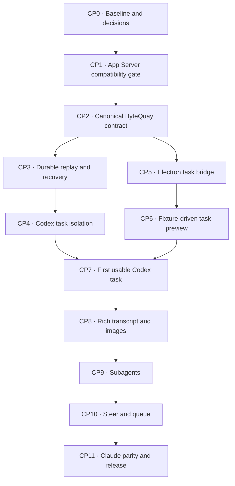

# Agent Service Implementation Checkpoints

> Temporary review draft. This file turns
> [Agent Service Design](agent-service.md) and
> [Agent Task UI Design](agent-task-ui.md) into an implementation sequence.
> It is not implementation approval and is intentionally not linked from the
> design index yet. After review, accepted decisions belong in the canonical
> design documents and delivery tracking; this temporary file can then be
> removed.

## 1. Outcome

Build ByteQuay's agent-task desktop surface on the agent service that already
exists. Do not build another agent harness.

The existing interactive shell is the executable reference client:

```text
scripts/agent-e2e.sh
    -> AgentController REST/SSE
    -> agent-core task and turn services
    -> Codex App Server or Claude CLI
    -> normalized events -> JSONL -> SSE
```

At the client boundary, the desktop replaces the shell's
`curl + jq + terminal` presentation:

```text
React UI
    <-> typed preload IPC
    <-> Electron main authenticated REST/SSE
    <-> existing and extended agent service
```

The desktop must not reproduce the shell's temporary backend, database, or
worktree operations. CP2–CP4 still extend the existing production backend's
contract, durability, isolation, and recovery before the live UI ships.
Leaving a task screen unsubscribes that renderer only; it does not cancel or
complete the backend task.

## 2. Progress legend and checkpoint rule

- `[x]` is implemented/verified, or is a decision that has been explicitly
  resolved. Only Section 3 uses it specifically to mean already implemented in
  the current repository.
- `[ ]` is required work or an unaccepted decision.
- A checkpoint is complete only when every implementation and exit-gate box in
  that checkpoint is checked.
- Backend and frontend work may run in parallel after the shared contract is
  frozen, but a backend-only or renderer-only half-checkpoint does not count as
  complete.
- Each checkpoint must leave its affected modules buildable and must include
  the smallest automated check that would fail if its contract regressed.
- Java checkpoint changes pass collection arguments directly to Guava
  immutable `copyOf` operations without a redundant `requireNonNull` wrapper,
  following the project-wide rule in `CONTRIBUTING.md`.

## 3. Current baseline

Already implemented and to be reused:

- [x] One lazily started Codex App Server over stdio.
- [x] Codex root-thread start/resume and multiple turns in one session.
- [x] A separate Claude `stream-json` driver.
- [x] Provider-neutral message, plan, command, file, tool, approval, usage,
  lifecycle, and error mapping.
- [x] SQLite task, turn, metrics, completion, and cleanup facts.
- [x] Turn idempotency and one active turn per task.
- [x] Clean-worktree validation and an in-process exclusive lease.
- [x] Task JSONL, monotonic task sequence, replay, and SSE publication.
- [x] Cancel, approval resolution, completion, retention, and provider-status
  HTTP endpoints.
- [x] `scripts/agent-e2e.sh --interactive` as a real Codex/Claude backend
  reference client.
- [x] Existing automated regression floors for task/turn services, JSONL,
  replay/SSE, provider mapping, SQLite stores, HTTP security, and completion.

Missing for the reviewed rich-task design:

- [ ] Workspace-owned public task creation instead of renderer-selected paths.
- [ ] Production adoption of the CP1 reference projection and version-tolerant
  decoding across the required experimental surface.
- [ ] Proof that the reviewed per-task execution-environment design exists in
  that reference protocol and still works with the latest installed CLI.
- [ ] A task-owned Codex executor/environment and fail-closed isolation.
- [ ] Canonical event IDs plus root/child/turn/item source identities.
- [ ] Persisted user input and delivery state.
- [ ] Atomic SQLite state plus event-outbox persistence.
- [ ] Immutable task-worktree ownership facts, mutation claims, approvals, and
  provider recovery facts.
- [ ] Model, effort, and permission defaults with per-turn snapshots.
- [ ] An authenticated Electron task/event bridge.
- [ ] React task routes, reducer, transcript, composer, and task controls.
- [ ] Safe images, subagent inspection, steering, queueing, and Claude parity.

## 4. Fixed scope

These are scope rules, not claims that current code already enforces them:

- The new interactive task surface adds no ByteQuay model-callable business
  tool, commit tool, Git hook, or post-turn workflow. Existing workflow-specific
  adapters remain unchanged unless a checkpoint explicitly updates their
  shared agent contract.
- There is no generic workflow abstraction combining interactive agent,
  cherry-pick, CI Autofix, and rebase state machines. They do share the approved
  [Managed Worktree Service](worktree-service.md) because all three top-level
  agent workflows need the same owned filesystem operations; Branch Rebase
  borrows its caller's worktree.
- Prefer stateless service boundaries. This is not a ban on state: add the
  smallest durable state when a concrete coordination, recovery, or
  user-visible requirement needs it, but do not add lifecycle states or
  recovery paths for hypothetical future cases.
- There is no arbitrary executable/script provider. The shell is a reference
  client; production providers remain the Codex and Claude drivers.
- There is no custom Code Mode host or undocumented App Server queue API.
- First-release interactive Codex tasks must prove that inherited MCP servers,
  apps/plugins, dynamic tools, exec-policy allow rules, and lifecycle hooks are
  absent or disabled in CP1/CP4. They must also prove that no managed
  requirements apply; a missing field, non-null value, request failure, or
  undecodable response fails closed until a narrower contract has exact
  executable evidence.
- The renderer receives no raw provider JSON, backend log stream, credential,
  or hidden reasoning.
- The UI does not copy Codex Desktop assets or promise pixel parity.
- The frontend adds no component framework, CSS framework, or state library.
- The queue has no priorities, reordering, schedules, or per-child stop/steer
  UI.

## 5. Ownership

| Role | Owns |
| --- | --- |
| Runtime owner | App Server protocol and reference fixtures, Codex/Claude adapters, process supervision, task executor/environment, routing, and quiescence |
| Service/storage owner | Task/turn/event/approval contracts, managed-worktree boundary, SQLite task state, outbox, provider recovery, and HTTP/SSE DTOs |
| Desktop owner | Electron REST/SSE client, preload API, React reducer, routes, task UI, accessibility, and plain CSS |
| Product/release owner | Experimental dependency decision, same-host trust decision, capability policy, and release gate |

One desktop owner should carry the first visible slice across Electron main,
preload, and React. Splitting those layers before the first vertical slice adds
handoff cost around one small event contract. Runtime and service owners supply
one checked-in fixture for that contract so desktop work can proceed in
parallel.

## 6. Delivery shape



Checkpoint 2 is the parallel-work cut: service/runtime work continues through
checkpoints 3 and 4 while the desktop owner builds checkpoints 5 and 6 from
the same recorded event fixtures. Checkpoint 7 is the convergence gate; it
must use the real runtime rather than fixtures.

## [x] CP0 — Freeze the baseline and release decisions

**Owners:** product/release owner with runtime owner

**Depends on:** nothing

**Visible UI:** no

Purpose: preserve the working backend path and decide whether the proposed
experimental dependency is acceptable before extending it.

**Status (2026-08-31): COMPLETE.** The engineering baseline is verified.
Product accepted the experimental App Server dependency, the stock executor's
same-host trust boundary, a separate ByteQuay-owned worktree per task, and a
development-only UI gate through CP11. The canonical worktree contract and
approved static UI prototype are recorded. The deterministic HTTP integration
test now verifies a sanitized golden create -> two turns -> replay/SSE ->
completion transcript.

Implementation and decisions:

- [x] Accept shipping the planned first product surface over Codex App
  Server while the official documentation describes the command as
  experimental and unsupported for production workloads. This decision was
  recorded on 2026-08-31 and does not waive the compatibility release gate.
- [x] Accept the unauthenticated same-host boundary of the reviewed stock task
  executor for the planned first release. This decision was recorded on
  2026-08-31 and does not describe the loopback listener as authenticated.
- [x] Choose Codex CLI/App Server `0.151.0` for the compatibility spike;
  this exact version and its hashes are reference-only and do not gate the
  production CLI.
- [x] Give every repository-scoped agent task a separately provisioned
  ByteQuay-owned worktree; no development agent edits the managed checkout.
- [x] Record one shared synchronous create/inspect/cleanup contract for interactive
  tasks, cherry-pick, and CI Autofix in
  [Managed Worktree Service](worktree-service.md). Branch Rebase reuses its
  caller's worktree. Cleanup is non-forcing, refuses dirty or open Git state,
  removes only the verified worktree, and always retains its generated branch.
- [x] Keep automatic Codex startup self-update enabled and use the
  user-managed installed CLI. The production probe records detected version text
  for diagnostics but never treats that output, including an unparseable
  string, as a readiness gate.
- [x] Keep the new task UI behind a development-only gate until CP11. Commit
  `84af81c73cea7ae2cf7a53681827f550c598b706` is the approved static visual and
  state artifact; this approval does not enable a live route or provider.
- [x] Capture a sanitized request/event fixture from the current task -> two
  turns -> replay/SSE -> completion flow. `TestAgentHttpApi` compares the full
  normalized journey with `agent-http-baseline.json`.
- [x] Keep `TestAgentHttpApi` as the deterministic Spring HTTP integration
  regression test.
- [x] Remove the stale non-interactive branch from `agent-e2e.sh` and its docs,
  rather than restoring a test-only deterministic driver to production.
- [x] Keep `--interactive --provider codex|claude` as the manual real-provider
  reference path.

Exit gate:

- [x] `cd backend && mvn verify` passes before contract changes begin: 518
  tests passed with no failures or errors.
- [x] `./scripts/agent-e2e.sh --interactive --provider codex --minimal-worktree`
  completes two turns against the current backend.
- [x] A Claude interactive run either completes or records one actionable
  readiness/authentication limitation. On this development host, Claude CLI
  `2.1.251` reports `loggedIn: false`; run `claude auth login` before its real
  provider shell can pass.
- [x] The latest-CLI update policy, reference-fixture version,
  experimental-risk decision, same-host trust decision, separate-worktree
  strategy, and shared worktree-service contract are recorded in the canonical
  design.

Primary files:

- `scripts/agent-e2e.sh`
- `docs/design/agent-e2e.md`
- `docs/design/Agent Task UI.html`
- `backend/app/src/test/resources/com/bytequay/app/web/agent/agent-http-baseline.json`
- `backend/app/.../AgentCliUpdateJob.java`
- `backend/agent-cli/.../CodexCliDriver.java`

The real Codex reference run used one temporary task and returned
`first-turn-ok` and `second-turn-ok` from consecutive completed turns. The
shell then stopped the backend and removed its temporary repository, database,
runtime, and logs.

## [x] CP1 — Prove the v0.151.0 reference contract

**Owner:** runtime owner

**Depends on:** CP0

**Visible UI:** no

Purpose: fail fast before persistence and UI depend on an experimental runtime
shape.

**Status (2026-08-31):** CP1's technical evidence is complete. The checked-in
offline fixture and both explicit local subscription-backed live gates passed with
`codex-cli 0.151.0` and `gpt-5.6-sol`. The no-child run proved one real command
approval, bounded Git-worktree writes, a yielded background terminal with
targeted termination, two-task event/approval/command/filesystem isolation,
credential-free executor process environments, and disk-backed history
recovery after an App Server restart. The recursive run proved the advertised V2 root/child/
grandchild graph, including the observed supplementary V1 collaboration item,
with clean worktree and terminal state.
Production adoption of the shared isolation guards and a CP1-approved
child-capable launch profile belongs to CP4. See
[Codex App Server compatibility fixture](codex-app-server-compat.md).

**Go/no-go (2026-08-31): GO.** The reviewed experimental App Server shape is
technically sufficient for CP2 provider-neutral contract work, and CP0's
product decisions and baseline evidence are complete. This is not
production-release approval or a general same-user filesystem-confinement
claim.

**Progress (2026-08-31):** the offline gate now projects and codec-tests the
v0.151.0 modern approval methods, top-level fields, requiredness, both command
kinds, every command/file decision shape, and the opaque permission payload
with its response scope. Legacy `applyPatchApproval` and
`execCommandApproval` requests are deliberately unsupported and fail closed.
The current runtime bridge still handles only command/file one-time
`accept`/`decline` and fails closed for unrepresented scope or stale decisions;
preserving every product-permitted decision offered by the provider in the
provider-neutral contract and UI begins in CP2. That set is the intersection of
the provider's legal choices and ByteQuay's immutable safety ceiling; an empty
set fails closed, and `acceptWithExecpolicyAmendment` is never product-permitted
in the first release. The gate also checks the background-terminal
list/terminate and `thread/resume` contracts and derives one compact committed
projection manifest instead of committing 413 schemas or 820 generated
TypeScript files. The normal fixture command verifies the manifest;
`--update-bindings` regenerates it intentionally. This remains reference-only
and never gates the production user-managed CLI. The safe live path proved one
real parent-command approval, one bounded mutation per repository, a yielded
command with targeted termination, and disk-backed history recovery through a
fresh App Server. Both live modes passed using an explicitly selected,
fixture-only 0700 `CODEX_HOME` signed into ChatGPT directly with file-backed
credential storage. They use the remote provider and are deliberately absent
from default and CI execution. API-key support is deferred.

The auth-free offline gate now also proves the proposed first-release
exec-policy source and managed-requirements absence guards. It first validates
that a poison isolated-user `.rules` file is a real `allow` rule with the
documented `codex execpolicy check` command.
`config/read(includeLayers: true)` exposes that active isolated user layer, and
the guard rejects it before any thread or model turn. After the poison file is
removed, the clean workspace passes only after the guard checks the `rules/`
directory beside every returned system, user, or project policy-bearing source
and finds no `.rules` file. `packagedDefaults` and
`legacyManagedConfigTomlFromFile` layers are not exec-policy sources. The
behavioral poison control exercises the isolated user source without claiming
every source type is present. The live isolation path calls `config/read` for
every temporary task cwd. The exact App Server has no public `--ignore-rules`
option or rule-inventory RPC, so CP4 must adopt this conservative source
inspection; a per-thread config override cannot disable rules. The same keyless
App Server call pins the
`configRequirements/read` response shape, requires its
`requirements` field to be present and null, and fails for an omitted or
non-null value.

The same pre-thread gate now proves three configured launch profiles are
effective, not merely present in command arguments: no child features,
`multi_agent` only, and `multi_agent_v2` only. Each separate App Server must
report one active `sessionFlags` layer and matching effective values for the
selected multi-agent shape plus every disabled optional feature, disabled web
search, empty MCP configuration, host-skill-discovery disable, and the minimal
shell environment. The V1 profile additionally sets and verifies
`agents.max_depth=2`, which is the bounded depth required for its grandchild
proof. `hooks/list` must be empty and error-free for the requested cwd.
`skills/list` may return only bundled system skills whose canonical paths
remain beneath the isolated `CODEX_HOME/skills/.system`; it rejects every host,
repository, plugin-owned, or out-of-root skill without pinning names or count.
Synthetic poison cases exercise those rejection branches. This proves profile
selection and repairs evidence behind the existing capability-isolation
checks; without a model turn it did not by itself close the then-open live
child-recursion gate. The later subscription-backed run closed that gate.

The offline schema gate now also pins the child-thread facts required by the
later recursive live proof. Stable schema must expose subagent source kinds,
parent/session/status metadata, `thread/status/changed`, V1
`collabAgentToolCall` sender/receiver/state fields, and V2
`subAgentActivity` identity/path/lifecycle fields. The direct-parent and
ancestor filters on `thread/list` must remain available only in the
experimental schema. They are an optional discovery aid; the fixed-point
history algorithm does not depend on them. This schema evidence adds no
production child router and did not by itself close the live recursion gate.

The compact Java projection now preserves an optional model
`multiAgentVersion`, V1 sender/receiver/agent-state identity and optional state
message, V2 agent thread, logical path, and lifecycle kind, plus the
parent/session/turn/item history
needed by recursive reconciliation. Optional capability fields remain absent
when omitted, additive fields remain ignorable, and future enum values decode
as `UNKNOWN`. This is codec evidence only: V2 activity is not yet routed into
provider-neutral events, and no child subscription or graph exists.

The [official App Server page](https://learn.chatgpt.com/docs/app-server)
documents version-specific schema generation, experimental opt-in,
`environment/info`, background-terminal APIs, steering, and streamed events.
It does not currently document `environment/add` on that page. Therefore the
per-task environment design is a go/no-go compatibility question, not an
assumption.

Implementation:

- [x] Generate JSON Schema from the exact selected binary, verify that the
  required experimental definitions are present, and preserve the generation
  command/version in the fixture metadata.
- [x] Make the generated compact reference projection authoritative for the
  fields ByteQuay consumes. The normal fixture verifies the committed manifest,
  `--update-bindings` regenerates it, and Java reflection/codec conformance keeps
  production decoding tolerant of additive fields and future enum values. An
  incompatible required shape fails the affected operation and reports the
  detected running version instead of failing a version-text gate.
- [x] Initialize with `capabilities.experimentalApi: true`, wait for the
  response, and send `initialized` before any other request.
- [x] Prove the exact schema/binary exposes and accepts `environment/add` with
  the fields required by the reviewed design.
- [x] Prove commands selected through environments A and B report distinct
  executor-only `HOME` values and canonical working directories rather than
  falling back to the App Server's ambient process.
- [x] Launch the version-matched official task executor on loopback and prove
  its reported endpoint and handshake behavior.
- [x] Register the task environment, call `environment/info`, and verify its
  canonical working directory and shell.
- [x] Start one thread and turn selecting only that environment; run one
  built-in command in a temporary executor directory and observe typed
  command-start, command-completion-with-output, and final-agent-message events.
- [x] Repeat a bounded filesystem action inside a disposable Git worktree with
  the proposed production sandbox shape.
- [x] Project and codec-test the modern approval methods, top-level fields,
  requiredness, both command kinds, every command/file wire decision shape,
  and the opaque permission payload plus response scope from v0.151.0.
- [x] Reject legacy `applyPatchApproval` and `execCommandApproval` server
  requests with a fail-closed JSON-RPC error.
- [x] Exercise one representative real command approval request and typed
  `accept` response through the live App Server path. Exhaustive modern wire
  coverage remains an offline schema/codec gate; richer product decision
  matrices begin in CP2 only after ByteQuay defines its finite immutable safety
  ceiling.
- [x] Exercise background-terminal list and clean with an empty result.
- [x] Exercise a non-empty yielded background terminal and targeted terminate.
- [x] Inspect `model/list` effort choices, text input support, and advertised
  multi-agent protocol version, then run the advertised default effort.
- [x] Exercise `thread/read(includeTurns: true)` with command history.
- [x] Pin the stable V1/V2 child item, child status, source-kind, and parent
  metadata schema plus the experimental-only parent/ancestor list filters.
- [x] Project and codec-test model multi-agent capability, V1/V2 child
  identity, and recursive thread/turn/item history without enabling routing.
- [x] Start separate credential-free no-child, V1-only, and V2-only launch
  profiles and repeat the pre-thread config, managed-policy, rule, skill, and
  hook isolation assertions for each one.
- [x] Add a separate subscription-backed `--live-children` path that discovers
  the model's V1/V2 profile under the no-child baseline, restarts with only
  that feature, sets and verifies the V1 depth-two requirement when applicable,
  and fail-closed checks a bounded root/child/grandchild history,
  markers, item types, approvals, worktree state, and background terminals.
- [x] Exercise recursive child discovery needed by the later quiescence
  barrier. Select only the child-capable profile advertised by the live model,
  then prove root, child, and grandchild history; profile selection alone
  cannot satisfy this item.
- [x] Call `thread/resume` for the still-loaded root and complete a second turn.
- [x] Restart App Server and prove disk-backed thread recovery.
- [x] Run two task environments through one App Server and prove event,
  approval, command, and filesystem separation.
- [x] Prove inherited MCP servers, lifecycle hooks, project config, and the
  caller's ambient user config are absent. The fixture requires exactly one
  fixture-selected App Server user layer, calls `config/read` for every
  temporary task cwd, accepts only isolated bundled system skills, and runs
  MCP/skill/hook/config assertions before the first model turn. The offline
  profile is temporary; a live profile is separate, persistent, and never the
  normal `~/.codex`.
- [x] Launch with apps/plugins and related optional features explicitly
  disabled, empty dynamic tools, and empty capability roots. The keyless gate
  proves the feature flags, web-search mode, empty MCP map, host-skill setting,
  and complete shell-environment policy are active session flags for the
  no-child, V1-only, and V2-only profiles. Exactly one multi-agent feature is
  enabled in each child-capable profile.
- [x] Give every offline/default compatibility subprocess and every live task
  executor a separate credential-free `CODEX_HOME` and minimal allowlisted
  process environment. Only the live App Server receives the explicitly
  selected profile. Configure every model-requested shell environment to omit
  `CODEX_HOME`, `CODEX_API_KEY`, `OPENAI_API_KEY`, and the App Server-only
  sentinel. Never copy `auth.json` or use the normal `~/.codex`.
- [x] Require `BYTEQUAY_CODEX_COMPAT_HOME` for an explicit live invocation,
  reject a missing, non-absolute, non-0700, default, ambient, repository-local, or
  non-ChatGPT profile before App Server starts, reject linked credentials and
  credentials that match or reuse the current ambient profile, reject stale
  runtime/config state and persistent Codex-home instructions, and require App Server
  `account/read` to report `requiresOpenaiAuth: true` and `chatgpt`.
- [x] Hold an exclusive profile-local lock across each live gate. Keep database
  state in a temporary `CODEX_SQLITE_HOME`, reuse database plus run-scoped
  rollout state for the App Server restart/reload proof, then remove exact
  runtime/config artifacts and release the lock without deleting `auth.json`
  or the persistent authentication profile.
- [x] Require the exact structured command action before returning the live
  approval `accept`, and keep failure diagnostics free of raw command text and
  output. This proves environment stripping, not same-user filesystem-read
  confinement of the dedicated profile.
- [x] Start App Server without credentials, inspect every returned config
  layer, reject a real rule-bearing isolated user source before any model turn,
  and accept a clean isolated home/workspace only after every returned system,
  user, or project policy-bearing source's `rules/` directory contains no
  `.rules` file.
- [x] Call `configRequirements/read` without credentials and prove that the
  isolated launch has no applicable managed requirements. A missing
  `requirements` field, non-null value, request failure, or undecodable response
  must make the lane unavailable. The response must contain exactly that one
  top-level key; an unknown sibling policy field also fails closed.
- [x] Make a reference-fixture version, generated-bundle hash, or required
  method/field mismatch an actionable fixture failure.

Exit gate:

- [x] The checked-in offline compatibility fixture passes for the exact
  version.
- [x] The checked-in `--live` fixture passes when invoked locally with the
  explicitly selected ChatGPT-subscription profile.
- [x] The checked-in `--live-children` fixture passes when invoked locally with
  the explicitly selected ChatGPT-subscription profile.
- [x] The reference compatibility fixture rejects a different version and
  rejects changed schema bundle hashes or required fields.
- [x] The executable fixture proves no managed requirements apply before the
  source guard is considered complete.
- [x] No tested command falls back to App Server's ambient/default executor;
  the exact recorded action expands both executor-specific `HOME` markers, an
  unset command-level `CODEX_HOME`, and an unset App Server-only sentinel.
- [x] The subscription-backed live runs prove App Server `account/read`
  reports `requiresOpenaiAuth: true` and `chatgpt`; executor tools have no
  `CODEX_API_KEY`, `OPENAI_API_KEY`, `CODEX_HOME`, or App Server-only sentinel;
  and restart recovery uses disposable SQLite plus run-scoped rollout state.
- [x] A yielded/background command remains observable and cleanable.
- [x] Multi-task routing contains no cross-task event or approval.
- [x] The checkpoint has the written GO result above and CP0 is complete.

Primary files:

- `scripts/codex-app-server-compat.mjs`
- `backend/agent-cli/src/test/resources/.../app-server-v0.151.0-bindings.json`
- `backend/agent-cli/.../codex/TestCodexProtocolReferenceBindings.java`
- `backend/agent-cli/.../codex/CodexAppServerClient.java`
- `backend/agent-cli/.../codex/CodexProtocol.java`
- `backend/agent-cli/.../codex/CodexProtocolCodec.java`
- `backend/agent-cli/.../codex/CodexCliDriver.java`
- Codex protocol/driver compatibility fixtures

## [x] CP2 — Freeze the ByteQuay task, worktree, and event contract

**Owners:** service/storage owner with runtime and desktop review

**Depends on:** CP1

**Visible UI:** no; desktop fixture work may start after completion

Purpose: establish one safe, versioned, provider-neutral contract for JSONL,
REST/SSE, Electron IPC, and React.

**Progress (2026-09-01):** CP2 has frozen the provider-neutral task, turn,
readiness, approval, and schema-v2 event contracts. Interactive tasks have one
workspace discriminator and immutable requested defaults; each accepted turn
retains its exact requested settings and opaque attachment references. Provider
source identity is carried through the SPI, user input and approval lifecycle
are durable event variants, legacy rows/schema-v1 logs remain readable, and one
strict TypeScript fixture covers every CP2 payload family. The workspace-safe
request/narrow response and managed CI replacement records are frozen but are
not active routes: CP3 must first supply the one durable worktree
implementation and crash-safe event outbox, then activate them. CP4 applies the
snapshotted settings to the real App Server runtime. The full backend reactor,
frontend lint and type checks, all 230 frontend tests, and the packaged desktop
build passed on 2026-09-01.

The managed-worktree boundary remains deliberately small. `agent-core` owns
only synchronous `provision(command)`, `inspect(worktree)`, and
`cleanup(worktree)`. There is no allocation state machine, store, recovery API,
cleanup disposition, or cleanup authority. CP3 owns the one application
implementation.

Implementation:

- [x] Add `workspaceId` to interactive `AgentTask` and SQLite task rows.
- [x] Add the smallest durable interactive-surface discriminator needed to keep
  workspace task lists from including cherry-pick, CI Autofix, or rebase agent
  tasks. Do not turn it into a generic workflow hierarchy.
- [x] Freeze the replacement task-creation request as `workspaceId`, title,
  lane, and task defaults, with no renderer-selected worktree or repository
  fields. Do not switch the production route until CP3 supplies the durable
  worktree implementation.
- [x] Add and freeze the CP0-approved `WorktreeService` contract and values in
  `agent-core`, including synchronous provision/inspect/cleanup, deterministic
  immutable ownership facts, and failure semantics. CP3 owns its one
  production implementation and activation; do not add a temporary adapter.
- [x] Define its repository identity as the physical workspace selected
  repository/`origin`; cherry-pick and CI keep logical monitored/upstream
  identities in their own workflow records.
- [x] Freeze the creation order: readiness first, then exact-commit resolution,
  verified worktree provisioning, task resources, and finally task publication
  as `READY`.
- [x] List interactive tasks by `workspaceId` and reject a route/task workspace
  mismatch.
- [x] Keep legacy/internal workflow tasks readable without silently listing
  unknown-workspace tasks as interactive tasks.
- [x] Add task defaults and per-turn requested snapshots for model, effort, permission,
  effective sandbox/runtime policy, and attachment references.
- [x] For CI Autofix, freeze distinct remote-head and generated-local-branch
  facts. Local validation and rebase use the generated branch returned by the
  task's `TaskWorktree`; push still targets the authorized remote head ref.
- [x] Reuse the existing model catalog; do not create a second registry.
- [x] Expand backend readiness to typed states: ready, authentication required,
  CLI missing, unsupported, degraded, and temporarily unavailable, with
  actionable reason metadata. `checking` remains renderer request state. For
  Codex, `unsupported` requires a detected protocol/capability failure and
  includes detected version text; no reported version text, including unparseable
  output, produces it by itself.
- [x] Apply that readiness allocation gate only to lanes enabled for the
  current checkpoint. Interactive Claude creation stays backend-disabled until
  CP11 supplies its exact authentication preflight and parity contract.
- [x] Define explicit `AgentEventPayload` variants in `agent-core`; stop using a
  serialized `ProviderAgentEvent` as the public/persisted shape.
- [x] Add `schemaVersion`, globally unique `eventId`, task sequence, task/turn
  IDs, provider root/child/turn/item IDs, timestamps, and typed payload.
- [x] Preserve provider source/item IDs when supplied. Derive a synthetic key
  only from deterministic provider fields with replay-stability fixtures;
  otherwise only display-only facts may omit source identity and render as a
  standalone/root-level event. An execution item, approval, delivery, or child
  relation without stable routing/reconciliation identity fails closed or
  makes that lane unavailable.
- [x] Add a durable user-message event shape, including attachment references
  and delivery kind.
- [x] Remove renderer-supplied attachment paths from `StartTurnRequest`. Until
  CP8 exists, public interactive turns reject attachments; after CP8 they
  accept only opaque task-owned attachment references. Trusted internal
  workflow attachments remain an internal command boundary.
- [x] Add typed approval request/resolution/expiry variants and the
  product-permitted subset of their provider-offered decisions. An empty subset
  fails closed.
- [x] Preserve completed items as authoritative replacements for deltas sharing
  the same source/item identity.
- [x] Keep Codex wire DTOs, the compact generated reference projection, and raw
  Claude blocks inside `agent-cli`.
- [x] Keep a schema-v1 JSONL reader: absent source fields render as an explicit
  root-level legacy stream rather than invented child identity.
- [x] Freeze narrowed task/turn response records so the renderer never receives
  a worktree path, provider session reference, backend URL, or credential. CP3
  activates those records with the workspace-owned routes.
- [x] Check in one valid monotonic frontend fixture containing create, user
  message, partial and final assistant messages, plan, command/output,
  file/tool activity, approval request/resolution, usage, lifecycle, and
  error. Derive separate transport tests that duplicate or omit an envelope.
- [x] Freeze the envelope/common-source evolution rule: later checkpoints may
  add versioned payload variants and optional fields compatibly, but may not
  reinterpret an existing tag. Reserve the direct-parent/logical-agent-path
  metadata needed for CP9.

Exit gate:

- [x] TypeScript models the fixture as a discriminated union without `any` or
  provider-payload inspection.
- [x] The frozen replacement interactive request schema cannot submit a
  worktree, repository, or attachment filesystem path; CP3 activation removes
  those fields from the production route.
- [x] The frozen replacement cherry-pick and CI Autofix request schemas resolve
  worktree roots from `workspaceId`; CI never receives or adopts a cherry-pick
  worktree. CP3 activates those schemas.
- [x] Workspace-scoped list/read and mismatch behavior is covered at the
  core/storage boundary. CP3 activates the route and adds its HTTP test rather
  than exposing a path-trusting half-migration.
- [x] Logged-out or incompatible providers allocate no task row, runtime
  directory, or worktree ownership.
- [x] Two turns retain their exact requested model, effort, permission,
  sandbox/runtime policy, and attachment-reference snapshots.
- [x] Existing logs/rows remain readable under explicit legacy behavior.
- [x] Existing cherry-pick, CI Autofix, and rebase callers still compile and
  their focused suites pass.

Primary files:

- `backend/agent-spi/...`
- `backend/agent-core/...`
- `backend/persistence-sqlite/.../AgentTaskEntity.java`
- `backend/persistence-sqlite/.../AgentTurnEntity.java`
- `backend/app/.../web/agent/AgentController.java`
- `backend/app/.../web/agent/AgentHttpModels.java`
- `backend/app/.../web/agent/InteractiveAgentHttpContract.java`
- `backend/app/.../web/ci/ManagedCiAutofixHttpContract.java`
- `frontend/src/agents/events.ts`
- `frontend/src/agents/fixtures/agent-events-v2.json`

## [ ] CP3 — Implement worktrees and make replay crash-safe

**Owner:** service/storage owner

**Depends on:** CP2

**Visible UI:** no

Purpose: implement the synchronous worktree boundary and make the event stream
an authoritative reconstruction source rather than a best-effort activity log.

**Progress (2026-09-01):** the first CP3 slice now persists immutable task
worktree ownership, provides the one stateless synchronous managed-worktree
implementation, and serializes repository worktree mutation against workspace
removal. SQLite state and bounded event-outbox rows can share one transaction;
outbox replay is idempotent across JSONL flush/mark crashes, repairs a partial
tail, and publishes only after the event is flushed and marked. Startup keeps
agent routes and mutation monitors behind one boolean gate while it drains the
outbox, reconciles existing agent execution, and drains again. This is a
foundation slice: task/turn/approval mutations have not all migrated to the
unit of work, and the workspace-scoped public routes remain inactive.

Implementation:

- [x] Add `AgentUnitOfWork` backed by one SQLite transaction.
- [x] Add `AgentEventOutboxStore` and its SQLite entity/store.
- [x] Make `TaskLogStore` find/append idempotently by `eventId`.
- [ ] Commit every state mutation and its bounded unsequenced event together.
- [ ] Drain the committed outbox to JSONL before SSE publication or provider
  callback completion.
- [x] Drain pending outbox rows before agent endpoints become ready at startup.
- [x] Add an explicit agent-serving gate: either complete recovery before the
  web layer serves agent data or have every agent task/turn/event/approval read,
  mutation, and SSE endpoint reject until recovery is ready. Provider-status
  diagnostics may remain available. `ApplicationReadyEvent` alone is too late
  because the HTTP server is already listening.
- [ ] Write bounded user-message bytes to a task-owned blob before the SQLite
  transaction, then persist only bounded metadata and its blob reference in
  the outbox before attempting `turn/start` or later `turn/steer` delivery.
- [ ] Add input-delivery states `ACCEPTED`, `SENDING`, `DELIVERED`, `FAILED`,
  and `UNKNOWN`; never automatically resend an unknown delivery.
- [ ] Persist each delivery's ID, start/steer kind, task/turn, idempotency key,
  timestamps, and redacted terminal reason.
- [ ] Persist approval requests before publishing cards and persist
  resolution/expiry before resuming the provider callback.
- [ ] Deny pending approvals durably on timeout, cancellation, terminal turn,
  or provider loss.
- [x] Persist the immutable `TaskWorktree` ownership/path/branch/start-commit
  facts with the owning task; do not add an allocation table or lifecycle.
- [x] Implement the one production `ManagedWorktreeService` in `app` with
  `WorkspacePaths` and direct argv-based Git commands. Do not add a new module,
  temporary implementation, allocation store, or recovery scanner.
- [x] Make `inspect(worktree)` revalidate the exact managed repository, path,
  generated branch, and required HEAD before returning dirty/open-operation
  facts.
- [x] Make `cleanup(worktree)` revalidate those facts, refuse dirty or open Git
  state, use non-forced removal, remove only the worktree, and always retain the
  generated branch.
- [ ] Activate workspace-owned interactive task creation: probe readiness,
  resolve the exact start commit, provision and verify the worktree, allocate
  task resources, then publish the task as `READY`. If provisioning reports a
  half-finished or mismatched orphan, preserve it and return an actionable
  diagnostic; do not adopt or delete it automatically.
- [ ] Activate workspace-scoped task list/read routes with the frozen narrowed
  CP2 response records. Reject a route/task workspace mismatch and remove the
  old renderer path/repository plus provider-session/turn-reference fields
  from the public route in the same change.
- [ ] Re-probe readiness before every accepted turn; a failed probe creates no
  turn or delivery and leaves the ready worktree unchanged.
- [ ] Replace `AgentWorkspaceService` and cherry-pick's private
  `CherryPickWorkspace` creation/removal with the shared service.
- [ ] Keep cherry-pick and CI cancellation non-destructive: dirty or uncertain
  work remains in place, and the shared worktree service exposes no force or
  branch-delete operation.
- [ ] Change CI Autofix to accept `workspaceId`, provision a fresh worktree at
  the verified PR head, and stop adopting the cherry-pick worktree. Branch
  Rebase continues to borrow the CI task's `TaskWorktree`.
- [ ] Change completed cherry-pick delivery to push the retained verified branch
  from the managed repository so the worktree can be removed at range
  completion.
- [ ] Update `WorkspaceBranchPusher`, `ManagedWorkspaceGit`, and
  `DefaultWorkspacePullRequestService` to verify and push that retained local
  ref without requiring a live checked-out worktree.
- [ ] Remove both remaining CI path-adoption entry points: pull-request delivery
  starts CI from `workspaceId`, and `scripts/ci-autofix` selects a managed
  workspace instead of submitting its current checkout. Update the shell docs
  and tests with that contract.
- [ ] Update CI local-branch validation and Branch Rebase calls to use the
  generated branch from the task's `TaskWorktree` and Git facts from
  `WorktreeService.inspect(worktree)`, while exact-lease
  push continues to target the authorized remote PR branch.
- [x] Serialize worktree add/remove per managed repository while allowing
  distinct ready worktrees to run concurrently.
- [ ] Add one task-local worktree mutation claim acquired by turn start, later
  queue claims, or completion. Recovery preserves and reconciles the existing
  claim; it does not invent a separate recovery-claim kind.
- [x] Serialize workspace unwatch against worktree provisioning so no
  task worktree can be provisioned after removal begins; add service/controller
  race coverage rather than relying on a query-only busy check.
- [ ] Convert `scripts/agent-e2e.sh` from raw worktree submission to a managed
  workspace fixture before activating the new public request.
- [ ] Keep provider delivery/process uncertainty in the existing typed
  `RECOVERING` task state. A worktree ownership mismatch is instead an
  operation error: preserve the path and report it without creating another
  worktree state.
- [ ] Keep a dirty terminal worktree in place with task cleanup
  `ACTION_REQUIRED`; cleanup must reject it without removing or modifying it.
- [ ] Keep provider, Git, JSONL, and SSE calls outside SQLite transactions.

Exit gate:

- [ ] Crash tests around state commit, JSONL flush, and outbox mark yield one
  `eventId` and one sequence with no missing state event.
- [ ] Replay always contains the accepted user input before provider output.
- [ ] Reconnect from the last sequence loses and duplicates no event.
- [ ] A resolved/expired approval never reappears as pending after reload.
- [x] Two live tasks derive distinct canonical worktree paths and branches.
- [x] Provisioning tests prove success returns only a fully verified worktree;
  a half-finished or mismatched orphan is preserved and reported.
- [x] Cleanup tests prove ownership mismatch, dirty state, or an open Git
  operation fails without removal; clean cleanup uses no force, removes only
  the verified worktree, and retains the generated branch.
- [ ] Completed cherry-pick delivery works from the retained branch after its
  worktree is gone, and CI Autofix uses a fresh worktree at the verified PR
  head.
- [ ] Concurrent Send and Complete yield exactly one mutation claim.
- [ ] Startup serves no agent mutation endpoint before event-outbox and owned
  provider-process recovery finishes, and no task/event read or SSE stream
  exposes partially recovered task state. There is no worktree startup scan.
- [ ] HTTP tests prove workspace-scoped list/read, route/task mismatch rejection,
  path-free creation, and narrowed task/turn responses after activation.
- [ ] Backend verification plus shared workflow regression suites pass.

Primary files:

- `backend/agent-core/.../DefaultAgentEventService.java`
- `backend/agent-core/.../DefaultAgentTaskService.java`
- `backend/agent-core/.../DefaultAgentTurnService.java`
- `backend/agent-core/.../DefaultAgentApprovalService.java`
- `backend/agent-core/.../FileTaskLogStore.java`
- `backend/persistence-sqlite/...`
- `backend/app/.../workspace/ManagedWorktreeService.java`
- `backend/app/.../workspace/WorkspaceBranchPusher.java`
- `backend/app/.../workspace/ManagedWorkspaceGit.java`
- `backend/app/.../workspace/DefaultWorkspacePullRequestService.java`
- `backend/app/.../workspace/DefaultWorkspaceRepositoryService.java`
- `backend/app/.../cherrypick/CherryPickExecutionService.java`
- `backend/app/.../ci/DefaultCiAutofixService.java`
- `backend/app/.../AgentMaintenanceJob.java`
- `scripts/agent-e2e.sh`
- `scripts/ci-autofix`
- `docs/ci-autofix-shell.md`

## [ ] CP4 — Integrate task isolation and quiescent recovery

**Owner:** runtime owner with service/storage owner

**Depends on:** CP1 and CP3

**Visible UI:** no

Purpose: turn the CP1 compatibility proof into the production Codex execution
path and prevent one task or old process from mutating another task's worktree.

Implementation:

- [ ] Implement the gated launch sequence from the canonical service design:
  fsynced `PREPARED` marker, committed launch intent, `ATTEMPTING`, gated
  launcher identity, `RELEASE_PENDING`, gate release, `RUNNING`, terminal
  receipt, then durable acknowledgement.
- [ ] Record executable identity and OS start token and verify directly owned
  process-tree termination during recovery; a root PID exit is insufficient.
- [ ] Persist launch phase and opaque owner for the shared App Server, each task
  executor, and each Claude turn.
- [ ] Add `TaskExecServerManager` using only the contract proven in CP1.
- [ ] Launch one version-matched executor/environment per active Codex task.
- [ ] Persist one unique environment ID per task, reuse it only for that task,
  and never assign it to another task. The v0.151.0 reference protocol has no
  unregister operation, so correctness must not depend on one.
- [ ] Re-register and verify a replacement environment before thread resume.
- [ ] Select exactly that task's environment for thread and turn start.
- [ ] Apply canonical worktree roots, workspace-write sandbox, model/effort
  snapshot, and the reviewed Auto approval behavior.
- [ ] Adopt the CP1-proven isolated subprocess environment, pre-turn
  child-capable launch profile plus the skill-origin, hook, config-layer
  rule-source, and managed-requirements guards in the production runtime path.
  Do not claim a per-thread override disables exec-policy rules; v0.151 exposes
  none.
- [ ] Verify inherited capabilities remain disabled after start and resume.
  Force skill discovery and repeat the origin/error guard immediately before
  every `turn/start`, including the first turn after resume/restart.
- [ ] Route root and child events/approvals by provider thread and turn identity
  without cross-task fallback.
- [ ] Run one combined fixed-point reconciliation: repeatedly read root and
  discovered descendants with `thread/read(includeTurns: true)`, reconcile all
  live/history command/tool/file/hook/terminal items, and page background
  terminals for every known child. Stop only after a final whole pass discovers
  no new child/item, every item is terminal, and every background list is
  empty.
- [ ] Treat root answer/turn completion as necessary but not sufficient for
  quiescence.
- [ ] Retain the mutation claim and task worktree while a child, item, background
  terminal, unknown delivery, or owned process is active or unverifiable.
- [ ] Add a guarded fail-recovery operation that never edits or cleans the
  worktree.
- [ ] Before enabling a model, prove full recursive child discovery/routing and
  quiescence. Changing ByteQuay capability metadata does not prevent invisible
  descendants; otherwise mark the model/lane unavailable. CP9 adds inspection,
  not this safety behavior.
- [ ] After a successful stable terminal reconciliation, atomically finalize
  the turn, release its `TURN` claim, and transition the task from `ACTIVE` to
  `READY`.

Exit gate:

- [ ] Two concurrent tasks share one App Server and distinct task executors with
  no event, approval, command, or filesystem cross-talk.
- [ ] Writes outside selected workspace roots are rejected by the compatibility
  sandbox fixture.
- [ ] A second turn resumes the same root only after its task environment is
  verified.
- [ ] A two-turn driver test changes model/effort/permission defaults between
  turns and proves each App Server `turn/start` receives exactly the immutable
  CP2 snapshot stored for that turn, including sandbox and runtime policy.
- [ ] Root completion while an item/child/background terminal runs keeps Send
  and Complete blocked.
- [ ] A missed live child, a child-created grandchild, and live/history overlap
  converge through recursive history closure without duplicate routing.
- [ ] Cancellation lists/cleans background terminals and reaches the same
  quiescence barrier.
- [ ] Backend restart either proves the old owned process tree stopped or leaves
  the task visibly recovering with its mutation claim held.
- [ ] Missing/corrupt process receipts fail closed.
- [ ] If a compatibility fixture can leave a writer outside both ByteQuay's
  directly owned process proof and App Server item/background-terminal
  registries, reject the Codex lane for release rather than merely leaving one
  task recovering.

Primary files:

- `backend/agent-cli/.../process/...`
- `backend/agent-cli/.../codex/...`
- new task-executor manager and fixtures in `agent-cli`
- recovery state and launch stores in `agent-core`/`persistence-sqlite`

## [ ] CP5 — Add the authenticated Electron task bridge

**Owner:** desktop owner

**Depends on:** CP2; may run in parallel with CP3 and CP4

**Visible UI:** no standalone product UI

Purpose: replace the reference shell's HTTP/SSE client without exposing
localhost secrets or provider wire data to React.

Implementation:

- [ ] Define narrowed task, turn, event, readiness, approval, and completion
  DTOs plus bridge methods in `frontend/src/types.ts`.
- [ ] Add Electron-main operations for list/create/get task, read events,
  start/get/cancel turn, resolve approval, and complete task.
- [ ] Do not scaffold defaults, attachments, steering, or queue methods before
  their checkpoints.
- [ ] Attach `X-ByteQuay-Session` only in Electron main.
- [ ] Implement one authenticated fetch-based SSE reader with standard
  `AbortController`; do not add a dependency or use renderer `EventSource`.
- [ ] Parse events split across network chunks and reconnect with the last
  delivered task sequence.
- [ ] Report `connecting`, `open`, `reconnecting`, and terminal `failed`
  connection states.
- [ ] Include subscription ID and task ID in pushed IPC so late events from a
  previous screen are ignored.
- [ ] Abort on explicit unsubscribe, replacement subscription, renderer/window
  destruction, or backend shutdown.
- [ ] Make authentication, not-found, workspace mismatch, and incompatible
  schema terminal/actionable instead of reconnecting forever.
- [ ] Expose one typed preload subscribe operation that returns unsubscribe.

Exit gate:

- [ ] Tests cover chunk splitting, replay/live overlap, duplicate sequence,
  reconnect cursor, explicit unsubscribe, late subscription events, and
  terminal HTTP failure.
- [ ] A test renderer receives ordered fixtures without knowing the backend URL
  or session token.
- [ ] No raw Codex/Claude payload, agent worktree/attachment path, or credential
  crosses the agent bridge. Existing non-agent workspace DTOs are outside this
  checkpoint.
- [ ] Existing frontend lint and type checks pass.

Primary files:

- `frontend/src/types.ts`
- `frontend/src/main.ts`
- `frontend/src/preload.ts`
- a small `frontend/src/agents/sse.ts` only if extraction is needed for testing

## [ ] CP6 — Build the fixture-driven text-task developer preview

**Owner:** desktop owner

**Depends on:** CP2 and CP5

**Visible UI:** yes, development-only

Purpose: produce the first reviewable task-screen shape from the frozen CP2
fixture while CP3/CP4 finish. This checkpoint proves renderer behavior only;
it does not claim a usable live agent task.

CP6 implements the approved `Agent Task UI.html` visual and state artifact
against fixture data. [Agent Task UI Design](agent-task-ui.md) remains the
behavioral contract.

Implementation:

- [ ] Add `#/workspaces/{workspaceId}/tasks/agent/{taskId}` to the existing hash
  route model; route state, not component memory, owns the selected task.
- [ ] Keep cherry-pick tasks unchanged and add a separate **Agent tasks**
  section to the existing Tasks screen.
- [ ] Add a preview-only New agent task action using the route workspace, the
  fixed Codex lane, and backend/workspace defaults. Do not add the provider,
  model, effort, or permission picker before CP7.
- [ ] Add one `agents/model.ts` reducer for task/turn state, ordered events,
  last sequence, connection state, projection, and composer state.
- [ ] Drive the screen and reducer through a typed mock bridge using the valid
  monotonic CP2 fixture plus separate duplicate/gap/reconnect cases.
- [ ] Simulate paged replay followed by subscription after the highest applied
  sequence.
- [ ] Ignore simulated duplicate/older sequence and fill a simulated gap before
  projecting newer events.
- [ ] Render durable user messages, partial/final assistant messages,
  lifecycle, and errors.
- [ ] Render plan, command/output, file, tool, approval, and usage fixtures as
  simple typed rows so the preview loses no information the shell prints.
- [ ] Render only the product-permitted subset of provider-offered approval
  decisions; do not reduce the contract to a generic boolean, and fail closed
  when that subset is empty.
- [ ] Anchor a text composer with Send, Cancel, connection state, and idle-only
  Complete.
- [ ] Have preview controls emit the exact typed bridge commands and one stable
  idempotency key, while transcript state still waits for the fixture's
  durable user-message event instead of inventing history.
- [ ] Navigating away unsubscribes the mock renderer subscription only.
  Reopening replays the simulated still-running task.
- [ ] Keep the preview behind the CP0 development gate and clearly label it as
  fixture data; it must never connect to a real provider or claim durability.

Exit gate:

- [ ] Route tests cover create/open/deep-link/reload/back/forward.
- [ ] Reducer tests cover replay/live overlap, duplicate/gap handling,
  authoritative final replacement, approval resolution, cancellation, and
  terminal errors.
- [ ] Static UI tests cover task list, task detail, composer, reconnecting, and
  error states.
- [ ] A mock-bridge journey covers create/open, Send command, streamed fixture,
  simulated reconnect/reload, Cancel command, and Complete command.
- [ ] No live-backend or provider acceptance is claimed; CP7 owns that gate.
- [ ] No new state/UI/CSS framework or generic task model is introduced.

Initial frontend shape:

```text
frontend/src/agents/
├── AgentTasksView.tsx
├── AgentTaskScreen.tsx
├── model.ts
└── model.test.ts
frontend/src/css/agents.css
```

Extract composer, approval, activity, or subagent components only when their
implemented behavior makes `AgentTaskScreen` materially harder to read.

## [ ] CP7 — Converge on the first usable Codex task

**Owners:** runtime, service/storage, and desktop owners

**Depends on:** CP3, CP4, CP5, and CP6

**Visible UI:** yes; first real-runtime milestone

Purpose: join the independently reviewed runtime and desktop work into one
complete vertical slice.

Implementation:

- [ ] Gate task creation on fresh typed provider readiness before task resources
  or worktree provisioning.
- [ ] Promote the existing cherry-pick-specific provider-status IPC into one
  shared typed agent-provider readiness operation; update its existing consumer
  instead of maintaining two status paths.
- [ ] Add typed Electron/preload operations to refresh provider readiness,
  update task defaults, read effective turn settings, cancel active execution,
  call `POST /agent/tasks/{taskId}/fail-recovery`, and invoke the confirmed
  shared-server stop operation.
- [ ] Add Workspace Settings provider rows and actionable install, login,
  report-issue, and retry states.
- [ ] Make this milestone Codex-only. Show Claude as unavailable or
  preview-only until CP11 rather than accepting a task the product cannot yet
  render and recover at parity.
- [ ] Add Codex model selection at task creation; keep the Codex lane immutable.
- [ ] Add supported model, effort, and permission selection for the next turn.
- [ ] Persist defaults and display the effective settings actually snapshotted
  for each turn.
- [ ] Map **Auto** through the typed backend policy; React never sends provider
  wire strings.
- [ ] Render complete typed approval cards with source, kind, reason,
  command/directory or scope, and only offered choices.
- [ ] Render live command, output, file, tool, plan, usage, lifecycle, and error
  rows from canonical events.
- [ ] Keep mutation controls disabled during recovery or unproven quiescence.
- [ ] Render a **Recovering agent execution** card with bounded diagnostics.
  **Stop execution** invokes normal turn cancellation/reconciliation while work
  may still be active; it does not release the claim or clean the task worktree.
- [ ] After every provider-visible item/background terminal is terminal and all
  directly owned processes are verified stopped, expose **Mark task failed**.
  It calls `POST /agent/tasks/{taskId}/fail-recovery`, marks the whole task
  `FAILED`, releases the claim, retains history, and requests safe worktree
  cleanup. Dirty work remains until it is committed or explicitly discarded.
  The backend rejects the action before that barrier.
- [ ] Add supervised `GET /agent/runtime/codex/stop-impact` and
  `POST /agent/runtime/codex/stop` operations plus typed Electron/preload
  methods. The first returns the runtime generation and complete affected-task
  list; the second requires both so a newly active task cannot be omitted by a
  stale confirmation.
- [ ] The confirmed **Stop shared Codex server** action marks every affected
  live Codex turn `INTERRUPTED`, durably denies pending approvals, pauses queued
  work, retains mutation claims and task worktrees, and blocks replacement until the old process
  tree is verified stopped. Resumption is an explicit later user action; the
  renderer never kills a process directly.
- [ ] After the recovery barrier, re-enable the composer. A **Retry** shortcut
  is the existing start-turn operation with a fresh idempotency key and an
  explicit confirmation to resend the prior message; it is never offered for
  `UNKNOWN` delivery and never runs automatically.
- [ ] Label the composer, model/effort/permission controls, approval actions,
  and activity disclosure; support keyboard operation, restore focus after an
  approval action, and announce only bounded state changes rather than every
  streamed token.
- [ ] Complete only while idle/quiescent and the generated branch is clean;
  close the provider session, stop the task executor, retain history, remove
  the worktree, and preserve the generated result branch.
- [ ] Adapt the shell reference client to the workspace-safe contract through a
  temporary test workspace; do not preserve a raw-path public API for it.
- [ ] Replace the CP6 mock-bridge implementation with the real bridge for the
  product route. Packaged builds cannot create/open fixture tasks or import the
  fixture runtime; fixtures remain test inputs only.

End-to-end acceptance:

- [ ] Create a Codex task from one watched workspace.
- [ ] Send “Summarize this repository” and see the durable user message, live
  typed activity, and final answer.
- [ ] Reload mid-turn; no item is lost or duplicated and the run continues.
- [ ] Restart the backend mid-turn; the restored turn is visibly
  `INTERRUPTED`/`RECOVERING` or reconciled terminal, never implicitly resumed or
  resent, and ownership remains held until the barrier passes.
- [ ] Resolve an approval, reload, and verify it stays resolved.
- [ ] Send a second message and verify the same root thread is resumed.
- [ ] Cancel a running turn and reach the quiescence/recovery outcome.
- [ ] Complete the idle task and prove its worktree is removed while its clean
  generated result branch remains.
- [ ] Run two tasks concurrently without event/approval/filesystem cross-talk.
- [ ] The packaged desktop, not only unit fixtures, passes this journey.

**Checkpoint result:** this is the first usable Codex task surface. Do not call
CP2, CP5, or CP6 alone “agent UI complete.”

## [ ] CP8 — Add rich transcript projection and safe images

**Owners:** service/runtime owner for facts and attachment boundary; desktop
owner for projection

**Depends on:** CP7

**Visible UI:** yes

Implementation:

- [ ] Distinguish structured checklist updates from free-form Plan-mode text.
- [ ] Preserve provider-supported readable reasoning summaries and discard
  hidden reasoning.
- [ ] Normalize bounded/redacted command output, cwd, file changes, built-in
  tools, web search, image view, compaction, retry, duration, and usage facts.
- [ ] Merge activity by provider thread/turn/item identity; completed items
  authoritatively replace deltas.
- [ ] Group contiguous activity into one expandable block and derive the folded
  sentence from typed facts only.
- [ ] Keep an activity group visibly active and expanded while any member is
  running. After all members become terminal, fold to the derived summary
  unless the user explicitly chose an expanded/collapsed state; live updates
  never override that choice.
- [ ] Show plan state, turn elapsed time, provider-supplied item duration,
  usage, unavailable cost, and existing-style status icons.
- [ ] Add task-owned attachment storage using opaque references.
- [ ] Add typed Electron/preload operations for native image selection, byte
  upload, owned-reference preview reads, and attachment removal. Electron main
  owns file paths; the renderer sees only metadata and opaque references.
- [ ] Verify media type, byte size, pixel dimensions, ownership, and model input
  modality.
- [ ] Convert a supported task-owned image to `localImage`; reject URL images,
  arbitrary paths, cross-task references, malformed images, and oversize data.
- [ ] Load replayed user-message attachment references through the typed bridge
  into transcript previews; show retained, expired, and unavailable states.
- [ ] Revoke every renderer object URL on replacement, removal, unmount, and
  failed preview load.
- [ ] Add composer preview/remove and retained/expired attachment states.

Exit gate:

- [ ] Folded summaries are reproducible from the canonical event fixture and
  are never persisted as state.
- [ ] Plan replacement, live elapsed stop, missing-cost display, and
  delta/final replacement have reducer tests.
- [ ] A supported image survives send/reload and reaches Codex from a
  task-owned path.
- [ ] An unsupported model cannot attach an image.
- [ ] Arbitrary local paths and unbounded output are rejected before
  persistence or provider input.

## [ ] CP9 — Preserve and inspect subagents

**Owners:** service/runtime owner for durable child projection; desktop owner
for inspection UI

**Depends on:** CP8

**Visible UI:** yes

Implementation:

- [ ] Expose the CP4-proven root/child identity, routing, recursive discovery,
  and quiescence facts as typed canonical subagent lifecycle events for
  supported V1 spawn events and V2 agent paths.
- [ ] Preserve the CP4 ordering rule: routing is active before a child discovery
  event is published.
- [ ] Persist explicit backfill lifecycle markers while CP4 reads known child
  history; deduplicate live/history projection by source identity.
- [ ] Project nested grandchildren on the direct-parent/logical-agent-path
  metadata reserved in CP2 while retaining one task sequence.
- [ ] Derive child terminal results from the reconciled CP4 child history; add
  no child transcript table.
- [ ] Persist only a compact terminal child index for post-cleanup summaries.
- [ ] Expose and replay CP4-routed child approvals in the filtered projection;
  an unmatched approval remains a CP4 fail-closed runtime error, not a second
  CP9 router.
- [ ] Render one parent card with **Active** and **Done**, label/purpose, status,
  elapsed time, and result summary.
- [ ] Clicking a child filters the existing event projection and shows a
  breadcrumb; it creates no task route or second SSE connection.
- [ ] Reuse root message, plan, activity, approval, and terminal renderers.
- [ ] Reuse CP4's recursive child/item/background-terminal closure as the
  safety barrier for Send/queue start/Complete; CP9 must not introduce a second
  quiescence algorithm.
- [ ] After cleanup, retain the child summary and show **Activity expired** for
  removed details.

Exit gate:

- [ ] Active and completed children are inspectable from replay while retained.
- [ ] Missed live discovery is recovered from history without duplicate items.
- [ ] A child-created grandchild is discovered and nested correctly.
- [ ] Root completion before child/item completion retains the mutation claim.
- [ ] Two tasks’ child events and approvals never cross.
- [ ] Cleanup preserves summaries and makes transcript expiry explicit.

## [ ] CP10 — Add steering and the durable next-turn queue

**Owners:** service/storage and runtime owners for delivery; desktop owner for
controls

**Depends on:** CP3, CP7, and CP9

**Visible UI:** yes

Implementation:

- [ ] Add capability-gated steering against the exact active root thread and
  turn.
- [ ] Persist steer user input and delivery state before one provider attempt.
- [ ] Add `POST /agent/turns/{turnId}/steer` plus its typed Electron/preload
  operation; the renderer never calls App Server steering directly.
- [ ] Add task-owned FIFO queue records with text/blob, attachments, effective
  settings, state, idempotency key, and prior/current turn references.
- [ ] Add create/list/remove/resume queue endpoints and typed IPC operations.
- [ ] Atomically claim FIFO head, new turn, input delivery, user event, and
  worktree mutation claim.
- [ ] Auto-start only after successful quiescent completion.
- [ ] Pause after failure, cancellation, interruption, authentication loss, or
  recovery.
- [ ] Make `UNKNOWN`/`UNCERTAIN` delivery visible and never automatically retry
  it.
- [ ] Serialize enqueue against Complete with expected task version and the
  shared mutation claim.
- [ ] Render **Steer**, **Run next**, queued/paused/starting/uncertain states,
  remove, and explicit resume. Do not add reorder, priority, or schedule.
- [ ] Show queued text preview, attachments, and effective settings in the
  queue, not as a transcript user message. The atomic first claim emits exactly
  one durable user-message event and moves that item into the transcript.

Exit gate:

- [ ] A stale/different active-turn steer is rejected.
- [ ] An untouched queued input survives restart and starts once in FIFO order.
- [ ] Non-success pauses later work.
- [ ] Unknown delivery is never silently resent.
- [ ] Double-click/idempotency and enqueue-versus-Complete races cannot create
  duplicate turns or live work on a completed task.
- [ ] Completing or discarding uncertain input records abandonment rather than
  claiming it was never delivered.

## [ ] CP11 — Finish Claude parity and pass the release gate

**Owners:** all roles

**Depends on:** CP8, CP9, and CP10

**Visible UI:** yes; release candidate

Implementation:

- [ ] Implement Claude's exact typed authentication/readiness probe, then
  enable Claude in New task only when a fresh probe is ready. Missing,
  unsupported, or authentication-required states stay disabled with their
  actionable Workspace Settings control.
- [ ] Map Claude's supported partial/final messages, tools, hooks, approvals,
  usage, errors, and parent-linked activity into the canonical contract.
- [ ] Apply exact per-turn model/effort snapshots on new and resumed Claude
  invocations.
- [ ] Preserve strict MCP configuration, empty inherited setting sources, and
  generated task sandbox settings.
- [ ] Make authentication-required a typed preflight result that blocks before
  task/turn/resource allocation.
- [ ] Preserve task resources and retry budget when authentication expires
  during a turn; enable explicit retry after login refresh.
- [ ] Wire **Refresh login status** to the shared typed
  `refreshAgentProviderReadiness` bridge operation. After readiness succeeds,
  **Retry** calls the existing typed `startAgentTurn` operation with a fresh
  idempotency key only after quiescence and explicit resend confirmation; it is
  disabled for `UNKNOWN` delivery and never silently reuses a delivery row.
- [ ] Hide or explain unsupported Claude controls through capabilities; do not
  invent steering, checklist, image, or event fidelity.
- [ ] Render Codex and Claude through the same reducer without provider-name
  branches except capability-specific labels.
- [ ] Re-run keyboard, focus, labeling, contrast, and restrained live-region
  checks across both provider capability shapes.
- [ ] Run full security/redaction, replay/reconnect, approval, isolation,
  recovery, completion, retention, image, subagent, steering, and queue
  acceptance matrices.
- [ ] Reconfirm the exact v0.151.0 reference suite, run the latest installed
  Codex integration journey, and reconfirm the product's recorded
  experimental/same-host decisions for the release candidate.
- [ ] Remove the development-only UI gate only after every release box passes.

Release checks:

- [ ] `cd backend && mvn verify`
- [ ] `cd frontend && npm run lint`
- [ ] `cd frontend && npx tsc --noEmit`
- [ ] `cd frontend && npm test`
- [ ] `cd frontend && npm run package`
- [ ] Packaged Codex create -> two turns -> approval -> reload -> cancel ->
  complete journey passes.
- [ ] Packaged Claude create -> two turns -> approval -> reload -> cancel ->
  complete journey passes for advertised capabilities.
- [ ] Interactive Codex and Claude `agent-e2e.sh` runs remain useful backend
  diagnostics.
- [ ] Logged-out/unsupported providers allocate no task resources.
- [ ] No event/blob/IPC payload contains provider credentials, backend session
  secrets, raw hidden reasoning, arbitrary paths, or unbounded output.
- [ ] No custom ByteQuay model tool, commit workflow, generic task framework,
  raw log viewer, UI framework, or copied Codex Desktop asset entered scope.

## 7. Review gates

CP0 through CP2 are complete. The later
unchecked questions below are decisions for their corresponding UI or release
checkpoint rather than reasons to reopen the compatibility spike.

- [x] The CP1 per-task environment design, including `environment/add`, is
  supported by the v0.151.0 reference fixture and passed the local
  subscription-backed live gates.
- [x] Use the user-managed Codex CLI, keep startup self-update enabled, and do
  not disable task start because of any reported version text, including
  unparseable output. Include the detected text when an actual protocol operation
  fails.
- [x] Is the experimental App Server dependency acceptable for the intended
  release audience? Accepted for the planned first release on 2026-08-31,
  subject to the compatibility and release gates.
- [x] Is the unauthenticated loopback task-executor boundary acceptable on the
  same host? Accepted for the planned first release on 2026-08-31 and still
  documented as a trust boundary, not authentication.
- [ ] Is CP7 the right first usable real-runtime milestone, with images, rich
  folding, subagents, queueing, and Claude parity deliberately following it?
- [x] Has CP0 selected and canonically designed one separate managed worktree
  per task, shared across interactive, cherry-pick, and CI Autofix workflows?
- [ ] Is seven-day detailed runtime retention still the desired product policy?

## 8. Next implementation action

Do not begin by writing React components. CP0 through CP2 are complete. Next:

1. implement synchronous worktree provisioning/inspection/cleanup and migrate
   interactive task, cherry-pick, and CI Autofix creation to that one service in
   CP3; and
2. add the CP3 transactional event outbox and prove replay/reconnect recovery;
   and
3. let desktop fixture work use the now-frozen CP2 contract without activating
   provider settings before CP4.

This ordering preserves the existing provider path while avoiding a UI or
workflow migration built on caller-provided checkout paths.
