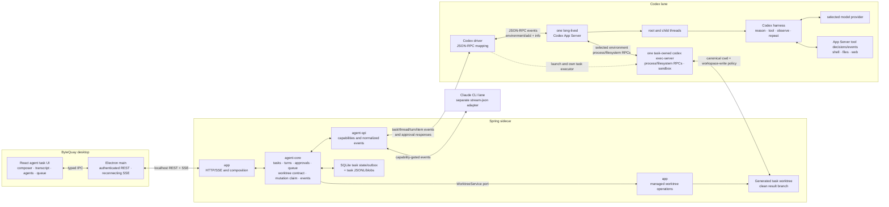

# Agent Task UI Design

This document defines the approved rich, worktree-scoped agent task surface that
ByteQuay will build over the existing agent service. It defines the product
interaction, frontend projection, Electron transport, and the additional
service capabilities required by that UI. Provider lifecycle and storage
contracts remain in [Agent Service Design](agent-service.md); Maven and process
boundaries remain in [ByteQuay Architecture](architecture.md).

The surface recreates the useful interaction model of a Codex task with
ByteQuay-owned React components. Codex App Server supplies the agent loop,
thread history, approvals, and typed events; it is not a frontend component
library. Claude remains a separate provider adapter behind the same
capability-driven ByteQuay contract.

This is technically feasible, but it has an explicit product risk: the
[official Codex App Server documentation](https://learn.chatgpt.com/docs/app-server)
currently marks the `app-server` command as experimental and unsupported for
production workloads. ByteQuay accepted that dependency and the stock
exec-server's same-host trust boundary for the planned first release on
2026-08-31. Shipping still requires the fixed reference-schema fixture and
compatibility tests. That fixture does not gate the user-managed production CLI: Codex's
startup self-update remains enabled and no reported version text, including
unparseable output, makes the lane unavailable. ByteQuay uses documented stdio
and does not adopt the experimental WebSocket transport.

The approved first-release visual and state reference is the
[Agent Task UI prototype](Agent%20Task%20UI.html), accepted in commit
`84af81c73cea7ae2cf7a53681827f550c598b706` on 2026-08-31. Its 13 static
fixture states define the intended layout, hierarchy, and principal
interactions. This document remains authoritative for behavior, capability
gates, persistence, security, and acceptance criteria. The prototype is not
production code and does not claim backend or provider integration.

## 1. Decision summary

This section describes the approved target shape. CP0 selected a separate
ByteQuay-managed worktree per task and accepted the experimental App Server and
unauthenticated same-host executor boundaries on 2026-08-31. Those decisions do
not weaken the remaining compatibility, isolation, and release gates.

- Workspace **Tasks** gains a separate agent-task list and detail screen. The
  existing cherry-pick task model and UI remain separate; there is no generic
  task hierarchy joining unrelated workflows.
- One ByteQuay agent task durably owns one workspace, one immutable provider
  lane, and one separately provisioned generated branch/worktree through the
  shared [Managed Worktree Service](worktree-service.md). It contains multiple
  turns in one resumable provider conversation.
- ByteQuay runs one long-lived Codex App Server process and multiplexes root
  and child Codex threads by thread ID. It does not start one App Server per
  task.
- ByteQuay launches one official `codex exec-server` per Codex task and selects
  it through App Server's experimental `environment/add` and per-thread
  `environments` fields. App Server still chooses and sequences tools; the
  task-owned executor performs their process/filesystem work in the generated
  task worktree.
- The spike-selected v0.151.0 exec-server listens on an ephemeral loopback port but is
  unauthenticated and accepts multiple local clients. That avoids off-host
  exposure, not a hostile same-host process; the first release records this as
  a conscious trust boundary rather than calling the random port a credential.
- This is separate from App Server's experimental `--code-mode-host`, which
  selects one Code Mode runtime for the whole App Server process. The first
  release leaves that process-wide option unset.
- The Spring sidecar owns task state, replayable events, approvals, queued
  inputs, and attachments. The renderer is a projection of that state, not an
  owner of provider execution.
- Electron main owns the authenticated REST and SSE connection. Provider
  credentials, backend session secrets, arbitrary filesystem paths, and raw
  provider messages never enter the renderer.
- The UI renders only capabilities advertised by the selected lane. Missing
  Claude or Codex features remain visibly unavailable instead of being
  synthesized.
- The first integration uses App Server's built-in tool loop inside the
  selected task environment and renders its typed calls, progress, and results.
  ByteQuay does not register custom business tools, hooks, or product workflows
  in this phase.
- Inherited Codex MCP servers, apps/plugins, dynamic tools, and lifecycle hooks
  are disabled for the first release. Only App Server built-ins plus the
  task-selected exec-server/sandbox are enabled; an active inherited
  capability makes the lane unavailable instead of silently widening the task
  boundary.

## 2. Product requirements

### 2.1 Task and conversation

- Create, list, open, resume, cancel, complete, and retain an agent task.
- Send multiple turns to the same root provider conversation.
- Rebuild the transcript from persisted events after navigation, renderer
  reload, SSE reconnect, or backend restart.
- Allow multiple ByteQuay tasks to run through the one Codex App Server while
  preserving task, root-thread, child-thread, turn, and item identity.
- Display task and turn state, selected provider/model, elapsed time, token
  usage when available, and terminal errors.
- After completion, display the retained generated branch name and HEAD as the
  local result without exposing the backend worktree path.

### 2.2 Composer

The composer provides:

- text input;
- local image attachments when the selected model and provider advertise
  image input;
- provider selection when creating the task, then model and reasoning-effort
  selection for each turn;
- a permission selector, initially including **Auto**;
- **Send** while the task is idle;
- **Steer** and **Run next** while a turn is active; and
- cancellation of the active turn.

The provider lane is immutable after task creation. The task stores default
model, effort, and permission choices; every accepted turn snapshots the
settings actually used. Changing a supported model or effort in the composer
changes the next turn default without creating a different task.

An accepted **Send** or **Steer** input becomes a user-message event, including
its attachment references, before ByteQuay delivers it to the provider. A
queued input appears in the queue rather than twice in the transcript; when it
is first claimed, ByteQuay appends exactly one user-message event before
starting its turn. A safe explicit resume after a known pre-send failure reuses
that message identity and adds a new delivery-attempt event instead of
duplicating the user's text.

For Codex, **Auto** maps to App Server's generated on-request approval value
(`approvalPolicy: "on-request"` in the v0.151 reference schema) plus a
workspace-write sandbox rooted at the generated task worktree. `thread/start` receives
the legacy `sandbox: "workspace-write"` field; `turn/start` receives the
structured `sandboxPolicy` for the effective turn. A subagent inherits the
active parent turn's effective sandbox and approval choices. The task executor
applies that App Server policy consistently to root and child execution;
ByteQuay does not introduce a parallel permission path in this phase.

### 2.3 Transcript and live activity

The transcript displays:

- user messages and their attachments;
- partial and completed assistant messages;
- provider-supported readable reasoning summaries, never hidden
  chain-of-thought;
- structured checklist steps and `pending`, `inProgress`, or `completed`
  state, plus separate free-form Plan-mode text when emitted;
- commands, incremental output, file changes, App Server built-in tools, web
  searches, image views, and terminal results;
- pending and resolved approval cards;
- context compaction, retries, errors, cancellation, and turn completion;
- optional item and turn duration, token usage, status icons, and a live
  elapsed clock.

Contiguous low-level activity is grouped into one expandable block. While any
member is running, the group stays visibly active. After the group finishes,
the renderer derives a compact sentence such as “Read files, ran 2 commands,
and edited 3 files” from the typed items. App Server does not supply that
presentation sentence. The completed item is authoritative when its payload
differs from accumulated deltas.

### 2.4 Approvals

An approval card identifies the source task, child agent when applicable,
turn, item, request kind, reason, and product-permitted available decisions.
Command cards show the command and working directory; network and filesystem
cards show the requested destination or scope rather than pretending every
request is a shell command.

The card renders only the product-permitted subset of decisions offered for
that request kind. Command/file requests may offer one-time or session-scoped
choices; permission requests show the grantable subset. The renderer sends a
tagged response, not a generic boolean. When a command request omits its
optional `availableDecisions`, the driver supplies the legal command defaults
defined by its protocol mapping and then intersects them with ByteQuay's
immutable safety ceiling; file and permission requests use the same ceiling.
The first release never permits a decision that persists an exec-policy allow
rule. If the intersection is empty, the request fails closed instead of
producing an actionable card. Unsupported tool-input or elicitation requests
also fail closed.

The backend persists pending and resolved state before publishing it. A
renderer disconnect does not approve anything, and timeout or terminal turn
cleanup resolves an unanswered request as denied. Replaying a task must never
resurrect a resolved approval as pending.

### 2.5 Subagents

- Render one card in the parent transcript when Codex or Claude delegates
  work.
- Show read-only **Active** and **Done** lists with agent label, prompt or
  purpose when available, status, elapsed time, and result summary.
- Open an agent to inspect its messages, plans, tools, logs, approvals, and
  terminal result while it is running or after it finishes within the task's
  configured runtime-retention window.
- Preserve direct parent/child identity at any nesting depth.
- Keep all root and child activity in the owning ByteQuay task's single
  monotonic event sequence so replay and SSE need no second transport.

A root `turn/completed` event may render its answer while descendants are still
active, but it does not release the task's worktree-mutation claim. Send, queue start,
and Complete stay disabled until every known descendant is terminal and
the driver recursively reads root/child history to a stable fixed point with no
new descendants. The same barrier requires every observed command, tool,
file-change, synchronous hook, terminal interaction, and background/yielded
execution to have a terminal lifecycle. The driver also pages App Server's
thread-scoped background-terminal list to empty for the root and every child.
An unfinished low-level item remains visibly active even if the root answer has
arrived. A missed notification, history-read error, newly discovered
grandchild, unterminated item/process, or provider version that cannot prove
this closure keeps the task recovering. Task close
unsubscribes the root and every known subscribed child only after that barrier.

For Codex, collaboration items provide the child relationship as the child is
created, but not the child's final result. ByteQuay records that relationship
immediately, begins routing the known child's live activity, and derives its
result summary from the child's terminal history. On recovery, `thread/read`
backfills each known child in provider order; the driver normalizes and
deduplicates by provider thread/item identity before append. A visible
backfill lifecycle marker distinguishes recovered history from new live
activity. Experimental parent/ancestor list filters are an optimization, not
the only way ByteQuay can rediscover its children.

### 2.6 Queue and steering

Steering appends input to the active turn and does not create a new ByteQuay
turn. It is enabled only when the driver advertises steering and the active
provider turn still matches the requested turn ID.

**Run next** creates a durable FIFO queued input containing text, attachment
references, and the settings selected for that input. The backend starts the
head automatically only after the root/descendant execution tree completes
successfully, passes quiescence, and the task returns to `READY`. After failure,
cancellation, interruption, or an
approval/authentication problem, queued inputs remain visible but paused until
the user explicitly resumes execution. The first release supports adding and
removing queued inputs, not reordering, priorities, or schedules.

After backend loss and provider quiescence, an untouched queued input remains
safely resumable. An
input already being delivered becomes **Delivery uncertain** and is never
resent automatically because App Server has no client input-idempotency key;
the user may discard it or explicitly send a new message after inspecting the
thread.

ByteQuay owns this queue and does not depend on any App Server queue API; no
queue method is part of the documented stable protocol. Queue submission
itself is the direct user action authorizing that later turn.

### 2.7 Deferred ByteQuay tools and workflows

The first integration does not register ByteQuay-specific model-facing business
tools, lifecycle hooks, post-turn Git actions, or other product workflows. It runs
the selected provider's built-in agent loop and persists and renders the
resulting typed tool-call events. Adding product-specific tools requires a
separate design after the App Server integration works end to end. Claude's
task-scoped permission callback remains an approval transport adapter, not a
product tool.

### 2.8 Screen shape and navigation

The existing Tasks screen keeps cherry-pick executions and adds a separate
**Agent tasks** section. It does not broaden `CherryPickExecution` into a
generic task DTO. A **New agent task** action asks for title, provider, model,
effort, and permission mode; the workspace is already fixed by the route. The
HTTP request contains `workspaceId`, not a worktree path. `app` resolves and
validates that workspace's managed repository and exact starting commit, then
the shared service provisions a separate generated task worktree before
`agent-core` reports the task ready.

The dialog checks the same typed provider readiness returned by Workspace
Settings before enabling **Create**. Authentication-required, missing,
unsupported, and unavailable lanes are disabled with an actionable link to
**Workspace Settings → Agent providers**. No task row, runtime directory, or
worktree is created until a fresh backend readiness check succeeds; the
backend repeats this gate so stale UI status cannot race task creation.
For Codex, `unsupported` means an actual required protocol or capability failed,
with the detected CLI version shown for diagnosis; no reported version text, including
unparseable output, creates that state by itself.

```text
#/workspaces/{workspaceId}/tasks
#/workspaces/{workspaceId}/tasks/agent/{taskId}
```

The route parser adds an optional `agentTaskId` to the existing workspace
location rather than storing navigation only in component state. Deep-link,
reload, back, and forward all reconstruct the selected task, and the backend
rejects a task whose durable `workspaceId` does not match the route. Existing
cherry-pick rows keep their current Commits navigation.

The detail screen keeps the composer anchored while the transcript scrolls:

```text
┌ Back · task title     Complete    lane · model · status · elapsed ┐
├───────────────────────────────────────────────────────────────────┤
│ user message + image previews                                     │
│ assistant text                                                    │
│ plan card: pending / in progress / completed                      │
│ ▸ folded activity summary (commands · files · web · tools)        │
│ approval card: request details          permitted decisions      │
│ subagents card: Active (2) · Done (3)          Open agent         │
│ final answer + usage/timing                                       │
├───────────────────────────────────────────────────────────────────┤
│ queued next turns (only when present)                              │
│ image chips · message input                                       │
│ model · effort · Auto                     Cancel · Steer/Run next │
└───────────────────────────────────────────────────────────────────┘
```

Opening a subagent filters the same task transcript and shows a breadcrumb
back to the root; it does not create another task route or SSE connection.
Active and finished agents use the same panel so completed work remains
inspectable during runtime retention. After cleanup, durable task/child
summaries remain visible, but opening removed activity shows **Activity
expired** with the deletion date instead of reconstructing provider history or
inventing events. Icons and exact spacing follow ByteQuay's existing
React/plain-CSS system rather than copying Codex Desktop source or assets.

After backend/provider loss, a **Recovering agent execution** card replaces
mutation controls while ByteQuay terminates or reconciles the owned execution
tree. It names any still-active child and offers **Stop and recover**; Retry is
enabled only after the barrier passes. The card also names active execution
items/background terminals or an unverifiable process receipt. The UI never
releases the task's worktree-mutation claim
merely because the root is marked interrupted. If provider-process ownership
or exit cannot be proven, the task remains blocked and its worktree stays
untouched, with an actionable diagnostic. A last-resort **Stop shared Codex server** action
requires confirmation and lists every other Codex task it will interrupt.

**Complete** is enabled only while the task is idle and no live queued input is
`QUEUED`, `PAUSED`, or `STARTING`. If an
`UNCERTAIN` delivery remains, confirmation explains that completion records it
as abandoned and never retries it. Complete closes the provider session,
retains the transcript for the configured period, and releases the exclusive
worktree-mutation claim. It records Git facts, removes a verified clean worktree, and
retains its generated branch as the local result. If the worktree is dirty or a
Git operation remains open, Complete shows an actionable conflict rather than
discarding files. The completed screen shows the retained branch and HEAD; it
does not merge or push them automatically. The detail screen must not leave a READY task permanently
holding that worktree without a visible close action.

## 3. System shape



App Server owns the Codex agent loop, provider requests, built-in tool
decisions, approvals, and root/child thread execution. ByteQuay owns the
selected local worktree, task-exec-server lifecycle and requested policy,
product task, durable projection, cross-provider event contract, UI, queue,
metrics, and attachment boundary. The matching official exec-server implements
Codex process/filesystem semantics; ByteQuay does not fork that protocol merely
to draw the UI.

## 4. Frontend state and rendering

One React reducer owns the open screen state; no new state library is needed.

| Projection | Derived from |
| --- | --- |
| Transcript blocks | Message, plan, activity, approval, and lifecycle events ordered by task sequence |
| Active turn | Durable turn response plus turn lifecycle events |
| Activity groups | Contiguous typed items and their start/completion state |
| Current plan | Latest structured plan update for the selected agent thread |
| Pending approvals | Approval requests minus matching resolution events |
| Agent tree | Child relationship and lifecycle events keyed by agent thread ID |
| Queue | Durable queue responses and queue-change events |
| Metrics | Turn/task timestamps, usage events, and a renderer-local live clock |
| Connection state | SSE open, reconnecting, or failed state plus last received sequence |

Opening a child agent changes the transcript filter to its agent thread ID; it
does not create another backend event stream. The task-level sequence remains
the ordering and reconnect cursor for every root and child event.

Icons, labels, folded activity prose, and live elapsed time are presentation
logic. Provider facts such as status, command, file path, tool name, duration,
and usage remain backend data. UI summaries must never be parsed later to
recover state.

## 5. Electron and HTTP boundary

Electron main exposes typed preload methods for task reads and mutations and a
subscribe/unsubscribe callback for event envelopes. It attaches the private
backend session credential and maintains the SSE reader. The renderer cannot
construct backend URLs or authentication headers.

The existing service endpoints remain, with these additions:

```text
PATCH  /agent/tasks/{taskId}/defaults
POST   /agent/turns/{turnId}/steer
POST   /agent/tasks/{taskId}/queue
GET    /agent/tasks/{taskId}/queue
DELETE /agent/tasks/{taskId}/queue/{queuedInputId}
POST   /agent/tasks/{taskId}/queue/resume
POST   /agent/tasks/{taskId}/attachments
GET    /agent/tasks/{taskId}/attachments/{attachmentId}
POST   /agent/tasks/{taskId}/fail-recovery
```

Task creation accepts a workspace ID, title, lane, and defaults; it never
accepts a renderer-selected worktree path. Turn/queue requests accept explicit
supported model, effort, and permission settings plus the observed task
version, so enqueue cannot race Complete. Attachment upload receives bytes
selected by Electron main, validates media type and size, writes an
owner-only task blob, and returns an opaque attachment reference. It never
accepts an arbitrary renderer-chosen local path.

The model selector reuses the existing `GET /api/settings/models` catalog and
workspace defaults. Its existing model DTO is extended with input modalities
so the image button is gated by the selected model, not only by provider. It
does not add another model-registry endpoint. Selector changes save the task's
next-turn defaults with an expected task version; every send/queue request also
carries its effective snapshot so a concurrent default change is unambiguous.

For Codex, a validated local upload is passed as `localImage {path}` using its
task-owned blob path. The URL-based `image` input is not part of the first
release.

The SSE reader reconnects with the last processed task sequence. Event append
remains persist-before-publish, so a dropped connection cannot create a gap or
interrupt provider execution.

## 6. Service contract additions

The agent service design adds only fields needed to preserve observable task
state:

- provider thread ID and optional direct parent provider thread ID on
  thread-scoped events;
- provider turn and item IDs on turn/item lifecycle and delta events;
- owning workspace ID on every task and an explicit persisted user-message
  event for each accepted send/steer or first queued claim, with later delivery
  attempts linked rather than duplicating text;
- immutable task-worktree ownership facts;
- task-local worktree-mutation claim, held while provider-process recovery is
  unresolved;
- task exec-server environment/launch identity plus directly owned
  provider process recovery state;
- task defaults and per-turn snapshots for model, effort, and permission;
- image attachment references and advertised media types;
- typed approval request and resolution details;
- subagent relationship, status, and result events;
- durable start/steer delivery state, including `UNKNOWN` without automatic
  resend;
- globally unique event IDs plus state/event outbox recovery;
- queue records and queue lifecycle events.

Provider-specific fields remain inside each driver unless they are required by
the cross-provider UI. Raw App Server or Claude JSON does not cross the SPI.

## 7. Implementation slices

Each slice first updates its exact contract and acceptance tests, then lands
end to end. A backend-only or renderer-only half-slice is not considered
complete.

1. **Protocol fidelity** — regenerate the fixed reference App Server bindings
   while keeping production decoding tolerant of additive changes; define the
   canonical event/input-delivery/approval schemas; preserve item IDs, image
   inputs, and child relationships; reject incompatible required protocol
   changes with the detected running version.
2. **Transport and replay** — add the SQLite/event-outbox unit of work, typed
   provider-process recovery, Electron REST/SSE IPC, React reducer, and task
   routes; prove crash-boundary idempotence, deep-link, reload, and reconnect
   during a live turn.
3. **Usable Codex task** — gate creation on typed provider readiness before
   task/worktree provisioning; link unavailable lanes to Workspace Settings; add
   per-task exec-server launch/`environment/add`/`environment/info`, disabled
   inherited capabilities, sandbox probes, and the task-local
   worktree-mutation claim;
   then create/open/complete a task, select
   model/effort/Auto, send text, resolve approvals, view live logs and final
   output, cancel, and send a second turn to the same thread.
4. **Rich transcript** — add plans, readable reasoning summaries, folded
   activity, timings, usage, icons, and safe image upload/display.
5. **Subagents** — preserve child thread identity, render Active/Done, and open
   live or completed child transcripts.
6. **Steer and queue** — add capability-gated Codex steering and the durable
   provider-neutral FIFO queue.
7. **Claude parity** — harden mid-run authentication recovery and add
   capability-correct Claude rendering.

## 8. Acceptance criteria

- Two Codex tasks can run through one App Server with distinct selected
  exec-server environments and without event, approval, process, or filesystem
  cross-talk.
- New/open/complete task routes survive deep-link, reload, back, and forward;
  completion removes the verified clean worktree while preserving its generated
  result branch, and task creation never trusts a renderer-supplied path.
- An unavailable or authentication-required provider cannot create a task,
  runtime directory, or worktree; the New task dialog links to the same actionable
  Workspace Settings state, and a successful readiness refresh enables Create.
- Renderer reload and SSE reconnect preserve a live run and neither lose nor
  duplicate completed items. After backend restart, the same transcript is
  restored, the lost active turn is visibly `INTERRUPTED`/`RECOVERING`, and
  retry stays disabled until the entire owned process tree is verified stopped;
  root-process exit alone is insufficient.
- The chosen model, effort, and permission are the settings actually used and
  recorded for each turn.
- Unsupported image input is disabled; supported images are task-owned,
  bounded, previewed, and delivered without exposing arbitrary local paths.
- Approval cards survive reconnect, identify their root or child source, and
  disappear durably after resolution or denial.
- Plans and activity update live, completed items replace deltas, and folded
  summaries are reproducible from typed events.
- Active and completed subagents remain inspectable, including child logs and
  terminal results, throughout runtime retention. After cleanup, their durable
  summaries remain and removed transcripts display **Activity expired**.
- Root completion while a descendant, command, tool, hook, terminal, or
  background/yielded execution is active keeps the task claim and mutation
  controls disabled; missed-live-child and nested-grandchild history is
  recovered recursively to a stable terminal fixed point, and every root/child
  background-terminal page is empty before the next turn or Complete
  is enabled. Compatibility fixtures verify that yielded/background commands
  are listed and cleanable. A delayed writer that escapes App Server's item and
  background-terminal registries fails the compatibility release gate; the
  design does not manufacture an OS receipt that App Server never exposed.
- Steering targets only the expected active turn. Queued inputs run once in
  FIFO order after success and pause after non-success terminal states.
  Unknown steer/queue delivery is visible and never resent automatically;
  discarding or completing an uncertain queue row visibly marks it abandoned,
  while consumed rows never block Complete. Concurrent enqueue and Complete
  cannot leave live queued work on a closed task.
- Every worktree operation revalidates the task's immutable repository, path,
  branch, and commit facts. A half-finished or mismatched orphan is preserved
  and reported rather than adopted or deleted; ByteQuay does not run automatic
  worktree reconciliation at startup.
- The Claude lane hides unsupported controls while retaining shared messages,
  tools, approvals, metrics, and nested activity that its current CLI exposes.
- Codex task startup verifies that inherited MCP servers, apps/plugins,
  dynamic tools, and lifecycle hooks are absent or disabled. A capability that
  cannot be disabled makes the lane unavailable; ByteQuay-specific tool
  registration is not part of this release.
- No event or persisted blob contains provider credentials, backend session
  secrets, arbitrary hidden reasoning, or unbounded command/tool output.
- Shipping explicitly accepts App Server/environment API experimental maturity
  and the unauthenticated same-host exec-server boundary, maintains reference
  bindings with experimental definitions enabled, and passes the compatibility
  suite. Production still uses the latest user-managed Codex CLI; a real
  incompatibility fails the affected operation with the detected version and an
  actionable issue-report diagnostic.

## 9. First-release non-goals

- Pixel-for-pixel reuse of Codex Desktop source or assets.
- A generic workflow abstraction combining agent, cherry-pick, CI, and rebase
  state machines. Their shared managed-worktree service is an approved narrow
  filesystem-operations boundary, not a generic task model.
- Queue reordering, priorities, schedules, or cross-task dependencies.
- Direct UI controls to steer or stop an individual subagent; users may ask
  the root agent to coordinate its children.
- Free-form tool user-input and MCP elicitation cards; unsupported requests
  fail closed until a separate typed interaction design exists.
- ByteQuay-specific model-callable business tools, lifecycle hooks, post-turn
  Git actions, or other product workflows; each requires a separate later
  design.
- Dependence on experimental App Server dynamic tools or any undocumented
  queue API.
- Raw chain-of-thought, raw provider protocol inspection, or a second event
  store in the renderer.
