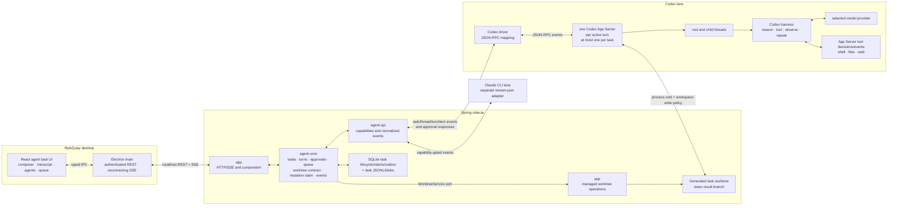

# Agent Task UI Design

This document defines the implemented rich, worktree-scoped agent task surface
over the existing agent service. It defines the product interaction, frontend
projection, Electron transport, and service capabilities used by that UI.
Provider lifecycle and storage contracts remain in
[Agent Service Design](agent-service.md); Maven and process boundaries remain
in [ByteQuay Architecture](architecture.md).

The surface recreates the useful interaction model of a Codex task with
ByteQuay-owned React components. Codex App Server supplies the agent loop,
thread history, approvals, and typed events; it is not a frontend component
library. Claude remains a separate provider adapter behind the same
capability-driven ByteQuay contract.

The implemented surface carries an explicit product risk: the
[official Codex App Server documentation](https://learn.chatgpt.com/docs/app-server)
currently marks the `app-server` command as experimental and unsupported for
production workloads. ByteQuay accepted that dependency for the first
release on 2026-08-31 and reconfirmed it when CP11 passed on 2026-09-04. The
fixed reference-schema fixture and compatibility tests do
not gate the user-managed production CLI. ByteQuay updates an installed Codex
CLI only when its parsed version is below the supported minimum; newer or
unparseable version text is left alone and never makes the lane unavailable.
ByteQuay uses documented stdio and does not adopt the experimental WebSocket
transport.

Two HTML design files accompany this document as the presentation references
for reviewing or changing how the implemented screens look and respond:

- [Agent Task UI.html](Agent%20Task%20UI.html) is the user-facing
  prototype: the accepted visual reference (commit
  `84af81c73cea7ae2cf7a53681827f550c598b706`) whose 13 static fixture states
  show the intended layout, hierarchy, and principal interactions as a user
  would see them.
- [Agent Task UI - full design.html](Agent%20Task%20UI%20-%20full%20design.html)
  is the full clickable design for development: every screen (task list,
  idle, running, approval, completed, subagents, queue and steer, image
  message, recovery, connecting, empty, expired, and the tab overview) with
  the exact markup, spacing, colours, states, and fixture data an
  implementation must reproduce. Anyone implementing or changing the agent
  task UI refers to this file first and treats it as authoritative for
  presentation.

Where the HTML and this document disagree about appearance or interaction,
the HTML wins; this document remains authoritative for behavior, capability
gates, persistence, security, and acceptance criteria. Neither file is
production code and neither claims backend or provider integration.

## 1. Decision summary

This section describes the implemented shape. CP0 selected a separate
ByteQuay-managed worktree per task and accepted experimental App Server on
2026-08-31. The earlier unauthenticated loopback executor boundary was removed:
each active Codex turn now runs in a task-owned App Server, verified stopped at
turn completion, and opens no ByteQuay listener.
The remaining same-host risk is ordinary same-user filesystem and provider
account-profile trust. These facts do not weaken the compatibility and
isolation requirements retained after release.

- Workspace **Tasks** gains a separate agent-task list and detail screen. The
  existing cherry-pick task model and UI remain separate; there is no generic
  task hierarchy joining unrelated workflows.
- One ByteQuay agent task durably owns one workspace, one immutable provider
  lane, and one separately provisioned generated branch/worktree through the
  shared [Managed Worktree Service](worktree-service.md). It contains multiple
  turns in one resumable provider conversation.
- ByteQuay runs one task-owned, worktree-capable Codex App Server per active
  turn, with the task worktree as its working directory. It verifies that
  process tree stopped at turn completion; the next turn resumes the same
  provider thread in a new matching-profile process. The only concurrent
  process allowed for that task is its bounded title helper, confined to empty
  read-only task-owned scratch with tools and network disabled. Root and child
  threads inside a process all belong to that task, so IDs are never routed
  between tasks.
- No execution environment is registered. App Server's default environment is
  rooted at its own working directory, so `workspace-write` confines a turn to
  the task worktree. Task sessions declare `experimentalApi: true` solely for
  background-terminal inventory and termination; no loopback listener is
  opened, so the first release carries no same-host trust boundary of
  ByteQuay's own making.
- This is separate from App Server's experimental `--code-mode-host`, which
  selects one Code Mode runtime for the whole App Server process. The first
  release leaves that process-wide option unset.
- The Spring sidecar owns task lifecycle, turn/claim facts, replayable events,
  approvals, queued inputs, and attachments. The renderer derives runtime
  status from those facts; it does not own provider execution.
- Electron main owns the authenticated REST and SSE connection. Provider
  credentials, backend session secrets, arbitrary filesystem paths, and raw
  provider messages never enter the renderer.
- The UI renders only capabilities advertised by the selected lane. Missing
  Claude or Codex features remain visibly unavailable instead of being
  synthesized.
- The first integration uses App Server's built-in tool loop inside the
  task-owned process and worktree and renders its typed calls, progress, and
  results.
  ByteQuay does not register custom business tools, hooks, or product workflows
  in this phase.
- Inherited Codex MCP servers, apps/plugins, dynamic tools, and lifecycle hooks
  are disabled for the first release. Only App Server built-ins plus the
  process-default sandbox are enabled; an active inherited
  capability makes the lane unavailable instead of silently widening the task
  boundary.

## 2. Product requirements

### 2.1 Task and conversation

- Create, list, open, resume, cancel, complete, and retain an agent task.
- Create a task from its first message alone, generate a short task name from
  that message in the background, and let the user rename it at any time.
- Send multiple turns to the same root provider conversation.
- Rebuild the transcript from persisted events after navigation, renderer
  reload, SSE reconnect, or backend restart.
- Allow multiple ByteQuay tasks to run turns concurrently through separate
  task-owned Codex App Server processes while preserving task, root-thread,
  child-thread, turn, and item identity; never run more than one process for a
  task.
- Display task lifecycle, derived runtime status, turn state, selected
  provider/model, elapsed time, token usage when available, and terminal
  errors.
- After completion, display the retained generated branch name and HEAD as the
  local result without exposing the backend worktree path.

### 2.2 Composer

The composer provides:

- text input;
- local image attachments when the selected model and provider advertise
  image input;
- provider selection when creating the task, then model and reasoning-effort
  selection for each turn;
- a truthful **Auto** permission fact for the first release; it is not styled
  or labeled as a menu until more than one interactive policy is supported;
- **Send** while the task is idle;
- **Steer** and **Run next** while a turn is active; and
- cancellation of the active turn.

The provider lane is immutable after task creation. The task stores default
model, effort, and permission choices; every accepted turn snapshots the
settings actually used. Changing a supported model or effort in the composer
changes the next turn default without creating a different task.

An accepted **Send** or **Steer** input becomes a user-message event, including
its attachment references, before ByteQuay delivers it to the provider. A
queued input appears in the queue rather than twice in the transcript; when it
is first claimed, ByteQuay appends exactly one user-message event before
starting its turn. A safe explicit resume after a known pre-send failure reuses
that message identity and adds a new delivery-attempt event instead of
duplicating the user's text.

For Codex, **Auto** maps to App Server's generated on-request approval value
(`approvalPolicy: "on-request"` in the v0.151 reference schema) plus a
workspace-write sandbox rooted at the generated task worktree. `thread/start` receives
the legacy `sandbox: "workspace-write"` field; `turn/start` receives the
structured `sandboxPolicy` for the effective turn. A subagent inherits the
active parent turn's effective sandbox and approval choices. The task-owned App
Server applies that policy consistently to root and child execution;
ByteQuay does not introduce a parallel permission path in this phase.

The renderer receives one normalized capability object for the selected lane,
not provider-name conditionals. It includes structured plans, tool and
incremental activity, hooks, subagents, approvals, usage, steering, supported
interactive permission policies, and attachment media types. Image attachment
controls require both a provider-supported image media type and the selected
model's image input modality. A missing capability is false; Claude therefore
does not acquire a synthetic checklist, image input, or steering control.

### 2.3 Transcript and live activity

The transcript displays:

- user messages and their attachments;
- partial and completed assistant messages;
- provider-supported readable reasoning summaries, never hidden
  chain-of-thought;
- structured checklist steps and `pending`, `inProgress`, or `completed`
  state, plus separate free-form Plan-mode text when emitted;
- commands, incremental output, file changes, App Server built-in tools, web
  searches, image views, and terminal results;
- pending and resolved approval cards;
- context compaction, retries, errors, cancellation, and turn completion;
- optional item and turn duration, token usage, status icons, and a live
  elapsed clock.

Contiguous low-level activity is grouped into one expandable block. While any
member is running, the group stays visibly active. After the group finishes,
the renderer derives a compact sentence such as “Read files, ran 2 commands,
and edited 3 files” from the typed items. App Server does not supply that
presentation sentence. The completed item is authoritative when its payload
differs from accumulated deltas.

### 2.4 Approvals

An approval card identifies the source task, child agent when applicable,
turn, item, request kind, reason, and product-permitted available decisions.
Command cards show the command and working directory; network and filesystem
cards show the requested destination or scope rather than pretending every
request is a shell command.

The card renders only the product-permitted subset of decisions offered for
that request kind. Command requests offer Allow once, Allow for this task and
Deny; file requests offer Allow once and Deny; permission requests show the
grantable subset. Allow for this task answers, without a card, every later
command in the same task with the same first three words, none of them an
option (`gh issue list`); a command with fewer such words (`git status`,
`sed -n 1,220p`) or a compound script is covered only when the identical
command line comes back, because a shorter prefix (`gh api`) would also cover
commands that do something else. Every command an allow answers is still
recorded and shown as approved for the task. The allow reaches the provider
as a plain one-time accept and is remembered by ByteQuay for the task, never
as a provider rule, and it does not outlive a restart of the app. The renderer
sends a tagged response, not a generic boolean.

A command that only reads GitHub needs no card at all: a `gh` list, view,
status, diff, checks or search (and `gh status`, or `gh auth status` without
token-display flags) is answered as the sandbox would have been and appears in
the log as any other command.
The same applies to a REST `gh api` request only when its method is provably GET
and it has no request fields, body, custom header or host, cache write, shell
expansion, or compound command. GraphQL and anything else that could write or
transmit local input or reveal credentials stays a card, as do every other
`gh` subcommand, explicit custom-host routing, `gh api --verbose`, and a
`--web` flag that opens the browser.
When a command request omits its
optional `availableDecisions`, the driver supplies the legal command defaults
defined by its protocol mapping and then intersects them with ByteQuay's
immutable safety ceiling; file and permission requests use the same ceiling.
The first release never permits a decision that persists an exec-policy allow
rule. If the intersection is empty, the request fails closed instead of
producing an actionable card. Unsupported tool-input or elicitation requests
also fail closed.

The backend persists pending and resolved state before publishing it. A
renderer disconnect does not approve anything, and timeout or terminal turn
cleanup resolves an unanswered request as denied. Replaying a task must never
resurrect a resolved approval as pending.

### 2.5 Subagents

- Render one card in the parent transcript only when the selected lane
  advertises nested-agent activity and supplies canonical direct parent/child
  thread identity. The current Claude stream does not meet that contract.
- Show read-only **Active** and **Done** lists with agent label, prompt or
  purpose when available, status, elapsed time, and result summary.
- Open an agent to inspect its messages, plans, tools, logs, approvals, and
  terminal result while it is running or after it finishes within the task's
  configured runtime-retention window.
- Preserve direct parent/child identity at any nesting depth.
- Keep all root and child activity in the owning ByteQuay task's single
  monotonic event sequence so replay and SSE need no second transport.

A root `turn/completed` event may render its answer while descendants are still
active, but it does not release the task's worktree-mutation claim. The driver
recursively pages `thread/items/list`, restricting root history to the current
provider turn, until no V1/V2 descendants appear and every observed
execution-capable item is terminal; terminal history also repairs a missed live
completion. It pages each thread's background-terminal list to empty. That item
history carries no descendant turn status, so this fixed point alone is not
quiescence. After it passes—or
after a history/item check fails—the per-turn App Server closes and its complete
owned process tree must be `VERIFIED_STOPPED`. Only a successful fixed point
plus verified stop yields a successful turn. A failed check yields a failed
turn whose claim may release only after verified stop; an unverifiable stop
keeps Send, queue start, and Complete disabled and projects recovery required.

A V1 subagent may use the nickname App Server supplies through
`thread/started` as its display label. V2 instead uses the canonical
`agentPath` as its stable label and logical path; nickname metadata never
replaces or overwrites it. A purpose is shown only when the provider supplies
the prompt it was spawned with. codex-cli 0.152.1 may announce a child through
`thread/started` with its parent and nickname but expose no spawn prompt on the
collaboration item or as the child's own first message, so the purpose line is
simply absent there.

Every thread in a task's process belongs to that task, but a non-root thread is
assigned lineage only from explicit provider identity. A live `thread/started`
may bind lineage only when it carries `parentThreadId`; a missing parent
is never inferred to mean the root. Historical discovery follows only the
selected model's V1 `spawnAgent` or V2 `subAgentActivity` `started` shape. This
keeps a child's final answer from being read back as the task's own recorded
final response without inventing a relationship.

For V2, the root logical path is `/`; every activity path is absolute,
normalized, and stable for its thread, and every `started` child path is
strictly nested beneath its direct parent's path. A `thread/started` lineage
signal alone does not publish or route a V2 child before that canonical path
arrives. The selected V1 spawn or V2 started item provides the child
relationship as the child is created, but not the child's final result.
ByteQuay records that relationship once its required identity is complete,
begins routing the known child's live activity, and derives its result summary
from the child's terminal history. On recovery, paginated
`thread/items/list` backfills each known child in provider order and recursively
discovers children and grandchildren; the driver normalizes and deduplicates by
provider thread/turn/item identity before append. A visible backfill lifecycle
marker distinguishes recovered history from new live activity. The unsupported
`thread/read(includeTurns: true)` call and experimental parent/ancestor list
filters are not correctness dependencies.

The panel that lists subagents also carries a **Pull requests** tab. Because a
task's generated branch is derived from its ID, that tab needs no new record of
what a task opened: it lists the pull requests whose head branch is this task's
generated branch, and selecting one opens ByteQuay's existing pull-request
detail surface unchanged. The tab shows an empty state until the user pushes
that branch and opens a pull request; nothing in the first release pushes or
opens one on its own.

### 2.6 Queue and steering

Steering appends input to the active turn and does not create a new ByteQuay
turn. It is enabled only when the driver advertises steering and the active
provider turn still matches the requested turn ID.

**Run next** creates a durable FIFO queued input containing text, attachment
references, and the settings selected for that input. The backend starts the
head automatically only after the root/descendant execution tree completes
successfully, passes quiescence, and releases the `TURN` claim so the `OPEN`
task projects idle. After failure,
cancellation, interruption, or an
approval/authentication problem, queued inputs remain visible but paused until
the user explicitly resumes execution. The first release supports adding and
removing queued inputs, not reordering, priorities, or schedules.

After backend loss and provider quiescence, an untouched queued input remains
safely resumable. An
input already being delivered becomes **Delivery uncertain** and is never
resent automatically because App Server has no client input-idempotency key;
the user may discard it or explicitly send a new message after inspecting the
thread.

ByteQuay owns this queue and does not depend on any App Server queue API; no
queue method is part of the documented stable protocol. Queue submission
itself is the direct user action authorizing that later turn.

### 2.7 Deferred ByteQuay tools and workflows

The first integration does not register ByteQuay-specific model-facing business
tools, lifecycle hooks, post-turn Git actions, or other product workflows. It runs
the selected provider's built-in agent loop and persists and renders the
resulting typed tool-call events. Adding product-specific tools requires a
separate design after the App Server integration works end to end. Claude's
task-scoped permission callback remains an approval transport adapter, not a
product tool.

### 2.8 Screen shape and navigation

The existing Tasks screen keeps cherry-pick executions and adds a separate
**Agent tasks** section. It does not broaden `CherryPickExecution` into a
generic task DTO. There is no New-agent-task dialog and no title field: the
Tasks screen anchors a composer under that section with the provider, model,
and permission controls, and sending its first message is what creates the
task. The composer uses the concise `Let's ship...` prompt without repeating
the starting branch or a creation hint; the surrounding screen supplies that
context while the input keeps its accessible name.
The workspace is already fixed by the route, so the HTTP request carries
`workspaceId` and the message, never a title or a worktree path. `app`
resolves and validates that workspace's managed repository and exact starting
commit, then the shared service provisions a separate generated task worktree
before `agent-core` persists the task as `OPEN` and accepts that first message
as its first turn.

A task is therefore never named by hand at creation. `agent-core` immediately
stores a plain-text first-prompt fallback capped at 36 characters so no row or
header is ever blank. After the real first turn is durably accepted, a disposable
text-only provider session receives at most the first 2,000 prompt characters
and asks for one sentence-case title: at most 36 characters, preferably two to
five words, specific, identifier-safe, in the user's language, and without
Markdown or trailing punctuation. Change requests use a precise imperative
verb. The naming session uses the first turn's selected lane, model, and validated
effort, has no attachments or resumable history, and treats the prompt as
untrusted quoted data. Claude runs with tools disabled. Codex uses an ephemeral
thread with shell, code-mode, and subagents disabled in an empty read-only
scratch directory; approvals and network access are denied. The turn times out
after 30 seconds. Its unique scratch directory lives inside the durable task's
runtime resources: that subtree is deleted only after provider shutdown is
verified and otherwise stays task-owned for recovery and normal task cleanup.
It never enters the task transcript or task usage totals, while the supervised
provider process remains attributable to the durable task and first turn across
restart.

The generated name and its pending `TITLE_UPDATED` event are committed together
under the task's runtime lock, and overlapping create replays share one in-flight
naming request. The name replaces only a still-provisional fallback. A user
rename is final, so a late naming result or retry cannot overwrite a name the
user chose; failure or invalid output simply leaves the fallback. A task-level
`TITLE_UPDATED` lifecycle event makes an open screen re-read the authoritative
task projection. The name stays editable from the task header for the life of
the task. Provider task protocols do not supply this name to ByteQuay: App
Server stores a name only after a client sets one, while Claude's one-way
print stream does not expose its internal session title. ByteQuay therefore
owns the same fallback-plus-background-generation lifecycle itself.

The workspace Home is the design's idle screen: the question "What should the
agent do in {repo}?", three starting points that fill the composer, the same
composer, and the open tasks drawn as windows — each a scaled copy of its own
screen showing the task's first events, read once and bounded. A Tab Overview
lays every open task out as such a window over whichever agent screen is
showing; `⇧⌘\` or its pinned control opens it, Escape closes it, a window
opens its task, its ✕ completes an idle task after confirmation, and a dashed
card starts a new one. Nothing in a window is interactive but the window.

The composer checks the same typed provider readiness returned by Workspace
Settings before enabling its send control. Authentication-required, missing,
unsupported, and unavailable lanes are disabled with an actionable link to
**Workspace Settings → Agent providers**. No task row, runtime directory, or
worktree is created until a fresh backend readiness check succeeds; the
backend repeats this gate so stale UI status cannot race task creation.
For Codex, `unsupported` means an actual required protocol or capability failed,
with the detected CLI version shown for diagnosis; no reported version text, including
unparseable output, creates that state by itself.

```text
#/workspaces/{workspaceId}/tasks
#/workspaces/{workspaceId}/tasks/agent/{taskId}
```

The route parser adds an optional `agentTaskId` to the existing workspace
location rather than storing navigation only in component state. Deep-link,
reload, back, and forward all reconstruct the selected task, and the backend
rejects a task whose durable `workspaceId` does not match the route. Existing
cherry-pick rows keep their current Commits navigation.

The detail screen keeps the composer anchored while the transcript scrolls:

```text
┌ Back · task title     Complete    lane · model · status · elapsed ┐
├───────────────────────────────────────────────────────────────────┤
│ user message + image previews                                     │
│ assistant text                                                    │
│ plan card: pending / in progress / completed                      │
│ ▸ folded activity summary (commands · files · web · tools)        │
│ approval card: request details          permitted decisions      │
│ subagents card: Active (2) · Done (3)          Open agent         │
│ final answer + usage/timing                                       │
├───────────────────────────────────────────────────────────────────┤
│ queued next turns (only when present)                              │
│ image chips · message input                                       │
│ model · effort · Auto                     Cancel · Steer/Run next │
└───────────────────────────────────────────────────────────────────┘
```

Opening a subagent filters the same task transcript and shows a breadcrumb
back to the root; it does not create another task route or SSE connection.
Active and finished agents use the same panel so completed work remains
inspectable during runtime retention. After cleanup, durable task/child
summaries remain visible, but opening removed activity shows **Activity
expired** with the deletion date instead of reconstructing provider history or
inventing events. Icons and exact spacing follow ByteQuay's existing
React/plain-CSS system rather than copying Codex Desktop source or assets.

After backend/provider loss, a **Recovering agent execution** card replaces
mutation controls while ByteQuay terminates or reconciles the owned execution
tree. It names any still-active child and offers **Stop and recover**; Retry is
enabled only after the barrier passes. The card also names active execution
items/background terminals or an unverifiable process receipt. The UI never
releases the task's worktree-mutation claim
merely because the root is marked interrupted. If provider-process ownership
or exit cannot be proven, the task remains blocked and its worktree stays
untouched, with an actionable diagnostic. A last-resort **Stop this task's
provider runtime** action requires confirmation and affects no other task.

An unverifiable close retains the runtime's session/process identity, so a
later confirmed **Stop this task's provider runtime** action actively retries
termination and verification. Only `VERIFIED_STOPPED` releases the stale claim
and enables a new turn or paused queue retry; the old turn is never resent.

A quiescent failed turn with `failureKind: AUTHENTICATION_REQUIRED` instead
shows an authentication recovery card while leaving the task and worktree
intact. **Refresh login status** calls the shared typed readiness operation for
the task's immutable lane. Once it returns ready, **Retry last message** shows
the original durable text and attachment names, requires explicit resend
confirmation, and calls the existing typed turn-start operation with those
opaque attachment references and a fresh idempotency key. The action is absent
until quiescence, disabled for `UNKNOWN` delivery, and never silently reuses a
delivery row. Ordinary failed turns do not gain this auth-only shortcut.

**Complete** is enabled only while the task is idle and no live queued input is
`QUEUED`, `PAUSED`, or `STARTING`. If an
`UNCERTAIN` delivery remains, confirmation explains that completion records it
as abandoned and never retries it. Complete closes the provider session,
retains the transcript for the configured period, and releases the exclusive
worktree-mutation claim. It records Git facts, removes a verified clean worktree, and
retains its generated branch as the local result. If the worktree is dirty or a
Git operation remains open, Complete shows an actionable conflict rather than
discarding files. The completed screen shows the retained branch and HEAD; it
does not merge or push them automatically. The detail screen must not leave an
`OPEN` task permanently holding that worktree without a visible close action.

## 3. System shape



App Server owns the Codex agent loop, provider requests, built-in tool
decisions, approvals, and root/child thread execution. ByteQuay owns the
selected local worktree, the per-turn task-owned App Server lifecycle and requested policy,
product task, durable projection, cross-provider event contract, UI, queue,
metrics, and attachment boundary. App Server implements Codex
process/filesystem semantics; ByteQuay does not fork that protocol merely
to draw the UI.

## 4. Frontend state and rendering

One React reducer owns the open screen state; no new state library is needed.

| Projection | Derived from |
| --- | --- |
| Transcript blocks | Message, plan, activity, approval, and lifecycle events ordered by task sequence |
| Active turn | Durable turn response plus turn lifecycle events |
| Activity groups | Contiguous typed items and their start/completion state |
| Current plan | Latest structured plan update for the selected agent thread |
| Pending approvals | Approval requests minus matching resolution events |
| Agent tree | Child relationship and lifecycle events keyed by agent thread ID, plus the task summary's kept child index once the transcript is cleaned up |
| Queue | Durable queue responses and queue-change events |
| Metrics | Turn/task timestamps, usage events, and a renderer-local live clock |
| Connection state | SSE open, reconnecting, or failed state plus last received sequence |

Opening a child agent changes the transcript filter to its agent thread ID; it
does not create another backend event stream. The task-level sequence remains
the ordering and reconnect cursor for every root and child event.

Icons, labels, folded activity prose, and live elapsed time are presentation
logic. Provider facts such as status, command, file path, tool name, duration,
and usage remain backend data. UI summaries must never be parsed later to
recover state.

## 5. Electron and HTTP boundary

Electron main exposes typed preload methods for task reads and mutations and a
subscribe/unsubscribe callback for event envelopes. It attaches the private
backend session credential and maintains the SSE reader. The renderer cannot
construct backend URLs or authentication headers.

The existing service endpoints remain, with these additions:

```text
PATCH  /agent/tasks/{taskId}
PATCH  /agent/tasks/{taskId}/defaults
POST   /agent/turns/{turnId}/steer
POST   /agent/tasks/{taskId}/queue
GET    /agent/tasks/{taskId}/queue
DELETE /agent/tasks/{taskId}/queue/{queuedInputId}
POST   /agent/tasks/{taskId}/queue/resume
POST   /agent/tasks/{taskId}/attachments
GET    /agent/tasks/{taskId}/attachments/{attachmentId}
POST   /agent/tasks/{taskId}/mark-failed
```

Task creation accepts a workspace ID, lane, defaults, and the first message;
it accepts neither a title nor a renderer-selected worktree path.
`PATCH /agent/tasks/{taskId}` carries only a user-chosen name and the observed
task version, so a rename cannot race an agent-proposed name. Turn/queue
requests accept explicit supported model, effort, and permission settings plus
the observed task version, so enqueue cannot race Complete. Attachment upload
receives bytes selected by Electron main, validates media type and size,
writes an
owner-only task blob, and returns an opaque attachment reference. It never
accepts an arbitrary renderer-chosen local path.

The model selector reuses the existing `GET /api/settings/models` catalog and
workspace defaults. Its existing model DTO is extended with input modalities
so the image button is gated by the selected model, not only by provider. It
does not add another model-registry endpoint. Selector changes save the task's
next-turn defaults with an expected task version; every send/queue request also
carries its effective snapshot so a concurrent default change is unambiguous.

For Codex, a validated local upload is passed as `localImage {path}` using its
task-owned blob path. The URL-based `image` input is not part of the first
release.

The SSE reader reconnects with the last processed task sequence. Event append
remains persist-before-publish, so a dropped connection cannot create a gap or
interrupt provider execution.

## 6. Service contract additions

The agent service design adds only fields needed to preserve observable task
state:

- provider thread ID and optional direct parent provider thread ID on
  thread-scoped events;
- provider turn and item IDs on turn/item lifecycle and delta events;
- owning workspace ID on every task and an explicit persisted user-message
  event for each accepted send/steer or first queued claim, with later delivery
  attempts linked rather than duplicating text;
- immutable task-worktree ownership facts;
- task-local worktree-mutation claim, held while provider-process recovery is
  unresolved;
- per-turn App Server launch identity keyed by task plus directly owned
  provider process recovery state;
- task name plus whether it is provisional, agent-proposed, or user-chosen, so
  a rename is never overwritten;
- task defaults and per-turn snapshots for model, effort, and permission;
- image attachment references and advertised media types;
- typed approval request and resolution details;
- subagent relationship, status, and result events;
- durable start/steer delivery state, including `UNKNOWN` without automatic
  resend;
- globally unique event IDs plus state/event outbox recovery;
- queue records and queue lifecycle events.

Provider-specific fields remain inside each driver unless they are required by
the cross-provider UI. Raw App Server or Claude JSON does not cross the SPI.

## 7. Implementation slices

Each slice first updates its exact contract and acceptance tests, then lands
end to end. A backend-only or renderer-only half-slice is not considered
complete.

1. **Protocol fidelity** — regenerate the fixed reference App Server bindings
   while keeping production decoding tolerant of additive changes; define the
   canonical event/input-delivery/approval schemas; preserve item IDs, image
   inputs, and child relationships; reject incompatible required protocol
   changes with the detected running version.
2. **Transport and replay** — add the SQLite/event-outbox unit of work, typed
   provider-process recovery, Electron REST/SSE IPC, React reducer, and task
   routes; prove crash-boundary idempotence, deep-link, reload, and reconnect
   during a live turn.
3. **Usable Codex task** — gate creation on typed provider readiness before
   task/worktree provisioning; link unavailable lanes to Workspace Settings; add
   per-turn task-owned App Server launch rooted at the task worktree, disabled
   inherited capabilities, sandbox probes, and the task-local
   worktree-mutation claim;
   then create/open/complete a task, select
   model/effort/Auto, send text, resolve approvals, view live logs and final
   output, cancel, and send a second turn to the same thread.
4. **Rich transcript** — add plans, readable reasoning summaries, folded
   activity, timings, usage, icons, and safe image upload/display.
5. **Subagents** — preserve child thread identity, render Active/Done, and open
   live or completed child transcripts.
6. **Steer and queue** — add capability-gated Codex steering and the durable
   provider-neutral FIFO queue.
7. **Claude parity** — harden mid-run authentication recovery and add
   capability-correct Claude rendering.

## 8. Acceptance criteria

- Two concurrent Codex turns for different tasks run in separate App Server
  processes rooted at their own worktrees, without event, approval, process, or
  filesystem cross-talk; each process is verified stopped with its turn.
- New/open/complete task routes survive deep-link, reload, back, and forward;
  completion removes the verified clean worktree while preserving its generated
  result branch, and task creation never trusts a renderer-supplied path.
- An unavailable or authentication-required provider cannot create a task,
  runtime directory, or worktree; the New task composer links to the same actionable
  Workspace Settings state, and a successful readiness refresh enables Create.
- Renderer reload and SSE reconnect preserve a live run and neither lose nor
  duplicate completed items. After backend restart, the same transcript is
  restored, the lost active turn is visibly `INTERRUPTED` with recovery
  required, and retry stays disabled until the entire owned process tree is
  verified stopped; root-process exit alone is insufficient.
- The chosen model, effort, and permission are the settings actually used and
  recorded for each turn.
- Unsupported image input is disabled; supported images are task-owned,
  bounded, previewed, and delivered without exposing arbitrary local paths.
- Approval cards survive reconnect, identify their root or child source, and
  disappear durably after resolution or denial.
- Plans and activity update live, completed items replace deltas, and folded
  summaries are reproducible from typed events.
- Active and completed subagents remain inspectable, including child logs and
  terminal results, throughout runtime retention. After cleanup, their durable
  summaries remain and removed transcripts display **Activity expired**.
- Root completion while a descendant, command, tool, hook, terminal, or
  background/yielded execution is active keeps the task claim and mutation
  controls disabled; missed-live-child and nested-grandchild history is
  recovered recursively to a stable item/background fixed point. Because item
  history has no descendant turn status, the per-turn App Server then closes and
  its complete owned process tree must be `VERIFIED_STOPPED` before the claim
  releases or the next turn and Complete are enabled. A failed history check
  records a failed turn; an unverifiable stop retains the claim. Compatibility
  fixtures verify that yielded/background commands are listed and cleanable.
- Steering targets only the expected active turn. Queued inputs run once in
  FIFO order after success and pause after non-success terminal states.
  Unknown steer/queue delivery is visible and never resent automatically;
  discarding or completing an uncertain queue row visibly marks it abandoned,
  while consumed rows never block Complete. Concurrent enqueue and Complete
  cannot leave live queued work on a closed task.
- Every worktree operation revalidates the task's immutable repository, path,
  branch, and commit facts. A half-finished or mismatched orphan is preserved
  and reported rather than adopted or deleted; ByteQuay does not run automatic
  worktree reconciliation at startup.
- The Claude lane hides unsupported controls while retaining shared messages,
  tools, approvals, metrics, and root-level task activity that its current CLI
  exposes. A `parent_tool_use_id` alone is not presented as a nested agent.
- Codex task startup verifies that inherited MCP servers, apps/plugins,
  dynamic tools, and lifecycle hooks are absent or disabled. A capability that
  cannot be disabled makes the lane unavailable; ByteQuay-specific tool
  registration is not part of this release.
- No event or persisted blob contains provider credentials, backend session
  secrets, arbitrary hidden reasoning, or unbounded command/tool output.
- Shipping explicitly accepts App Server's experimental maturity, maintains
  reference bindings, and passes the compatibility
  suite. Production still uses the latest user-managed Codex CLI; a real
  incompatibility fails the affected operation with the detected version and an
  actionable issue-report diagnostic.

## 9. First-release non-goals

- Pixel-for-pixel reuse of Codex Desktop source or assets.
- A generic workflow abstraction combining agent, cherry-pick, CI, and rebase
  state machines. Their shared managed-worktree service is an approved narrow
  filesystem-operations boundary, not a generic task model.
- Queue reordering, priorities, schedules, or cross-task dependencies.
- Direct UI controls to steer or stop an individual subagent; users may ask
  the root agent to coordinate its children.
- Free-form tool user-input and MCP elicitation cards; unsupported requests
  fail closed until a separate typed interaction design exists.
- ByteQuay-specific model-callable business tools, lifecycle hooks, post-turn
  Git actions, or other product workflows; each requires a separate later
  design.
- Dependence on experimental App Server dynamic tools or any undocumented
  queue API.
- Raw chain-of-thought, raw provider protocol inspection, or a second event
  store in the renderer.
