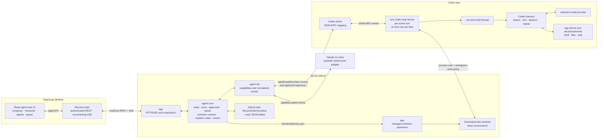

# Agent Task UI Design

[WorkBench](workbench.md) owns the shared navigation, task-bound code access,
and reviews of local development commits. Its source and hosting contracts
apply to the existing services described here.

## Issue development entry points

The approved [issue development scope](issue-development-plan.md) adds Goal
marking and Start development to existing issue cards. Launch opens this
composer with source context and current model/Automation controls. After
creation, View task opens the existing task in its workspace's Tasks tab,
including completed tasks; View issue links back to the source. Both existing
Needs attention views use the same launch path for eligible assigned issues.

The source is a compact card directly above the shared composer, rather than a
banner above the transcript. Hover or keyboard focus reveals a readable Markdown
preview; pointer/focus can move into it to inspect the source. The pre-launch
composer offers source refresh without losing additional instructions. Completed
tasks retain source navigation. The initial development message uses the compact
draft-PR request-row style: an issue icon, **Start development**, and repository
and issue number. Raw prompts and source payloads stay hidden; uploaded images
remain visible below the row. Durable initial-turn identity selects it. If an
older response lacks that identity, only the first root request in a confirmed
complete history prefix may use the row. A partial history page or later turn
never qualifies. Later messages retain their ordinary presentation.


## Development delivery presentation

[Development Task Delivery](development-delivery.md#7-task-presentation)
defines the Automation control. The new-task composer exposes the three choices
and Local only for the first submission; a started interactive task shows them
read-only, and workflow tasks hide the control. Accepted request identities and
authentication retries retain the same choices.

A completed turn's durable false readiness report shows Waiting for your answer
as the task status and as the composer placeholder; the question itself stays in
the transcript rather than being repeated above the composer. This survives
bounded-history eviction and clears when a new answer starts. Active
execution/approval and cleanup ownership remain separate; the status never
infers a question from arbitrary transcript text.

An unfinished continuation blocks ordinary Send, steer, queue start, Complete, and the
manual draft action while preserving composer text. A quiet continuation shows
Automation running; active provider/approval and recovery facts take precedence.
Stop automation uses the existing runtime-stop API and explains that verified
stop ends the current execution while preserving the task and its files for
another message. Questions disable Resume queue while allowing a normal
answer after continuation ownership settles. Marker changes refresh the task
through the existing lifecycle event stream.

The task uses an Idle runtime label and generated follow-up and CI activity labels. One pull-request chip above the composer names the pull request found
on the task's branch and opens the side panel on it; a task whose branch already
has one opens with that panel open. CI GREEN keeps the source busy until full
checks and synchronization finish; the final marker refreshes the PR list.
Waiting/synchronization/promotion messages use existing
task-level lifecycle events, with one bounded latest message retained outside
the loaded transcript. Status-only subscriptions forward those messages while
coalescing ordinary transcript activity. New user turns cannot revive older
progress. Questions retain display precedence. Shared conversation components
remain the implementation boundary; no stored workflow stages or Resume delivery
control are introduced.

Development tasks offer `@ci` as the default recipient suggestion as soon as
`@` is typed. Click, Enter, or Tab inserts the mention; Escape dismisses it.
A standalone `@ci` token sends the remaining text through the existing CI
message endpoint. It never falls back to a source turn, steer, or queue.
The source must still own an eligible paused run whose current projection
permits messages. Finished or unavailable runs explain why Send is disabled.
CI replies are text only, up to 16,384 characters, and retain their draft and
idempotency key after a failed request. The composer keeps Stop available.

The separate CI status/log block, history action, and CI conversation panel
are removed. Task-header activity and sequential source-task polling remain;
PR checks stay in the PR surface. Removing presentation does not delete saved
CI records or change run authority. Historical CI failure notices are omitted
when the run's terminal time follows the latest source turn; newer attachment
failures remain visible.

## Shared conversation presentation

Tasks and PR review Activity use `AgentConversation` for the transcript,
approvals, live activity, queue, composer, and history scrolling. They also use
the same bounded-history session and event reducer. The shared composer owns
the complete input box, including image drafts, Attach, Auto, the model picker,
and delivery buttons. Screens supply real values and supported callbacks,
not custom control rows or review-specific labels. Review Activity does
not mount the interactive Tasks route or manufacture an interactive task DTO.
Changes to conversation behavior belong in this shared implementation.

## Bounded history correction

Opening a task shows a bounded recent window, not a replay of its whole log.
The same rule applies to open, completed, and failed tasks and to task cards.
History comes from ByteQuay's JSONL event store, never provider transcript reads.

The transcript follow-up expands the original 200-event page and
600-event window allowances to the count limits below, keeping the byte caps.

Each history page contains at most 1,000 events and 2 MiB of stored event JSON.
Normalizing defaulted fields in old records can expand the response, so the
renderer separately enforces a 12 MiB cap on each page's normalized event JSON.
Opaque byte cursors load adjacent older or newer pages. Scrolling near
the top loads one older transport page and preserves the visible scroll anchor.
Opening or following a task reads at most three recent transport pages.
Before retention, the renderer combines redundant updates to the same streamed
item while preserving its first occurrence, text/output, and authoritative
completion. Other conversation and lifecycle events remain intact. Adjacent
compact pages coalesce up to 1,000 retained events and 12 MiB of normalized
JSON per page. The renderer retains at most three of these compact pages
(3,000 retained events and 36 MiB of normalized event JSON), so thousands of
output deltas from one command do not evict the surrounding messages.
The outer byte cursors still address the original log. It evicts content away
from the viewport and can reload evicted pages. Returning
to the latest view requests a fresh bounded page. Live updates keep their own
sequence cursor; browsing older pages never rewinds current task state or
replays all intervening messages into memory.

The conversation starts at the latest activity and follows new messages until
the user scrolls up. Layout changes and automatic scroll anchoring never pause
live updates. Scroll down to load newer pages and resume following at the bottom;
there are no **Load newer activity** or **Jump to latest** buttons. Sending or
steering a message also resumes following. A sent message appears at once as
local request progress, marked **Sending…**, until its durable user-message
event replaces it in place; a failed send removes it and restores the draft.
From the live edge it glides from the bottom to the top of the transcript,
leaving the latest turn's viewport for the reply; reduced motion skips the
glide. Archive and Restore in the task
header are icons with matching hover tooltips and accessible names.

While an adjacent page loads, scrolling updates the saved visible passages.
Only replacing the event window restores them; a turn completion does not
consume the pending anchor. If the first visible group changes at a page
boundary, the next surviving visible passage anchors the view. Layout changes
near the bottom do not resume following; downward scrolling must reach the
bottom, unless the conversation has become short enough to fit the viewport.

These JSON budgets do not include JavaScript object, DOM, or decoded-image
overhead; attachment and UI caches must also remain bounded.

A follow-up reproduced a raw-page eviction in the actual task UI:
one older page replaced the visible conversation and final answer with a single
collapsed command. Scroll anchoring cannot retain messages removed from the
window. Compact retention replaces the previous three-transport-page limit;
the per-request count/byte limits and the retained normalized-JSON budget stay
bounded. Browser regressions exercise the production task component, CSS,
projection, and reducer with thousands of command updates and native wheel input.

A page can cut through a turn or a streamed item. The UI shows one loading
indicator over the transcript while fetching content; it never inserts a row
that shifts the reading position. It uses durable
turn facts for controls and headers, and never
calls unloaded subagent activity expired. Historical approval cards cannot
become actionable because their resolution lies outside the window. Attachment
previews and fold/turn caches follow the retained window and have explicit
memory bounds. Cards replace their recent page instead of accumulating events.
An unresolved command or tool in an older window, or a durably ended turn,
has unknown item outcome until its terminal event is loaded. It never shows a
running spinner or invents a successful exit. Partial historical text also
stops displaying a live cursor. Wheel gestures over shell or diff output move
the conversation directly; inspecting the output's own scroll range requires
explicit scrollbar or keyboard interaction.
Retained image previews are limited to sixteen thumbnails of at most 512 pixels
per side. Opening the image viewer fetches its original separately and releases
that object URL when closed. Finished turns fold their logs by default on opening
and completion, leaving each turn's final answer and footer visible. The footer's
receipt counts the repository memories and guideline files the turn carried and
expands to list each memory as the agent received it. Live turns
and turns without a loaded final answer keep their logs open. Explicit fold
choices always win. Reaching the bottom resumes latest-history loading, including
when completion leaves the displayed content short enough to fit the viewport.

Backend replay also reads bounded pages on demand and does not prebuild the
whole subscriber backlog. Large-log verification must cover page byte limits,
scroll anchoring, eviction/reload, live updates while reading old history,
terminal tasks, and reconnect without lost or duplicated events.

Verification: 498 frontend tests, full lint and TypeScript checks,
and desktop packaging passed. Hidden Electron tests exercised the production
task body and screen wrapper: initial and short pages did not load older history
automatically, paging stayed within 600 events, and ten visible-passage checks
measured zero vertical movement through prepend/eviction, including one streamed
item spanning pages. In the unpinned live case, completion preserved the reading
line and performed no history fetch until the user returned to the bottom;
that return fetched the final answer once without another stream notification.
Image-viewer checks verified original resolution and URL cleanup on close,
unmount, and late responses. These checks complement the bounded-storage tests;
they are not a full-browser 1 GiB heap benchmark.

This document defines the implemented rich, worktree-scoped agent task surface
over the existing agent service. It defines the product interaction, frontend
projection, Electron transport, and service capabilities used by that UI.
Provider lifecycle and storage contracts remain in
[Agent Service Design](agent-service.md); Maven and process boundaries remain
in [ByteQuay Architecture](architecture.md).

The surface recreates the useful interaction model of a Codex task with
ByteQuay-owned React components. Codex App Server supplies the agent loop,
thread history, approvals, and typed events; it is not a frontend component
library. Claude remains a separate provider adapter behind the same
capability-driven ByteQuay contract.

The implemented surface carries an explicit product risk: the
[official Codex App Server documentation](https://learn.chatgpt.com/docs/app-server)
currently marks the `app-server` command as experimental and unsupported for
production workloads. ByteQuay accepted that dependency for the first
release and reconfirmed it when CP11 passed. The
fixed reference-schema fixture remains historical protocol evidence. Production
independently configures `0.156.1` as its minimum Codex CLI version, upgrades
older installations at startup to that exact configured release through npm, and keeps
equal or newer versions. Readiness requires the configured executable to meet
the minimum after any upgrade; failed or unreadable version checks cannot
bypass that gate. A reported mismatch includes an actionable versioned
installation command.
ByteQuay uses documented stdio and does not adopt the experimental WebSocket
transport.

Four HTML design files accompany this document as the presentation references
for reviewing or changing how the implemented screens look and respond:

- [Tasks.dc.html](Tasks.dc.html) is the Tasks tab: Active and Archived tabs,
  archive, restore and delete, multi-select, the undo toast, and the delete
  confirmation. Open it in a browser beside `support.js`; it is interactive.
  The type tabs, today's cards and the older rows follow the prose below.
- [Workspace Home.dc.html](Workspace%20Home.dc.html) is the workspace Home:
  repository avatar, composer, starting points, the repository's own Needs
  attention rows, and the open tasks as a grid of windows with rename and hide.

- [Agent Task UI.html](Agent%20Task%20UI.html) is the user-facing
  prototype: the accepted visual reference (commit
  `84af81c73cea7ae2cf7a53681827f550c598b706`) whose 13 static fixture states
  show the intended layout, hierarchy, and principal interactions as a user
  would see them.
- [Agent Task UI - full design.html](Agent%20Task%20UI%20-%20full%20design.html)
  is the full clickable design for development: every screen (task list,
  idle, running, approval, completed, subagents, queue and steer, image
  message, recovery, connecting, empty, expired, and the tab overview) with
  the exact markup, spacing, colours, states, and fixture data an
  implementation must reproduce. Anyone implementing or changing the agent
  task UI refers to this file first and treats it as authoritative for
  presentation.

Where the HTML and this document disagree about appearance or interaction,
the HTML wins; this document remains authoritative for behavior, capability
gates, persistence, security, and acceptance criteria. Neither file is
production code and neither claims backend or provider integration.

## 1. Decision summary

This section describes the implemented shape. CP0 selected a separate
ByteQuay-managed worktree per task and accepted experimental App Server.
The earlier unauthenticated loopback executor boundary was removed:
each active Codex turn now runs in a task-owned App Server, verified stopped at
turn completion, and opens no ByteQuay listener.
The remaining same-host risk is ordinary same-user filesystem and provider
account-profile trust. These facts do not weaken the compatibility and
isolation requirements retained after release.

- Workspace **Tasks** gains a separate agent-task list and detail screen. The
  existing cherry-pick task model and UI remain separate; there is no generic
  task hierarchy joining unrelated workflows.
- One ByteQuay agent task durably owns one workspace, one immutable provider
  lane, and one separately provisioned generated branch/worktree through the
  shared [Managed Worktree Service](worktree-service.md). It contains multiple
  turns in one resumable provider conversation.
- ByteQuay runs one task-owned, worktree-capable Codex App Server per active
  turn, with the task worktree as its working directory. It verifies that
  process tree stopped at turn completion; the next turn resumes the same
  provider thread in a new matching-profile process. Task and branch naming runs
  before provisioning in a bounded helper, confined to empty read-only scratch
  with tools and network disabled. Startup shows “Naming task and branch”
  while that helper is running. Root and child
  threads inside a process all belong to that task, so IDs are never routed
  between tasks.
- No execution environment is registered. App Server's default environment is
  rooted at its own working directory. Attended Codex `AUTO` adds ordinary
  `/tmp` and `$TMPDIR` allowances to the task worktree; other writes outside
  those roots need provider approval. Task sessions declare `experimentalApi: true` for direct
  child listing and background-terminal inventory/termination; no loopback listener is
  opened, so the first release carries no same-host trust boundary of
  ByteQuay's own making.
- This is separate from App Server's experimental `--code-mode-host`, which
  selects one Code Mode runtime for the whole App Server process. The first
  release leaves that process-wide option unset.
- The Spring sidecar owns task lifecycle, turn/claim facts, replayable events,
  approvals, queued inputs, and attachments. The renderer derives runtime
  status from those facts; it does not own provider execution.
- Electron main owns the authenticated REST and SSE connection. Provider
  credentials, backend session secrets, arbitrary filesystem paths, and raw
  provider messages never enter the renderer.
- The UI renders only capabilities advertised by the selected lane. Missing
  Claude or Codex features remain visibly unavailable instead of being
  synthesized.
- The first integration uses App Server's built-in tool loop inside the
  task-owned process and worktree and renders its typed calls, progress, and
  results.
  ByteQuay does not register custom business tools, hooks, or product workflows
  in this phase.
- Inherited Codex MCP servers, apps/plugins, dynamic tools, and lifecycle hooks
  are disabled for the first release. Only App Server built-ins plus the
  process-default sandbox are enabled; an active inherited
  capability makes the lane unavailable instead of silently widening the task
  boundary.

## 2. Product requirements

### 2.1 Task and conversation

- Create, list, open, resume, cancel, complete, and retain an agent task.
- Create a task from its first message alone, generate a short task name from
  that message in the background, and let the user rename it at any time.
- Send multiple turns to the same root provider conversation.
- Rebuild the transcript from persisted events after navigation, renderer
  reload, SSE reconnect, or backend restart.
- Allow multiple ByteQuay tasks to run turns concurrently through separate
  task-owned Codex App Server processes while preserving task, root-thread,
  child-thread, turn, and item identity; never run more than one process for a
  task.
- Display task lifecycle, derived runtime status, turn state, selected
  provider/model, elapsed time, token usage when available, and terminal
  errors.
- After completion, display the retained generated branch name and HEAD as the
  local result without exposing the backend worktree path.

### 2.2 Composer

The composer provides:

- text input;
- local image attachments when the selected model and provider advertise
  image input;
- provider selection when creating the task, then model and reasoning-effort
  selection for each turn;
- a Fast toggle beside the model when its catalog advertises a service tier
  named Fast, with an explicit pressed state and the catalog's description;
- a truthful **Auto** permission fact for the first release; it is not styled
  or labeled as a menu until more than one interactive policy is supported;
- **Send** while the task is idle;
- **Steer** and **Run next** while a turn is active; and
- cancellation of the active turn.

Image drafts are square, rounded thumbnails with an overlaid corner remove
button. Filenames remain in accessible labels instead of a visible name/size
row. Clicking a ready image in either composer or the transcript opens a
modal image viewer, initially fitted to the window, with zoom, actual-size,
and fit controls. Close, Escape, or clicking the backdrop dismisses the viewer
and restores focus to the thumbnail. The viewer reuses the existing image
object URL and does not upload or fetch it again.

The provider lane is immutable after task creation. The task stores default
model, effort, service tier, and permission choices; every accepted turn snapshots the
settings actually used. Changing a supported model or effort in the composer
changes the next turn default without creating a different task.

Fast is independent of reasoning effort. It starts off for a new task, persists
as the selected catalog tier ID in `serviceTier`, and is cleared when the user
switches to a model that does not advertise that tier. Null means standard
speed. Active and queued turns keep their accepted settings when composer
defaults change; steering cannot change those settings. A missing tier catalog
hides the Fast control.

An accepted **Send** or **Steer** input becomes a user-message event, including
its attachment references, before ByteQuay delivers it to the provider. A
queued input appears in the queue rather than twice in the transcript; when it
is first claimed, ByteQuay appends exactly one user-message event before
starting its turn. A safe explicit resume after a known pre-send failure reuses
that message identity and adds a new delivery-attempt event instead of
duplicating the user's text.

For Codex and DeepSeek, **Approve for me** (stored as `AUTO`) maps to App Server's generated on-request
approval value (`approvalPolicy: "on-request"` in the v0.151 reference schema)
and reviewer `auto_review`. Native review runs first; ByteQuay applies its fixed
rules to remaining requests and shows a user card only when they are unresolved.
The workspace-write sandbox is rooted at the generated
task worktree and retains ordinary `/tmp` and `$TMPDIR` allowances. The
validated Maven, Gradle, and npm cache roots and linked-worktree Git metadata
roots permit routine builds and local commits; the cache content is shared
with later local builds. Full worktree turns allow command network access for
dependency downloads. Provider prompts that reach ByteQuay appear as approval
cards; native denials remain in force. GitHub writes require direct explicit
user authorization, and persistent or blanket future grants remain prohibited.
**Approve for me** does not guarantee that every test command will be approved. Normal
tasks also enable Codex's native web tool. `thread/start` receives
the legacy `sandbox: "workspace-write"` field; `turn/start` receives the
structured `sandboxPolicy` for the effective turn. A subagent inherits the
active parent turn's effective sandbox and approval choices. The task-owned App
Server applies that policy consistently to root and child execution;
ByteQuay does not introduce a parallel permission path in this phase.

The renderer receives one normalized capability object for the selected lane,
not provider-name conditionals. It includes structured plans, tool and
incremental activity, hooks, subagents, approvals, usage, steering, supported
interactive permission policies, and attachment media types. Image attachment
controls require both a provider-supported image media type and the selected
model's image input modality. A missing capability is false. Structured plans
come from Codex plan updates or successfully completed Claude native todo writes;
ordinary prose never grants a structured-plan capability or changes plan state.

### 2.3 Transcript and live activity

The transcript displays:

- user messages and their attachments, except ByteQuay's create-PR request,
  which shows as one **Open draft pull request** `head → base` row instead of
  the prompt, or **Update pull request #N** when a pull request already tracks
  the branch. The panel action and Auto draft PR start the same turn, so the row
  is chosen by that turn's publication origin and never by matching its words;
- initial, incremental, and completion-repair review requests use compact
  cards built from the saved review scope instead of generated prompts;
- generated Refine summary and Auto commit requests use compact action cards,
  selected by durable turn-origin metadata. Their full prompts are available
  in the closed-by-default disclosure, rendered as Markdown with sections,
  lists, and inline code. Saved plain-text instructions retain their line
  breaks. Ordinary user messages and steering retain their text;
- review questions and replies use the same outlined request-card style, with
  a green title bar, review topic, and one-line preview of the saved user's
  message. Clicking the title selects **Summary**, opens the matching
  summary, commit, finding, or local discussion card, and scrolls it into view.
  Earlier requests retain their original report run. A separate chevron
  expands the full message and reviewed revision, or the existing private
  local discussion and its actions. Generated tool instructions and repeated
  selected-card context are omitted. Durable turn/message-event identities
  select the card, including queued questions after replay;
- partial and completed assistant messages;
- provider-supported readable reasoning summaries, never hidden
  chain-of-thought;
- structured checklist steps and `pending`, `inProgress`, or `completed`
  state, plus separate free-form Plan-mode text when emitted;
- commands, incremental output, file changes, App Server built-in tools, web
  searches, image views, and terminal results;
- pending and resolved approval cards;
- context compaction, retries, errors, cancellation, and turn completion;
- turn duration, token usage, status icons, and a live turn elapsed clock.

One structured Plan card updates in place per turn. The live root plan above the
composer uses the turn's durable latest-plan snapshot, so paging or reopening a
long conversation cannot lose it. A new turn starts without a plan; an explicit
empty update clears it. Child-agent plans stay in their own transcript and do not
replace the root snapshot. Plain Markdown checklists display disabled checkboxes
without becoming plan state. The footer calls commands, tools and file changes
**activities**, reserving **steps** for the structured plan.

Contiguous low-level activity is grouped into one expandable block. While any
member is running, the group stays visibly active. After the group finishes,
the renderer derives a compact sentence such as “Read files, ran 2 commands,
and edited 3 files” from the typed items. App Server does not supply that
presentation sentence. The completed item is authoritative when its payload
differs from accumulated deltas.

Activity groups and their individual rows omit elapsed times. A read or
command's summary title is its disclosure control, with the exact command and
result in a single shell panel underneath; there is no separate **Output**
row. Reads use the provider's display name when available, then a retained
relative path, then **Read file**. Skill/tool loading without a result remains
a plain row. Resolved approvals keep their outcome and command without an
inline timestamp. This transcript refinement supersedes the older timing and
disclosure presentation in the HTML references.

Repeated identical action descriptions within one command appear once; distinct
commands, paths, and search queries retain their own entries, and the disclosure
keeps the full command and result. While following a running task, a live line
below its transcript names the current command or tool, or shows **Thinking**
between actions. A moving text highlight indicates ongoing work and respects
reduced-motion preferences. Startup, approval, cancellation, and reconnect states
use their own labels; completion removes the live line and folds the turn's log
when a final answer is available, unless the user explicitly chose its fold state.

### 2.4 Approvals

Provider permission requests that reach ByteQuay appear as task approval
cards for Codex, DeepSeek, and Claude. Native provider denials can stop an
action before it reaches a card. Denials, timeouts, and aborted requests stay
visible, and the agent handles the next step or asks the user.
Pending CI Autofix requests appear on the linked development Task screen. A
standalone CI run started from a cherry-pick delivery shows its pending cards
in that Commits delivery view. Both surfaces answer through the same task
approval endpoint.

An approval card identifies the source task, child agent when applicable,
turn, item, request kind, reason, and product-permitted available decisions.
Command cards show the command and working directory; network and filesystem
cards show the requested destination or scope rather than pretending every
request is a shell command.

A question the agent asks arrives as a permission request for its question
tool, and its card draws the questions instead of the raw tool input: each
question keeps its short header, and its options are the decision, one chosen
per question or several where the question takes several. Sending returns the
chosen labels to the agent as the answers to the questions it asked, so it
continues with them rather than with a bare allow; dismissing denies the
request, and the agent continues without an answer. A question whose input no
longer reads as one, because it was truncated or redacted, keeps the ordinary
allow and deny card.

The card renders only the product-permitted subset of decisions offered for
that request kind. Command requests offer Allow once, Allow for this task and
Deny; file requests offer Allow once and Deny; permission requests show the
grantable subset. Allow for this task answers, without a card, every later
command in the same task with the same first three words, none of them an
option (`gh issue list`); a command with fewer such words (`git status`,
`sed -n 1,220p`) or a compound script is covered only when the identical
command line comes back, because a shorter prefix (`gh api`) would also cover
commands that do something else. Every command an allow answers is still
recorded and shown as approved for the task. The allow reaches the provider
as a plain one-time accept and is remembered by ByteQuay for the task, never
as a provider rule, and it does not outlive a restart of the app. The renderer
sends a tagged response, not a generic boolean.

A command that only reads GitHub needs no card at all: a `gh` list, view,
status, diff, checks or search (and `gh status`, or `gh auth status` without
token-display flags) is answered as the sandbox would have been and appears in
the log as any other command.
The same applies to a REST `gh api` request only when its method is provably GET
and it has no request fields, body, custom header or host, cache write, shell
expansion, or compound command. GraphQL and anything else that could write or
transmit local input or reveal credentials stays a card, as do every other
`gh` subcommand, explicit custom-host routing, `gh api --verbose`, and a
`--web` flag that opens the browser.
When a command request omits its
optional `availableDecisions`, the driver supplies the legal command defaults
defined by its protocol mapping and then intersects them with ByteQuay's
immutable safety ceiling; file and permission requests use the same ceiling.
The first release never permits a decision that persists an exec-policy allow
rule. If the intersection is empty, the request fails closed instead of
producing an actionable card. Unsupported tool-input or elicitation requests
also fail closed.

The backend persists pending and resolved state before publishing it. A
renderer disconnect does not approve anything, and timeout or terminal turn
cleanup resolves an unanswered request as denied. Replaying a task must never
resurrect a resolved approval as pending.

### 2.5 Subagents

- Render one card in the parent transcript only when the selected lane
  advertises nested-agent activity and supplies canonical direct parent/child
  execution identity. Codex supplies native thread identities. Claude supplies
  observed Agent invocation ownership and forwarded `parent_tool_use_id`;
  its namespaced invocation IDs route executions, not resumable sessions.
- Show read-only **Active** and **Done** lists with agent label, prompt or
  purpose when available, status, elapsed time, and result summary.
- Open an agent to inspect its messages, plans, tools, logs, approvals, and
  terminal result while it is running or after it finishes within the task's
  configured runtime-retention window.
- Preserve direct parent/child identity at any nesting depth.
- Keep all root and child activity in the owning ByteQuay task's single
  monotonic event sequence so replay and SSE need no second transport.

A root `turn/completed` event may render its answer while descendants are still
active, but it does not release the task's worktree-mutation claim. The driver
recursively reads metadata-only `thread/read` and a latest-turn status page
from `thread/turns/list` (`limit: 1`, descending, `itemsView: "notLoaded"`).
Each agent must be idle with a terminal latest turn, its tools stopped, and
its children finished. The latest root ID must equal the accepted provider turn.
These status reads do not download old transcript content;
legacy items are not matched against live item IDs. Parent-filtered `thread/list`
inventories children even when history omits a relationship; this local
completion traversal adds no synthetic UI lineage or V2 path. Already observed
children remain included. Idle agents need empty background-terminal lists;
not-loaded agents need terminal latest-turn status and recursive child checks. Missing,
unknown, or active status keeps the task blocked.

After this check passes, the driver records finished provider work before
closing the per-turn App Server. Verified cleanup releases the claim. A cleanup
failure preserves the completed answer and provider result, retains the claim,
and keeps Send, queued starts, and Complete disabled. A failed provider check
supplies no finished-work proof and uses conservative shutdown. The contract is
[Agent Service §5.6](agent-service.md#56-process-ownership-correction); it
separates provider completion from cleanup without adding a new task state.

A V1 subagent may use the nickname App Server supplies through
`thread/started` as its display label. V2 instead uses the canonical
`agentPath` as its stable label and logical path; nickname metadata never
replaces or overwrites it. A purpose is shown only when the provider supplies
the prompt it was spawned with. codex-cli 0.152.1 may announce a child through
`thread/started` with its parent and nickname but expose no spawn prompt on the
collaboration item or as the child's own first message, so the purpose line is
simply absent there.

Every thread in a task's process belongs to that task, but a non-root thread is
assigned lineage only from explicit provider identity. A live `thread/started`
may bind lineage only when it carries `parentThreadId`; a missing parent
is never inferred to mean the root. Historical discovery follows only the
selected model's V1 `spawnAgent` or V2 `subAgentActivity` `started` shape. This
keeps a child's final answer from being read back as the task's own recorded
final response without inventing a relationship.

For V2, the root logical path is `/`; every activity path is absolute,
normalized, and stable for its thread, and every `started` child path is
strictly nested beneath its direct parent's path. A `thread/started` lineage
signal alone does not publish or route a V2 child before that canonical path
arrives. The selected V1 spawn or V2 started item provides the child
relationship as the child is created, but not the child's final result.
ByteQuay records that relationship once its required identity is complete,
begins routing the known child's live activity, and derives its result summary
from the child's typed terminal activity. Reconnect replays ByteQuay's durable
events. Current legacy provider history synthesizes item IDs and omits tool and
collaboration activity, so exact events lost before ingestion cannot be
recreated. ByteQuay does not append synthetic history items or show a backfill
that did not happen. The separate parent-filtered `thread/list` completion
inventory still traverses children and grandchildren without display metadata.
Such an inventory-only child does not manufacture cards or a V2 path, including
saved children of resumed turns.

The panel opens on Changes and uses the main PR page's toolbar,
content spacing, and actions. **PR** and **WorkBench** are the primary destinations. WorkBench contains
**Changes**, **Summary**, and **Code & Tests** for development and review tasks.
Development tasks also expose the learning tab before a PR exists. After a
successful turn changes code or commits, a dedicated **Refine summary** turn
updates the change intention and each commit’s design and implementation.
The intention and each commit are numbered timeline events, each followed by
its own private explanation and discussion card: a green header for the
intention, a blue one for a commit's design and implementation. A commit's Git
message body folds behind the `···` toggle on its event. Comment inputs reuse
the code-diff review editor's presentation and keep their private handlers.
The task's reviewer follows the commits as its own event, with its findings. This uses the existing completion coordinator and runs after
accepted delivery work, including source synchronization from CI. It also runs
with commit/publication automation off. The conversation labels the generated
request **ByteQuay · Refine summary** and the active step **Refining summary…**.
The tab keeps the last completed report while the update runs; it has no manual
**Start review** empty state for development. Questions appear inside private
cards and preserve the original summary snapshot when newer reports replace
the cards. Earlier summary discussions remain accessible below the current
report. An explanation or summary refresh never releases a pending decision.
**Subagents**, with its total count, opens as a closable top-level tab beside
PR and WorkBench when a subagent chip in the conversation is clicked, on
providers that support nested activity.
Refresh, **Submit review**, and the checks/merge
button remain in the toolbar. An author can submit a comment review on their
own PR, without approval or request-changes choices. **Open full width** shows
the same pull request in a dialog over 90% of the window, dimming the task
behind it; closing it returns to the task.
Pull-request state, `base ← head`, and checks scroll with the body. The dialog
opened by the checks button exposes **Ready for review** for the author or a
repository writer on open drafts, beside the merge action.
Both buttons remain visible: drafts enable **Ready for review** and disable
merge, while open non-drafts disable **Ready for review** and enable merge when
its existing permission, checks, and merge-mode requirements pass. Only clicking
**Ready for review** promotes the draft; running checks do not block this
explicit action. Drafts cannot be merged from that dialog.

The PR tab mounts ByteQuay's existing pull-request detail surface in the panel,
so the pull request is read beside the conversation without leaving the task. A
transcript link to that pull request selects the tab instead of navigating, and
the task route does not change. **WorkBench → Changes** shows the same pull request's diff
with GitHub threads, private local discussions, and agent findings on their
reviewed lines. **View in Changes** and **Open in Summary** navigate
the same finding within the panel. Both the panel and full-width surface use the
same diff loader, commit-range selection, line selection, inline composer,
review-thread renderer, detail loader, and timeline. Selecting a commit compares
its parent to that commit; selecting consecutive commits compares the first
parent to the last commit. Pending comparisons clear the previous patch and
ignore responses for earlier selections. New PR revisions reset the selected
range and its pending review comments.

An open interactive development task offers **Send to agent** from the shared
inline composer, including on the user's own PR and while GitHub detail
permissions are loading. One click submits the comment, file, old/new line
range, known revision, and selected code directly to the task. An idle task
starts a normal user turn; a busy task queues a normal input for its next turn.
The main message draft and its attachments are untouched. Submission disables
the inline controls until acceptance; failures preserve the comment and its
retry identity and show the error beside it. A disconnected task, unfinished
delivery, recovery, or closed PR disables submission with a visible reason.

In a development task, the inline action authorizes committing and pushing
requested changes to the existing open PR. It snapshots Auto commit and Auto draft PR on and Auto
CI fix off for this input only, preserving a draft's status and all saved task
and composer settings. Questions request an explanation without edits or
release of earlier held work. The agent must locate the selected code in the
current checkout before editing because its quoted revision may be older.
Each accepted submission creates a durable **Local review comment**, marked
**Private**, with the selected code snapshot and its revision. The conversation
shows its review card instead of the generated agent-context prompt. The same
thread appears in **Summary**, the task PR timeline, full-width PR
timeline, and diff. The learning tab lists private discussions from all tasks
associated with that PR, including its separate review task. Each discussion
continues with its owning agent.
Local cards reuse the GitHub review card presentation with a distinct subtle
background. Code from another revision stays available as a labeled snapshot;
it must never attach to an unrelated line in the current diff.

User and agent replies belong to the same saved thread. **Reply to agent** sends
directly, and **Resolve**/**Reopen** update local resolution without starting
work. The agent can reply or change resolution through the task's fixed local
review tools. A saved message whose delivery failed remains visible with an
explicit **Retry** action. The existing delivery identity prevents duplicate
inputs after retry or reload. Neither the comment nor its code context is
published as a GitHub comment, review, PR description, or quoted in commit
messages. GitHub review actions retain their separate explicit buttons and
permission checks.
Changes continues to show the linked PR snapshot, not unpushed worktree edits.

Tab selection is renderer-local panel state, never a route. The shared detail
hook holds one five-second conditional refresh loop per visible surface rather
than a single read: a stored snapshot carries no age, and reading it once froze
the timeline at whatever the last refresh happened to write. Both surfaces
invalidate their cached diff when a new detail revision arrives or the user
refreshes the PR.

Branch matching is unchanged. It matches the task's generated branch and the
current branch of its verified managed checkout, so an agent-renamed branch
remains discoverable. Reading the current branch validates repository, origin,
path, and worktree registration without changing immutable cleanup ownership.
Missing or detached checkouts retain the generated-branch lookup. The panel
reads the pull request the branch still has open, newest first; without one it
reads the newest merged pull request, so a task stays linked to the work it
delivered. A closed, unmerged row never stands in for one; it leaves the branch
without a pull request, which is the state below.

Without an open or merged pull request the PR tab reads **Pull request**,
without a number, and renders a centred empty state: the title, the task's
branch and the monitored repository, the **Check again** action, and one line
saying ByteQuay reads the branch when the task opens and after every turn, and
that a pull request opened from the agent or on GitHub appears at the next
check.

Opening an idle task, ending any ordinary turn, or selecting the PR panel
refreshes those branches through GitHub's head-filtered pull-request endpoint.
The target is the workspace's monitored repository; the head owner comes from
the task's physical repository. For a fork workspace these are different:
`chenjian2664/trino_new` supplies the branch, while `trinodb/trino` owns the PR.
Both cached reads and GitHub refreshes use that monitored target. The task's
stored repository identifies its checkout and must not be used as the PR target.
The refresh is read-only on GitHub and persists the result before displaying it;
cached rows remain visible while it runs or if it fails. This works independently
of the selected side-panel tab. Lookup failures appear only in the PR or Changes
panel, with a read-only retry; they never replace a task-action error or create a
conversation-wide failure banner. A failed lookup without a cached PR is unknown,
so it does not show the no-PR creation state. This lookup does not rely on
repository search indexing or search results, which omit head branches. No transcript prose or PR URL is
treated as authoritative association, and no separate durable task-to-PR link
is introduced. Matching stored rows remains repository plus branch.

Its **Check again** action runs that same lookup on demand. It writes nothing:
a pull request is published by the accepted Auto draft PR automation, or by the
agent, and this only asks GitHub about the branch again between turns. The
button is offered whenever the branch has no open or merged pull request, and is
disabled while the lookup runs or while the task is busy enough that its answer
would be stale. ByteQuay does not open a pull request from this panel.

### 2.6 Queue and steering

Steering appends input to the active turn and does not create a new ByteQuay
turn. It is enabled only when the driver advertises steering and the active
provider turn still matches the requested turn ID.

**Run next** creates a durable FIFO queued input containing text, attachment
references, and the settings selected for that input. The backend starts the
head automatically only after the root/descendant execution tree completes
successfully, passes quiescence, and releases the `TURN` claim so the `OPEN`
task projects idle. After failure,
cancellation, interruption, or an
approval/authentication problem, queued inputs remain visible but paused until
the user explicitly resumes execution. The first release supports adding and
removing queued inputs, not reordering, priorities, or schedules.

While a steering-capable turn runs, each unclaimed queued row also offers
**Steer**. It sends that row's full saved text and attachments into the displayed
turn without using or clearing the composer draft. The running turn's model
must support its attachments. Starting, previously claimed, and uncertain rows
cannot be steered. Acceptance atomically consumes the queue row and records the
normal steer delivery, so the input cannot also run as a later turn. Failed or
uncertain delivery remains visible in the transcript and is never requeued.

After backend loss and provider quiescence, an untouched queued input remains
safely resumable. An
input already being delivered becomes **Delivery uncertain** and is never
resent automatically because App Server has no client input-idempotency key;
the user may discard it or explicitly send a new message after inspecting the
thread.

ByteQuay owns this queue and does not depend on any App Server queue API; no
queue method is part of the documented stable protocol. Queue submission
itself is the direct user action authorizing that later turn.

### 2.7 Deferred ByteQuay tools and workflows

The first integration does not register ByteQuay-specific model-facing business
tools, lifecycle hooks, post-turn Git actions, or other product workflows. It runs
the selected provider's built-in agent loop and persists and renders the
resulting typed tool-call events. Adding product-specific tools requires a
separate design after the App Server integration works end to end. Claude's
task-scoped permission callback remains an approval transport adapter, not a
product tool.

### 2.8 Screen shape and navigation

Authored PR browsing uses **Assign agent** beside GitHub and omits the
**Summary** tab. Assignment opens the existing task layout with
navigation, conversation and PR side pane, loading the PR context in its first
turn. **View in task** is available for all PRs in a matching workspace, using
an interactive task for authored PRs and a review task for other authors.
An existing task is reused; without one, the icon's tooltip describes the start
action. These icons are disabled when no workspace matches the repository.
The exact imported PR remains selected even after it closes or merges.


The existing Tasks screen keeps cherry-pick executions and adds a separate
**Agent tasks** section. It does not broaden `CherryPickExecution` into a
generic task DTO. There is no New-agent-task dialog and no title field: the
Tasks screen anchors a composer under that section with the provider, model,
and permission controls, and sending its first message is what creates the
task. The composer uses the concise `Let's ship...` prompt without repeating
the starting branch or a creation hint; the surrounding screen supplies that
context while the input keeps its accessible name.
Sending immediately replaces Home or the task list with a starting conversation
showing the submitted message, image previews, and a visible **Starting task…**
indicator that lists the creation steps in order — provider check, repository
fetch, worktree provisioning, image storage when images were attached, and
provider session start — and marks the one in progress. While the create
request is in flight the renderer polls `GET /agent/tasks/{taskId}/startup`
with its client-generated task id; the backend answers from an in-memory phase
map that the creator and controller write and clear when the request returns.
This is local request progress: it does not invent a persisted task
or start replay/SSE before creation is acknowledged. Success opens the durable
task route; failure restores the composer with its text, images, and retry error.
The workspace is already fixed by the route, so the HTTP request carries
`workspaceId` and the message, never a title or a worktree path. `app`
resolves and validates that workspace's managed repository and exact starting
commit, then the shared service provisions a separate generated task worktree
before `agent-core` persists the task as `OPEN` and accepts that first message
as its first turn.

A task is therefore never named by hand at creation. `agent-core` immediately
stores a plain-text first-prompt fallback capped at 36 characters so no row or
header is ever blank. After the real first turn is durably accepted, a disposable
text-only provider session receives at most the first 2,000 prompt characters
and asks for one sentence-case title: at most 36 characters, preferably two to
five words, specific, identifier-safe, in the user's language, and without
Markdown or trailing punctuation. Change requests use a precise imperative
verb. The naming session uses the first turn's selected lane, model, and validated
effort, has no attachments or resumable history, and treats the prompt as
untrusted quoted data. Claude runs with tools disabled. Codex uses an ephemeral
thread with shell, code-mode, and subagents disabled in an empty read-only
scratch directory; approvals and network access are denied. The turn times out
after 30 seconds. Codex completion uses the ephemeral thread's terminal event
and native idle status, because ephemeral threads have no persisted turn-history
API; background/child inventories and verified shutdown still gate acceptance.
Its unique scratch directory lives inside the durable task's
runtime resources: that subtree is deleted only after provider shutdown is
verified and otherwise stays task-owned for recovery and normal task cleanup.
It never enters the task transcript or task usage totals, while the supervised
provider process remains attributable to the durable task and first turn across
restart.

The generated name and its pending `TITLE_UPDATED` event are committed together
under the task's runtime lock, and overlapping create replays share one in-flight
naming request. The name replaces only a still-provisional fallback. A user
rename is final, so a late naming result or retry cannot overwrite a name the
user chose; failure or invalid output simply leaves the fallback. A task-level
`TITLE_UPDATED` lifecycle event makes an open screen re-read the authoritative
task projection. The name stays editable from the task header for the life of
the task. Provider task protocols do not supply this name to ByteQuay: App
Server stores a name only after a client sets one, while Claude's one-way
print stream does not expose its internal session title. ByteQuay therefore
owns the same fallback-plus-background-generation lifecycle itself.

The Tasks tab lists every kind of task in the workspace: development tasks, PR
reviews, cherry-pick executions and CI fixes, all read from local storage and
re-read every five seconds while the page is visible. Its heading carries an
**Active** / **Archived** segmented control with counts; Archived's tooltip
names the rule that completed tasks archive automatically after seven days.
The heading reserves space for the pinned overview button and wraps at narrow
widths so the controls remain separate. Below it, the type tabs **All**,
**Development**, **Review**, **Cherry-pick** and **CI fix** each carry the
type's icon and colour (teal, blue, amber, red), a count, and an orange dot
while an item of that type needs the user. The selected tab has the `#fd8c73`
underline and filters the whole page. In a narrow pane the tabs scroll
sideways under the button at their right, which follows the tab: **+ New
task** focuses the composer, **+ Review a pull request** and **+ Fix a failing
check** open the Pull requests tab, and **+ New cherry-pick** opens upstream
Commits.

**Today** comes first: the items that moved today as cards in a
`minmax(270px, 1fr)` grid, ordered **Needs you**, **Running**, **Idle**, then
finished (**Completed**, **Finished** or **Failed**), newest first within a
state. A card shows the type chip, state pill and age; the title in 14px
regular type, clamped to two lines; why it needs the user when it does (an
approval, a question, a paused run); the conversation's last message with who
said it and when; and its ticket, pull request and issue keys beside what its
checkout holds, how far a cherry-pick has come through its commits, or which
CI attempt is running. Lane and model stay inside the task. **Yesterday**,
**Earlier this week** (from Monday) and **Older** follow as one-line rows,
newest first; an item whose time does not read lands in Older rather than
disappearing. Only development tasks archive, delete and select: hovering a
card or row shows Archive and Delete, on a card in place of its age, and the
type icon turns into a checkbox on hover and while anything is selected. The
selection bar appears under the type tabs. Archived lists only shelved
development tasks and no composer.

The composer is docked at the bottom of the page: centred at 760px over a white
fade the list scrolls under, sticky at the foot of the page's scroller so the
last row always scrolls clear of it. A round chip holding only the repository
avatar sits 10px above the composer and names the repository new tasks start
in.

A cherry-pick opens its progress over the list. A CI fix opens the development
task that started it, else the cherry-pick whose pull request it fixes, else
that pull request. A review reads as **Running** while its run works, **Needs
you** while it waits on an approval, **Finished** once it ended or saved its
result, and **Failed** when it could not finish. It is titled by its pull
request's number and stored title, or by repository and number before ByteQuay
has stored the pull request, and it sits in the day of its latest activity.
Selecting a review opens that exact review in the existing PR detail
overlay's **Changes** tab; closing the overlay returns to the
list. A review also has a **View inside workspace** icon. It opens the
exact review at `tasks/review/{reviewId}`, so reload and back/forward retain
the selected review. The workspace shows the existing review conversation on
the left and the same PR page on the right. Both development and review tasks
use the same draggable divider, pane widths, and minimum/maximum bounds; the
conversation fills the remaining space, and changing PR tabs retains the width.
Dragging begins at the rendered width when the window constrains the pane.
The PR page contains independent
learning and finding cards; it has no **Summary & comments** or **Activity**
subtabs. The **View in workspace** action on its review opens that same route.
Starting a review from the PR keeps its existing start screen and runs the
backend task independently of which page is open. Private inline comments in
that review send questions to its review agent and retain the read-only review
execution profile.
Review rows use review-scoped reads and actions and do not expose interactive
task creation, archive, or deletion. Agent tasks are grouped
into Commits-style day cards by the local calendar day of `updatedAt`
(**Today**, **Yesterday**, then the weekday and date), newest first. A row is a
selection slot, the title, the task's pull request, mono `lane · model · age`,
the state pill, always visible icon actions and a chevron. The pull request is
the one the side panel reads — open, else merged — shown as its state icon,
number and title. The task list response carries it, picked on the backend from
the generated branch's stored rows, so it paints with the row and the list never
asks GitHub or Git for it. A task without one names what its checkout holds
instead: **No changes**, **Uncommitted changes**, **N commits** since the
task's start commit, or both. One batched read, `GET /agent/tasks/changes`,
checks every listed live checkout after the rows paint; the page keeps the last
answer per workspace, so a return visit paints it with the rows and replaces it
when the read lands. A row whose checkout is removed or unreadable names nothing
beyond its title. Archive is a
backend-persisted `archivedAt`
flag on the task, toggled through `PATCH /agent/tasks/{taskId}` with
`{ archived, expectedVersion }`; it never changes task state, checkout, branch or
provider session, an archived task leaves Home and the Tab Overview, and a
scheduled sweep archives **Completed** tasks whose `terminalAt` is older than
`bytequay.agent.auto-archive-days` (default 7). Failed and open tasks are never
archived automatically. The task header offers the same Archive/Restore beside
Complete. Delete is refused, in the row and by the API, while a turn runs or
the worktree is claimed; otherwise an app-styled confirmation names what goes:
transcript, events, approvals and queued inputs; attachments and runtime logs;
the generated branch and its worktree. `DELETE /agent/tasks/{taskId}` is the one
place ByteQuay destroys a generated branch: it stops the provider runtime,
removes the worktree and branch first (a refusal leaves the task whole and
visible), then the runtime files, then the rows, and a repeated delete is a
no-op. Clicking the slot selects a row; while anything is selected every row
shows its checkbox, clicking a row toggles it, the section header becomes a
selection bar (`N selected · Select all · Archive|Restore · Delete · Cancel`,
Delete disabled when the selection holds a running task) and Escape clears it.
Archive and restore, single or bulk, show a five-second toast with Undo; delete
shows the same toast without it.

The workspace Home is [Workspace Home.dc.html](Workspace%20Home.dc.html): a
header with the 28px repository avatar, the repository name and the overview
control, the same composer docked at the bottom as on the Tasks page, with the
repository chip and three starting points that fill it as pills in one row
above it, the repository's own **Needs attention** rows (drawn from the same
candidates and ack/snooze store as the application Home, as described below),
and the open tasks as a responsive
grid of compact cards. Running development tasks and reviews come first,
preserving their source order within the running and remaining groups. Reviews
waiting for approval or recovery also remain visible; finished and stopped
reviews stay in Tasks. A review card names its PR or local changes, shows its
Review type and provider, and opens that exact review's workspace conversation.
A card names the task and its state (**Needs you**,
Running, Idle), then why it waits on the user or the start of what it last
said, then its lane, model and age beside its pull request or what its checkout
holds. The page reads the task list and `GET /agent/tasks/activity` on one
short tick rather than each card polling its own task. Reviews use the same
workspace workflow feed and refresh interval as Tasks. Hovering a development
card shows Rename, which edits the name in place through the ordinary rename, and Hide
from Home, which keeps a renderer-local per-workspace set
(`bq.home.hiddenTasks.{workspaceId}`) and leaves the task in Tasks and the
overview. A hidden card comes back on its own when its task needs recovery or
an approval after it was put away. A Tab Overview lays every open task out as a
window over whichever agent screen is showing: each a scaled copy of its own
screen, anchored to its newest work like the screen following its bottom, with
finished turns folded. A window polls its task and any events it has not shown
yet on a shared tick instead of streaming, because main keeps one stream per
renderer and task and the overview draws over a screen that may hold it.
`⇧⌘\` or its pinned control opens the overview, Escape closes it, a window
opens its task, its ✕ completes an idle task after confirmation, and a dashed
card starts a new one. Nothing in a window is interactive but the window and
its close control.

Both Homes draw **Needs attention** as one box of rows, the same row Circles'
**Needs you** draws for every pull request, issue, Jira ticket and agent task.
Each shows at most four rows. Items whose newest source update or event falls
in the last seven days are ranked by how they involve the user, newest first
within a rank: the user's own pull requests (every event, merged and closed
included), issues and agent tasks; then what asks them (a pending review
request, a direct @mention, or an issue or Jira ticket assigned to them), a
circle member's ask first; then pull requests they reviewed or monitor; then
pull requests and issues a circle member opened. Older items follow, newest
first: the list keeps every update until it is handled, and nobody
acknowledges them all, so ranking old ones would bury the week's news under
long-merged pull requests. Anything else stays off the list, including a circle
member's comment or update on another person's pull request. Reason priority
only breaks equal-time ties.
Acknowledging or snoozing one brings in the next eligible item. Filter tabs
above the list (**All · PRs · Issues · Jira · Tasks**) narrow the rows to one
source; the cap applies after filtering. Neither the header nor the tabs show a
count: every circle member's pull request stays eligible, so a total measures
the circles, not what needs the user. There are no
**All issues** or **All pull requests** links. A row leads with its source's
icon in the source's colour (pull request green, issue blue, Jira ticket purple,
agent task teal) but no type name, then the title on one line with its key,
where the item stands and a **Goal** badge when the item is in its workspace's
pinned goal, and its age on the right. Where the item stands is a golden
outline around plain text: Review requested, Changes requested, Checks failing,
Merge blocked, New commits or Ready to merge for a pull request, or Merged,
Closed, Draft, Approved or Open for one that only moved; Approval needed,
Question for you, Turn finished, Turn failed or Recovery required for a task;
Assigned to you for an assigned issue, Open for another issue, or the actual
status for a Jira ticket. The line below names who the item is from and how:
the author who authored a pull request or opened an issue (assigned to you,
when it is), a ticket's assignee, or a task's lane; a circle member is named the
way Circles names them, beside the circle. The application Home then names the
repository, or the workspace an issue would start in, and linked items follow
as their keys, with each title and status on hover. The last line is the
latest event: **Latest:** the actor and what they did (commented, pushed
commits, requested your review, finished a turn, moved the ticket) and when.
Hovering that line, or focusing the row, unfolds what happened below it: a
comment or review renders its opening Markdown, up to a hundred words, a label
change names the label, and an event with nothing to show falls back to what
the item waits on, such as the commits since your last review or the failing
check. A pull request with no recorded event still shows the line when it
waits on commits or checks; an issue, or a ticket with nothing new, has none.
While the pointer or focus is inside the row the age gives way to Pin, ◎ (add
to or remove from that goal), Start development (issues and tickets that can
start), Acknowledge, Snooze and Open.

Resting the pointer on a row for two seconds opens the item's hover card, the
shared reference card: the source's icon, key and where the item stands, the
title, who it is from and when it was opened and updated, then the item's
description (a task's last message), its labels, and Start development, Ack,
Snooze and Open. An issue's or ticket's description comes with the list; a
pull request's is the one its last detail read stored, which
`GET /prs/stored/description` reads without reaching GitHub or marking the
pull request viewed; with no stored detail, the card says to open the pull
request. The card widens with the window from 500 to 720 pixels and opens up
to 720 pixels tall, never taller than the room above or below its row; a
longer description scrolls inside it. Leaving the row and its card closes it;
moving or resizing the card keeps it open until Escape or a press outside.

Ack and snooze keep the shared store, undo toast and session **Bring back**.
**ACK** records only acknowledgment, never a review, prompt or source mutation.
It clears that snapshot until the item changes. Snooze is a timed reminder:
activity does not end it early, and the deadline brings back the latest row
even without new activity. The menu offers one hour, tomorrow and next Monday.

Opening an item keeps its notification visible while its details remain
open, without showing a **Viewed** label. Successful actions show **Reviewed**,
**Prompted**, **Updated state**, or **Posted N comments**. Failed actions and
drafts do not count. Closing its zoom, leaving its detail page or selecting
another item clears the last displayed snapshot; a later source update makes
it eligible again. Multiple mounted details of the same item share one visit.
Source snapshots returned by successful writes are consumed before clearing,
so the user's own action does not immediately reappear after refresh.

A pin action on every attention row and item detail adds the item to the
global **Pinned** sidebar section. PRs, issues, Jira tickets and tasks retain
their explicit source or workspace destination across navigation and app
restart. Pinned items stay out of both Needs attention views and monitored PR
desktop notifications, including after source changes. Unpinning restores
normal attention eligibility while preserving any ACK or snooze. Pinning and
handling are renderer-local preferences and never write to GitHub or Jira.

Ordinary rows render the shared stored projections. Timed snoozes retain a
snapshot and reread their source after expiry, so closed or otherwise
ineligible items still return with their latest available state. With nothing
left, the section says **Nothing needs you right now.**

The sources are all discovered personal and watched-repository pull requests,
cached watched-repository issues, tickets in connected saved Jira board scopes,
and unarchived local agent tasks. Assignment, Goal marking, a linked task, or
an ordinary update does not remove an item from this list. Those facts still
control whether Start development is offered. Source discovery is independent
of the limit used to warm full pull-request details. `GET /prs/attention` carries
each pull request's cached details from its stored timeline, commits and check runs: the latest comment's opening text and
the file and line of an inline one, the commits cached after the viewer's last
review (or the review request when there was none), and the names of the
latest failing checks. Failing test names are not stored, so a CI detail names
the check. `GET /api/jira/attention` sends each ticket with the last change
ByteQuay saw on it: a status move with where it went and any comment with it, a
comment with its author, or the fields that changed (see
[jira-integration.md](jira-integration.md)); a workspace's Home lists the
tickets assigned to that workspace. Task rows include running, idle and terminal
updates as well as approvals,
questions and recovery. Their age follows the newest task change, root message,
turn completion, approval or execution claim. Archived tasks stay out of Home.
Both Homes read
`GET /agent/tasks/activity?workspaceId=…` on a short tick: one batched local read
returning, by task id, the pending approval, the newest turn, and the start of
the newest root message (a user message, or a final answer or commentary of the
task's own agent), which a backwards scan of the task's event log finds within
a bounded number of records. A task whose transcript retention removed quotes
its kept final answer. A task row names its lane without the model (Claude
Code, Codex, or a DeepSeek key's own name such as ds-001), and its linked items
are its Jira ticket, pull request and issue; a pull request's row links the
task whose branch opened it.

**Goals.** A workspace can hold several goals, each a local list of pull
requests, issues, Jira tickets and agent tasks toward one outcome. One is
pinned, and every page of the workspace follows it. Goals live in SQLite behind
`/api/workspaces/{workspaceId}/goals`; no goal change writes to GitHub or Jira
or starts work, and removing an item leaves its task and history as they are.
Adding an item saves its kind, key, label and title as ByteQuay stores them.
Reading a goal reads each item from the local store for its kind: a merged or
closed pull request, a closed issue, a done ticket or an ended task is
**Finished**; an open pull request, an issue with a development task, a ticket
in progress or a running task is **Working**; anything else is **Idle**. An
issue gone from the repository's synced open issues reads as closed, and any
other item no store holds keeps its saved label and title. A ticket in a status
named Blocked is blocked. An item needs you while it shows in the workspace's
Needs attention, which the workspace reads once for all of its pages. Marking
an issue or Jira ticket as a Goal gives its workspace a goal named after it
that does not list the marked item itself; unmarking removes that goal. A
workspace's first goal is pinned, choosing another goal in the switcher pins
that one, and deleting the pinned goal pins the oldest one left.

Every workspace page but an open task or review carries the pinned goal as a
pill: a progress ring, the goal's name, `finished/total` and how many items
need you. It starts just above the composer's right edge, or in the page's
bottom-right corner where there is no composer. It can be dragged anywhere, and
keeps its spot per page (`bq.goal.pill.{page}`); wherever it would cover the
composer it is lifted above it. A click that did not drag, or ⌥G, opens the
goal: docked in a 340px column beside a Home at least 1100px wide, where ×
collapses it back to the pill (`bq.goal.dockCollapsed`), and otherwise as a
380px drawer inset 10px, for which the page makes room so the composer
re-centres. The panel has the goal switcher (**GOAL 1 of 3**, **Pinned**,
**New goal**, and **Delete this goal** for a goal no marker seeded), the title
and description, a Finished / Working / Idle bar, tiles for pull requests
merged and open, what needs you and what is blocked, **All · Needs you ·
Blocked** tabs, **+ Add** searching the repository's stored pull requests and
issues, cached Jira tickets and the workspace's tasks, the items grouped
Working, Idle and Finished (folded) with remove on hover, and recent activity:
the latest stored change of each item. ⤢ opens a board of Idle, Working and
Finished columns with the same search and remove. Task cards and rows on the
Tasks page and open-task cards on Home show ◎ for a task in the pinned goal or
one working on a pull request in it.

The composer checks the same typed provider readiness returned by Workspace
Settings before enabling its send control. Authentication-required, missing,
unsupported, and unavailable lanes are disabled with an actionable link to
**Workspace Settings → Agent providers**. No task row, runtime directory, or
worktree is created until a fresh backend readiness check succeeds; the
backend repeats this gate so stale UI status cannot race task creation.
For Codex, `unsupported` includes a required protocol or capability failure or
a reported version below the configured minimum, currently `0.156.1`, or an
unparseable reported version. The diagnostic shows the detected CLI version
and the required minimum where relevant. Failed or empty
version reads make the lane temporarily unavailable with the probe diagnostic.

```text
#/workspaces/{workspaceId}/tasks
#/workspaces/{workspaceId}/tasks/agent/{taskId}
```

The route parser adds an optional `agentTaskId` to the existing workspace
location rather than storing navigation only in component state. Deep-link,
reload, back, and forward all reconstruct the selected task, and the backend
rejects a task whose durable `workspaceId` does not match the route. Existing
cherry-pick rows keep their current Commits navigation.

The detail header shows Back, the task title, status, and an icon-only completion
button on the left. Its hover tooltip and accessible name are **Mark it complete**;
disabled tooltips explain the current blocker. Provider, model, turn count, and
time remain in the composer or transcript rather than the header.

The detail screen keeps the composer anchored at the bottom of the conversation
pane while the transcript scrolls. The composer shares the transcript's reading
width and horizontal inset, with no divider above it. Back, title, task status,
archive/completion, the panel toggle, and **Show all tasks** stay in the conversation
column's header. Connection and task-error banners also belong to that column.
An open side panel sits beside the whole conversation, including its header and
composer, and occupies the screen's full height with its own PR toolbar at the
top. Resizing the panel keeps task controls inside the conversation column.
This layout supersedes the older HTML prototype's full-width dock and task header.

```text
┌ Back · task title · status · ✓                      panel toggle ┐
├───────────────────────────────────────────────────────────────────┤
│ user message + image previews                                     │
│ assistant text                                                    │
│ plan card: pending / in progress / completed                      │
│ ▸ folded activity summary (commands · files · web · tools)        │
│ approval card: request details          permitted decisions      │
│ subagents card: Active (2) · Done (3)          Open agent         │
│ final answer + usage/timing                                       │
│                                                                   │
│ queued next turns (only when present)                              │
│ image chips · message input                                       │
│ model · effort · Auto                     Cancel · Steer/Run next │
└───────────────────────────────────────────────────────────────────┘
```

Opening a subagent filters the same task transcript and shows a breadcrumb
back to the root; it does not create another task route or SSE connection.
Active and finished agents use the same panel so completed work remains
inspectable during runtime retention. After cleanup, durable task/child
summaries remain visible, but opening removed activity shows **Activity
expired** with the deletion date instead of reconstructing provider history or
inventing events. Icons and exact spacing follow ByteQuay's existing
React/plain-CSS system rather than copying Codex Desktop source or assets.

After backend/provider loss, a static **Could not verify shutdown** card replaces
mutation controls while the owned execution tree remains unverified. It names
any confirmed still-active child and offers the task-scoped Stop action. Only
an actively submitted Stop shows progress; an unresolved claim does not imply
an automatic recovery loop. The card also names active execution
items/background terminals or an unverifiable process receipt. The UI never
releases the task's worktree-mutation claim
merely because the root is marked interrupted. If provider-process ownership
or exit cannot be proven, the task remains blocked and its worktree stays
untouched, with an actionable diagnostic. A last-resort **Stop this task's
provider runtime** action requires confirmation and affects no other task.

Stopping the runtime and **Mark task failed** use an app-styled modal with a
short explanation, **Cancel**, and a named action. Cancel receives initial
focus; Escape dismisses the dialog before submission. Both buttons remain
disabled while the request runs. Failures return to the task with a diagnostic;
retrying Stop fetches a fresh runtime impact and requires another confirmation.
Mark failed explains that the transcript and uncommitted changes are retained,
while a clean checkout may be removed and its branch kept.

An unverifiable close retains the runtime's session/process identity, so a
later confirmed **Stop this task's provider runtime** action actively retries
termination and verification. Only `VERIFIED_STOPPED` releases the stale claim
and enables a new turn or paused queue retry; the old turn is never resent.
Ordinary failure, approval timeout, and stopped automation retain the `OPEN`
task, checkout, conversation, and attachments. Once the claim is released,
the composer accepts the next message without deleting or recreating the task.
The expired turn's approval cards stay resolved and cannot grant a new turn's
operations. Failed automation is not automatically resumed.
The card distinguishes completed provider work with blocked runtime cleanup
from an interrupted or failed provider turn. Missing evidence says **Could not
verify shutdown**, with the specific reason in details; it does not claim a
process is still running. Stop reuses durable finished-work evidence for the
same launch and retries termination and inspection. It cannot invent evidence
for an old run, and neither restart nor Mark task failed bypasses cleanup.

A quiescent failed turn with `failureKind: AUTHENTICATION_REQUIRED` instead
shows an authentication recovery card while leaving the task and worktree
intact. **Refresh login status** calls the shared typed readiness operation for
the task's immutable lane. Once it returns ready, **Retry last message** shows
the original durable text and attachment names, requires explicit resend
confirmation, and calls the existing typed turn-start operation with those
opaque attachment references and a fresh idempotency key. The action is absent
until quiescence, disabled for `UNKNOWN` delivery, and never silently reuses a
delivery row. Ordinary failed turns do not gain this auth-only shortcut.

**Complete** is enabled only while the task is idle and no live queued input is
`QUEUED`, `PAUSED`, or `STARTING`. If an
`UNCERTAIN` delivery remains, confirmation explains that completion records it
as abandoned and never retries it. Complete closes the provider session,
retains the transcript for the configured period, and releases the exclusive
worktree-mutation claim. It records Git facts, removes a verified clean worktree, and
retains its generated branch as the local result. If the worktree is dirty or a
Git operation remains open, Complete shows an actionable conflict rather than
discarding files. The completed screen shows the retained branch and HEAD; it
does not merge or push them automatically. The detail screen must not leave an
`OPEN` task permanently holding that worktree without a visible close action.

## 3. System shape



App Server owns the Codex agent loop, provider requests, built-in tool
decisions, approvals, and root/child thread execution. ByteQuay owns the
selected local worktree, the per-turn task-owned App Server lifecycle and requested policy,
product task, durable projection, cross-provider event contract, UI, queue,
metrics, and attachment boundary. App Server implements Codex
process/filesystem semantics; ByteQuay does not fork that protocol merely
to draw the UI.

## 4. Frontend state and rendering

One React reducer owns the open screen state; no new state library is needed.

| Projection | Derived from |
| --- | --- |
| Transcript blocks | Message, plan, activity, approval, and lifecycle events ordered by task sequence |
| Active turn | Durable turn response plus turn lifecycle events |
| Activity groups | Contiguous typed items and their start/completion state |
| Current plan | Durable root-plan snapshot for the active turn; thread-scoped plan events in each transcript |
| Pending approvals | Approval requests minus matching resolution events |
| Agent tree | Child relationship and lifecycle events keyed by agent thread ID, plus the task summary's kept child index once the transcript is cleaned up |
| Queue | Durable queue responses and queue-change events |
| Metrics | Turn/task timestamps, usage events, and a renderer-local live clock |
| Connection state | SSE open, reconnecting, or failed state plus last received sequence |

Opening a child agent changes the transcript filter to its agent thread ID; it
does not create another backend event stream. The task-level sequence remains
the ordering and reconnect cursor for every root and child event.

Icons, labels, folded activity prose, and live elapsed time are presentation
logic. Provider facts such as status, command, file path, tool name, duration,
and usage remain backend data. UI summaries must never be parsed later to
recover state.

## 5. Electron and HTTP boundary

Electron main exposes typed preload methods for task reads and mutations and a
subscribe/unsubscribe callback for event envelopes. It attaches the private
backend session credential and maintains the SSE reader. The renderer cannot
construct backend URLs or authentication headers.

The existing service endpoints remain, with these additions:

```text
PATCH  /agent/tasks/{taskId}
PATCH  /agent/tasks/{taskId}/defaults
POST   /agent/turns/{turnId}/steer
POST   /agent/tasks/{taskId}/queue
GET    /agent/tasks/{taskId}/queue
DELETE /agent/tasks/{taskId}/queue/{queuedInputId}
POST   /agent/tasks/{taskId}/queue/resume
POST   /agent/tasks/{taskId}/queue/{queuedInputId}/steer?workspaceId=...&turnId=...
POST   /agent/tasks/{taskId}/attachments
GET    /agent/tasks/{taskId}/attachments/{attachmentId}
POST   /agent/tasks/{taskId}/mark-failed
DELETE /agent/tasks/{taskId}
GET    /agent/tasks/{taskId}/pull-requests
POST   /agent/tasks/{taskId}/pull-requests/sync
```

Task creation accepts a workspace ID, lane, defaults, and the first message;
it accepts neither a title nor a renderer-selected worktree path.
The new-task image picker retains up to eight native-selected images in
Electron main memory, returning opaque draft IDs and bounded preview bytes.
Both new and existing task inputs also accept a pasted clipboard image with
the same model/provider gates. The renderer handles an image-bearing paste
gesture; Electron reads the native clipboard only for that gesture, converts
the image to PNG, checks pixel and byte limits, and reuses the draft/upload
path. Text-only paste keeps the normal input behavior without reading the
native image clipboard. While an image is being attached, sending is disabled
and the input remains editable so text from a mixed clipboard is preserved.
Removing an image or leaving the composer releases its draft. Selecting an
image alone does not allocate a task or worktree. On Send, Electron posts
multipart `POST /agent/tasks` with a JSON `request` part and `images` parts;
the text-only request remains JSON. Each image is limited to 10 MiB, verified
against its claimed media type, and bounded to 30 million pixels before any
task allocation. The selected model and provider must both accept images.
The backend stores validated uploads as task-owned attachments before starting
the first turn. The creation fingerprint includes the ordered image names,
types, and bytes, so replaying a lost response cannot silently replace the
first message's images or start another turn. Once that turn is accepted,
replaying the request reuses its stored attachments.
`PATCH /agent/tasks/{taskId}` carries either a user-chosen name or the archive
flag, with the observed task version, so a rename cannot race an agent-proposed
name and a stale list cannot flip the shelf. Turn/queue
requests accept explicit supported model, effort, and permission settings plus
the observed task version, so enqueue cannot race Complete. Attachment upload
receives bytes selected by Electron main, validates media type and size,
writes an
owner-only task blob, and returns an opaque attachment reference. It never
accepts an arbitrary renderer-chosen local path.

The model selector reuses the existing `GET /api/settings/models` catalog and
workspace defaults. Its existing model DTO is extended with input modalities
so the image button is gated by the selected model, not only by provider. It
does not add another model-registry endpoint. Selector changes save the task's
next-turn defaults with an expected task version; every send/queue request also
carries its effective snapshot so a concurrent default change is unambiguous.

The composer refreshes its authoritative task projection on task-level
`WORKTREE_UPDATED` events from Code & Tests saves, worktree synchronization,
and local-run claim acquisition or release. An editor's own polling cannot
replace that shared refresh: Send must observe the new task version without
requiring navigation or a failed first attempt. The version guard remains in
place; a concurrent change still preserves the draft and retry identity.

For Codex, a validated local upload is passed as `localImage {path}` using its
task-owned blob path. The URL-based `image` input is not part of the first
release.

The SSE reader reconnects with the last processed task sequence. Event append
remains persist-before-publish, so a dropped connection cannot create a gap or
interrupt provider execution.

## 6. Service contract additions

The agent service design adds only fields needed to preserve observable task
state:

- provider thread ID and optional direct parent provider thread ID on
  thread-scoped events;
- provider turn and item IDs on turn/item lifecycle and delta events;
- owning workspace ID on every task and an explicit persisted user-message
  event for each accepted send/steer or first queued claim, with later delivery
  attempts linked rather than duplicating text;
- immutable task-worktree ownership facts;
- task-local worktree-mutation claim, held while provider-process recovery is
  unresolved;
- per-turn App Server launch identity keyed by task plus directly owned
  provider process recovery state;
- task name plus whether it is provisional, agent-proposed, or user-chosen, so
  a rename is never overwritten;
- task defaults and per-turn snapshots for model, effort, and permission;
- image attachment references and advertised media types;
- typed approval request and resolution details;
- subagent relationship, status, and result events;
- durable start/steer delivery state, including `UNKNOWN` without automatic
  resend;
- globally unique event IDs plus state/event outbox recovery;
- queue records and queue lifecycle events.

Provider-specific fields remain inside each driver unless they are required by
the cross-provider UI. Raw App Server or Claude JSON does not cross the SPI.

## 7. Implementation slices

Each slice first updates its exact contract and acceptance tests, then lands
end to end. A backend-only or renderer-only half-slice is not considered
complete.

1. **Protocol fidelity** — regenerate the fixed reference App Server bindings
   while keeping production decoding tolerant of additive changes; define the
   canonical event/input-delivery/approval schemas; preserve item IDs, image
   inputs, and child relationships; reject incompatible required protocol
   changes with the detected running version.
2. **Transport and replay** — add the SQLite/event-outbox unit of work, typed
   provider-process recovery, Electron REST/SSE IPC, React reducer, and task
   routes; prove crash-boundary idempotence, deep-link, reload, and reconnect
   during a live turn.
3. **Usable Codex task** — gate creation on typed provider readiness before
   task/worktree provisioning; link unavailable lanes to Workspace Settings; add
   per-turn task-owned App Server launch rooted at the task worktree, disabled
   inherited capabilities, sandbox probes, and the task-local
   worktree-mutation claim;
   then create/open/complete a task, select
   model/effort/Auto, send text, resolve approvals, view live logs and final
   output, cancel, and send a second turn to the same thread.
4. **Rich transcript** — add plans, readable reasoning summaries, folded
   activity, timings, usage, icons, and safe image upload/display.
5. **Subagents** — preserve child thread identity, render Active/Done, and open
   live or completed child transcripts.
6. **Steer and queue** — add capability-gated Codex steering and the durable
   provider-neutral FIFO queue.
7. **Claude parity** — harden mid-run authentication recovery and add
   capability-correct Claude rendering.

## 8. Acceptance criteria

- Two concurrent Codex turns for different tasks run in separate App Server
  processes rooted at their own worktrees, without event, approval, process, or
  filesystem cross-talk; each process is verified stopped with its turn.
- Fresh and resumed successful turns, including provider startup with
  short-lived children, return to idle once complete shutdown is proven. No
  manual Stop or Mark task failed is needed for normal startup churn.
- A detached native child still able to write keeps the task claim and mutation
  controls blocked, even if its root exited and its old process group is empty.
  Missing historical evidence is shown as a verification failure, not as proof
  of a running child or a promise that another Stop will fix it.
- New/open/complete task routes survive deep-link, reload, back, and forward;
  completion removes the verified clean worktree while preserving its generated
  result branch, and task creation never trusts a renderer-supplied path.
- An unavailable or authentication-required provider cannot create a task,
  runtime directory, or worktree; the New task composer links to the same actionable
  Workspace Settings state, and a successful readiness refresh enables Create.
- Renderer reload and SSE reconnect preserve a live run and neither lose nor
  duplicate completed items. After backend restart, the same transcript is
  restored, the lost active turn is visibly `INTERRUPTED` with recovery
  required, and retry stays disabled until the entire owned process tree is
  verified stopped; root-process exit alone is insufficient.
- The chosen model, effort, and permission are the settings actually used and
  recorded for each turn.
- Unsupported image input is disabled; supported images are task-owned,
  bounded, previewed, and delivered without exposing arbitrary local paths.
- Approval cards survive reconnect, identify their root or child source, and
  disappear durably after resolution or denial.
- Plans and activity update live, completed items replace deltas, and folded
  summaries are reproducible from typed events.
- Active and completed subagents remain inspectable, including child logs and
  terminal results, throughout runtime retention. After cleanup, their durable
  summaries remain and removed transcripts display **Activity expired**.
- Root completion while a descendant, command, tool, hook, terminal, or
  background/yielded execution is active keeps the task claim and mutation
  controls disabled. Parent-filtered inventory includes missed-live children
  and grandchildren; native thread status, latest-turn status, and background
  inventory determine completion without requiring lost item notifications.
  After each current-run agent and its tools finish, the driver records that
  provider fact before cleanup. Only verified cleanup releases the claim and
  enables the next turn or Complete. Cleanup failure preserves a completed
  provider result with recovery required; a failed provider check supplies no
  finished-work proof. Fixtures verify active descendants, missed completion
  notifications, background commands, startup churn, and cleanup failure.
  Missing legacy tool activity is not recreated under synthetic item IDs;
  everything already ingested remains replayable from ByteQuay's event log.
- Steering targets only the expected active turn. Queued inputs run once in
  FIFO order after success and pause after non-success terminal states.
  Unknown steer/queue delivery is visible and never resent automatically;
  discarding or completing an uncertain queue row visibly marks it abandoned,
  while consumed rows never block Complete. Concurrent enqueue and Complete
  cannot leave live queued work on a closed task.
- Every worktree operation revalidates the task's immutable repository, path,
  branch, and commit facts. A half-finished or mismatched orphan is preserved
  and reported rather than adopted or deleted; ByteQuay does not run automatic
  worktree reconciliation at startup.
- The Claude lane hides unsupported controls while retaining shared messages,
  tools, approvals, metrics, and root-level task activity that its current CLI
  exposes. A `parent_tool_use_id` alone is not presented as a nested agent.
- Codex task startup verifies that inherited MCP servers, apps/plugins,
  dynamic tools, and lifecycle hooks are absent or disabled. A capability that
  cannot be disabled makes the lane unavailable; ByteQuay-specific tool
  registration is not part of this release.
- No event or persisted blob contains provider credentials, backend session
  secrets, arbitrary hidden reasoning, or unbounded command/tool output.
- Shipping explicitly accepts App Server's experimental maturity, maintains
  reference bindings, and passes the compatibility
  suite. Production sets a configurable minimum Codex CLI version, currently
  `0.156.1`, upgrades older installations at startup to that exact release, and keeps equal
  or newer versions. Readiness rejects an executable that remains below the
  minimum or whose version cannot be read. A real incompatibility fails the
  affected operation with the detected version and an actionable issue-report
  diagnostic.

## 9. First-release non-goals

- Pixel-for-pixel reuse of Codex Desktop source or assets.
- A generic workflow abstraction combining agent, cherry-pick, CI, and rebase
  state machines. Their shared managed-worktree service is an approved narrow
  filesystem-operations boundary, not a generic task model.
- Queue reordering, priorities, schedules, or cross-task dependencies.
- Direct UI controls to steer or stop an individual subagent; users may ask
  the root agent to coordinate its children.
- Free-form tool user-input and MCP elicitation cards; unsupported requests
  fail closed until a separate typed interaction design exists.
- ByteQuay-specific model-callable business tools, lifecycle hooks, post-turn
  Git actions, or other product workflows; each requires a separate later
  design.
- Dependence on experimental App Server dynamic tools or any undocumented
  queue API.
- Raw chain-of-thought, raw provider protocol inspection, or a second event
  store in the renderer.

## Spec check activity

The workspace's Memory page owns the spec check controls. A running check
shows its latest activity lines, Stop and the existing recovery controls; its
task offers no interactive route or steering. Opening the page, synchronizing
comments or restoring the app never starts a check.
