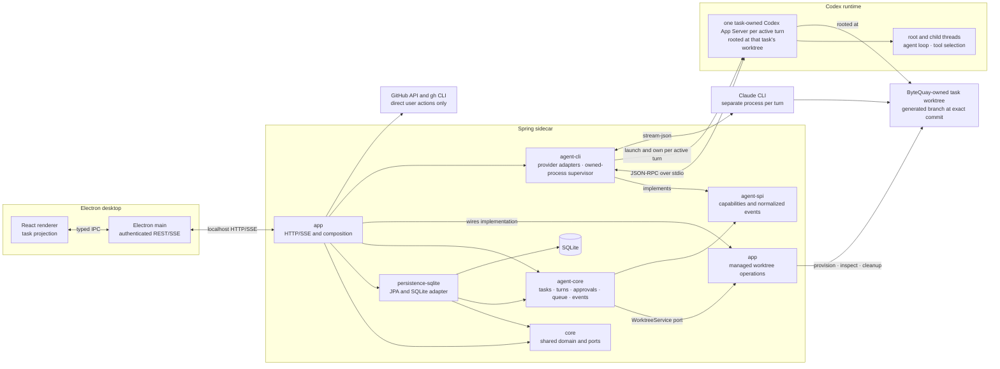

# ByteQuay Architecture

Issue-backed development exposes one read-only task-bound context tool through
the existing provider bridge. The application reads its durable issue association
and existing local caches; the tool performs no remote issue fetch. Codex and
Claude use the same source capability and receive its instructions on every
session. The shared conversation renders source and initial-request cards from
structured task facts while the existing agent service owns execution.

Private development and PR-owned **Local review comments** use domain values and a storage
port in `core`, one SQLite aggregate adapter in `persistence-sqlite`, and
application orchestration/HTTP in `app`. Existing task turns and queued inputs
deliver user discussion; their identities correlate the private card with the
transcript. A fixed task-scoped bridge in `agent-spi`/`agent-cli` permits local
agent replies and resolution without changing either task's execution profile.
Task, diff, and **Review & Learning** surfaces render the same saved discussions
through the shared review-card presentation. PR-owned report messages retain a
run-scoped card identity for independent summary, commit, evidence, and finding
discussions, and development PRs reuse that report workflow. No GitHub comment is created by this path.
PR review uses two sequential turns in its existing task: investigation saves
hypotheses and assessed scope, then validation checks them before reporting.
The application coordinator, existing turn idempotency, and two run fields
(investigation and validation-start) own this progression; no new task engine
or module is added.

App-wide [managed agent skills](agent-skills.md) combine private packaged
system guidance with user-added skills in the existing SQLite application-settings
port. Application services own the composition and user skill collection;
agent core supplies task identity when resolving each session's instructions.
User skills have Global, Development, or Review scope. Global applies to all
sessions; development identity or open review ownership adds only the matching
user skills, and helpers receive Global only.
The application includes development guidance only for development tasks and
adds private review guidance through the bridge for open review-owned tasks.
Helper sessions receive common guidance. `agent-spi` carries these instructions
to each provider adapter. No additional Maven module or
provider plugin system is introduced.

ByteQuay is a local-first macOS desktop application. Its Electron and React
frontend talks to one Spring Boot sidecar on localhost. The sidecar integrates
with GitHub, stores durable local state in SQLite, and hosts the implemented
worktree-scoped agent service. Its implemented rich task surface is specified
in [Agent Task UI Design](agent-task-ui.md).

[Repository Context](repository-context.md) stores the workspace notebook in the
existing application-settings port. Bounded values live in core; local editing,
source capture from retained review evidence, and HTTP live in app. Explicit
workspace deletion clears the notebook after existing ownership checks.
Review startup captures bounded local selection and retained evidence on the
existing review run, whose nullable context JSON is mapped by persistence-sqlite.
Matching and history reuse existing Git, repository enrichment, PR, issue,
review and task services/stores. Enabled scope rules gate notes; within those
matches, saved lessons rank by distinct title/summary words shared with PR text
or changed basenames. Knowledge leads within each scope rank, and lessons with
only a scope match remain lower-priority candidates. Match reasons disclose this
lexical heuristic; applicability remains unverified and packet budgets are
unchanged. Completed task-summary lookup scopes workspace and the selected
physical repository before its row limit; task and review
excerpts share one three-item cap. Snapshot capture occurs before provider admission and records
prepared text and bounded baseline input fingerprints, not confirmed delivery.
Input identities are read from frozen Git objects outside notebook mutations;
failed or partial inventories retain gaps instead of reusable digests.
Selected baseline-file and document reads append bounded typed source receipts
to that context, with exact excerpts stored once in existing run evidence.
Core validates receipt identity, bounds and evidence references; persistence
serializes the closed receipt types in the existing run JSON. App reads pinned
local baseline blobs or registered documents, then rechecks turn ownership and
retains receipt/evidence in one run update. These reads do not mutate the shared
notebook or certify source applicability or completed knowledge preparation.
The Electron bridge exposes typed notebook reads and revision-guarded edits.
Workspace settings renders knowledge, lessons, scopes and documentation sources;
private review messages can be saved as user-edited lessons bound to their original
run, with an explicit scope choice before saving. Review details renders the
retained packet, sealed investigation brief and collection supplements, source
receipts, and per-turn input bindings with gaps and provenance. Delivery labels
are derived from existing turn facts; preparation alone is never acceptance.
Opening either surface performs no generation or remote
fetch. Review-owned generation now uses `RepositoryContextPreparation` through
one fixed BEGIN/SUBMIT tool on enabled initial investigation turns. Git/input
inspection and report validation run outside locks; accepted ownership/results
and the exact run operation journal commit under the workspace lock in the existing
AgentUnitOfWork transaction. One workspace owner fences concurrent generation;
READY/EMPTY reuse compares full input inventories and preserves checked blank
receipts. Reconciliation clears only a terminal turn with no task runtime claim,
recording FAILED and preserving saved notes. Settings displays these retained
outcomes. Accepted preparation responses expose their saved operation key as
receiptRef, so investigation reports can validate citations to the same run.

The framework-free ReviewTurnInputResolver port in agent-core composes reference
input after turn acceptance, outside the task monitor and before provider launch.
Its app implementation uses the existing review assignment fence to select the
saved run setting and immutable packet prefix. Core rechecks cancellation and
worktree ownership, then sends the composed AgentTurnCommand message through the
existing provider transport. Original accepted input/transcript text stays intact;
source bodies do not enter managed instructions or process arguments. Direct,
queued and resumed turns use this same boundary, including old-card discussions
bound to their original run. Off and absent historical snapshots add no input.

ContextContribution and ContextDelivery are bounded core values in the existing
run JSON. Investigation seals the first contribution atomically with its report
and replay receipt; at most two collection supplements append. Each rendered
contribution fits 8 KiB, every packet fits 32 KiB, and composed message text fits
256 KiB UTF-8. A maximum of 128 turn bindings stores exact packet prefix/digest
and input digest/size, not another lifecycle state. contextDeliveryStates in the
run projection derives acceptance from AgentTurn provider references, startedAt
and knownUnsent; a missing receipt is uncertain. No automatic uncertain resend
or model acknowledgment is introduced.

Selected historical-source learning extends the existing source/preparation
boundary: one merged PR or closed issue yields a bounded typed ContextHistoryRead
and exact retained run evidence. BEGIN can admit up to ten already captured
history IDs into scope input fingerprints; SUBMIT validates those same identities.
History-backed generated knowledge also needs nonblank captured monitored-baseline
evidence. History cannot prove EMPTY or automatically become user-owned memory.
Closed-issue discovery remains separate from selected reads and the open cache.

The implemented Find suggestions and Use selected suggestions actions precede
Learn. The implementation checklist records verification. Discovery inspects a
frozen monitored baseline only in an existing
local repository; it does not provision, clone, Git-fetch or start an agent.
Optional remote history search remains bounded and separate. Acceptance rederives
selected proposal IDs outside locks, rejects moved baseline/routing, then appends
configuration under the existing revision/owner guard. Scope and source
discoveryEvidenceRef values point to application-captured RepositoryFile excerpts
in notebook sourceEvidence, retained even before notes exist. BEGIN does not
register proposals or expand the accepted Learn source assignment.
Repository traversal is bounded breadth-first across eligible directories at any
depth, including below manifest directories. Queries prioritize children and
filter scope proposals without pruning nonmatching ancestors. The existing eight
manifest names, 24-directory/24-file caps, first-100-entry directory pages and
safe-path/hidden/generated/vendor exclusions remain. Symlinks and submodules are
not followed. No workspace parser, build execution or dependency is added;
discovered configuration still requires captured evidence and user acceptance.
Preview/apply carry a required repositoryFingerprint over routing and
lastCodeSyncAt. Metadata is captured and rechecked under the workspace lock,
alongside a final bounded local rev-parse before notebook registration. That
two-second/no-lazy-fetch ref check catches a failed sync that moved the ref
without recording lastCodeSyncAt; it holds no notebook transaction or task
monitor. Candidate Git reads and all network/model work stay outside that lock.
These guards reject preview transfer to another upstream at the same commit
and synchronization completed while acceptance awaited the lock.
Local history uses bounded GitBrowseService.localLog with no lazy fetch or
replacement objects. Repository source reads share the configurable
`bytequay.repository-context.discovery-timeout=30s` budget: one Stopwatch supplies
remaining time to Guava SimpleTimeLimiter on the existing ioExecutor. Only the
caller mutates the scan; timeout preserves completed suggestions with a gap,
and late worker results are not merged. Interruption restores the flag and aborts
before history or configuration saving. No scheduler is added. Git command limits
and history budgets remain separate; this is not a thirty-second HTTP latency
or measured-performance guarantee.

Cold-start implementation includes this historical-source path, standalone Learn
and Refresh knowledge, scope/root proposals and bounded resolved-history
discovery. Fresh discussion-source supplements and selected deferred-note
exact-version reads are next. The user starts a visible,
stoppable ordinary task with selected scopes; it reads repository files, directory
structure, repository documentation and registered docs by default, including
the first run. Those sources are part of the assignment, not optional switches.
Selected merged-PR/closed-issue references add optional history. Opening the app,
workspace or settings, startup recovery and source synchronization never start
or resume learning; there is no background learning scheduler.
ContextBuildStore keeps the latest accepted task/source binding in existing
settings, separately from notebook content. ReviewBridgeResolver selects its
fixed context tools and restricted profile from that binding, never from prompt
text or a synthetic review. Shared preparation retains mandatory task/turn
ownership with review/run IDs either both present or both absent. Existing task
events drive settlement; a terminal task keeps its binding until recorded
worktree removal permits replacement. Reconciliation leaves already-FAILED
tasks' worktrees for explicit purpose-scoped cleanup; GET and startup cannot
infer safe removal from a recovery claim discarded by Mark failed. Project input
fingerprints include root entry names/modes without hashing every unrelated
repository content change.
Project overview is a default scope before any note exists; its generated content
belongs under Knowledge. Save lesson remains the explicit user-owned memory
action. Selected deferred-note exact-version reads and fresh
discussion-source supplements follow cold start. Citation navigation, folded
activity and measured provider/performance/quality retain their acceptance gates.

[Development delivery](development-delivery.md) extends the current agent core
through one application coordinator. Core reserves its source owner after a
verified stopped turn, and the coordinator drives generated commit/publication
turns, existing CI work, final checks, source synchronization, and ready promotion.
The existing owner also drains admitted program actions before Stop/shutdown
cleanup. Existing turn reports and task lifecycle events carry gates and progress;
there is no overall delivery state machine or restart recovery.

CI description repair reuses the fixed CI tool bridge in `agent-spi` and
`agent-cli`; application CI orchestration owns validation and remote writes.
The existing attempt stores the exact proposal and write/verification facts in
`core` and `persistence-sqlite`. It adds no module or independent workflow engine.

## 1. Architecture decision

The backend is a small six-module Maven reactor. Every listed module contains
implemented behavior; no empty extension or connector modules are reserved for
future work.

```text
backend/
├── pom.xml                         # Parent and reactor aggregator
├── core/
│   ├── pom.xml
│   └── src/                        # Shared domain values and storage ports
├── persistence-sqlite/
│   ├── pom.xml
│   └── src/                        # JPA entities, repositories, converters, stores
├── agent-spi/
│   ├── pom.xml
│   └── src/                        # Provider contract and shared provider values
├── agent-core/
│   ├── pom.xml
│   └── src/                        # Agent task and turn orchestration
├── agent-cli/
│   ├── pom.xml
│   └── src/                        # Codex, Claude, and process implementations
└── app/
    ├── pom.xml
    └── src/                        # Spring Boot composition root and executable
```

This is the smallest split that gives SQLite and agent providers real
boundaries without turning each package into a Maven module.

The module, provider-process, and desktop boxes below exist today. The diagram
shows the implemented rich-task flow from
[Agent Task UI Design](agent-task-ui.md), including authenticated renderer
transport, child-thread projection, normalized events, attachments, queueing,
and task controls.



## 2. Why SQLite is a dedicated module

The database adapter remains in the dedicated `persistence-sqlite` module.

The current SQLite package already contains a cohesive adapter:

- JPA entities and Spring Data repositories;
- JSON, collection, map, and time converters;
- pull-request, repository, watched-repository, view-state, detail, and
  credential stores;
- SQLite- and Hibernate-specific transactions; and
- credential-at-rest encryption used by the credential store.

The current agent service stores task, turn, metric, durable approval,
event-outbox, input-delivery, and queued-input facts in the same database; only
the live approval callback remains process-local. A task stores the immutable
ownership facts returned by `WorktreeService`; there is no separate worktree
allocation table or lifecycle. Keeping the durable implementations together
localizes Hibernate, Spring Data JPA, the SQLite driver, entity scanning,
schema ownership, and database integration tests.

The module is an outbound adapter, not a business-service layer. Controllers,
GitHub clients, task orchestration, provider protocols, and UI projections must
not move into it.

### 2.1 Dependency inversion

`persistence-sqlite` cannot depend on `app`, because `app` depends on the
persistence implementation at runtime. The extraction established this
direction by:

1. moving shared immutable domain values from `com.bytequay.app.domain` to
   `core`;
2. defining narrow storage ports in `core` for current GitHub/PR data;
3. keeping agent storage ports in `agent-core`;
4. making `persistence-sqlite` implement both sets of ports; and
5. making `app` depend on the ports and compose the SQLite implementations.

The result has no Maven cycle:

```text
app -> core
app -> persistence-sqlite
app -> agent-core
app -> agent-cli
persistence-sqlite -> core
persistence-sqlite -> agent-core
agent-core -> agent-spi
agent-cli -> agent-spi
```

Do not create a generic `Repository<T>`, a database-neutral entity model, or
a separate `database-spi` module. Storage ports belong beside the domain
behavior that uses them; SQLite implements those ports.

### 2.2 Persistence module contents

Suggested packages:

```text
com.bytequay.persistence.sqlite
├── config/                          # Entity and repository scanning
├── converter/                       # JPA column converters
├── credential/                      # Encrypted credential persistence
├── entity/                          # JPA entities
├── repository/                      # Spring Data repositories
└── store/                           # Domain-port implementations
```

`CredentialCipher` may move with the encrypted credential store because it
protects data at rest and uses no application behavior. It should remain a
concrete implementation, not gain a speculative cipher interface. GitHub CLI
token selection and credential policy remain in `app`.

The module should expose one explicit Spring configuration:

```java
@Configuration
@EntityScan(basePackageClasses = SqlitePersistenceMarker.class)
@EnableJpaRepositories(basePackageClasses = SqliteRepositoryMarker.class)
@ComponentScan(basePackageClasses = SqlitePersistenceMarker.class)
public class SqlitePersistenceConfiguration
{
}
```

`app` imports that configuration. It remains the only executable module and
the only place that chooses SQLite as ByteQuay's storage implementation.

### 2.3 Schema ownership

`persistence-sqlite` owns:

- JPA entity mappings;
- SQLite column representations;
- converters and repository queries;
- transactional store implementations; and
- database integration fixtures.

Hibernate continues to own schema creation and updates. The module does not add
Flyway or migration-history machinery until ByteQuay has a real released-data
migration contract.

The runtime database remains:

```text
~/Library/Application Support/ByteQuay/bytequay-1.0.db
```

Tests continue to use unique SQLite files under the system temporary
directory.

One backend owns that file at a time. Startup takes an exclusive
operating-system lock on `backend.lock` beside it, before Spring initializes
SQLite, and a second backend exits with a message naming the process that holds
the lock. Two JVMs on one SQLite file fail every read-then-write transaction
with `SQLITE_BUSY` — SQLite skips the busy handler when a reading transaction
upgrades to a write — and their sync sweeps delete each other's rows. The port
fallback cannot prevent that; a second backend simply moves to another port and
keeps the same database. The kernel releases the lock however the holder dies,
so a leftover lock file never blocks a restart.

## 3. Module responsibilities

| Module | Owns | Must not own |
| --- | --- | --- |
| `core` | Shared immutable PR/repository values, credential storage values, and current-feature storage ports | Spring, JPA, SQLite, HTTP, provider protocols, or UI DTOs |
| `persistence-sqlite` | JPA entities, repositories, converters, encrypted credential storage, current-feature stores, and agent stores | Controllers, GitHub clients, task orchestration, or provider protocols |
| `agent-spi` | Driver/session/run contracts, shared command authorization policy, lane IDs, capabilities, typed readiness, normalized provider events with opaque source identity, and usage samples | Spring, JPA, HTTP, SQLite, CLI process code, or provider SDKs |
| `agent-core` | Agent task/turn state, the shared worktree-service contract, mutation claims, event sequencing, approvals, input delivery, durable queued inputs, attachment references, metrics, completion, cleanup, and agent storage ports | Workspace path resolution, Git process implementation, Codex/Claude wire formats, JPA entities, or HTTP DTOs |
| `agent-cli` | Per-turn task-owned Codex App Server client, Claude `stream-json` client, binary discovery, owned-process supervision, event mapping, and fixtures | Task tables, SSE, GitHub PR behavior, or database code |
| `app` | Spring composition, HTTP/SSE, GitHub clients, application services, managed workspace/worktree Git operations, schedulers, configuration, and executable packaging | Provider branching in controllers or direct JPA access from web code |

The frontend remains an npm project and does not become a Maven module.

## 4. Why there are no more modules

The current GitHub clients and pull-request services have one application
consumer and share the Spring Boot runtime. They stay in `app` until a second
consumer or independent release boundary exists.

Codex and Claude stay together in `agent-cli` because they share process
discovery, stream draining, cancellation, output limits, and fixtures. Split
them only if their dependencies, ownership, or release cadence diverge.

There is no parser module. Provider parsing is an implementation detail of
`agent-cli`. There is no connector framework: `AgentDriver` is the only
extension point currently justified.

## 5. Dependency and composition rules

1. Dependencies point toward framework-free contracts.
2. No module depends on `app`.
3. `app` is the only composition root and executable JAR.
4. `core`, `agent-core`, and `agent-spi` contain no Spring annotations.
5. `persistence-sqlite` never exposes JPA entities across its public ports.
6. `agent-cli` never writes SQLite or publishes SSE.
7. Native tools follow the selected task sandbox and approval policy. Shared
   `AgentCommandPolicy` instructions and restrictions belong in `agent-spi`;
   adapters translate them into native model and reviewer configuration without
   a second shell command parser. Attended development may use authenticated
   `git` and `gh`, with GitHub writes requiring direct explicit authorization
   from user input or accepted automation. Review, CI, cherry-pick, and helpers
   retain narrower profiles. Fixed task tools are defined by their feature
   designs: CodeGraph exploration, review/local reporting, task-scoped CI
   evidence, and the bounded development publication tool. They do not create
   a general product-tool framework.
8. Java Platform Module System descriptors are unnecessary; Maven dependency
   direction is sufficient.

The current parent POM aggregates all six implemented children:

```xml
<packaging>pom</packaging>

<modules>
    <module>core</module>
    <module>agent-spi</module>
    <module>agent-core</module>
    <module>agent-cli</module>
    <module>persistence-sqlite</module>
    <module>app</module>
</modules>
```

Dependency and plugin versions belong in the parent. Each child declares only
the dependencies it uses.

Authored PR assignment reuses interactive tasks, with a `PullRequestTask`
association and storage port in `core`, Hibernate entity/store in
`persistence-sqlite`, and application orchestration in `app`. Its explicit PR
identity lets a task imported at a fetched PR head retain the original PR in
its side pane independently of its generated local branch. The association
is removed with task deletion.

## 6. System data flow

### 6.1 Pull-request flow

Display and refresh are separate paths:

1. A frontend display request for a stored PR ID reads detail, diff metadata, or stored file content
   through a `core` storage port and returns the local SQLite snapshot.
2. A direct repository-and-number detail request also reads SQLite first, but fetches that exact PR
   from GitHub on a local miss. This establishes a directly opened row or preserves GitHub's
   authoritative `404` when the PR does not exist.
3. `CredentialService` binds the resolved token to its GitHub user profile in one in-memory account
   record. Repeated profile, PR-sync, and CI-autofix reads reuse that record; changing the resolved
   token invalidates it and resolves `/user` once for the new credential.
4. The PR page and task panel share one detail hook addressed by repository and PR number.
   Both render persisted detail first, then start a non-overlapping five-second conditional refresh
   loop while visible. An unchanged PR ETag refreshes only CI and
   mergeability and returns a status-only response; a changed PR ETag rebuilds and returns the full
   UI detail snapshot. Check runs and combined commit statuses carry their own stored ETags. An
   exhausted GitHub rate limit pauses the loop until GitHub's reported reset time.
5. The user-triggered detail refresh bypasses the PR ETag, rebuilds the complete local detail and
   default diff snapshots, and returns the full detail response. Both surfaces share a diff hook
   that reloads cached files and commits after refresh and fetches the exact parent-to-head
   comparison when the user selects a commit range.

The normalized repository name and PR number uniquely identify a pull request in SQLite. GitHub's
search and pull-request endpoints expose different numeric IDs for the same PR, so ingestion retains
the existing local row ID whenever either endpoint returns that repository-and-number pair.

Repository refresh discovers every pull request updated within 30 days without filtering by state,
plus older pull requests that remain open. Search results can add or update rows but their absence
never deletes a row. A known row omitted by the current search is reconciled through GitHub's exact
repository-and-number endpoint before retention runs. Closed rows expire only after both their close
time and last GitHub update are older than 30 days. The background job runs six minutes after its
previous refresh completes. New PRs, changed GitHub update timestamps, and missing local details
refresh the full aggregate immediately. An unchanged open dashboard PR refreshes mergeability and CI
when its stored status is at least six minutes old, including older open PRs. Explicitly monitored
PRs continue refreshing after closure; unmonitored unchanged closed PRs are skipped. Authored closed
PR discovery uses recent activity, so a new comment can bring an older closed PR back into the snapshot.

Dashboard refresh requests for the same GitHub credential join an in-flight dashboard refresh and
reuse a successful dashboard snapshot for six minutes after it completes. A credential change waits
for older in-flight work and then starts a new scan. This keeps a manual refresh from queuing behind
scheduled repository work and then repeating the same GitHub discovery scan. The frontend keeps the
persisted list visible while a refresh is in progress, reloads the current search when it completes,
and reports sync failures in the list without replacing cached rows. The pull-request toolbar reuses
the existing dashboard and repository list scans, running the repository scan once for each currently
monitored repository. It persists only fields returned by those list APIs; detail-derived metrics and
diffs remain cached until the selected PR's focused polling or the scheduled full refresh updates
them. The global list combines personalized dashboard rows with current workspace projections.

Default PR diff files and commit metadata refresh with changed PR detail. Commit-range diffs and
full file bodies refresh only after the user requests that range or expands that file, and are
persisted before they are displayed.

GitHub writes remain behind direct comment, approve, ready-for-review, failed-check rerun, or merge actions.
Merge and queue submission finishes when GitHub acknowledges the write; the dialog closes before
the detail and list refresh completes. These writes invalidate the detail ETag while retaining
the stored snapshot and diffs, so refresh can reuse unchanged patches and concurrent readers
continue to see cached data.

Home and Workspace Home read an unpaginated personal attention projection. Authored PRs follow all
activity, including drafts and closure. Other PRs qualify for review requests, or new commits and
merge readiness when the user was requested or has reviewed them. Repository watching alone does
not make another author's failed CI actionable. A bell on each PR card explicitly monitors that PR;
monitoring is local SQLite state and performs no GitHub write. Enabling it establishes a current
activity baseline without fetching repository permissions or diffs. Existing detail snapshots receive
the fresh activity while retaining cached write access; a missing detail remains a normal cache miss.
Subsequent changes enter Needs attention. Stored activity timestamps include
check changes that do not advance GitHub's PR update timestamp.

Attention rows display the latest known GitHub action, its actor, and its own event timestamp.
The local timeline supplies this summary in one batch read; display never fetches GitHub or loads
full PR details per row. Local workflow events and subscription bookkeeping are excluded. When
GitHub's PR update timestamp is newer than the known timeline action, the row says `Updated`
without attributing it to a person. The row's age and ordering within each attention reason use
this GitHub timestamp, while the reason remains on the icon tooltip and preview. Local activity
timestamps continue to drive monitoring and acknowledgment, independently of the displayed age.

Electron checks the local attention projection every 30 seconds and shows a native notification for
new monitored activity discovered by GitHub refresh. This continues while the app runs with its window
closed. Notification clicks open the PR in ByteQuay. Delivery marks and a copy of the renderer's local
acknowledgment/snooze state survive restart in Electron's application data. Acknowledgment and
"until new activity" snoozes wake on changed activity; timed snoozes remain quiet until their deadline.
The bell does not announce activity that predates enabling it.

### 6.2 Issue flow

Issue display and refresh use the same local-first boundary:

1. Issue list, individual issue, activity, and type display requests read SQLite only.
2. `WorkspaceIssueRefreshService.refreshIssues` fetches and persists the open-issue projection;
   the scheduled job and the frontend refresh action call this same method.
3. `WorkspaceIssueRefreshService.refreshDetail` fetches one issue's activity and type data,
   persists one detail snapshot, and then rereads it for the explicit frontend refresh response.
4. Direct comment, close, type, assignee, and label writes update the affected local projection so
   later display requests still read SQLite. Closing removes the issue from the open-only projection.

Markdown reference previews use the cached workspace issue when available. On a cache miss,
the exact repository-and-number preview endpoint reads GitHub directly, including closed issues
and repositories without a workspace, without changing the open-only issue projection. The preview
preserves GitHub's issue state and identifies issue-form URLs that actually refer to pull requests.

### 6.3 Agent task flow

The Codex/Claude adapters, backend task/event services, Electron bridge, and
React projection implement this end-to-end flow:

1. The React renderer calls typed preload operations. An interactive create
   request carries a client-generated task ID used for idempotent creation and
   a workspace ID, never a repository or worktree path. Electron main adds the
   private desktop session credential and sends the localhost HTTP request.
2. `app` validates that task ID, resolves an exact commit in the selected
   workspace, and generates a concise title and branch from the complete request
   and accepted issue context in an isolated text-only helper. It then provisions one ByteQuay-owned generated branch/worktree
   through the shared synchronous `WorktreeService`. Only after the returned
   worktree is verified does it create or resume the worktree-scoped task
   through `agent-core`.
3. `agent-core` enforces lifecycle and queue rules and selects an
   `AgentDriver` through `agent-spi`.
4. For each active Codex turn, the adapter opens one task-owned App Server in
   that task's worktree under the selected model's `NONE`, V1, or V2 launch
   profile. Every root or child thread in that process belongs to that task.
   The process is stopped when the turn settles; the stored root thread ID is
   resumed by a fresh process for a later turn. The Claude adapter remains a
   separate `stream-json` process per turn.
5. App Server owns the Codex model/tool loop, built-in tool execution, and
   provider approval requests. Its default environment is rooted at its own
   working directory, which is the task worktree. Attended Codex `AUTO` also
   permits ordinary `/tmp` and `$TMPDIR` writes; other writes outside the
   permitted roots require provider approval.
   Each driver maps only user-visible provider facts to normalized ByteQuay
   events.
6. `agent-core` correlates task, agent thread, turn, and item identity. Each
   SQLite state change and matching event commit through one unit-of-work and
   outbox before JSONL/SSE publication. A task-local worktree-mutation claim serializes
   turns, queued starts, and completion; an explicitly queued input starts only
   after a successful terminal turn. The turn claim is released only after
   metadata-only `thread/read` and a one-turn `thread/turns/list` status page
   confirm native/latest-turn status, parent-filtered `thread/list` closes the
   child inventory, loaded
   agents are idle with empty background-terminal inventories, and
   the task-owned runtime cleanup is verified. The adapter records finished
   provider work durably before stopping the process. Cleanup failure preserves
   that provider result and holds the claim. Durable task lifecycle is only
   `OPEN -> COMPLETED | FAILED`;
   running, idle, closing, and recovery required are derived from turn state,
   mutation-claim ownership, and provider quiescence. A provider terminal,
   failed, cancelled, or interrupted status alone never proves tools stopped.
   Typed live notifications supply provider activity; replay restores ByteQuay's
   durable event sequence. Legacy provider history cannot reconstruct exact lost
   tool events because it omits items and synthesizes IDs.
   The completion correction separates provider completion from process
   cleanup and preserves process identities when an observation fails. Its
   implementation contract and regression gate are in
   [Agent Service §5.6](agent-service.md#56-process-ownership-correction).
7. `persistence-sqlite` stores task, turn, input-delivery, queue, approval,
   owned-process, and metric facts, including the task's immutable worktree
   ownership values; detailed history and bounded attachment/output blobs
   remain in the task runtime directory.
8. `app` exposes replay and live events through one task SSE sequence.
   Electron main reconnects from the last sequence and forwards typed events
   to the renderer.
9. The renderer derives transcript grouping, folded activity prose, plans,
   icons, elapsed clocks, queue state, and root/child navigation without
   interpreting raw provider payloads.
10. Native execution remains in the provider harness. Fixed task tools follow
    the separately defined CodeGraph, review, local-comment, and development
    delivery contracts. Generated draft publication uses its task-bound tool
    and backend-verified destination and lease; an ordinary user turn may
    instead perform explicitly authorized CLI publishing under the shared
    command policy.

The detailed backend contract is in
[Agent Service Design](agent-service.md); the frontend behavior is in
[Agent Task UI Design](agent-task-ui.md).

### 6.4 Embedded browser pages

Electron main owns one `WebContentsView` per visited browser tab. The React
browser rail and toolbar present that state through the typed preload bridge.
Returning to ByteQuay or selecting another tab detaches the native surface
without destroying the page, preserving navigation history, drafts, and scroll
position while the app remains open. Only an explicit tab close or window/app
shutdown releases its web contents.

Pinning stores the page URL and display metadata in a local file under Electron
user data. Pinned entries return after restart; their pages load only when
selected. Unpinned tabs are retained for the current window. All embedded tabs
reuse `persist:inapp-browser`, so existing cookies and site storage remain
available subject to each website's expiry and sign-in policies. No external
browser cookies or backend API credentials are copied into this session.

The far-left rail collapses to icons or expands to titles, and the Web pages
control above Settings hides or restores the column without closing tabs.
Browser pages open in a centered zoom overlay using roughly 80% of the window
area. A toolbar control switches between zoom and filling the available window;
Settings → Browser → Full screen behavior chooses the default for each opening,
with Zoom as the initial preference. The toolbar address field navigates on
Enter. The browser surface starts to the right of the visible rail, and the
underlying ByteQuay surface remains mounted but inert while a page is shown. Browser IPC validates the app renderer and main
frame, and native bounds are converted from CSS pixels using the app renderer's
zoom factor, rounded inward, and clamped to the window. Page-load failures and
renderer crashes detach the native surface and expose a reload action.

## 7. Operational boundaries

- The backend listens only on `127.0.0.1`, first trying port `9527` and
  falling back to an OS-assigned port when it is occupied. After startup it
  reports the selected port to Electron; development startup passes that
  port through `BYTEQUAY_BACKEND_PORT`.
- SQLite and runtime files stay under ByteQuay's application-support
  directory.
- There is one Spring application context and one SQLite database.
- Every agent task uses a separate worktree generated under its managed
  workspace by the shared service described in
  [Managed Worktree Service](worktree-service.md). The renderer never selects a
  repository or worktree path. Each provision, inspection, and cleanup call
  derives and revalidates the expected path, repository, branch, and commit.
  A half-finished or mismatched orphan is preserved and reported for manual
  inspection; startup does not run a worktree recovery state machine. Owned
  provider processes are still reconciled before agent endpoints become ready.
- Normal task completion requires a clean generated branch, removes the
  worktree without force, and always retains that branch as the local result.
  Worktree add/remove operations are serialized per managed repository; work
  inside different ready worktrees remains concurrent.
- Interactive development exposes `git` and `gh` through native provider tools.
  Shared scope rules require authorization and verification of the actual
  repository, remote, task branch, outgoing changes, and complete shell action.
  These are model-based checks, not OS-enforced remote or branch capabilities.
  Existing filesystem isolation and native denials remain. Codex keeps shell
  networking off until native escalation; Claude sends interactive Bash through
  native classification and keeps sandbox escape disabled. Provider decisions
  can differ while following the same ByteQuay scope.
  A finite shared Git CLI environment allowlist supports existing CLI login,
  credential helpers, SSH-agent routing, and configured GitHub environment
  tokens in eligible sessions. ByteQuay never injects its stored GitHub token.
  Provider authentication does not select permissions; Claude subscription and
  API-key use share the same policy, and no new API driver is introduced.
- Stock provider tool workloads run through the selected sandbox and approval
  policy. App Server and Claude retain the provider traffic their control loops
  require; endpoint-level OS filtering is not claimed by this first design.
  Fixed task-tool boundaries are specified separately; the optional CodeGraph
  tool remains fail-open. Directly owned App
  Server and Claude processes use durable launch intents/markers. Codex first
  verifies current-run agent status, tools, children, and background terminals,
  records finished work on that launch, and stops the per-turn App Server.
  Only verified root/group/known-descendant cleanup permits claim release;
  durable provider completion may resolve a historical observation gap, never
  a live known process. This does not claim arbitrary native-process
  containment. Agent Service §5.6 specifies recovery and regression coverage.
  Codex JSON-RPC and Claude stream-json stdout are lossless protocol streams:
  bounded queues apply backpressure instead of a lifetime byte cap or dropped
  bytes. Frame, stderr-capture, and UI output limits remain independent.
- Every active Codex turn starts its task-owned App Server with an explicit
  isolation baseline. Before creating or resuming a thread, ByteQuay must
  verify through
  `config/read` that the effective session flags disable every unapproved
  optional feature, enable native live web for ordinary tasks (disabled for
  text-only helpers), expose no MCP server, and apply the minimal
  shell environment without inherited setters, exclusions, or filters.
  Ordinary tasks use native automatic approval review with ByteQuay's exact
  pinned policy. Native risk rules govern routine task prerequisites, including
  bounded build/test cache and temporary writes; the task request supplies
  authorization without a separate approval naming each cache path. Every
  GitHub write still requires direct explicit user authorization. Native
  denials and the prohibition on persistent or blanket future grants remain;
  `AUTO` does not guarantee approval of every test command.
  `hooks/list` must be empty. `skills/list` may contain only bundled system
  skills canonically beneath the isolated `CODEX_HOME/skills/.system`, never a
  repository, user, admin, plugin-owned, or out-of-root skill. The completed
  executable gate proves all three launch profiles: `NONE` disables both
  multi-agent implementations, V1 enables only `multi_agent` with the proven
  recursive depth, and V2 enables only `multi_agent_v2`. The model catalog runs
  under `NONE`; each accepted turn's immutable model snapshot selects its
  matching `NONE`, V1, or V2 task profile. Skill discovery and the origin/error
  guard repeat immediately before every turn so an earlier workspace-write
  turn cannot introduce a later skill.
- Before a Codex turn, the driver reads App Server's effective config layers
  for every task cwd, requires the isolated user layer, rejects project config,
  and rejects every `.rules` file beside a returned system, user, or project
  policy-bearing source. `packagedDefaults` and
  `legacyManagedConfigTomlFromFile` layers are not exec-policy sources. It also
  requires `configRequirements/read` to report no applicable managed
  requirements. A
  missing `requirements` field, non-null value, request failure, or undecodable
  response fails closed. This security-specific response must contain exactly
  that one top-level key; an unknown sibling policy field also fails closed.
  The exact v0.151 executable gate proves the isolated keyless value is
  explicitly null; supporting a broader shape later requires new executable
  evidence.
  These are the first-release guards against inherited exec-policy allow rules;
  App Server v0.151 has no public per-thread rule-disable or effective-rule
  inventory.
- Every Codex process ByteQuay starts runs with `CODEX_HOME` set to ByteQuay's
  own home under its application-support directory, signed in separately by
  the user with the command readiness shows. The user's `~/.codex` is never
  read, copied, or linked, and the variable is set on ByteQuay's processes
  only, so the user's own Codex sessions are unaffected.
- Every Claude CLI process ByteQuay starts uses `CLAUDE_CONFIG_DIR` pointing
  to `claude-home` under that same application-support directory. The sign-in
  command shown by readiness uses the same path; the CLI owns the credentials.
- There is one Codex App Server process per active Codex turn, launched with
  the task ID as its owner and the task worktree as its working directory. Its
  loss interrupts only that task's turn; stored thread IDs remain resumable by
  a fresh process for a later turn or explicit retry. A replacement starts only
  after the prior owned process tree is `VERIFIED_STOPPED`. An unverifiable
  close retains that runtime's session/process identity and `TURN` claim so a
  confirmed Stop can retry termination and verification; only a later verified
  stop releases the claim, and it never resends the old turn.
- A task's process working directory is its explicit sandbox root. Attended
  Codex `AUTO` keeps ordinary `/tmp` and `$TMPDIR` allowances by setting both
  temporary-directory exclusions to false; other policies retain the exclusions.
  Attended Codex development and review turns also make `~/.m2/repository`, the user's Maven local
  repository, a writable root, with network still off; other cache directories
  are not writable roots, and native review handles those escalations. No
  separate execution environment is registered and no loopback listener is
  opened. Initialization declares
  `experimentalApi: true` for parent-filtered
  child listing and background-terminal list/terminate methods; ByteQuay calls no
  experimental environment method.
- A session owns the App Server process serving one active turn. Settlement
  closes that process and waits for the supervisor's `VERIFIED_STOPPED`
  receipt before `RunningTurn.completion()` can release the task claim. The
  runtime registry closes any remaining session at backend shutdown.
- The first release leaves the experimental, process-wide
  `--code-mode-host` option unset. It is not a per-task tool-routing API; any
  future custom Code Mode host needs a separately validated protocol design.
- App Server's command-level experimental maturity is an explicit product
  risk. ByteQuay uses its background-terminal API but not the removed
  experimental environment family. A fixed v0.151.0 reference fixture
  generates bindings with experimental definitions enabled. Production sets
  `bytequay.agent.codex-minimum-version` to `0.156.1`. At startup it upgrades
  an older installed Codex CLI to that exact configured release through npm
  and keeps equal or newer versions. Readiness, catalog discovery, and task
  launch check the configured executable against the minimum, including after
  an upgrade. Failed or unreadable version checks remain unavailable; a
  reported mismatch includes a versioned installation command in its diagnostic.
  The v0.151.0 fixture remains historical protocol evidence. A real protocol
  incompatibility blocks the affected operation and reports that detected
  version so the issue can be fixed.
- Maven module boundaries do not create processes or network boundaries.
- The packaged app starts only the `app` executable; library modules are
  ordinary JAR dependencies.
- Current Checkstyle, license, unit, SQLite integration, and Spring context
  checks run from the backend reactor.

The separately locked [Agent Review](agent-review.md) design extends this
implemented baseline only for review-owned task context reads and local
review reporting. Its delivery is tracked separately. Review orchestration
stays in `app`, durable review values/ports in `core`, and SQLite adapters in
`persistence-sqlite`; execution remains in the existing agent modules. No
new module, general product-tool framework, or model-callable GitHub write
is authorized by that extension.

## 8. Extraction sequence

The initial module extraction was completed in this order. Future structural
changes keep the same rule: mechanical moves remain separate from behavior.

1. Create `core`, move shared domain records, and introduce current-feature
   storage ports without changing behavior.
2. Create `persistence-sqlite`, move SQLite/JPA classes and
   `CredentialCipher`, and import its configuration from the existing app.
3. Move the remaining Spring Boot source into `app`; update `dev.sh`, CI,
   license paths, and packaging.
4. Add `agent-spi`, `agent-core`, and `agent-cli` with the first implemented
   provider behavior.

Every step must leave the backend reactor passing `mvn verify`. Do not mix
the repository moves with agent behavior.

## 9. Tradeoffs

The dedicated persistence module adds two costs: shared domain/storage ports
must move upstream first, and Spring scanning must be explicit. Those costs are
worth paying once agent data joins the existing PR data because the module
then owns one real technical boundary and one database.

Keeping all code in `app` would be simpler today, but agent storage would
increase coupling between JPA, provider execution, task lifecycle, and web
code. Splitting every feature into its own SPI and connector would move too far
in the opposite direction. The six-module design keeps the replaceable edges
isolated and leaves single-consumer application behavior together.
