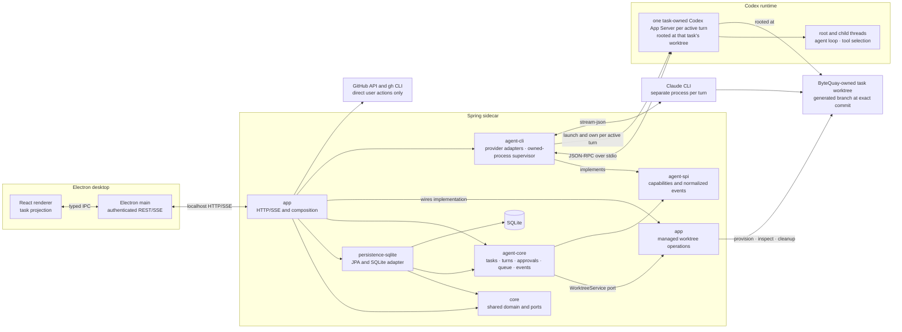

# ByteQuay Architecture

[WorkBench](workbench.md) owns the shared navigation, task-bound code access,
and reviews of local development commits. Its source and hosting contracts
apply to the existing services described here.

Remote-review worktrees catch up to observed PR heads through the existing
review observer, reconciliation, and task synchronization claim. A clean idle
checkout may advance without starting an agent review. The review aggregate
retains the last service-aligned worktree head separately from immutable review
run heads; SQLite adds that nullable field through Hibernate. Dirty or busy
worktrees remain untouched, and the derived projection reports why catch-up is
pending or blocked. No scheduler, sync job, or additional lifecycle is added.

Jira account management lives in application HTTP/services and the existing
encrypted SQLite connection store. Personal API-token connections verify the
site and account before saving, then authenticate directly to Atlassian's fixed
gateway. Token replacement preserves connection identity and task history;
tokens require manual renewal. Optional browser sign-in uses the separately
hosted `services/jira-auth` process, which holds OAuth secrets and rotating
grants. Its configured origin, pairing credential and verified account/site
identity bind API access. Browser authorization completes through the settings
page's bounded polling. Both paths reuse the same Jira service and cache; no
general connector framework is added.

GitHub jobs and Jira's scheduled and open-ticket polling share the existing
application quiet-hours policy. General settings owns its enable flag and local
time range; manual refresh remains independent. Jira automatic detail requests
are marked at the native API boundary so the backend can serve cached context
during quiet hours without a second clock or settings policy in the renderer.

Issue-backed development exposes one read-only task-bound context tool through
the existing provider bridge. The application reads its durable issue association
and existing local caches; the tool performs no remote issue fetch. Codex and
Claude use the same source capability and receive its instructions on every
session. The shared conversation renders source and initial-request cards from
structured task facts while the existing agent service owns execution.

Private development and PR-owned **Local review comments** use domain values and a storage
port in `core`, one SQLite aggregate adapter in `persistence-sqlite`, and
application orchestration/HTTP in `app`. Existing task turns and queued inputs
deliver user discussion; their identities correlate the private card with the
transcript. A fixed task-scoped bridge in `agent-spi`/`agent-cli` permits local
agent replies and resolution without changing either task's execution profile.
Task, diff, and **Review & Learning** surfaces render the same saved discussions
through the shared review-card presentation. PR-owned report messages retain a
run-scoped card identity for independent summary, commit, evidence, and finding
discussions, and development PRs reuse that report workflow. No GitHub comment is created by this path.
PR review uses sequential assignments in its existing task: investigation saves
hypotheses and assessed scope, then validation checks them before reporting.
A complete zero-finding result adds one nit-check investigation and validation
round before acceptance. The application coordinator, existing turn idempotency,
and persisted run assignments own this progression; no new task engine or module
is added.

App-wide [managed agent skills](agent-skills.md) combine private packaged
system guidance with user-added skills in the existing SQLite application-settings
port. Application services own the composition and user skill collection;
agent core supplies task identity when resolving each session's instructions.
User skills have Global, Development, or Review scope. Global applies to all
sessions; development identity or open review ownership adds only the matching
user skills, and helpers receive Global only.
The application includes development guidance only for development tasks and
adds private review guidance through the bridge for open review-owned tasks.
Helper sessions receive common guidance. `agent-spi` carries these instructions
to each provider adapter. No additional Maven module or
provider plugin system is introduced.

ByteQuay is a local-first macOS desktop application. Its Electron and React
frontend talks to one Spring Boot sidecar on localhost. The sidecar integrates
with GitHub, stores durable local state in SQLite, and hosts the implemented
worktree-scoped agent service. Its implemented rich task surface is specified
in [Agent Task UI Design](agent-task-ui.md).

Every accepted agent turn carries the repository's guideline files as
delimited reference data, read at a commit the turn cannot change.
[Repository memory](repository-memory.md) keeps short rules and specifications
per workspace in the `repository_memory` table, each with its sources.
Development tasks and reviews whose workspace has memories get the titles of the
matching ones at the start of every turn and one tool to search, read and report
them; no agent can edit one.

A [spec check](spec-check.md) compares one directory's code
with the specifications it links and reproduces each gap with a test. It runs as
one noninteractive agent task the user starts; its check and current turn binding
live in application settings, and task/turn records remain the execution
authority. ContextBuildCoordinator observes the task's events and settles each
turn without resending uncertain input. Workspace deletion removes both records.

[Development delivery](development-delivery.md) extends the current agent core
through one application coordinator. Core reserves its source owner after a
verified stopped turn, and the coordinator drives generated commit/publication
turns, existing CI work, final checks, source synchronization, and ready promotion.
The existing owner also drains admitted program actions before Stop/shutdown
cleanup. Existing turn reports and task lifecycle events carry gates and progress;
there is no overall delivery state machine or restart recovery.

CI description repair reuses the fixed CI tool bridge in `agent-spi` and
`agent-cli`; application CI orchestration owns validation and remote writes.
The existing attempt stores the exact proposal and write/verification facts in
`core` and `persistence-sqlite`. It adds no module or independent workflow engine.

## 1. Architecture decision

[Workspace relationships and backport chains](workspace-backports.md) reuse the
same modules. Direct Fork/Dependency settings and focused conversation links use
the existing application-settings store; discovery, memory reads and handoffs use
the shared provider bridges. A single versioned chain value/store in `core` and
`persistence-sqlite` records accepted routes and child identities. Its application
coordinator advances through the existing monitor, cherry-pick, delivery, CI and
rebase services. Each hop names its source dependency, allowing sibling backports
to proceed independently while dependent hops consume their parent’s landed PR. No additional agent or workflow engine waits for PR merges.

The backend is a small six-module Maven reactor. Every listed module contains
implemented behavior; no empty extension or connector modules are reserved for
future work.

```text
backend/
├── pom.xml                         # Parent and reactor aggregator
├── core/
│   ├── pom.xml
│   └── src/                        # Shared domain values and storage ports
├── persistence-sqlite/
│   ├── pom.xml
│   └── src/                        # JPA entities, repositories, converters, stores
├── agent-spi/
│   ├── pom.xml
│   └── src/                        # Provider contract and shared provider values
├── agent-core/
│   ├── pom.xml
│   └── src/                        # Agent task and turn orchestration
├── agent-cli/
│   ├── pom.xml
│   └── src/                        # Codex, Claude, and process implementations
└── app/
    ├── pom.xml
    └── src/                        # Spring Boot composition root and executable
```

This is the smallest split that gives SQLite and agent providers real
boundaries without turning each package into a Maven module.

The module, provider-process, and desktop boxes below exist today. The diagram
shows the implemented rich-task flow from
[Agent Task UI Design](agent-task-ui.md), including authenticated renderer
transport, child-thread projection, normalized events, attachments, queueing,
and task controls.



## 2. Why SQLite is a dedicated module

The database adapter remains in the dedicated `persistence-sqlite` module.

The current SQLite package already contains a cohesive adapter:

- JPA entities and Spring Data repositories;
- JSON, collection, map, and time converters;
- pull-request, repository, watched-repository, view-state, detail, and
  credential stores;
- SQLite- and Hibernate-specific transactions; and
- credential-at-rest encryption used by the credential store.

The current agent service stores task, turn, metric, durable approval,
event-outbox, input-delivery, and queued-input facts in the same database; only
the live approval callback remains process-local. A task stores the immutable
ownership facts returned by `WorktreeService`; there is no separate worktree
allocation table or lifecycle. Keeping the durable implementations together
localizes Hibernate, Spring Data JPA, the SQLite driver, entity scanning,
schema ownership, and database integration tests.

The module is an outbound adapter, not a business-service layer. Controllers,
GitHub clients, task orchestration, provider protocols, and UI projections must
not move into it.

### 2.1 Dependency inversion

`persistence-sqlite` cannot depend on `app`, because `app` depends on the
persistence implementation at runtime. The extraction established this
direction by:

1. moving shared immutable domain values from `com.bytequay.app.domain` to
   `core`;
2. defining narrow storage ports in `core` for current GitHub/PR data;
3. keeping agent storage ports in `agent-core`;
4. making `persistence-sqlite` implement both sets of ports; and
5. making `app` depend on the ports and compose the SQLite implementations.

The result has no Maven cycle:

```text
app -> core
app -> persistence-sqlite
app -> agent-core
app -> agent-cli
persistence-sqlite -> core
persistence-sqlite -> agent-core
agent-core -> agent-spi
agent-cli -> agent-spi
```

Do not create a generic `Repository<T>`, a database-neutral entity model, or
a separate `database-spi` module. Storage ports belong beside the domain
behavior that uses them; SQLite implements those ports.

### 2.2 Persistence module contents

Suggested packages:

```text
com.bytequay.persistence.sqlite
├── config/                          # Entity and repository scanning
├── converter/                       # JPA column converters
├── credential/                      # Encrypted credential persistence
├── entity/                          # JPA entities
├── repository/                      # Spring Data repositories
└── store/                           # Domain-port implementations
```

`CredentialCipher` may move with the encrypted credential store because it
protects data at rest and uses no application behavior. It should remain a
concrete implementation, not gain a speculative cipher interface. GitHub CLI
token selection and credential policy remain in `app`.

The module should expose one explicit Spring configuration:

```java
@Configuration
@EntityScan(basePackageClasses = SqlitePersistenceMarker.class)
@EnableJpaRepositories(basePackageClasses = SqliteRepositoryMarker.class)
@ComponentScan(basePackageClasses = SqlitePersistenceMarker.class)
public class SqlitePersistenceConfiguration
{
}
```

`app` imports that configuration. It remains the only executable module and
the only place that chooses SQLite as ByteQuay's storage implementation.

### 2.3 Schema ownership

`persistence-sqlite` owns:

- JPA entity mappings;
- SQLite column representations;
- converters and repository queries;
- transactional store implementations; and
- database integration fixtures.

Hibernate continues to own schema creation and updates. The module does not add
Flyway or migration-history machinery until ByteQuay has a real released-data
migration contract.

The runtime database remains:

```text
~/Library/Application Support/ByteQuay/bytequay-1.0.db
```

Tests continue to use unique SQLite files under the system temporary
directory.

One backend owns that file at a time. Startup takes an exclusive
operating-system lock on `backend.lock` beside it, before Spring initializes
SQLite, and a second backend exits with a message naming the process that holds
the lock. Two JVMs on one SQLite file fail every read-then-write transaction
with `SQLITE_BUSY` — SQLite skips the busy handler when a reading transaction
upgrades to a write — and their sync sweeps delete each other's rows. The port
fallback cannot prevent that; a second backend simply moves to another port and
keeps the same database. The kernel releases the lock however the holder dies,
so a leftover lock file never blocks a restart.

## 3. Module responsibilities

| Module | Owns | Must not own |
| --- | --- | --- |
| `core` | Shared immutable PR/repository values, credential storage values, and current-feature storage ports | Spring, JPA, SQLite, HTTP, provider protocols, or UI DTOs |
| `persistence-sqlite` | JPA entities, repositories, converters, encrypted credential storage, current-feature stores, and agent stores | Controllers, GitHub clients, task orchestration, or provider protocols |
| `agent-spi` | Driver/session/run contracts, shared command authorization policy, lane IDs, capabilities, typed readiness, normalized provider events with opaque source identity, and usage samples | Spring, JPA, HTTP, SQLite, CLI process code, or provider SDKs |
| `agent-core` | Agent task/turn state, the shared worktree-service contract, mutation claims, event sequencing, approvals, input delivery, durable queued inputs, attachment references, metrics, completion, cleanup, and agent storage ports | Workspace path resolution, Git process implementation, Codex/Claude wire formats, JPA entities, or HTTP DTOs |
| `agent-cli` | Per-turn task-owned Codex App Server client, Claude `stream-json` client, binary discovery, owned-process supervision, event mapping, and fixtures | Task tables, SSE, GitHub PR behavior, or database code |
| `app` | Spring composition, HTTP/SSE, GitHub clients, application services, managed workspace/worktree Git operations, schedulers, configuration, and executable packaging | Provider branching in controllers or direct JPA access from web code |

The frontend remains an npm project and does not become a Maven module.

## 4. Why there are no more modules

The current GitHub clients and pull-request services have one application
consumer and share the Spring Boot runtime. They stay in `app` until a second
consumer or independent release boundary exists.

Codex and Claude stay together in `agent-cli` because they share process
discovery, stream draining, cancellation, output limits, and fixtures. Split
them only if their dependencies, ownership, or release cadence diverge.

There is no parser module. Provider parsing is an implementation detail of
`agent-cli`. There is no connector framework: `AgentDriver` is the only
extension point currently justified.

## 5. Dependency and composition rules

1. Dependencies point toward framework-free contracts.
2. No module depends on `app`.
3. `app` is the only composition root and executable JAR.
4. `core`, `agent-core`, and `agent-spi` contain no Spring annotations.
5. `persistence-sqlite` never exposes JPA entities across its public ports.
6. `agent-cli` never writes SQLite or publishes SSE.
7. Native tools follow the selected task sandbox and approval policy. Shared
   `AgentPermissionScope` derives one provider-neutral decision from task
   policy, session access, and review ownership; shared `AgentCommandPolicy`
   instructions and restrictions belong in `agent-spi`. Codex and Claude
   adapters translate that decision into their own native sandbox and reviewer
   settings without a second shell command parser. Provider prompts that reach
   ByteQuay use its existing task approval service. Attended development may
   use `git` and `gh`, but ByteQuay does not pass ambient GitHub token,
   `GH_CONFIG_DIR`, or `SSH_AUTH_SOCK` variables into agent processes. GitHub
   writes require direct explicit authorization from user input or accepted
   automation. Review, CI, cherry-pick, and helpers retain narrower profiles.
   Fixed task tools are
   defined by their feature designs: CodeGraph exploration, review/local
   reporting, task-scoped CI evidence, and the bounded development publication
   tool. They do not create a general product-tool framework.
8. Java Platform Module System descriptors are unnecessary; Maven dependency
   direction is sufficient.

The current parent POM aggregates all six implemented children:

```xml
<packaging>pom</packaging>

<modules>
    <module>core</module>
    <module>agent-spi</module>
    <module>agent-core</module>
    <module>agent-cli</module>
    <module>persistence-sqlite</module>
    <module>app</module>
</modules>
```

Dependency and plugin versions belong in the parent. Each child declares only
the dependencies it uses.

Authored PR assignment reuses interactive tasks, with a `PullRequestTask`
association and storage port in `core`, Hibernate entity/store in
`persistence-sqlite`, and application orchestration in `app`. Its explicit PR
identity lets a task imported at a fetched PR head retain the original PR in
its side pane independently of its generated local branch. The association
is removed with task deletion.

## 6. System data flow

### 6.1 Pull-request flow

Display and refresh are separate paths:

1. A frontend display request for a stored PR ID reads detail, diff metadata, or stored file content
   through a `core` storage port and returns the local SQLite snapshot.
2. A direct repository-and-number detail request also reads SQLite first, but fetches that exact PR
   from GitHub on a local miss. This establishes a directly opened row or preserves GitHub's
   authoritative `404` when the PR does not exist.
3. `CredentialService` binds the resolved token to its GitHub user profile in one in-memory account
   record. Repeated profile, PR-sync, and CI-autofix reads reuse that record; changing the resolved
   token invalidates it and resolves `/user` once for the new credential.
4. The PR page and task panel share one detail hook addressed by repository and PR number.
   Both render persisted detail first. While visible, pending checks refresh every 30 seconds;
   metadata and discussion refresh every 60 seconds. A changed local attention snapshot triggers
   a refresh immediately. Hidden surfaces stop foreground polling. Requests never overlap, and
   a rate limit pauses polling until the reported retry time. These intervals contact GitHub;
   Electron's independent five-second attention poll reads local SQLite only.
   Metadata, discussion/reviews, and checks have separate persisted freshness timestamps. A PR
   ETag validates only metadata; a new notification or summary timeline timestamp invalidates
   discussion freshness independently. Check runs and combined commit statuses keep their own
   ETags. Refreshes for one PR share in-flight work across open views and background warming.
5. The user-triggered detail refresh bypasses the PR ETag, rebuilds the complete local detail and
   default diff snapshots, and returns the full detail response. Both surfaces share a diff hook
   that reloads cached files and commits after refresh and fetches the exact parent-to-head
   comparison when the user selects a commit range.

The normalized repository name and PR number uniquely identify a pull request in SQLite. GitHub's
search and pull-request endpoints expose different numeric IDs for the same PR, so ingestion retains
the existing local row ID whenever either endpoint returns that repository-and-number pair.

Repository discovery paginates open pull requests and pull requests updated within the recent
30-day window. Personal discovery paginates its authored, review-requested, and reviewed queries.
Every discovered list row is persisted before optional enrichment; the detail warm limit does not
limit discovery or Home eligibility. Incomplete searches and GitHub's 1,000-result search ceiling
surface an error while retaining already saved pages. Missing rows never complete a pruning sweep.

A dedicated attention scheduler polls the authenticated notification inbox approximately every
60 seconds, honoring `X-Poll-Interval` and `Last-Modified`/`If-Modified-Since`. The stable paginated
query includes read and unread threads and both participating and subscribed activity. Per-account
checkpoints and thread versions live in existing SQLite settings. A pass advances its checkpoint only
after ingestion succeeds; failed passes retain the prior checkpoint and validator while persisting
successful thread versions, so retries skip completed ingestion even after restart. Notifications discover
PRs directly and update issue cards in watched repositories without fetching full histories.
A latest-comment URL can supply one bounded card preview. Deleted comments do not discard the card.

Every two minutes the same scheduler paginates recent authored, review-requested, reviewed, involved,
and watched-repository PR searches. Each query resumes its own completed checkpoint with a five-minute
overlap; the first incremental pass covers the preceding hour. The independent thirty-minute broad
scan reconciles older rows and notification/search gaps. The inbox is not a complete repository event
stream. Notification permission failure leaves discovery active. Older responses cannot overwrite
newer stored cards, and the warm limit never limits discovery or Home eligibility.

Changed cards, pending checks, and explicitly monitored PRs receive compact GraphQL enrichment in
batches of at most five PRs: CI rollup, mergeability, review state, latest head and viewer review,
counts, timeline timestamp, and one latest activity preview. Settled cards reuse a ten-minute summary
cache; changed source timestamps bypass it and pending checks are checked at most once a minute.
These updates never mark full details fresh. Each successful batch is persisted immediately; later
failures retain earlier results. Failed batches wait for another pass, and authentication, permission,
or rate-limit rejection stops remaining batches. A handled review may additionally read author-reply
metadata; the result is cached by activity version.

A separate ten-minute pass keeps full details warm for the newest 30 PRs per repository, configurable
to 10 in GitHub settings. Canonical repository names share one allowance across personal and workspace
rows. It refreshes sequentially through the same per-PR path used by an open view, skipping fresh
resource groups. Older monitored and notified PRs retain card coverage, and opening any older PR
refreshes its details immediately when stale. Full default diffs are bound to base/head commit SHAs;
unchanged coordinates reuse cached patches and commits. Missing or failed diffs retry independently
without invalidating otherwise fresh metadata or discussion.

Watched issue cards also use two-minute incremental, all-state scans with per-account/repository
checkpoints and overlap. Open issues are saved and closed ones removed from the open projection;
only the independent thirty-minute complete open scan prunes omissions. No issue timeline is fetched
for background card discovery.

REST and GraphQL share bounded HTTP concurrency and a secondary-limit cooldown. Primary core,
search, and GraphQL budgets stay separate. The transport honors `Retry-After` and reset headers and
recognizes GraphQL errors inside HTTP 200 responses. Endpoint/status request counters, elapsed time,
and quota headers remain available in the shared interceptor's diagnostic snapshot.
`GET /api/auth/github/sync-status` exposes this in-memory account snapshot and notification degraded reason without CLI or GitHub requests.

Dashboard refresh requests for the same GitHub credential join an in-flight dashboard refresh and
reuse a successful dashboard snapshot for six minutes after it completes. Scheduled reconciliation
already enforces its thirty-minute interval and bypasses this cache. A credential change waits
for older in-flight work and then starts a new scan. This keeps a manual refresh from queuing behind
scheduled repository work and then repeating the same GitHub discovery scan. The frontend keeps the
persisted list visible while a refresh is in progress, reloads the current search when it completes,
and reports sync failures in the list without replacing cached rows. The pull-request toolbar reuses
the existing dashboard and repository list scans, running the repository scan once for each currently
monitored repository. It refreshes discovered rows; full detail warming remains independent. The global list
combines personalized dashboard rows with current workspace projections.

Default PR diff files and commit metadata refresh when their base/head coordinates change or the cache is missing. Commit-range diffs and
full file bodies refresh only after the user requests that range or expands that file, and are
persisted before they are displayed.

GitHub writes remain behind direct title/description edit, comment, approve, ready-for-review, failed-check rerun, or merge actions.
An accepted title edit patches the cached detail and list title; the existing detail ETag invalidation lets subsequent refreshes observe GitHub's metadata and rename activity.
Merge and queue submission finishes when GitHub acknowledges the write; the dialog closes before
the detail and list refresh completes. These writes invalidate the detail ETag while retaining
the stored snapshot and diffs, so refresh can reuse unchanged patches and concurrent readers
continue to see cached data.

Home's recent and followed-person activity feeds resolve missing PR titles from existing SQLite rows
only. Reading an activity feed never imports a PR or makes it eligible for Needs attention; uncached
titles retain the PR-number fallback.

Home and Workspace Home read an unpaginated update projection containing observed personal PRs and
all cached PRs in currently watched repositories, including drafts and closure. A row carries `mentioned`
when the last polled GitHub inbox files that PR as a direct @mention of the viewer; reading it makes no
GitHub call. Needs attention keeps only items tied to the viewer or their [circles](teams.md), ranked as
[Agent Task UI](agent-task-ui.md) describes; the Jira attention read returns only watched-board tickets
assigned to the connected account. Action tags still describe the actual relationship to the viewer. A bell on each PR card explicitly monitors that PR;
monitoring is local SQLite state and performs no GitHub write. Enabling it establishes a current
card-activity baseline without fetching repository permissions or diffs. Existing detail snapshots
keep their own freshness timestamps; a missing detail remains a normal cache miss.
Subsequent changes enter Needs attention. Stored activity timestamps include
check changes that do not advance GitHub's PR update timestamp.

Attention rows display the latest known GitHub action, its actor, and its own event timestamp.
Stored card previews and local timelines supply this summary in batch reads; display never fetches GitHub or loads
full PR details per row. Local workflow events and subscription bookkeeping are excluded. When
GitHub's PR update timestamp is newer than the known timeline action, the row says `Updated`
without attributing it to a person. Cards with activity in the last seven days sort by how the item involves
the viewer, then by their newest source update or event timestamp; older cards follow, newest first. Attention
reason only breaks equal-time ties. The four-card limit is applied after handling and
source filtering. A circle member's review request or assignment ranks above other people's, and a member's
own PRs and issues rank last. The row's age uses this same source timestamp. Local activity
timestamps continue to drive monitoring and acknowledgment, independently of the displayed age.

Electron checks the local attention projection every five seconds, forwards it to both Home views,
and shows a native notification for
new monitored activity discovered by GitHub refresh. This continues while the app runs with its window
closed. Notification clicks open the PR in ByteQuay. Delivery marks and a copy of the renderer's local
acknowledgment/snooze state and pinned item keys survive restart in Electron's application data.
Acknowledgment and completed detail visits wake on changed activity; timed snoozes remain quiet
until their deadline and remind again even without a source change. Pinned items stay quiet until
unpinned. The renderer persists the global pinned destinations and shares pin/handling changes
between Home, workspace Home, item details and the sidebar.
The bell does not announce activity that predates enabling it.
Native delivery failure pauses further native attempts until the app restarts
and logs one diagnostic; the local attention poll and in-app updates continue.
Failed attempts do not advance delivery marks. macOS native notifications require
a signed app and notification permission.

### 6.2 Issue flow

Issue display and refresh use the same local-first boundary:

1. Issue list, individual issue, activity, and type display requests read SQLite only.
2. `WorkspaceIssueRefreshService.refreshIssues` fetches and persists the open-issue projection;
   the scheduled job and the frontend refresh action call this same method.
3. `WorkspaceIssueRefreshService.refreshDetail` fetches one issue's activity and type data,
   persists one detail snapshot, and then rereads it for the explicit frontend refresh response.
4. Direct comment, close, type, assignee, and label writes update the affected local projection so
   later display requests still read SQLite. Closing removes the issue from the open-only projection.

Markdown reference previews use the cached workspace issue when available. On a cache miss,
the exact repository-and-number preview endpoint reads GitHub directly, including closed issues
and repositories without a workspace, without changing the open-only issue projection. The preview
preserves GitHub's issue state and identifies issue-form URLs that actually refer to pull requests.

Goal planning keeps the objective in `Goal` and accepted outcomes in `WorkItem`,
with framework-free values and store ports in `core` and Hibernate adapters in
`persistence-sqlite`. SQLite reserves one owner for each canonical issue/Jira
source and task identity across workspaces. Decisions use revision checks and
retry identities. Application-level source admission saves task, accepted source
and work-item association in the same existing transaction. Goal reads project
local reference activity; they never call a model or change outcome state.
Explicit acceptance, reopening and Goal moves retain the item's identity and
history. See [Goal guidance](goal-guidance.md) for current limits and later work.

### 6.3 Agent task flow

The Codex/Claude adapters, backend task/event services, Electron bridge, and
React projection implement this end-to-end flow:

1. The React renderer calls typed preload operations. An interactive create
   request carries a client-generated task ID used for idempotent creation and
   a workspace ID, never a repository or worktree path. Electron main adds the
   private desktop session credential and sends the localhost HTTP request.
2. `app` validates that task ID, resolves an exact commit in the selected
   workspace, and generates a concise title and branch from the complete request
   and accepted issue context in an isolated text-only helper. It then provisions one ByteQuay-owned generated branch/worktree
   through the shared synchronous `WorktreeService`. Only after the returned
   worktree is verified does it create or resume the worktree-scoped task
   through `agent-core`.
3. `agent-core` enforces lifecycle and queue rules and selects an
   `AgentDriver` through `agent-spi`.
4. For each active Codex turn, the adapter opens one task-owned App Server in
   that task's worktree under the selected model's `NONE`, V1, or V2 launch
   profile. Every root or child thread in that process belongs to that task.
   The process is stopped when the turn settles; the stored root thread ID is
   resumed by a fresh process for a later turn. The Claude adapter remains a
   separate `stream-json` process per turn.
5. App Server owns the Codex model/tool loop, built-in tool execution, and
   provider approval requests. Its default environment is rooted at its own
   working directory, which is the task worktree. Attended Codex `AUTO` also
   permits ordinary `/tmp` and `$TMPDIR` writes; other writes outside the
   permitted roots require provider approval.
   Each driver maps only user-visible provider facts to normalized ByteQuay
   events.
6. `agent-core` correlates task, agent thread, turn, and item identity. Each
   SQLite state change and matching event commit through one unit-of-work and
   outbox before JSONL/SSE publication. A task-local worktree-mutation claim serializes
   turns, queued starts, and completion; an explicitly queued input starts only
   after a successful terminal turn. The turn claim is released only after
   metadata-only `thread/read` and a one-turn `thread/turns/list` status page
   confirm native/latest-turn status, parent-filtered `thread/list` closes the
   child inventory, loaded
   agents are idle with empty background-terminal inventories, and
   the task-owned runtime cleanup is verified. The adapter records finished
   provider work durably before stopping the process. Cleanup failure preserves
   that provider result and holds the claim. Durable task lifecycle is only
   `OPEN -> COMPLETED | FAILED`;
   running, idle, closing, and recovery required are derived from turn state,
   mutation-claim ownership, and provider quiescence. A provider terminal,
   failed, cancelled, or interrupted status alone never proves tools stopped.
   Typed live notifications supply provider activity; replay restores ByteQuay's
   durable event sequence. Legacy provider history cannot reconstruct exact lost
   tool events because it omits items and synthesizes IDs.
   The completion correction separates provider completion from process
   cleanup and preserves process identities when an observation fails. Its
   implementation contract and regression gate are in
   [Agent Service §5.6](agent-service.md#56-process-ownership-correction).
7. `persistence-sqlite` stores task, turn, input-delivery, queue, approval,
   owned-process, and metric facts, including the task's immutable worktree
   ownership values; detailed history and bounded attachment/output blobs
   remain in the task runtime directory.
8. `app` exposes replay and live events through one task SSE sequence.
   Electron main reconnects from the last sequence and forwards typed events
   to the renderer.
9. The renderer derives transcript grouping, folded activity prose, plans,
   icons, elapsed clocks, queue state, and root/child navigation without
   interpreting raw provider payloads.
10. Native execution remains in the provider harness. Fixed task tools follow
    the separately defined CodeGraph, review, local-comment, and development
    delivery contracts. Generated draft publication uses its task-bound tool
    and backend-verified destination and lease; an ordinary user turn may
    instead attempt explicitly authorized CLI publishing under the shared
    command policy when its own CLI authentication is available.

The detailed backend contract is in
[Agent Service Design](agent-service.md); the frontend behavior is in
[Agent Task UI Design](agent-task-ui.md).

### 6.4 Embedded browser pages

Electron main owns one `WebContentsView` per visited browser tab. The React
browser rail and toolbar present that state through the typed preload bridge.
Returning to ByteQuay or selecting another tab detaches the native surface
without destroying the page, preserving navigation history, drafts, and scroll
position while the app remains open. Only an explicit tab close or window/app
shutdown releases its web contents.

Pinning stores the page URL and display metadata in a local file under Electron
user data. Pinned entries return after restart; their pages load only when
selected. Unpinned tabs are retained for the current window. All embedded tabs
reuse `persist:inapp-browser`, so existing cookies and site storage remain
available subject to each website's expiry and sign-in policies. No external
browser cookies or backend API credentials are copied into this session.

The far-left rail collapses to icons or expands to titles, and the Web pages
control above Settings hides or restores the column without closing tabs.
Browser pages open in a centered zoom overlay using roughly 80% of the window
area. A toolbar control switches between zoom and filling the available window;
Settings → Browser → Full screen behavior chooses the default for each opening,
with Zoom as the initial preference. The toolbar address field navigates on
Enter. The browser surface starts to the right of the visible rail, and the
underlying ByteQuay surface remains mounted but inert while a page is shown. Browser IPC validates the app renderer and main
frame, and native bounds are converted from CSS pixels using the app renderer's
zoom factor, rounded inward, and clamped to the window. Page-load failures and
renderer crashes detach the native surface and expose a reload action.

## 7. Operational boundaries

- The backend listens only on `127.0.0.1`, first trying port `9527` and
  falling back to an OS-assigned port when it is occupied. After startup it
  reports the selected port to Electron; development startup passes that
  port through `BYTEQUAY_BACKEND_PORT`.
- SQLite and runtime files stay under ByteQuay's application-support
  directory.
- There is one Spring application context and one SQLite database.
- Every agent task uses a separate worktree generated under its managed
  workspace by the shared service described in
  [Managed Worktree Service](worktree-service.md). The renderer never selects a
  repository or worktree path. Each provision, inspection, and cleanup call
  derives and revalidates the expected path, repository, branch, and commit.
  A half-finished or mismatched orphan is preserved and reported for manual
  inspection; startup does not run a worktree recovery state machine. Owned
  provider processes are still reconciled before agent endpoints become ready.
- Normal task completion requires a clean generated branch, removes the
  worktree without force, and always retains that branch as the local result.
  Worktree add/remove operations are serialized per managed repository; work
  inside different ready worktrees remains concurrent.
- Interactive development exposes `git` and `gh` through native provider tools.
  Shared scope rules require authorization and verification of the actual
  repository, remote, task branch, outgoing changes, and complete shell action.
  These are model-based checks, not OS-enforced remote or branch capabilities.
  Codex and DeepSeek use the native workspace-write sandbox; Claude uses its
  native sandbox and classifies interactive Bash. Provider prompts that remain
  after native review are routed through ByteQuay approval cards, including
  unresolved CI repair prompts. Claude Auto mode retains its native classifier;
  full development and CI sandbox-escape retries require a ByteQuay approval,
  while restricted profiles refuse them. Full development and CI turns allow
  command networking for builds. A shared filter removes ambient
  GitHub token, `GH_CONFIG_DIR`, and `SSH_AUTH_SOCK` variables from agent process
  environments; ByteQuay never injects its stored GitHub token. Same-user
  filesystem access is still not a complete credential boundary.
  Provider authentication does not select permissions; Claude subscription and
  API-key use share the same policy, and no new API driver is introduced.
- Stock provider tool workloads run through the selected sandbox and approval
  policy. App Server and Claude retain the provider traffic their control loops
  require; endpoint-level OS filtering is not claimed by this first design.
  Fixed task-tool boundaries are specified separately; the optional CodeGraph
  tool remains fail-open. Directly owned App
  Server and Claude processes use durable launch intents/markers. Codex first
  verifies current-run agent status, tools, children, and background terminals,
  records finished work on that launch, and stops the per-turn App Server.
  Only verified root/group/known-descendant cleanup permits claim release;
  durable provider completion may resolve a historical observation gap, never
  a live known process. This does not claim arbitrary native-process
  containment. Agent Service §5.6 specifies recovery and regression coverage.
  Codex JSON-RPC and Claude stream-json stdout are lossless protocol streams:
  bounded queues apply backpressure instead of a lifetime byte cap or dropped
  bytes. Frame, stderr-capture, and UI output limits remain independent.
- Every active Codex turn starts its task-owned App Server with an explicit
  isolation baseline. Before creating or resuming a thread, ByteQuay must
  verify through
  `config/read` that the effective session flags disable every unapproved
  optional feature, enable native live web for ordinary tasks (disabled for
  text-only helpers), expose no MCP server, and apply the minimal
  shell environment without inherited setters, exclusions, or filters.
  Ordinary tasks use native on-request approval review. ByteQuay checks
  provider prompts against the task scope and presents unresolved supported
  requests as one-time approval cards. Validated worktree Git metadata and
  build-cache roots are configured before launch. Every GitHub write still
  requires direct explicit user authorization. Native denials and the
  prohibition on persistent or blanket future grants remain; `AUTO` does not
  guarantee approval of every test command.
  `hooks/list` must be empty. `skills/list` may contain only bundled system
  skills canonically beneath the isolated `CODEX_HOME/skills/.system`, never a
  repository, user, admin, plugin-owned, or out-of-root skill. The completed
  executable gate proves all three launch profiles: `NONE` disables both
  multi-agent implementations, V1 enables only `multi_agent` with the proven
  recursive depth, and V2 enables only `multi_agent_v2`. Process and thread
  config also pin `agents.enabled` to false for `NONE` and true otherwise;
  the effective config and session-flags layer are checked before thread
  creation. In Codex 0.159.3, legacy feature flags alone do not disable
  model-selected subagents. The model catalog runs
  under `NONE`; each accepted turn's immutable model snapshot selects its
  matching `NONE`, V1, or V2 task profile. Skill discovery and the origin/error
  guard repeat immediately before every turn so an earlier workspace-write
  turn cannot introduce a later skill.
- Before a Codex turn, the driver reads App Server's effective config layers
  for every task cwd, requires the isolated user layer, rejects project config,
  and rejects every `.rules` file beside a returned system, user, or project
  policy-bearing source. `packagedDefaults` and
  `legacyManagedConfigTomlFromFile` layers are not exec-policy sources. It also
  requires `configRequirements/read` to report no applicable managed
  requirements. A
  missing `requirements` field, non-null value, request failure, or undecodable
  response fails closed. This security-specific response must contain exactly
  that one top-level key; an unknown sibling policy field also fails closed.
  The exact v0.151 executable gate proves the isolated keyless value is
  explicitly null; supporting a broader shape later requires new executable
  evidence.
  These are the first-release guards against inherited exec-policy allow rules;
  App Server v0.151 has no public per-thread rule-disable or effective-rule
  inventory.
- Every Codex process ByteQuay starts runs with `CODEX_HOME` set to ByteQuay's
  own home under its application-support directory, signed in separately by
  the user with the command readiness shows. The user's `~/.codex` is never
  read, copied, or linked, and the variable is set on ByteQuay's processes
  only, so the user's own Codex sessions are unaffected.
- Every Claude CLI process ByteQuay starts uses `CLAUDE_CONFIG_DIR` pointing
  to an app-owned profile under that same application-support directory. The
  default uses `claude-home`; named accounts use `claude-home/accounts/<UUID>`.
  Each account has a stable provider lane used by repository model overrides
  and persisted tasks, so later turns retain their account when defaults change.
  Account UUIDs, display names and login emails use the existing settings store;
  the sign-in command pre-fills the saved email and readiness verifies it against
  the selected profile's authenticated email. The CLI owns the credentials.
  Global Models settings shows the default Claude provider; named-account setup
  and selection live in repository Model overrides. Profiles remain outside Git
  checkouts, and every task worktree uses its persisted account profile.
- There is one Codex App Server process per active Codex turn, launched with
  the task ID as its owner and the task worktree as its working directory. Its
  loss interrupts only that task's turn; stored thread IDs remain resumable by
  a fresh process for a later turn or explicit retry. A replacement starts only
  after the prior owned process tree is `VERIFIED_STOPPED`. An unverifiable
  close retains that runtime's session/process identity and `TURN` claim so a
  confirmed Stop can retry termination and verification; only a later verified
  stop releases the claim, and it never resends the old turn.
- A task's process working directory is its explicit sandbox root. Attended
  Codex `AUTO` keeps ordinary `/tmp` and `$TMPDIR` allowances by setting both
  temporary-directory exclusions to false; other policies retain the exclusions.
  Full Codex development, review, and CI turns allow command network access.
  Codex, DeepSeek, and Claude select the same validated
  `$HOME/.m2`, `$HOME/.gradle`, and `$HOME/.npm`
  writable cache roots; Claude also permits the resolved host `/tmp`, `/var/tmp`,
  JVM temporary directory and inherited `TMPDIR` for build temporary files.
  Full development, CI, and cherry-pick turns use one validated selection of linked-worktree
  Git metadata roots for local commits; other Git refs and shared configuration
  retain their normal native protections.
  The optional managed network proxy stays disabled
  because the native macOS JVM fixture cannot use it for dependency fetches. No
  separate execution environment is registered and no loopback listener is
  opened. Initialization declares
  `experimentalApi: true` for parent-filtered
  child listing and background-terminal list/terminate methods; ByteQuay calls no
  experimental environment method.
- A session owns the App Server process serving one active turn. Settlement
  closes that process and waits for the supervisor's `VERIFIED_STOPPED`
  receipt before `RunningTurn.completion()` can release the task claim. The
  runtime registry closes any remaining session at backend shutdown.
- The first release leaves the experimental, process-wide
  `--code-mode-host` option unset. It is not a per-task tool-routing API; any
  future custom Code Mode host needs a separately validated protocol design.
- App Server's command-level experimental maturity is an explicit product
  risk. ByteQuay uses its background-terminal API but not the removed
  experimental environment family. A fixed v0.151.0 reference fixture
  generates bindings with experimental definitions enabled. Production sets
  `bytequay.agent.codex-minimum-version` to `0.159.3`. At startup it upgrades
  an older installed Codex CLI to that exact configured release through npm
  and keeps equal or newer versions. Readiness, catalog discovery, and task
  launch check the configured executable against the minimum, including after
  an upgrade. Failed or unreadable version checks remain unavailable; a
  reported mismatch includes a versioned installation command in its diagnostic.
  The v0.151.0 fixture remains historical protocol evidence. A real protocol
  incompatibility blocks the affected operation and reports that detected
  version so the issue can be fixed.
- Maven module boundaries do not create processes or network boundaries.
- The packaged app starts only the `app` executable; library modules are
  ordinary JAR dependencies.
- Current Checkstyle, license, unit, SQLite integration, and Spring context
  checks run from the backend reactor.

The separately locked [Agent Review](agent-review.md) design extends this
implemented baseline only for review-owned task context reads and local
review reporting. Its delivery is tracked separately. Review orchestration
stays in `app`, durable review values/ports in `core`, and SQLite adapters in
`persistence-sqlite`; execution remains in the existing agent modules. No
new module, general product-tool framework, or model-callable GitHub write
is authorized by that extension.

## 8. Extraction sequence

The initial module extraction was completed in this order. Future structural
changes keep the same rule: mechanical moves remain separate from behavior.

1. Create `core`, move shared domain records, and introduce current-feature
   storage ports without changing behavior.
2. Create `persistence-sqlite`, move SQLite/JPA classes and
   `CredentialCipher`, and import its configuration from the existing app.
3. Move the remaining Spring Boot source into `app`; update `dev.sh`, CI,
   license paths, and packaging.
4. Add `agent-spi`, `agent-core`, and `agent-cli` with the first implemented
   provider behavior.

Every step must leave the backend reactor passing `mvn verify`. Do not mix
the repository moves with agent behavior.

## 9. Tradeoffs

The dedicated persistence module adds two costs: shared domain/storage ports
must move upstream first, and Spring scanning must be explicit. Those costs are
worth paying once agent data joins the existing PR data because the module
then owns one real technical boundary and one database.

Keeping all code in `app` would be simpler today, but agent storage would
increase coupling between JPA, provider execution, task lifecycle, and web
code. Splitting every feature into its own SPI and connector would move too far
in the opposite direction. The six-module design keeps the replaceable edges
isolated and leaves single-consumer application behavior together.
