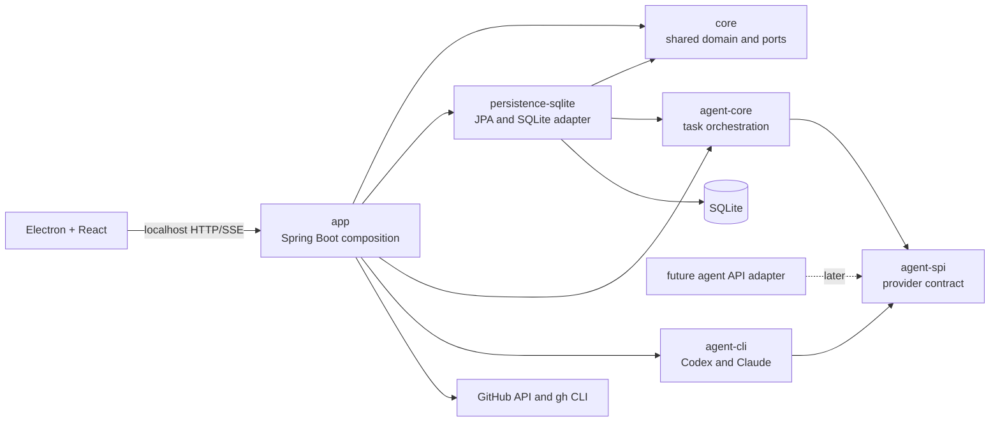

# ByteQuay Architecture

ByteQuay is a local-first macOS desktop application. Its Electron and React
frontend talks to one Spring Boot sidecar on localhost. The sidecar integrates
with GitHub, stores durable local state in SQLite, and may host the proposed
worktree-scoped agent service.

## 1. Architecture decision

The backend grows into a small Maven reactor with at most six planned modules.
The reactor must list only modules that contain implemented behavior. The
initial refactor therefore creates `core`, `persistence-sqlite`, and `app`;
the three agent modules remain absent until the agent feature is implemented.

```text
backend/
├── pom.xml                         # Parent and reactor aggregator
├── core/
│   ├── pom.xml
│   └── src/                        # Shared domain values and storage ports
├── persistence-sqlite/
│   ├── pom.xml
│   └── src/                        # JPA entities, repositories, converters, stores
├── agent-spi/
│   ├── pom.xml
│   └── src/                        # Provider contract and shared provider values
├── agent-core/
│   ├── pom.xml
│   └── src/                        # Agent task and turn orchestration
├── agent-cli/
│   ├── pom.xml
│   └── src/                        # Codex, Claude, and process implementations
└── app/
    ├── pom.xml
    └── src/                        # Spring Boot composition root and executable
```

This is the smallest split that gives SQLite and agent providers real
boundaries without turning each package into a Maven module.



## 2. Why SQLite should be a dedicated module

Yes, the database repository can and should become a dedicated
`persistence-sqlite` module when the backend is split.

The current SQLite package already contains a cohesive adapter:

- JPA entities and Spring Data repositories;
- JSON, collection, map, and time converters;
- pull-request, repository, watched-repository, view-state, detail, and
  credential stores;
- SQLite- and Hibernate-specific transactions; and
- credential-at-rest encryption used by the credential store.

The proposed agent service adds task and turn stores to the same database.
Keeping those implementations together localizes Hibernate, Spring Data JPA,
the SQLite driver, entity scanning, schema ownership, and database integration
tests.

The module is an outbound adapter, not a business-service layer. Controllers,
GitHub clients, task orchestration, provider protocols, and UI projections must
not move into it.

### 2.1 Required dependency inversion

`persistence-sqlite` cannot depend on `app`, because `app` must depend on
the persistence implementation at runtime. Before moving the current SQLite
classes:

1. Move shared immutable domain values from `com.bytequay.app.domain` to
   `core`.
2. Define narrow storage ports in `core` for current GitHub/PR data.
3. Keep agent storage ports in `agent-core`.
4. Make `persistence-sqlite` implement both sets of ports.
5. Make `app` depend on the ports and compose the SQLite implementations.

The result has no Maven cycle:

```text
app -> core
app -> persistence-sqlite
app -> agent-core
app -> agent-cli
persistence-sqlite -> core
persistence-sqlite -> agent-core
agent-core -> agent-spi
agent-cli -> agent-spi
```

Do not create a generic `Repository<T>`, a database-neutral entity model, or
a separate `database-spi` module. Storage ports belong beside the domain
behavior that uses them; SQLite implements those ports.

### 2.2 Persistence module contents

Suggested packages:

```text
com.bytequay.persistence.sqlite
├── config/                          # Entity and repository scanning
├── converter/                       # JPA column converters
├── credential/                      # Encrypted credential persistence
├── entity/                          # JPA entities
├── repository/                      # Spring Data repositories
└── store/                           # Domain-port implementations
```

`CredentialCipher` may move with the encrypted credential store because it
protects data at rest and uses no application behavior. It should remain a
concrete implementation, not gain a speculative cipher interface. GitHub CLI
token selection and credential policy remain in `app`.

The module should expose one explicit Spring configuration:

```java
@Configuration
@EntityScan(basePackageClasses = SqlitePersistenceMarker.class)
@EnableJpaRepositories(basePackageClasses = SqliteRepositoryMarker.class)
@ComponentScan(basePackageClasses = SqlitePersistenceMarker.class)
public class SqlitePersistenceConfiguration
{
}
```

`app` imports that configuration. It remains the only executable module and
the only place that chooses SQLite as ByteQuay's storage implementation.

### 2.3 Schema ownership

`persistence-sqlite` owns:

- JPA entity mappings;
- SQLite column representations;
- converters and repository queries;
- transactional store implementations; and
- database integration fixtures.

Hibernate continues to own schema creation and updates. The module does not add
Flyway or migration-history machinery until ByteQuay has a real released-data
migration contract.

The runtime database remains:

```text
~/Library/Application Support/ByteQuay/bytequay-1.0.db
```

Tests continue to use unique SQLite files under the system temporary
directory.

## 3. Module responsibilities

| Module | Owns | Must not own |
| --- | --- | --- |
| `core` | Shared immutable PR/repository values, credential storage values, and current-feature storage ports | Spring, JPA, SQLite, HTTP, provider protocols, or UI DTOs |
| `persistence-sqlite` | JPA entities, repositories, converters, encrypted credential storage, current-feature stores, and agent stores | Controllers, GitHub clients, task orchestration, or provider protocols |
| `agent-spi` | Driver/session/run contracts, lane IDs, capabilities, normalized provider events, usage samples, and provider health | Spring, JPA, HTTP, SQLite, CLI process code, or provider SDKs |
| `agent-core` | Agent task/turn state, worktree leases, event sequencing, approvals, metrics, completion, cleanup, and agent storage ports | Codex/Claude wire formats, JPA entities, or HTTP DTOs |
| `agent-cli` | Codex App Server client, Claude `stream-json` client, binary discovery, streaming process supervision, event mapping, and fixtures | Task tables, SSE, GitHub PR behavior, or database code |
| `app` | Spring composition, HTTP/SSE, GitHub clients, application services, schedulers, configuration, and executable packaging | Provider branching in controllers or direct JPA access from web code |

The frontend remains an npm project and does not become a Maven module.

## 4. Why there are no more modules

The current GitHub clients and pull-request services have one application
consumer and share the Spring Boot runtime. They stay in `app` until a second
consumer or independent release boundary exists.

Codex and Claude stay together in `agent-cli` because they share process
discovery, stream draining, cancellation, output limits, and fixtures. Split
them only if their dependencies, ownership, or release cadence diverge.

There is no parser module. Provider parsing is an implementation detail of
`agent-cli`. There is no connector framework: `AgentDriver` is the only
extension point currently justified.

## 5. Dependency and composition rules

1. Dependencies point toward framework-free contracts.
2. No module depends on `app`.
3. `app` is the only composition root and executable JAR.
4. `core`, `agent-core`, and `agent-spi` contain no Spring annotations.
5. `persistence-sqlite` never exposes JPA entities across its public ports.
6. `agent-cli` never writes SQLite or publishes SSE.
7. Provider and GitHub writes require a direct user action or an approval
   policy explicitly established by that action.
8. Java Platform Module System descriptors are unnecessary; Maven dependency
   direction is sufficient.

The current parent POM aggregates the three implemented children:

```xml
<packaging>pom</packaging>

<modules>
    <module>core</module>
    <module>persistence-sqlite</module>
    <module>app</module>
</modules>
```

When agent implementation begins, `agent-spi`, `agent-core`, and `agent-cli`
are added to this list with their first real code. Empty placeholder modules
are not created. Dependency and plugin versions belong in the parent. Each
child declares only the dependencies it uses.

## 6. System data flow

### 6.1 Pull-request flow

Display and refresh are separate paths:

1. A frontend display request for a stored PR ID reads detail, diff metadata, or stored file content
   through a `core` storage port and returns the local SQLite snapshot.
2. A direct repository-and-number detail request also reads SQLite first, but fetches that exact PR
   from GitHub on a local miss. This establishes a directly opened row or preserves GitHub's
   authoritative `404` when the PR does not exist.
3. `CredentialService` binds the resolved token to its GitHub user profile in one in-memory account
   record. Repeated profile, PR-sync, and CI-autofix reads reuse that record; changing the resolved
   token invalidates it and resolves `/user` once for the new credential.
4. Selecting a stored PR requests detail by its stable local row ID. The backend resolves the
   repository and number from SQLite, renders persisted detail first, then the frontend starts a
   non-overlapping six-second conditional refresh loop. An unchanged PR ETag refreshes only CI and
   mergeability and returns a status-only response; a changed PR ETag rebuilds and returns the full
   UI detail snapshot. Check runs and combined commit statuses carry their own stored ETags. An
   exhausted GitHub rate limit pauses the loop until GitHub's reported reset time.
5. The user-triggered detail refresh bypasses the PR ETag, rebuilds the complete local detail and
   default diff snapshots, and returns the full detail response.

The normalized repository name and PR number uniquely identify a pull request in SQLite. GitHub's
search and pull-request endpoints expose different numeric IDs for the same PR, so ingestion retains
the existing local row ID whenever either endpoint returns that repository-and-number pair.

Repository refresh discovers every pull request updated within 30 days without filtering by state,
plus older pull requests that remain open. Search results can add or update rows but their absence
never deletes a row. A known row omitted by the current search is reconciled through GitHub's exact
repository-and-number endpoint before retention runs. Closed rows expire only after both their close
time and last GitHub update are older than 30 days. The background job runs six minutes after its
previous refresh completes. New PRs, changed GitHub update timestamps, and missing local details
refresh the full aggregate immediately. An unchanged open PR updated within the previous six hours
refreshes only mergeability and CI when its stored status is at least six minutes old. Other unchanged
PRs are skipped, including every unchanged closed PR and older open PR.

Dashboard refresh requests for the same GitHub credential join an in-flight dashboard refresh and
reuse a successful dashboard snapshot for six minutes after it completes. A credential change waits
for older in-flight work and then starts a new scan. This keeps a manual refresh from queuing behind
scheduled repository work and then repeating the same GitHub discovery scan. The frontend keeps the
persisted list visible while a refresh is in progress, reloads the current search when it completes,
and reports sync failures in the list without replacing cached rows.

Default PR diff files and commit metadata refresh with changed PR detail. Commit-range diffs and
full file bodies refresh only after the user requests that range or expands that file, and are
persisted before they are displayed.

GitHub writes remain behind direct comment, approve, failed-check rerun, or merge actions.

### 6.2 Issue flow

Issue display and refresh use the same local-first boundary:

1. Issue list, individual issue, activity, and type display requests read SQLite only.
2. `WorkspaceIssueRefreshService.refreshIssues` fetches and persists the open-issue projection;
   the scheduled job and the frontend refresh action call this same method.
3. `WorkspaceIssueRefreshService.refreshDetail` fetches one issue's activity and type data,
   persists one detail snapshot, and then rereads it for the explicit frontend refresh response.
4. Direct comment, close, type, assignee, and label writes update the affected local projection so
   later display requests still read SQLite. Closing removes the issue from the open-only projection.

### 6.3 Agent flow

1. The frontend creates a worktree-scoped task through `app`.
2. `agent-core` validates lifecycle rules and selects an `AgentDriver`.
3. `agent-cli` opens or resumes Codex or Claude and emits normalized events.
4. `agent-core` sequences events and updates metrics.
5. `persistence-sqlite` stores task and turn facts; disposable JSONL and
   blobs remain in the task runtime directory.
6. `app` adapts replay and live events to SSE.

The detailed agent design is in [Agent Service Design](agent-service.md).

## 7. Operational boundaries

- The backend listens only on `127.0.0.1:53123`.
- SQLite and runtime files stay under ByteQuay's application-support
  directory.
- There is one Spring application context and one SQLite database.
- Maven module boundaries do not create processes or network boundaries.
- The packaged app starts only the `app` executable; library modules are
  ordinary JAR dependencies.
- Current Checkstyle, license, unit, SQLite integration, and Spring context
  checks run from the backend reactor.

## 8. Extraction sequence

Keep mechanical moves separate from behavior:

1. Create `core`, move shared domain records, and introduce current-feature
   storage ports without changing behavior.
2. Create `persistence-sqlite`, move SQLite/JPA classes and
   `CredentialCipher`, and import its configuration from the existing app.
3. Move the remaining Spring Boot source into `app`; update `dev.sh`, CI,
   license paths, and packaging.
4. Add `agent-spi`, `agent-core`, and `agent-cli` according to the agent
   design.

Every step must leave the backend reactor passing `mvn verify`. Do not mix
the repository moves with agent behavior.

## 9. Tradeoffs

The dedicated persistence module adds two costs: shared domain/storage ports
must move upstream first, and Spring scanning must be explicit. Those costs are
worth paying once agent data joins the existing PR data because the module
then owns one real technical boundary and one database.

Keeping all code in `app` would be simpler today, but agent storage would
increase coupling between JPA, provider execution, task lifecycle, and web
code. Splitting every feature into its own SPI and connector would move too far
in the opposite direction. The six-module design keeps the replaceable edges
isolated and leaves single-consumer application behavior together.
