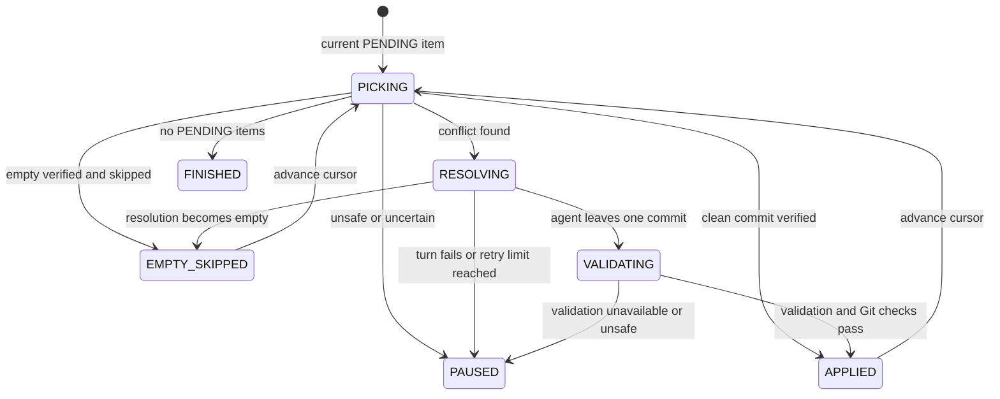

# Cherry-pick Range Design

> **Status: proposed.** This design records an approved product direction; it
> does not mean the feature is implemented. The agent-backed executor and its
> program/agent boundary are specified in
> [Agent-based cherry-pick execution](#13-agent-based-cherry-pick-execution).

Implementation work is tracked in the temporary
[Cherry-pick Range Implementation Checklist](cherry-pick-range-impl-tmp.md).

This document defines how ByteQuay prepares, displays, confirms, and verifies a
range of source commits to cherry-pick onto a target branch. It is a new bounded
workflow and does not restore the deleted task-agent or development-flow
systems.

## 1. Decision

The backend prepares one ordered preview from an exact source range and target
commit. Each source commit contains enough Git, pull-request, target-presence,
and conflict information for the frontend to group the range by pull request
without changing the underlying commit order.

The user reviews the pull requests and commits, chooses any additional commits
to skip, and explicitly confirms the plan. Confirmation freezes the exact Git
object IDs and selections and authorizes local cherry-pick execution. It does
not authorize a push or any other GitHub write.

The workflow uses:

- original source commit order as the cherry-pick order;
- direct ancestry and standard `git cherry-pick -x` origin lines to determine
  whether a source commit is already represented on the target;
- GitHub's final source-commit-to-pull-request association rather than pull
  request head SHAs;
- native Git merge simulation to preview conflicts; and
- `git range-diff` only as a final human-readable review.

Commit titles and `range-diff` similarity never cause an automatic skip.

## 2. Boundary and invariants

The first release has these boundaries:

- One plan names one repository, source range, target branch, and target
  worktree.
- Source, range-boundary, and target object IDs are resolved before preview is
  returned.
- Only non-merge source commits are supported. A merge commit blocks preview
  with an actionable diagnostic rather than being silently dropped or assigned
  a guessed mainline parent.
- Source commits remain in Git topological order throughout preview,
  confirmation, execution, and verification.
- A source commit has exactly one final disposition: already on target, skipped
  by the user, skipped because execution proved it empty, cherry-picked, or
  unresolved.
- A pull-request checkbox is a convenient group selection. It never changes
  commit order and is never the durable execution input.
- Conflict preview is read-only and tied to the target commit used for the
  simulation.
- Confirmation is the direct user action that permits local Git mutation.
- Nothing pushes, comments, approves, or merges on GitHub as part of this
  workflow.

The backend, not the agent or frontend, owns the plan, ordering, skip reasons,
and final accounting.

## 3. Preview preparation

The user supplies:

- repository and clean target worktree;
- source range start and end, such as `477` and `478`; and
- target branch, such as `fork/master`.

The backend performs these read-only steps:

1. Fetch or otherwise refresh the required refs through an explicit user
   action established by the surrounding workflow.
2. Resolve the range boundaries and target tip to full immutable object IDs.
3. Enumerate source commits in oldest-first topological order so position one
   is the first commit that execution would attempt.
4. Reject source merge commits.
5. Scan target history once for source commits reachable by ancestry and for
   exact standard origin lines:

   ```text
   (cherry picked from commit <full-source-object-id>)
   ```

6. Associate each final source commit with the merged pull request that
   introduced it when GitHub provides that association.
7. Simulate conflicts against the frozen target and build the preview.

The pull-request association starts from each final source-range commit. It
must not compare the pull request branch's old commit SHAs because GitHub
rebase-and-merge and squash-and-merge create different SHAs on the base branch.

## 4. Backend preview contract

The backend returns a flat ordered commit list. Repeating the small optional
pull-request projection in each commit keeps the frontend contract direct; the
frontend groups records by pull-request identity while retaining every commit's
position.

```text
CherryPickRangePreview
  previewId
  repository
  sourceBaseSha
  sourceTipSha
  targetBranch
  targetSha
  createdAt
  commits[]
  warnings[]

CherryPickCommitPreview
  position                 one-based cherry-pick order
  sourceSha                full immutable object ID
  title
  pullRequest?             absent when GitHub has no association
  targetMatch?             absent when not already represented
  conflictPreview

PullRequestPreview
  repository
  number
  title
  url
  mergedAt

TargetMatch
  kind                     DIRECT_ANCESTOR | CHERRY_PICK_ORIGIN
  targetCommitSha

ConflictPreview
  status                   CLEAN | CONFLICT | NOT_ANALYZED
  basis                    AT_FROZEN_TARGET | AFTER_CLEAN_PREFIX | ESTIMATE
  files[]
  warning?

ConflictFilePreview
  path
  module?
  type
  sections[]

ConflictSectionPreview
  startLine?
  endLine?
```

`alreadyOnTarget` is derived from the presence of `targetMatch`. Returning the
match kind and target commit makes the result explainable and lets the UI link
to the evidence.

Conflict type includes native Git categories such as content, add/add,
modify/delete, rename/delete, binary, file/directory, and submodule conflicts.
Line ranges exist only for textual conflicts where Git can produce meaningful
hunks. Module is found from the nearest containing Maven `pom.xml`; it may be
absent for repository-root files.

The backend does not calculate a synthetic conflict-risk percentage. The UI
can sort or summarize using actual module, file, and conflict-section counts.

## 5. Conflict-preview accuracy

A cherry-pick is a sequence: the result of an earlier commit becomes the input
to the next commit. The backend therefore distinguishes:

- `AFTER_CLEAN_PREFIX`: exact for commits simulated after all earlier planned
  commits applied cleanly;
- `AT_FROZEN_TARGET`: exact for applying that one commit directly to the
  frozen target; and
- `ESTIMATE`: useful scope information after an earlier unresolved conflict,
  but not a guarantee of what execution will encounter.

Once simulation reaches a conflict, the user's eventual resolution can change
all later results. The backend may continue independent simulations to provide
an estimate, but it must label them accordingly. Binary and structural
conflicts may report paths and types without line ranges.

Native Git output supplies the facts. `git merge-tree --write-tree` with a
specified source parent as merge base can report conflict paths and stable
conflict types without touching the index or working tree. A temporary
worktree may be used when line-level conflict rendering is required. The
implementation must not modify the user's selected worktree during preview.

## 6. Pull-request grouping and selection

The frontend groups commits by pull request while retaining the flat backend
order. Pull requests are ordered by the smallest `position` among their source
commits. `mergedAt` is displayed as useful context but is not the ordering
authority.

The default **Skip pull requests** view resembles:

```text
Trino 477 -> 478                         300 commits, 126 PRs

[x] #23401  Fix Hive coercion
    Merged Aug 3 | 3 commits | Already on target

[ ] #23418  Improve JDBC metadata
    Merged Aug 4 | 2 commits

[-] #23422  Improve query planning
    Merged Aug 5 | 4 commits | 1 already on target
```

Checkbox rules are:

- Commits with `targetMatch` are skipped automatically and cannot be selected
  for cherry-pick.
- Checking an available pull request selects all its remaining commits for an
  explicit user skip.
- A partially selected pull request uses the indeterminate state.
- Expanding a pull request shows its commits in source order and permits
  individual selection changes.
- Commits without a pull-request association appear in a separate group.
- Title search helps find a pull request but never establishes its identity;
  repository plus pull-request number is the identity.

The screen shows a live summary:

```text
300 source commits
18 already on target
7 explicitly skipped
275 will be cherry-picked
```

## 7. Confirmation contract

The frontend confirms explicit commit selections, not grouped UI state:

```text
ConfirmCherryPickRangeCommand
  previewId
  expectedSourceBaseSha
  expectedSourceTipSha
  expectedTargetSha
  userSkippedSourceShas[]
  idempotencyKey
```

The backend reloads the preview and validates:

- every skipped SHA belongs to the frozen source range;
- the source boundaries still resolve to the expected object IDs;
- the target branch and selected worktree still point at `expectedTargetSha`;
- commits marked already on target still have their recorded evidence;
- the worktree is clean and has no merge, rebase, or cherry-pick in progress;
  and
- another live execution does not own the worktree.

A moved source or target produces a stale-preview result. The backend does not
silently recompute and execute a different range; the user reviews a refreshed
preview.

Successful confirmation creates an immutable plan whose ordered entries are:

```text
sourceSha + position + disposition + reason
```

Disposition is one of:

```text
ALREADY_ON_TARGET
USER_SKIPPED
TO_CHERRY_PICK
```

The confirmed plan is the only input to execution. Pull-request titles,
checkbox state, commit titles, conflict scores, and agent prose do not control
execution.

## 8. Execution handoff

Confirmation starts execution or durably queues it for immediate start. The
executor receives only the frozen target SHA and the ordered
`TO_CHERRY_PICK` source SHAs. Every created commit uses `git cherry-pick -x`.

When execution encounters a conflict, it must preserve the standard `-x`
origin line through resolution and `git cherry-pick --continue`. After every
successful commit, the program verifies the final commit message contains the
expected source object ID.

The executor follows the program-owned state machine in
[Agent-based cherry-pick execution](#13-agent-based-cherry-pick-execution).
It must not change the confirmed skips, reorder source commits, push, merge a
pull request, or use agent response text as a control fact.

## 9. Completion and range review

After execution stops, the backend inspects actual Git state. Successful local
completion requires:

- a clean index and worktree;
- no merge, rebase, or cherry-pick in progress;
- every `TO_CHERRY_PICK` source SHA not recorded as `EMPTY_SKIPPED`
  represented by an exact standard `-x` origin line in the newly created
  range;
- the created commits ordered consistently with the confirmed source order;
  and
- every source commit accounted for as already on target, user skipped,
  execution-proven empty, or newly cherry-picked.

The backend then runs `git range-diff` between the original source range and
the newly created update range for human review. The frontend uses it to show
missing, extra, and changed patches, especially conflict resolutions.

`range-diff` output is human-readable and heuristic. It is never parsed to
decide completion. In particular, an old-only entry is acceptable only when
the confirmed plan accounts for it as `ALREADY_ON_TARGET` or `USER_SKIPPED`,
or the durable execution result records it as `EMPTY_SKIPPED`.

## 10. Failure and recovery

- Preview failure changes no Git state.
- A stale preview requires review and confirmation of a new preview.
- Cancellation never resets or deletes user work automatically.
- An execution conflict is not itself a failed range; it is unresolved work.
- Backend restart must not guess whether an uncertain Git operation completed.
  It reconciles the frozen plan with actual HEAD, standard `-x` markers, and
  Git operation state before offering a next action.
- A missing or incorrect expected `-x` marker pauses execution for inspection.
- A source commit that becomes empty during execution is automatically
  recorded as `EMPTY_SKIPPED` after the program proves the empty state, clears
  the operation, and verifies that HEAD is unchanged and the worktree is
  clean. It is never recorded as newly cherry-picked.

## 11. API shape

The proposed localhost API is deliberately small:

```text
POST /api/cherry-pick-ranges/previews
GET  /api/cherry-pick-ranges/previews/{previewId}
POST /api/cherry-pick-ranges/executions
GET  /api/cherry-pick-ranges/executions?limit=...
GET  /api/cherry-pick-ranges/executions/{executionId}
POST /api/cherry-pick-ranges/executions/{executionId}/messages
POST /api/cherry-pick-ranges/executions/{executionId}/cancel
```

The execution start request contains the confirmation contract and requires an
idempotency key. Progress transport and agent interaction reuse the existing
agent-service event model; this design does not add a second generic workflow
or event framework.

## 12. Acceptance criteria

The feature is ready when tests prove:

1. A fixed source range produces a stable, one-based, topologically ordered
   commit list.
2. Direct ancestry and exact `-x` origin lines mark the correct source commits
   already on target, including a conflict-resolved historical cherry-pick
   whose patch ID differs.
3. Rebase-merged and squash-merged source pull requests group the final source
   commits without relying on old pull-request head SHAs.
4. Pull-request and individual checkboxes produce only explicit source-SHA
   skip selections and never reorder commits.
5. Conflict preview reports paths, modules, types, and textual sections when
   available, and labels estimates after the first unresolved conflict.
6. Moving the source or target after preview causes a stale-preview rejection
   with no local mutation.
7. Confirmation is required before any cherry-pick begins.
8. Every created commit retains the expected standard `-x` origin line.
9. Completion is determined from actual Git state and the immutable plan, not
   agent prose or `range-diff` output.
10. A cherry-pick proven empty creates no target commit, is durably recorded
    as `EMPTY_SKIPPED`, leaves HEAD unchanged and the worktree clean, and
    advances without another agent turn or a user pause.
11. No preview, confirmation, execution, cancellation, or verification path
    performs a GitHub write.

## 13. Agent-based cherry-pick execution

The execution design has one owner and one source of truth:

- `CherryPickExecutionService` is the only component allowed to move the
  range forward or record a final commit result.
- Git state decides what actually happened.
- Agent messages are progress for the user, never control input.

### 13.1 Small state model

The execution has only three statuses:

```text
RUNNING
PAUSED
FINISHED
```

It stores a cursor pointing to the current source commit. Only that commit can
have a current step:

```text
PICKING
RESOLVING
VALIDATING
```

Each plan item has one result:

```text
PENDING
ALREADY_ON_TARGET
USER_SKIPPED
APPLIED
EMPTY_SKIPPED
```

`ALREADY_ON_TARGET` and `USER_SKIPPED` come from the confirmed plan.
`APPLIED` stores the created target SHA. `EMPTY_SKIPPED` stores no target SHA.
A paused commit remains `PENDING`; the execution pause reason explains what
needs attention.

For example:

```text
cursor=42, currentStep=RESOLVING, item[42].result=PENDING
```

After verification, the service records either `APPLIED` or `EMPTY_SKIPPED`
for item 42, advances the cursor to 43, and selects the next step.

There are no separate phases for journaling, inspection, retries, or waiting.
Those are implementation actions inside one of the three current steps.

Only `CherryPickExecutionService` writes `status`, `cursor`, `currentStep`,
`result`, or `pauseReason`. The agent service, Git helper, validation runner,
controller, and store cannot make those decisions.

### 13.2 How the program knows the result

Before changing Git, the service stores the current source SHA and expected
target HEAD. After Git or an agent turn finishes, it inspects the repository
instead of trusting the command exit text or agent response.

A commit is `APPLIED` only when:

1. HEAD is exactly one new child of the stored expected target HEAD.
2. The new commit contains the exact standard `-x` source line.
3. No cherry-pick, merge, rebase, or unmerged index entry remains.
4. The index and worktree are clean.
5. `git diff --check <expectedHead>..HEAD` passes.
6. If an agent resolved a conflict, the required local validation passes and
   the same Git checks pass again afterward.

A commit is `EMPTY_SKIPPED` only when:

1. HEAD is still the stored expected target HEAD.
2. `CHERRY_PICK_HEAD` is exactly the current source SHA.
3. There are no staged, tracked, untracked, or unmerged changes.
4. The program records its intention to skip, runs
   `git cherry-pick --skip`, and then verifies that HEAD is unchanged, the
   worktree is clean, and no Git operation remains.

A commit is currently `RESOLVING` when the exact source SHA remains in
`CHERRY_PICK_HEAD` with conflict or staged-resolution work. It is
`VALIDATING` only after one structurally correct target commit exists.

Any mismatch—wrong parent, extra commit, missing `-x` line, unexpected skip,
dirty files, or uncertain Git state—pauses the whole execution. It does not
guess a result.

After a restart, the stored cursor and current step tell the program where to
look; Git inspection confirms what happened. If they disagree, execution
pauses. Thus the stored step is UI progress, while Git facts plus the stored
expected HEAD determine the final result.

### 13.3 Transition and transaction ownership

`CherryPickExecutionService.advance(...)` performs at most one external action.
It is the single transition owner.

Each action uses two short SQLite transactions:

1. Store the intended action, source SHA, expected HEAD, and optimistic version.
2. Commit that transaction.
3. Run Git, an agent turn, or one validation command without a database
   transaction.
4. Inspect the result.
5. Store the observed step or final result in another short transaction.

The optimistic version prevents two monitor calls from advancing the same
execution. If the backend stops between steps 3 and 5, the next call inspects
Git before doing anything else. It never blindly repeats a Git command.

The execution service defines these transaction boundaries. The SQLite store
only performs each requested atomic write.

The transition rules are:

| Program observation | Service decision |
| --- | --- |
| Current plan item is already on target or user skipped | Keep its confirmed result and advance the cursor |
| Clean cherry-pick produces one verified commit | Record `APPLIED` and advance |
| Cherry-pick has a conflict | Set `RESOLVING` and start one agent turn |
| Agent leaves one verified commit | Set `VALIDATING` and run local validation |
| Validation passes and Git still matches | Record `APPLIED` and advance |
| Cherry-pick is proven empty | Guardedly skip it, record `EMPTY_SKIPPED`, and advance |
| Git, agent, or validation is unsafe or uncertain | Set execution `PAUSED`; leave the item `PENDING` |
| Cursor has passed every item | Set execution `FINISHED` |

### 13.4 Components and boundaries

The first implementation needs only these components:

| Component | Responsibility |
| --- | --- |
| `CherryPickExecutionService` | Own the cursor, transitions, prompts, retry limit, final results, pause, and completion |
| `CherryPickExecutionStore` | Persist and atomically version the execution; make no decisions |
| `CherryPickGit` | Run one `-x` cherry-pick, inspect Git, and clear one proven-empty operation |
| Existing `AgentTaskService` and `AgentTurnService` | Run one worktree-scoped agent conversation and report turn state |
| Existing bounded process runner | Run the stored module or project validation command |

`CherryPickGit` and validation planning stay as package-private concrete
helpers in `app`. They do not need public interfaces until a second
implementation exists. The execution records and store port live in `core`;
SQLite implements the store in `persistence-sqlite`. Existing agent services
continue to own provider sessions and turns.

The agent can edit only the leased worktree and only for the current commit.
It cannot update the cursor, item result, or execution status.

### 13.5 Agent goal and prompt

The same prompt shape is used for the first conflict and later repair attempts.
The program adds current Git facts and the latest validation error.

```text
Resolve only this cherry-pick.

Source commit: <full source SHA>
Expected target parent: <full target SHA>
Current step: <RESOLVING or VALIDATING>
Conflict files:
- <path and conflict type>
Latest program diagnostic:
- <diagnostic, when retrying>

Goal:
- If the cherry-pick is open, resolve all conflicts, stage the result, and run
  git cherry-pick --continue.
- If one target commit already exists and validation failed, fix it and run
  git commit --amend --no-edit.
- Run the listed validation command when possible:
  <working directory and argv>
- Leave exactly one child of the expected parent, preserve the standard -x
  source line, and leave the worktree clean.

If git reports that the cherry-pick is empty, stop and leave it open.
ByteQuay will inspect and skip it safely.

Do not skip or abort the cherry-pick yourself. Do not create a fixup commit,
pick another commit, rebase, push, or write to GitHub.

Your final message is for the user. ByteQuay will inspect Git and rerun
validation itself.
```

One source commit creates at most one target commit. Conflict completion uses
`git cherry-pick --continue`. A later validation repair uses
`git commit --amend --no-edit`, not a `fixup!` commit.

The program allows at most three agent turns for one source commit. If the
same safe conflict or validation failure remains after that, it pauses.

### 13.6 Java contracts

Only the application service and persistence port are public interfaces.

#### `CherryPickExecutionService`

```java
package com.bytequay.app.cherrypick;

import com.bytequay.core.cherrypick.CherryPickExecution;
import com.bytequay.core.cherrypick.CherryPickExecutionId;

import java.util.List;

/**
 * Owns the progress and final results of confirmed cherry-pick executions.
 */
public interface CherryPickExecutionService
{
    /**
     * Creates or returns the execution for an idempotent start request.
     *
     * @param command confirmed plan, worktree, agent lane, and idempotency key
     * @return the durable execution
     */
    CherryPickExecution start(StartCherryPickExecutionCommand command);

    /**
     * Returns one execution for the UI.
     *
     * @param executionId execution identifier
     * @return current execution, cursor, step, and item results
     */
    CherryPickExecution get(CherryPickExecutionId executionId);

    /**
     * Lists recent executions in reverse update order.
     *
     * @param limit positive maximum result count
     * @return recent executions
     */
    List<CherryPickExecution> list(int limit);

    /**
     * Adds a bounded user instruction to the current paused item.
     *
     * <p>The service rechecks Git before resuming. The message cannot change
     * the confirmed plan, skip or reorder commits, push, or expand agent
     * permissions.
     *
     * @param command execution, message, and idempotency key
     * @return resumed or still-paused execution
     */
    CherryPickExecution sendMessage(SendCherryPickMessageCommand command);

    /**
     * Stops future work without resetting or deleting local Git changes.
     *
     * @param executionId execution identifier
     * @return finished or safely paused execution
     */
    CherryPickExecution cancel(CherryPickExecutionId executionId);

    /**
     * Reconciles Git and performs at most one next action.
     *
     * <p>This is the only method that advances the current commit. It first
     * stores intent, runs no more than one Git, agent, or validation action,
     * inspects actual facts, and then stores the next step or final result.
     *
     * @param executionId execution selected by the local monitor
     * @return execution after one bounded action
     */
    CherryPickExecution advance(CherryPickExecutionId executionId);
}
```

#### `CherryPickExecutionStore`

```java
package com.bytequay.core.cherrypick;

import java.util.List;
import java.util.Optional;

/**
 * Persists versioned cherry-pick executions without making transitions.
 */
public interface CherryPickExecutionStore
{
    /**
     * Creates an execution or returns the existing execution with the same
     * start idempotency key.
     *
     * @param execution proposed execution
     * @return created or existing execution
     */
    CherryPickExecution createOrGet(CherryPickExecution execution);

    /**
     * Finds an execution by ID.
     *
     * @param executionId execution identifier
     * @return execution when present
     */
    Optional<CherryPickExecution> find(CherryPickExecutionId executionId);

    /**
     * Lists recent executions for the UI.
     *
     * @param limit positive maximum result count
     * @return executions in reverse update order
     */
    List<CherryPickExecution> listRecent(int limit);

    /**
     * Lists running executions that may need one monitor action.
     *
     * @param limit positive maximum result count
     * @return running executions in stable update order
     */
    List<CherryPickExecution> listRunning(int limit);

    /**
     * Saves one transition using the aggregate's expected version.
     *
     * @param execution updated execution
     * @return stored execution with its next version
     */
    CherryPickExecution save(CherryPickExecution execution);
}
```

The package-private Git helper has only three operations:

```java
final class CherryPickGit
{
    /**
     * Runs one non-interactive git cherry-pick -x for the current source.
     */
    GitState cherryPick(CherryPickCommand command);

    /**
     * Reads HEAD, operation markers, index, status, source line, and diff
     * checks without changing Git.
     */
    GitState inspect(InspectGitCommand command);

    /**
     * Skips only an exact, clean, proven-empty operation and verifies that
     * HEAD remains unchanged.
     */
    EmptySkipResult skipEmpty(SkipEmptyCommand command);
}
```

`GitState` has four kinds: `APPLIED_CANDIDATE`, `CONFLICT`, `EMPTY`, and
`UNSAFE`. It carries the observed HEAD, operation marker, changed/conflict
paths, and bounded diagnostics. The execution service maps these facts to its
small state model.

### 13.7 Local API contract

The localhost API remains:

```text
POST /api/cherry-pick-ranges/previews
GET  /api/cherry-pick-ranges/previews/{previewId}
POST /api/cherry-pick-ranges/executions
GET  /api/cherry-pick-ranges/executions?limit=...
GET  /api/cherry-pick-ranges/executions/{executionId}
POST /api/cherry-pick-ranges/executions/{executionId}/messages
POST /api/cherry-pick-ranges/executions/{executionId}/cancel
```

The start request contains the confirmed plan ID, expected target SHA,
worktree, agent lane, and `Idempotency-Key`. It cannot supply a different
commit order or skip list.

The execution response is intentionally small:

```text
executionId, planId, status, cursor, currentStep?, pauseReason?
initialTargetSha, currentTargetSha, agentTaskId, currentTurnId?
items[]:
  position, sourceSha, result, targetSha?
```

`currentStep` explains only the current `PENDING` item. `result` is the durable
answer for each item, including already-on-target and user-skipped items from
the confirmed plan. Agent events remain in the existing agent task stream
instead of being copied into the cherry-pick response.

### 13.8 Flow through the interfaces



The concrete call flow is:

1. `start(...)` freezes the plan, creates one existing agent task, and stores
   the execution.
2. The monitor calls `advance(...)`.
3. The service stores `PICKING` and calls `CherryPickGit.cherryPick(...)`.
4. A clean verified commit becomes `APPLIED`. A proven empty operation is
   skipped and becomes `EMPTY_SKIPPED`.
5. A conflict sets `RESOLVING` and starts one existing agent turn with the
   prompt above.
6. On terminal turn completion, `advance(...)` calls
   `CherryPickGit.inspect(...)`. It either safely retries, handles empty, sets
   `VALIDATING`, or pauses.
7. The existing bounded process runner executes module or project validation.
   Passing validation plus a final Git inspection records `APPLIED`.
8. Recording a final result advances the cursor. When no `PENDING` item
   remains, the service performs final range accounting and records
   `FINISHED`.

### 13.9 Edge cases and tests

| Edge case | Program response |
| --- | --- |
| Empty before a conflict | Verify, skip, record `EMPTY_SKIPPED`, continue |
| Conflict resolution becomes empty | Verify, skip, record `EMPTY_SKIPPED`, continue without another agent turn |
| Conflict remains after a turn | Retry the same item, up to three total turns |
| Validation fails | Give bounded diagnostics to the same task; agent amends the one commit |
| Wrong parent, extra commit, missing `-x`, or dirty worktree | Pause without changing history |
| Backend stops during Git work | Reconcile the stored intent with Git; never blindly rerun |
| Agent turn fails or provider authentication expires | Pause and preserve the worktree and task |
| User cancels | Stop future actions; do not reset, abort, clean, or push |

Focused tests use temporary Git repositories and cover clean apply, ordinary
conflict, validation repair by amend, empty before and after conflict, invalid
history, restart reconciliation, retry exhaustion, and cancellation. Every
test asserts the final cursor and item result from stored state and confirms
that no path writes to GitHub.
