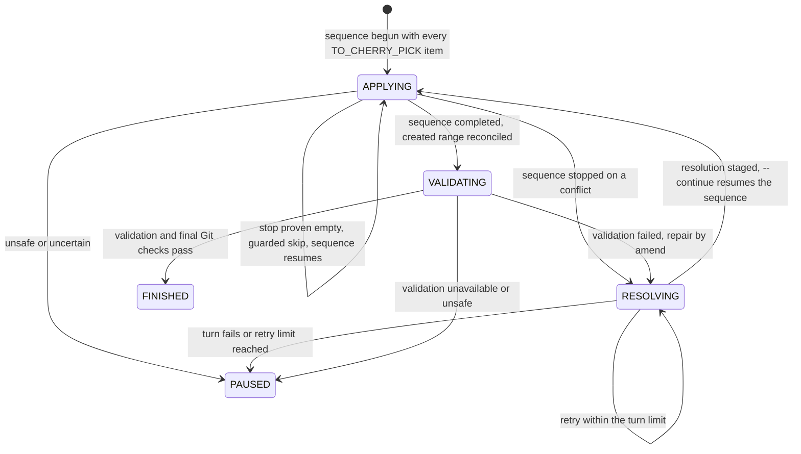

# Cherry-pick Range Design

> **Status: proposed.** This design records an approved product direction; it
> does not mean the feature is implemented. The agent-backed executor and its
> program/agent boundary are specified in
> [Agent-based cherry-pick execution](#13-agent-based-cherry-pick-execution).

Implementation work is tracked in the temporary
[Cherry-pick Range Implementation Checklist](cherry-pick-range-impl-tmp.md).

This document defines how ByteQuay prepares, displays, confirms, and verifies a
range of source commits to cherry-pick onto a target branch. It is a new bounded
workflow and does not restore the deleted task-agent or development-flow
systems.

## 1. Decision

The backend prepares one ordered preview from an exact source range and target
commit. Each source commit contains enough Git, pull-request, target-presence,
and conflict information for the frontend to group the range by pull request
without changing the underlying commit order.

The user reviews the pull requests and commits, chooses any additional commits
to skip, and explicitly confirms the plan. Confirmation freezes the exact Git
object IDs and selections and authorizes local cherry-pick execution. It does
not authorize a push or any other GitHub write.

The workflow uses:

- original source commit order as the cherry-pick order;
- direct ancestry and standard `git cherry-pick -x` origin lines to determine
  whether a source commit is already represented on the target;
- GitHub's final source-commit-to-pull-request association rather than pull
  request head SHAs;
- native Git merge simulation to preview conflicts; and
- `git range-diff` only as a final human-readable review.

Commit titles and `range-diff` similarity never cause an automatic skip.

## 2. Boundary and invariants

The first release has these boundaries:

- One plan names one repository, source range, target branch, and target
  worktree.
- Three branches are involved and their roles never overlap:

  | Ref | Role |
  | --- | --- |
  | `fork/master` | Remote-tracking ref. Read during sync, never checked out. |
  | `fork-master` | Local target branch. Synced from the remote, never checked out, never receives cherry-picks. |
  | `bump-477-478-a7` | Work branch. Created by ByteQuay, checked out in the worktree, receives every cherry-pick. |

- ByteQuay names the work branch `bump-{from}-{to}-{2 random characters from
  `0-9a-zA-Z`}`. The user never types it.
- The local target branch is never checked out, because Git refuses to fetch
  into a branch that a worktree holds. Keeping it unchecked keeps sync always
  possible.
- A remote-tracking ref is never checked out. Git cannot do so without
  detaching HEAD, and commits made on a detached HEAD reach no branch.
- Exactly one step contacts the Git remote: synchronizing the local target
  branch, at task creation. Preview, confirmation, execution, verification, and
  rebase are local. Reading pull-request association from the GitHub REST API
  is the one other network call, and it is a read used only for display and
  grouping.
- Source, range-boundary, and target object IDs are resolved before preview is
  returned.
- Only non-merge source commits are supported. A merge commit blocks preview
  with an actionable diagnostic rather than being silently dropped or assigned
  a guessed mainline parent.
- Source commits remain in Git topological order throughout preview,
  confirmation, execution, and verification.
- A source commit has exactly one final disposition: already on target, skipped
  by the user, skipped because execution proved it empty, cherry-picked, or
  unresolved.
- A pull-request checkbox is a convenient group selection. It never changes
  commit order and is never the durable execution input.
- Conflict preview is read-only and tied to the target commit used for the
  simulation.
- Confirmation is the direct user action that permits local Git mutation.
- Nothing pushes, comments, approves, or merges on GitHub as part of this
  workflow.

The backend, not the agent or frontend, owns the plan, ordering, skip reasons,
and final accounting.

## 3. Preview preparation

The user supplies:

- the repository clone;
- the source remote and range start and end, such as `477` and `478`; and
- the target remote and branch, such as `fork` and `master`.

The backend first synchronizes, which is the only step that contacts the Git
remote:

1. Reject a shallow clone. Range enumeration, ancestry, and merge-base results
   are all wrong on one, and they fail quietly rather than loudly.
2. Fetch the source remote in full. The range lives there, and a narrow refspec
   leaves ancestry queries short of objects they need.
3. Synchronize the local target branch in one command:

   ```text
   git fetch <targetRemote> <targetBranch>:<localTargetBranch>
   ```

   This creates the local branch when it is missing and fast-forwards it when
   it exists.
4. Verify the result from Git rather than from the exit code: the local target
   branch and the remote-tracking ref must resolve to the same object ID. A
   rejected non-fast-forward update still advances the remote-tracking ref, so
   the two can disagree after a command that reported a failure.
5. Refuse a diverged local target branch instead of forcing it. Local commits
   on the target branch are user work, and `--force` destroys them silently.

The backend then performs these read-only steps:

1. Resolve the range boundaries and the local target branch tip to full
   immutable object IDs.
2. Enumerate source commits in oldest-first topological order so position one
   is the first commit that execution would attempt.
3. Reject source merge commits.
4. Scan local target branch history once for source commits reachable by
   ancestry and for exact standard origin lines:

   ```text
   (cherry picked from commit <full-source-object-id>)
   ```

5. Associate each final source commit with the merged pull request that
   introduced it when GitHub provides that association. This grouping is what
   lets the user skip a whole pull request's commits at once.
6. Simulate conflicts against the frozen target and build the preview.

The pull-request association starts from each final source-range commit. It
must not compare the pull request branch's old commit SHAs because GitHub
rebase-and-merge and squash-and-merge create different SHAs on the base branch.

## 4. Backend preview contract

The backend returns a flat ordered commit list. Repeating the small optional
pull-request projection in each commit keeps the frontend contract direct; the
frontend groups records by pull-request identity while retaining every commit's
position.

```text
CherryPickRangePreview
  previewId
  repository
  sourceBaseSha
  sourceTipSha
  targetBranch
  targetSha
  createdAt
  commits[]
  warnings[]

CherryPickCommitPreview
  position                 one-based cherry-pick order
  sourceSha                full immutable object ID
  title
  pullRequest?             absent when GitHub has no association
  targetMatch?             absent when not already represented
  conflictPreview

PullRequestPreview
  repository
  number
  title
  url
  mergedAt

TargetMatch
  kind                     DIRECT_ANCESTOR | CHERRY_PICK_ORIGIN
  targetCommitSha

ConflictPreview
  status                   CLEAN | CONFLICT | NOT_ANALYZED
  basis                    AT_FROZEN_TARGET | AFTER_CLEAN_PREFIX | ESTIMATE
  files[]
  warning?

ConflictFilePreview
  path
  module?
  type
  sections[]

ConflictSectionPreview
  startLine?
  endLine?
```

`alreadyOnTarget` is derived from the presence of `targetMatch`. Returning the
match kind and target commit makes the result explainable and lets the UI link
to the evidence.

Conflict type includes native Git categories such as content, add/add,
modify/delete, rename/delete, binary, file/directory, and submodule conflicts.
Line ranges exist only for textual conflicts where Git can produce meaningful
hunks. Module is found from the nearest containing Maven `pom.xml`; it may be
absent for repository-root files.

The backend does not calculate a synthetic conflict-risk percentage. The UI
can sort or summarize using actual module, file, and conflict-section counts.

## 5. Conflict-preview accuracy

A cherry-pick is a sequence: the result of an earlier commit becomes the input
to the next commit. The backend therefore distinguishes:

- `AFTER_CLEAN_PREFIX`: exact for commits simulated after all earlier planned
  commits applied cleanly;
- `AT_FROZEN_TARGET`: exact for applying that one commit directly to the
  frozen target; and
- `ESTIMATE`: useful scope information after an earlier unresolved conflict,
  but not a guarantee of what execution will encounter.

Once simulation reaches a conflict, the user's eventual resolution can change
all later results. The backend may continue independent simulations to provide
an estimate, but it must label them accordingly. Binary and structural
conflicts may report paths and types without line ranges.

Native Git output supplies the facts. `git merge-tree --write-tree` with a
specified source parent as merge base can report conflict paths and stable
conflict types without touching the index or working tree. A temporary
worktree may be used when line-level conflict rendering is required. The
implementation must not modify the user's selected worktree during preview.

## 6. Pull-request grouping and selection

The frontend groups commits by pull request while retaining the flat backend
order. Pull requests are ordered by the smallest `position` among their source
commits. `mergedAt` is displayed as useful context but is not the ordering
authority.

The default **Skip pull requests** view resembles:

```text
Trino 477 -> 478                         300 commits, 126 PRs

[x] #23401  Fix Hive coercion
    Merged Aug 3 | 3 commits | Already on target

[ ] #23418  Improve JDBC metadata
    Merged Aug 4 | 2 commits

[-] #23422  Improve query planning
    Merged Aug 5 | 4 commits | 1 already on target
```

Checkbox rules are:

- Commits with `targetMatch` are skipped automatically and cannot be selected
  for cherry-pick.
- Checking an available pull request selects all its remaining commits for an
  explicit user skip.
- A partially selected pull request uses the indeterminate state.
- Expanding a pull request shows its commits in source order and permits
  individual selection changes.
- Commits without a pull-request association appear in a separate group.
- Title search helps find a pull request but never establishes its identity;
  repository plus pull-request number is the identity.

The screen shows a live summary:

```text
300 source commits
18 already on target
7 explicitly skipped
275 will be cherry-picked
```

## 7. Confirmation contract

The frontend confirms explicit commit selections, not grouped UI state:

```text
ConfirmCherryPickRangeCommand
  previewId
  expectedSourceBaseSha
  expectedSourceTipSha
  expectedTargetSha
  userSkippedSourceShas[]
  idempotencyKey
```

The backend reloads the preview and validates:

- every skipped SHA belongs to the frozen source range;
- the source boundaries still resolve to the expected object IDs;
- the local target branch still resolves to `expectedTargetSha`;
- commits marked already on target still have their recorded evidence; and
- no other live execution targets the same repository and target branch.

The worktree is not validated here because it does not exist yet. Confirmation
is followed by preparation, which creates the work branch and worktree and then
validates them. Splitting the two keeps confirmation a pure decision about the
plan and leaves every Git mutation on one side of it.

A moved source or target produces a stale-preview result. The backend does not
silently recompute and execute a different range; the user reviews a refreshed
preview.

Successful confirmation creates an immutable plan whose ordered entries are:

```text
sourceSha + position + disposition + reason
```

Disposition is one of:

```text
ALREADY_ON_TARGET
USER_SKIPPED
TO_CHERRY_PICK
```

The confirmed plan is the only input to execution. Pull-request titles,
checkbox state, commit titles, conflict scores, and agent prose do not control
execution.

## 8. Execution handoff

### 8.1 Workspace preparation

Confirmation prepares the workspace before the first cherry-pick. Preparation
is local; the remote was contacted once, during synchronization.

1. Generate the work branch name `bump-{from}-{to}-{2 random characters}` and
   retry with new characters if that branch or worktree path already exists.
2. Create the branch and its worktree in one command, at the **frozen** target
   object ID rather than at the local target branch name:

   ```text
   git worktree add -b bump-477-478-a7 <path> <frozenTargetSha>
   ```

   Branching from the frozen object ID keeps the worktree consistent with the
   plan even when the local target branch moves afterwards.
3. Lease the worktree through the existing agent workspace service, which
   validates repository identity, cleanliness, and that HEAD is a branch rather
   than a detached commit.
4. Create the `CHERRY_PICK` agent task while the worktree is still clean.

Preparation cannot reuse an existing worktree the user prepared by hand, and it
never checks out the local target branch. Git refuses to fetch into a checked-out
branch, so keeping the local target branch unchecked is what keeps
synchronization possible for every later run.

### 8.2 Handoff

Confirmation starts execution or durably queues it for immediate start. The
executor receives only the frozen target SHA and the ordered
`TO_CHERRY_PICK` source SHAs. Every created commit uses `git cherry-pick -x`
and lands on the work branch, never on the local target branch.

When execution encounters a conflict, it must preserve the standard `-x`
origin line through resolution and `git cherry-pick --continue`. After every
successful commit, the program verifies the final commit message contains the
expected source object ID.

The executor follows the program-owned state machine in
[Agent-based cherry-pick execution](#13-agent-based-cherry-pick-execution).
It must not change the confirmed skips, reorder source commits, push, merge a
pull request, or use agent response text as a control fact.

## 9. Completion and range review

After execution stops, the backend inspects actual Git state. Successful local
completion requires:

- a clean index and worktree;
- no merge, rebase, or cherry-pick in progress;
- every `TO_CHERRY_PICK` source SHA not recorded as `EMPTY_SKIPPED`
  represented by an exact standard `-x` origin line in the newly created
  range;
- the created commits ordered consistently with the confirmed source order;
  and
- every source commit accounted for as already on target, user skipped,
  execution-proven empty, or newly cherry-picked.

The backend then runs `git range-diff` between the original source range and
the newly created update range for human review. The frontend uses it to show
missing, extra, and changed patches, especially conflict resolutions.

`range-diff` output is human-readable and heuristic. It is never parsed to
decide completion. In particular, an old-only entry is acceptable only when
the confirmed plan accounts for it as `ALREADY_ON_TARGET` or `USER_SKIPPED`,
or the durable execution result records it as `EMPTY_SKIPPED`.

## 10. Failure and recovery

- Preview failure changes no Git state.
- A stale preview requires review and confirmation of a new preview.
- Cancellation never resets or deletes user work automatically. The work
  branch and its worktree are ByteQuay's own, not user work, so cancelling
  removes both after recording the final result. Nothing outside the
  generated worktree is touched, and the local target branch is unchanged
  because no cherry-pick ever reached it.
- An execution conflict is not itself a failed range; it is unresolved work.
- Backend restart must not guess whether an uncertain Git operation completed.
  It reconciles the frozen plan with actual HEAD, standard `-x` markers, and
  Git operation state before offering a next action.
- A missing or incorrect expected `-x` marker pauses execution for inspection.
- A source commit that becomes empty during execution is automatically
  recorded as `EMPTY_SKIPPED` after the program proves the empty state, clears
  the operation, and verifies that HEAD is unchanged and the worktree is
  clean. It is never recorded as newly cherry-picked.

## 11. API shape

The proposed localhost API is deliberately small:

```text
POST /api/cherry-pick-ranges/previews
GET  /api/cherry-pick-ranges/previews/{previewId}
POST /api/cherry-pick-ranges/executions
GET  /api/cherry-pick-ranges/executions?limit=...
GET  /api/cherry-pick-ranges/executions/{executionId}
POST /api/cherry-pick-ranges/executions/{executionId}/messages
POST /api/cherry-pick-ranges/executions/{executionId}/cancel
```

The execution start request contains the confirmation contract and requires an
idempotency key. Progress transport and agent interaction reuse the existing
agent-service event model; this design does not add a second generic workflow
or event framework.

## 12. Acceptance criteria

The feature is ready when tests prove:

1. A fixed source range produces a stable, one-based, topologically ordered
   commit list.
2. Direct ancestry and exact `-x` origin lines mark the correct source commits
   already on target, including a conflict-resolved historical cherry-pick
   whose patch ID differs.
3. Rebase-merged and squash-merged source pull requests group the final source
   commits without relying on old pull-request head SHAs.
4. Pull-request and individual checkboxes produce only explicit source-SHA
   skip selections and never reorder commits.
5. Conflict preview reports paths, modules, types, and textual sections when
   available, and labels estimates after the first unresolved conflict.
6. Moving the source or target after preview causes a stale-preview rejection
   with no local mutation.
7. Confirmation is required before any cherry-pick begins.
8. Every created commit retains the expected standard `-x` origin line.
9. Completion is determined from actual Git state and the immutable plan, not
   agent prose or `range-diff` output.
10. A cherry-pick proven empty creates no target commit, is durably recorded
    as `EMPTY_SKIPPED`, leaves HEAD unchanged and the worktree clean, and
    advances without another agent turn or a user pause.
11. No preview, confirmation, execution, cancellation, or verification path
    performs a GitHub write.

## 13. Agent-based cherry-pick execution

The execution design has one owner and one source of truth:

- `CherryPickExecutionService` is the only component allowed to move the
  range forward or record a final commit result.
- Git state decides what actually happened.
- Agent messages are progress for the user, never control input.

### 13.1 Small state model

Cherry-picking and rebasing are the same Git machinery. `git cherry-pick <list>`
and `git rebase <base>` both drive Git's sequencer: it applies commits until one
conflicts or turns out empty, records the remainder in its todo file, and
resumes on `--continue` or `--skip`. ByteQuay drives that sequencer rather than
reimplementing it, and shares one driver with
[Branch Rebase Service](rebase-service.md).

The execution has three statuses:

```text
RUNNING
PAUSED
FINISHED
```

and, while `RUNNING`, one current step:

```text
APPLYING
RESOLVING
VALIDATING
```

Each plan item has one result:

```text
PENDING
ALREADY_ON_TARGET
USER_SKIPPED
APPLIED
EMPTY_SKIPPED
```

`ALREADY_ON_TARGET` and `USER_SKIPPED` come from the confirmed plan.
`APPLIED` stores the created target SHA. `EMPTY_SKIPPED` stores no target SHA.
A paused item remains `PENDING`; the pause reason explains what needs
attention.

Git's sequencer owns *what runs next*. ByteQuay owns *what the result was*. The
cursor is therefore derived, not stored: it is the lowest-position item still
`PENDING`. Storing a second position beside Git's todo file would create two
answers to one question, and they would disagree after any crash.

Only `CherryPickExecutionService` writes `status`, `currentStep`, `result`, or
`pauseReason`. The sequencer driver, agent service, validation runner,
controller, and store cannot make those decisions.

### 13.2 How the program knows the result

Before changing Git, the service stores the intended action and the HEAD it
expects to start from. Afterwards it inspects the repository instead of
trusting the command exit text or the agent response.

One `advance(...)` can apply many commits, because the sequencer keeps going
until something stops it. Reconciliation is therefore a range, not a single
commit:

1. Read every commit between the stored expected HEAD and current HEAD, oldest
   first.
2. Require each to carry an exact standard `-x` source line.
3. Require those source SHAs to equal the plan's still-`PENDING`
   `TO_CHERRY_PICK` items, in plan order, with no extras.
4. Record each as `APPLIED` with its created target SHA.
5. Record any `TO_CHERRY_PICK` item the sequencer passed over, and which
   produced no commit, as `EMPTY_SKIPPED` — but only through the guarded skip
   below, never by inference.
6. Require a clean index and worktree, and no leftover conflict marker:

   ```text
   git -c core.whitespace=-trailing-space,-space-before-tab,-indent-with-non-tab,-tab-in-indent
       diff --check <expectedHead>..HEAD
   ```

   A leftover conflict marker is the only thing this condition rejects.
   Whitespace the source author wrote is copied faithfully and never pauses the
   range, and `core.whitespace` in the target repository cannot change what the
   program accepts.

The `-x` line is what makes batching safe: every created commit names the
source commit it came from, so a run of commits maps back to plan items exactly,
without relying on counting or ordering alone.

An item becomes `EMPTY_SKIPPED` only when the sequencer has stopped on it and:

1. HEAD is unchanged from the stored expected HEAD.
2. `CHERRY_PICK_HEAD` is exactly that item's source SHA.
3. There are no staged, tracked, untracked, or unmerged changes.
4. The program records its intention, runs `git cherry-pick --skip`, and then
   verifies HEAD is still unchanged and the worktree clean.

This one path covers both a commit that was empty upstream and one the target
already contains. Git stops on them identically, so there is no second
detection mechanism and no tree comparison that bypasses the sequencer.

The step is `RESOLVING` while the sequencer is stopped with conflict or
staged-resolution work. It is `VALIDATING` only after the sequence has run to
completion and the created range is structurally correct.

Any mismatch — an unexpected commit, a missing `-x` line, a source SHA that is
not the next pending item, dirty files, or uncertain Git state — pauses the
whole execution. It never guesses a result.

After a restart, Git's todo file and the stored item results together say where
the sequence stands. If they disagree, execution pauses.

### 13.3 Transition and transaction ownership

`CherryPickExecutionService.advance(...)` performs at most one external action.
It is the single transition owner.

Each action uses two short SQLite transactions:

1. Store the intended action, expected HEAD, and optimistic version.
2. Commit that transaction.
3. Run one sequencer action, one agent turn, or one validation command without
   a database transaction.
4. Inspect the result.
5. Store the observed step and any final results in another short transaction.

The optimistic version prevents two monitor calls from advancing the same
execution. If the backend stops between steps 3 and 5, the next call inspects
Git before doing anything else. It never blindly repeats a Git command.

The transition rules are:

| Program observation | Service decision |
| --- | --- |
| No sequence started yet | Begin one with every `TO_CHERRY_PICK` item, in plan order |
| Sequence ran to completion | Reconcile the created range, then set `VALIDATING` or finish |
| Sequence stopped on a conflict | Reconcile commits created so far, set `RESOLVING`, start one agent turn |
| Sequence stopped and the item is provably empty | Guarded `--skip`, record `EMPTY_SKIPPED`, continue |
| Agent staged a resolution | Run `git cherry-pick --continue` |
| Validation passes and Git still matches | Record the remaining results and finish |
| Git, agent, or validation is unsafe or uncertain | Set `PAUSED`; leave items `PENDING` |
| Every item has a result | Set `FINISHED` |

Confirmed `ALREADY_ON_TARGET` and `USER_SKIPPED` items never enter the
sequence. They are excluded when the sequence is begun, which is what keeps a
user skip from depending on any Git behavior.

### 13.4 Components and boundaries

| Component | Responsibility |
| --- | --- |
| `CherryPickExecutionService` | Own the plan, transitions, prompts, retry limit, final results, pause, and completion |
| `CherryPickExecutionStore` | Persist and atomically version the execution; make no decisions |
| `GitSequencerDriver` | Shared with the rebase service: begin, observe, continue, guarded-skip, and abort one Git sequence. Decides nothing about plans |
| Existing `AgentTaskService` and `AgentTurnService` | Run one worktree-scoped agent conversation and report turn state |
| Existing bounded process runner | Run the stored module or project validation command |

`GitSequencerDriver` is the shared part because it is the part that is
genuinely identical. What is *not* shared is the layer above it: cherry-pick
owns a user-confirmed plan with durable per-item results, and rebase owns no
plan at all. Sharing the driver removes real duplication; sharing the plan
layer would force two unlike things into one shape.

The driver stays a concrete package-private helper. It gains no interface until
a second implementation exists. The execution records and store port live in
`core`; SQLite implements the store in `persistence-sqlite`.

The agent can edit only the leased worktree and only for the stopped commit. It
cannot update item results or execution status, and it never runs `--continue`,
`--skip`, or `--abort`.

### 13.5 Agent goal and prompt

The same prompt shape is used for the first conflict and later repair attempts.
The program adds current Git facts and the latest validation error.

```text
Resolve only this cherry-pick.

Source commit: <full source SHA>
Expected target parent: <full target SHA>
Current step: <RESOLVING or VALIDATING>
Conflict files:
- <path and conflict type>
Latest program diagnostic:
- <diagnostic, when retrying>

Goal:
- If the cherry-pick is stopped on a conflict, resolve every conflict and stage
  the result. Then stop. ByteQuay runs git cherry-pick --continue itself.
- If a target commit already exists and validation failed, fix it and run
  git commit --amend --no-edit.
- Run the listed validation command when possible:
  <working directory and argv>
- Leave no conflict markers and no unrelated changes.

If git reports that the cherry-pick is empty, stop and leave it open.
ByteQuay will inspect and skip it safely.

Do not run git cherry-pick --continue, --skip, or --abort. Do not create a
fixup commit, pick another commit, rebase, push, or write to GitHub.

Your final message is for the user. ByteQuay will inspect Git and rerun
validation itself.
```

One source commit creates at most one target commit. The program, not the
agent, runs `git cherry-pick --continue`, because the sequencer then carries on
through the remaining commits and ByteQuay must inspect each stop. A later
validation repair uses `git commit --amend --no-edit`, not a `fixup!` commit.

This is the same division the rebase service uses, and it is why the two can
share one driver: the agent resolves files, the program moves the sequence.

The program allows at most three agent turns for one source commit. If the
same safe conflict or validation failure remains after that, it pauses.

### 13.6 Java contracts

Only the application service and persistence port are public interfaces.

#### `CherryPickExecutionService`

```java
package com.bytequay.app.cherrypick;

import com.bytequay.core.cherrypick.CherryPickExecution;
import com.bytequay.core.cherrypick.CherryPickExecutionId;

import java.util.List;

/**
 * Owns the progress and final results of confirmed cherry-pick executions.
 */
public interface CherryPickExecutionService
{
    /**
     * Creates or returns the execution for an idempotent start request.
     *
     * @param command confirmed plan, worktree, agent lane, and idempotency key
     * @return the durable execution
     */
    CherryPickExecution start(StartCherryPickExecutionCommand command);

    /**
     * Returns one execution for the UI.
     *
     * @param executionId execution identifier
     * @return current execution, step, and item results
     */
    CherryPickExecution get(CherryPickExecutionId executionId);

    /**
     * Lists recent executions in reverse update order.
     *
     * @param limit positive maximum result count
     * @return recent executions
     */
    List<CherryPickExecution> list(int limit);

    /**
     * Adds a bounded user instruction to the current paused item.
     *
     * <p>The service rechecks Git before resuming. The message cannot change
     * the confirmed plan, skip or reorder commits, push, or expand agent
     * permissions.
     *
     * @param command execution, message, and idempotency key
     * @return resumed or still-paused execution
     */
    CherryPickExecution sendMessage(SendCherryPickMessageCommand command);

    /**
     * Stops future work without resetting or deleting local Git changes.
     *
     * @param executionId execution identifier
     * @return finished or safely paused execution
     */
    CherryPickExecution cancel(CherryPickExecutionId executionId);

    /**
     * Reconciles Git and performs at most one next action.
     *
     * <p>This is the only method that advances the current commit. It first
     * stores intent, runs no more than one Git, agent, or validation action,
     * inspects actual facts, and then stores the next step or final result.
     *
     * @param executionId execution selected by the local monitor
     * @return execution after one bounded action
     */
    CherryPickExecution advance(CherryPickExecutionId executionId);
}
```

#### `CherryPickExecutionStore`

```java
package com.bytequay.core.cherrypick;

import java.util.List;
import java.util.Optional;

/**
 * Persists versioned cherry-pick executions without making transitions.
 */
public interface CherryPickExecutionStore
{
    /**
     * Creates an execution or returns the existing execution with the same
     * start idempotency key.
     *
     * @param execution proposed execution
     * @return created or existing execution
     */
    CherryPickExecution createOrGet(CherryPickExecution execution);

    /**
     * Finds an execution by ID.
     *
     * @param executionId execution identifier
     * @return execution when present
     */
    Optional<CherryPickExecution> find(CherryPickExecutionId executionId);

    /**
     * Lists recent executions for the UI.
     *
     * @param limit positive maximum result count
     * @return executions in reverse update order
     */
    List<CherryPickExecution> listRecent(int limit);

    /**
     * Lists running executions that may need one monitor action.
     *
     * @param limit positive maximum result count
     * @return running executions in stable update order
     */
    List<CherryPickExecution> listRunning(int limit);

    /**
     * Saves one transition using the aggregate's expected version.
     *
     * @param execution updated execution
     * @return stored execution with its next version
     */
    CherryPickExecution save(CherryPickExecution execution);
}
```

The shared sequencer driver replaces a cherry-pick-specific Git helper. It is
concrete and package-private, and the rebase service uses the same type:

```java
final class GitSequencerDriver
{
    /**
     * Starts one sequence: an ordered cherry-pick list, or a rebase onto a base.
     */
    SequenceState begin(BeginSequenceCommand command);

    /**
     * Reads HEAD, sequencer todo, operation markers, index, status, source
     * lines, and conflict details without changing Git.
     */
    SequenceState observe(ObserveSequenceCommand command);

    /**
     * Resumes a sequence whose conflicts are fully staged.
     */
    SequenceState continueSequence(ContinueSequenceCommand command);

    /**
     * Skips only an exact, clean, proven-empty stop and verifies HEAD is
     * unchanged.
     */
    SequenceState skipEmpty(SkipEmptyCommand command);

    /**
     * Aborts the sequence and verifies the branch tip returned to the recorded
     * value.
     */
    SequenceState abort(AbortSequenceCommand command);
}
```

`SequenceState` has five kinds:

| Kind | Meaning |
| --- | --- |
| `COMPLETED` | No operation open, index and worktree clean |
| `STOPPED_CONFLICT` | Operation open on a named commit, unmerged paths present |
| `STOPPED_RESOLVED` | Operation open, no unmerged paths, resolution staged |
| `STOPPED_EMPTY` | Operation open on a named commit, nothing staged, worktree clean |
| `UNSAFE` | Anything else |

It carries the observed HEAD, the stopped commit, remaining todo entries,
conflict paths and types, and bounded diagnostics. It reports facts and decides
nothing: the calling service maps them to its own state model.

`begin` refuses to start when an operation is already open, and every mutating
operation takes the HEAD it expects to start from so a stale caller cannot act
on a worktree that moved.

### 13.7 Local API contract

The localhost API remains:

```text
POST /api/cherry-pick-ranges/previews
GET  /api/cherry-pick-ranges/previews/{previewId}
POST /api/cherry-pick-ranges/executions
GET  /api/cherry-pick-ranges/executions?limit=...
GET  /api/cherry-pick-ranges/executions/{executionId}
POST /api/cherry-pick-ranges/executions/{executionId}/messages
POST /api/cherry-pick-ranges/executions/{executionId}/cancel
```

The start request contains the confirmed plan ID, expected target SHA,
worktree, agent lane, and `Idempotency-Key`. It cannot supply a different
commit order or skip list.

The execution response is intentionally small:

```text
executionId, status, currentStep?, pauseReason?
initialTargetSha, currentTargetSha, agentTaskId, currentTurnId?
items[]:
  position, sourceSha, result, targetSha?
```

`currentStep` explains only the current `PENDING` item. `result` is the durable
answer for each item, including already-on-target and user-skipped items from
the confirmed plan. Agent events remain in the existing agent task stream
instead of being copied into the cherry-pick response.

### 13.8 Flow through the interfaces



The concrete call flow is:

1. `start(...)` freezes the plan, prepares the work branch and worktree,
   creates one existing agent task, and stores the execution.
2. The monitor calls `advance(...)`.
3. The service stores `APPLYING` and calls `GitSequencerDriver.begin(...)` with
   every `TO_CHERRY_PICK` source SHA in plan order. Confirmed skips are never
   in the list.
4. The sequencer applies commits until it completes or stops. Each returning
   `advance(...)` reconciles the commits created since the stored HEAD by their
   `-x` lines and records them `APPLIED`.
5. A `STOPPED_EMPTY` stop is verified, skipped through the guarded path,
   recorded `EMPTY_SKIPPED`, and the sequence resumes — no agent turn.
6. A `STOPPED_CONFLICT` stop sets `RESOLVING` and starts one agent turn with the
   prompt above.
7. On terminal turn completion, `advance(...)` observes Git. A
   `STOPPED_RESOLVED` state leads to `continueSequence(...)`, which resumes the
   remaining commits. Anything unsafe pauses.
8. When the sequence reports `COMPLETED`, the service reconciles the full
   created range against the plan and sets `VALIDATING`.
9. The existing bounded process runner executes module or project validation.
   Passing validation plus a final Git inspection completes the range.
10. When every item has a result, the service performs final range accounting
    and records `FINISHED`.

A single `advance(...)` may therefore record many `APPLIED` items at once. That
is the intended consequence of letting Git's sequencer run: the program checks
in at every stop rather than after every commit, and the `-x` line on each
created commit is what keeps the mapping back to plan items exact.

### 13.9 Edge cases and tests

| Edge case | Program response |
| --- | --- |
| Empty before a conflict | Verify, guarded skip, record `EMPTY_SKIPPED`, sequence resumes |
| Conflict resolution becomes empty | Same guarded skip path, no extra agent turn |
| Conflict remains after a turn | Retry the same stop, up to three total turns |
| Validation fails | Give bounded diagnostics to the same task; agent amends the one commit |
| Extra commit, missing `-x`, out-of-order source SHA, or dirty worktree | Pause without changing history |
| Agent runs `--continue`, `--skip`, or `--abort` itself | Detected as an unexpected sequencer position; pause |
| Backend stops mid-sequence | Read Git's todo file and the stored results; never blindly rerun |
| Agent turn fails or provider authentication expires | Pause and preserve the worktree and task |
| User cancels | Stop future actions, abort the open sequence, and remove the generated work branch and worktree |

Focused tests use temporary Git repositories and cover clean apply, ordinary
conflict, validation repair by amend, empty before and after conflict, invalid
history, restart reconciliation, retry exhaustion, and cancellation. Every test
asserts the final item results from stored state and confirms that no path
writes to GitHub.

Two tests exist specifically because the sequencer runs in batches: one where a
single `advance(...)` records many `APPLIED` items and the recorded target SHAs
match the `-x` lines one for one, and one where a batch stops on an empty commit
mid-run and resumes to completion after the guarded skip.

## 14. Landing the range

Execution finishes with every confirmed commit on the work branch. The work
branch still sits on the target object ID frozen at confirmation, which the
remote may have moved past while the range was being applied.

Landing is a separate, user-started step:

1. Synchronize the local target branch again. This is the second and last time
   the workflow contacts the Git remote.
2. Rebase the work branch onto the refreshed local target branch, resolving
   conflicts through the shared service in
   [Branch Rebase Service](rebase-service.md).
3. Push the work branch and open a pull request. This remains outside the first
   release; the user performs it.

Landing never runs automatically at the end of execution. A completed range is
a reviewable local result, and the user decides when to move it.

The rebase is a distinct operation from cherry-picking, not another pass of the
same state machine. Cherry-picking copies a fixed list of source commits onto a
frozen base; rebasing replays the work branch's own commits onto a base that
moved. They share conflict resolution, not their plans.
