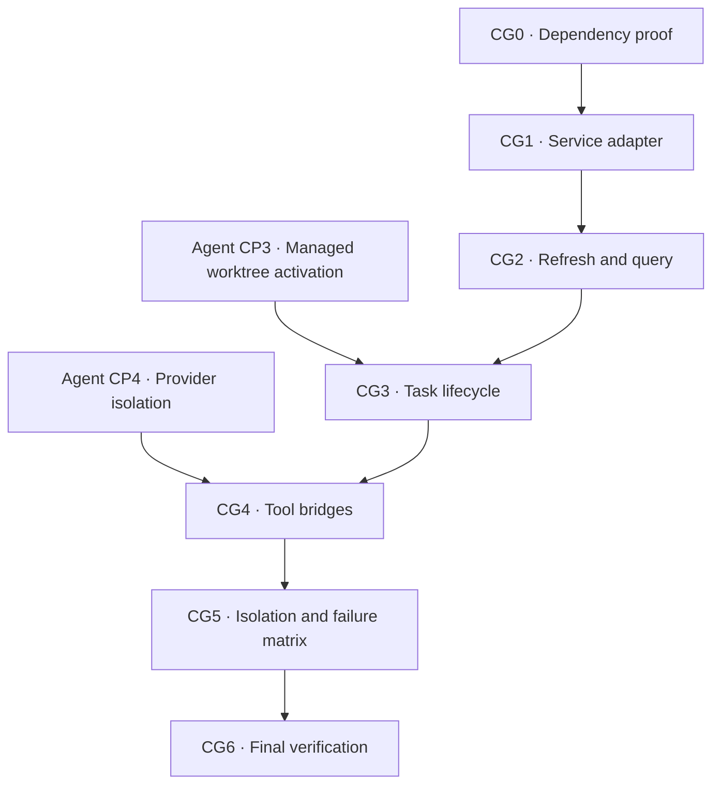

# Code Graph Implementation Checkpoints

> **Temporary implementation tracker.** The canonical behavior is locked in
> [CodeGraph Service](codegraph-service.md). Delete this file only after every
> checkpoint is complete and the canonical design reflects the implementation.

Status: implementation not started.

A checkbox is complete only when the behavior and focused tests exist. A
checkpoint gate must pass before work begins on a dependent checkpoint.

## Outcome

Add one optional, task-scoped CodeGraph capability to managed agent worktrees.
The root agent chooses when structural graph evidence is useful. ByteQuay
provides exactly two bounded tools and managed guidance, keeps one disposable
index per worktree, and continues normally when any graph operation fails.

## Locked V1 decisions

- [x] One managed `TaskWorktree` owns one independent external index under its
  task runtime.
- [x] A task that never calls a graph tool creates no index.
- [x] The first `codegraph_explore` or `codegraph_refresh` initializes an
  absent index; later turns synchronize an existing index before provider
  execution.
- [x] Existing-index refresh uses CodeGraph's unscoped filesystem
  reconciliation. ByteQuay does not gate it with `HEAD`, commit ranges,
  `git status`, or timestamps.
- [x] The agent selects graph queries. ByteQuay does not inject a prepared
  evidence pack or automatic graph context.
- [x] Graph relationships are navigation hints. Current source, compiler,
  tests, linters, and runtime evidence remain authoritative.
- [x] Graph failure never changes task, turn, worktree, or provider readiness.
- [x] Managed guidance is supplied by ByteQuay through provider instructions,
  never through `AGENTS.md`, `CLAUDE.md`, global configuration, or disguised
  user text.
- [x] V1 adds no graph database table, lifecycle/freshness state, watcher,
  daemon, shared index, renderer UI, review behavior, or general tool registry.

## Baseline evidence

- [x] CodeGraph 1.6.0 was exercised against Trino commit
  `ce0884ad4dbc2cc1f7f1e0fb644cd11612e92d0c` on an Apple M4 Max, 16 cores,
  128 GB RAM, and local SSD.
- [x] The isolated Trino clone contained 15,497 tracked files, 10,864 Java
  files, and about 1.93 million Java lines; CodeGraph indexed 11,440 files into
  about 360,000 nodes and 1.13 million edges.
- [x] End-to-end reference timings were about 39–40 seconds for initial
  indexing, 0.49–0.54 seconds for unchanged unscoped sync, and 0.94–1.06
  seconds for one small Java edit.
- [x] The resulting per-worktree index occupied about 1.28 GB.
- [x] These values are a recorded reference, not a cross-machine SLA or a
  brittle CI timing assertion.

## Dependency order

The dependency arrows are implementation gates, not new runtime states.

## [ ] CG0 — Prove the dependency boundary

**Owner:** runtime/integration owner

**Depends on:** nothing

**Visible UI:** no

Purpose: prove that the selected CodeGraph build can satisfy ByteQuay's
storage, packaging, sandbox, and offline requirements before adding product
code.

- [ ] Pin one exact CodeGraph source revision and distributable version,
  starting from the benchmarked 1.6.0 release.
- [ ] Record package and platform-artifact checksums, license notice, and
  macOS arm64/x64 provenance.
- [ ] Prove a separate canonical source root and external index root. Every
  database, WAL, lock, metadata, and configuration file must remain under
  `<task-runtime>/<task-id>/codegraph`.
- [ ] If upstream still writes `.codegraph` below the source root, pin and
  audit the smallest external-storage patch. Do not use a symlink, hidden
  ignore rule, or worktree exception.
- [ ] Freeze a noninteractive helper contract for version/probe, initialize or
  sync, explore, and safe index deletion. The helper must not run an installer
  or edit provider/project configuration.
- [ ] Prove the helper is packaged with ByteQuay and runs without a global
  CodeGraph or Node installation and without a runtime download.
- [ ] Disable telemetry and update checks and prove execution succeeds with
  network denied.
- [ ] Prove the process sandbox permits source reads and task-index writes but
  denies source writes, other task runtimes, other worktrees, credentials, and
  network access.
- [ ] Add an executable compatibility fixture for version/probe, initialize,
  unchanged sync, changed sync, query, missing binary, malformed output,
  nonzero exit, timeout, and process termination.
- [ ] Prove and record the accepted upstream same-size/same-mtime detection
  limitation. Do not add a full-repository hash manifest or claim stronger
  freshness than the executable proves.

Checkpoint gate:

- [ ] Stop implementation if external index storage, offline packaging, or
  the sandbox boundary cannot be proved without a workaround inside the
  worktree.

Primary files:

- Pinned CodeGraph source/package metadata
- New executable compatibility fixture under `backend/app/src/test`
- `frontend/forge.config.ts`

## [ ] CG1 — Add the minimal service and adapter

**Owner:** backend owner

**Depends on:** CG0

**Visible UI:** no

Purpose: hide CodeGraph behind one optional task-scoped boundary without a new
module, database record, or per-worktree service object.

- [ ] Add `CodeGraphService` and `CodeGraphException` to `agent-core` with the
  exact approved operations: usable-index check, refresh, explore, and index
  deletion.
- [ ] Derive the index root from trusted `TaskResources`; do not add a
  `TaskResources` field, graph table, registration store, or lifecycle enum.
- [ ] Add one concrete adapter under `app` and wire it through the Spring
  composition root.
- [ ] Bind every call to the persisted canonical `TaskWorktree`. Accept no
  renderer/model path, task ID, repository, commit, or index location.
- [ ] Use argv execution without a shell. Reuse the existing bounded process
  infrastructure only if it can host this optional short-lived process without
  adding provider or graph lifecycle state; otherwise add the smallest
  app-local bounded runner. Do not stretch `GitCommandRunner`.
- [ ] Serialize initialize/sync/query/delete for one task without serializing
  unrelated tasks.
- [ ] Bound query length, initialization and sync duration, query duration,
  stdout, stderr, returned text, and process-drain time.
- [ ] Redact bounded diagnostics before they enter an agent event or tool
  result.
- [ ] Terminate and drain every owned graph process after success, timeout, or
  failure.
- [ ] Map only expected operational failures to `CodeGraphException`;
  programming and mandatory worktree/resource errors remain visible.

Checkpoint gate:

- [ ] Focused `agent-core` contract and `app` adapter tests pass for success,
  invalid paths, missing executable, nonzero exit, malformed output, timeout,
  truncation, process drain, and concurrent tasks.

Primary files:

- `backend/agent-core/src/main/java/com/bytequay/agent/core/CodeGraphService.java`
- `backend/agent-core/src/main/java/com/bytequay/agent/core/CodeGraphException.java`
- `backend/app/src/main/java/com/bytequay/app/agent/codegraph/`
- `backend/app/src/main/java/com/bytequay/app/agent/AgentConfiguration.java`

## [ ] CG2 — Implement lazy initialization, refresh, and exploration

**Owner:** backend owner

**Depends on:** CG1

**Visible UI:** no

Purpose: charge full indexing only to a task whose agent requests the graph,
then keep that index current with the simplest safe reconciliation.

- [ ] Make `hasUsableIndex(worktree, resources)` a derived-cache check only.
  It must reject partial, incompatible, corrupt, escaped, or wrong-worktree
  indexes without persisting a freshness state.
- [ ] Make the first explicit refresh initialize an absent index and later
  refreshes run unscoped sync.
- [ ] Make the first explore initialize an absent index before executing its
  bounded query.
- [ ] Make an unchanged refresh a normal no-op.
- [ ] Do not add a caller-side Git commit, status, diff, dirty-path, or
  timestamp gate.
- [ ] Return structural source/relationship evidence with an explicit
  truncation marker when the output cap is reached.
- [ ] On corruption or version incompatibility, safely discard only the
  derived index and return unavailable. A later explicit graph call may build
  once; do not add an automatic retry loop.
- [ ] Test committed and uncommitted additions, modifications, renames, and
  deletions, including a clean checkout/rebase that changes source while
  `git status` is clean.
- [ ] Test that unchanged files are not reparsed and one changed file does not
  trigger a full rebuild.
- [ ] Test restart using only persisted `TaskWorktree` facts and the
  deterministic task-runtime path.

Checkpoint gate:

- [ ] A small real-Git fixture proves initial exploration and incremental
  reconciliation without a ByteQuay commit cursor.

Primary files:

- CodeGraph adapter and focused real-Git fixtures from CG1

## [ ] CG3 — Integrate the managed task lifecycle

**Owner:** agent-core/application owner

**Depends on:** CG2 and Agent Service CP3 managed-worktree activation

**Visible UI:** no

Purpose: preserve mandatory task/worktree checks while making every graph
operation optional and cleanup race-free.

- [ ] Keep task creation unchanged: provision worktree, allocate runtime,
  persist task. Do not create a graph directory or schedule a background build.
- [ ] After a turn owns the task mutation boundary, require persisted
  `TaskWorktree` and `TaskResources` and run mandatory
  `WorktreeService.inspect` before any graph call.
- [ ] If `hasUsableIndex` is false, skip automatic pre-turn refresh and start
  the provider normally.
- [ ] If an index exists, run best-effort `refreshIfNeeded` immediately before
  provider session open/start.
- [ ] Catch only `CodeGraphException` around the optional index check/refresh;
  mandatory worktree, resource, and sandbox failures remain fail-closed.
- [ ] Let an in-turn explicit refresh observe edits made during that turn.
- [ ] Use the existing task-local execution boundary so graph callbacks cannot
  race task completion or worktree removal.
- [ ] After successful `WorktreeService.cleanup`, request best-effort graph
  deletion.
- [ ] If worktree cleanup fails, skip immediate index deletion.
- [ ] Let existing `AgentResourceService.delete` retention remove any leftover
  derived index without graph-specific cleanup state.
- [ ] Test absent-index pre-turn, refresh failure, restart, successful and
  refused worktree cleanup, deletion failure, and a graph callback racing
  completion.

Checkpoint gate:

- [ ] No graph outcome can reject, fail, interrupt, recover-block, or retain a
  claim for an otherwise valid task or turn.

Primary files:

- `backend/agent-core/src/main/java/com/bytequay/agent/core/impl/DefaultAgentTurnService.java`
- `backend/agent-core/src/main/java/com/bytequay/agent/core/impl/DefaultAgentCompletionService.java`
- `backend/agent-core/src/main/java/com/bytequay/agent/core/impl/AgentRuntimeRegistry.java`

## [ ] CG4 — Expose exactly two tools and managed instructions

**Owner:** provider/runtime owner

**Depends on:** CG3 and Agent Service CP4 provider isolation

**Visible UI:** existing tool activity only

Purpose: expose the same bounded task capability to supported root agents
without introducing a product-tool framework or editing repository guidance.

- [ ] Define fixed schemas for `codegraph_explore(query)` and
  `codegraph_refresh()`.
- [ ] Reject empty or oversized queries and every unknown argument.
- [ ] Bind callbacks from trusted session context. Expose no task, path,
  project, commit, configuration, initialization mode, status, rebuild,
  deletion, or multi-project parameter.
- [ ] Add one narrow optional CodeGraph bridge value to
  `AgentSessionContext`; do not add a model-controlled tool registry.
- [ ] Record invocation and bounded result/error through the existing agent
  event and blob infrastructure.
- [ ] Return ordinary recoverable tool results for missing, busy, corrupt,
  timed-out, or otherwise unavailable graph operations.
- [ ] Prove the Codex App Server dynamic-tool registration, callback,
  cancellation, managed-instruction, and resume shapes in the compatibility
  fixture before enabling them.
- [ ] Permit only these two audited dynamic tools in the Codex task isolation
  checks; every other MCP, app/plugin, hook, dynamic tool, and Code Mode host
  remains absent.
- [ ] Extend Claude's existing capability-token-protected task MCP boundary
  with these two fixed handlers. Keep the permission callback separate and do
  not add a generic MCP registry.
- [ ] Supply the approved instruction through each provider's managed
  system/developer instruction channel on initial and resumed sessions only
  when both tools pass preflight.
- [ ] Never write repository instruction files, provider-global config, or
  user-message text to advertise CodeGraph.
- [ ] Guarantee the bridge only for the root agent in V1.
- [ ] If bridge registration/self-test fails, omit both tools and the managed
  instruction and open the provider normally.
- [ ] If a provider explicitly rejects the optional configuration, retry open
  once without both tools and the instruction. Do not retry unrelated provider
  failures.
- [ ] Test task binding, cross-task denial, schema bounds, new/resumed sessions,
  managed-instruction presence/absence, legacy tasks without `TaskWorktree`,
  preflight omission, and the one-time fallback for Codex and Claude.

Checkpoint gate:

- [ ] Provider-independent bridge tests and provider-specific compatibility
  fixtures pass without weakening the base task isolation checks.

Primary files:

- `backend/agent-spi/src/main/java/com/bytequay/agent/spi/AgentSessionContext.java`
- `backend/agent-cli/src/main/java/com/bytequay/agent/cli/codex/`
- `backend/agent-cli/src/main/java/com/bytequay/agent/cli/claude/`
- `scripts/codex-app-server-compat.mjs`
- `backend/agent-cli/src/test/resources/com/bytequay/agent/cli/codex/app-server-v0.151.0-bindings.json`

## [ ] CG5 — Prove isolation, failure behavior, and measured cost

**Owner:** backend/runtime owner

**Depends on:** CG4

**Visible UI:** no new UI

Purpose: prove CodeGraph can be completely absent or broken without changing
the task, while retaining exact per-worktree isolation when available.

- [ ] Prove two tasks for the same repository use different indexes and return
  their divergent committed and uncommitted symbols.
- [ ] Prove graph files never appear in `git status` and cannot block normal
  clean worktree cleanup.
- [ ] Prove source writes, path traversal, symlink escape, other-task access,
  network access, runtime downloads, telemetry, and update checks are denied.
- [ ] Inject missing executable, initialize, refresh, query, malformed output,
  timeout, corruption, provider bridge, and deletion failures and prove every
  optional boundary fails open.
- [ ] Prove a task that never uses CodeGraph creates no index and pays no full
  initialization cost.
- [ ] Re-run the opt-in Trino benchmark for full initialization, repeated
  no-change sync, repeated one-Java-file sync, representative query latency,
  peak memory, and index size.
- [ ] Record CodeGraph version, Trino commit, macOS version, hardware, storage,
  counts, timing distribution, and index size beside the result.
- [ ] Keep reference-machine targets and regressions outside normal CI wall
  clock assertions; CI exercises behavior and bounds with a small fixture.
- [ ] Add a watcher, exact-path cursor, shared baseline, or daemon only after
  field P95 data demonstrates that unscoped refresh is insufficient.

Checkpoint gate:

- [ ] CodeGraph may be unavailable for an entire task without changing that
  task's lifecycle, correctness, cleanup, or native source tools.

Primary files:

- Focused isolation/failure fixtures from CG0–CG4
- Opt-in CodeGraph performance fixture and recorded results

## [ ] CG6 — Full verification and handoff

**Owner:** final integrator

**Depends on:** CG5

**Visible UI:** no new UI

- [ ] Run focused compatibility, adapter, lifecycle, provider, isolation, and
  failure tests.
- [ ] Run `mvn verify` in `backend/`.
- [ ] Run `git diff --check`.
- [ ] Confirm the packaged macOS app contains the pinned CodeGraph helper and
  requires no runtime installation or download.
- [ ] Confirm no change writes to GitHub or adds a renderer-facing graph API.
- [ ] Reconcile the implementation with `codegraph-service.md`,
  `architecture.md`, `agent-service.md`, and the design index.
- [ ] Replace planned wording with implemented evidence where appropriate.
- [ ] Delete this temporary checklist only after every preceding box is
  checked and the canonical documents contain all durable decisions.

Final gate:

- [ ] The two graph tools are useful when available and semantically invisible
  to task correctness when unavailable.

## Explicitly deferred

- [ ] Live watcher or daemon.
- [ ] Exact-path or Git-cursor refresh optimization.
- [ ] Shared repository baseline or cross-worktree index.
- [ ] Persistent graph registration, lifecycle, or freshness states.
- [ ] Eager or background initialization.
- [ ] Renderer graph status or management UI.
- [ ] Automatic graph-context selection or injection.
- [ ] Child-agent tool inheritance.
- [ ] Pull-request review, evidence, anchors, or GitHub comments.
- [ ] Generic application-tool framework.
