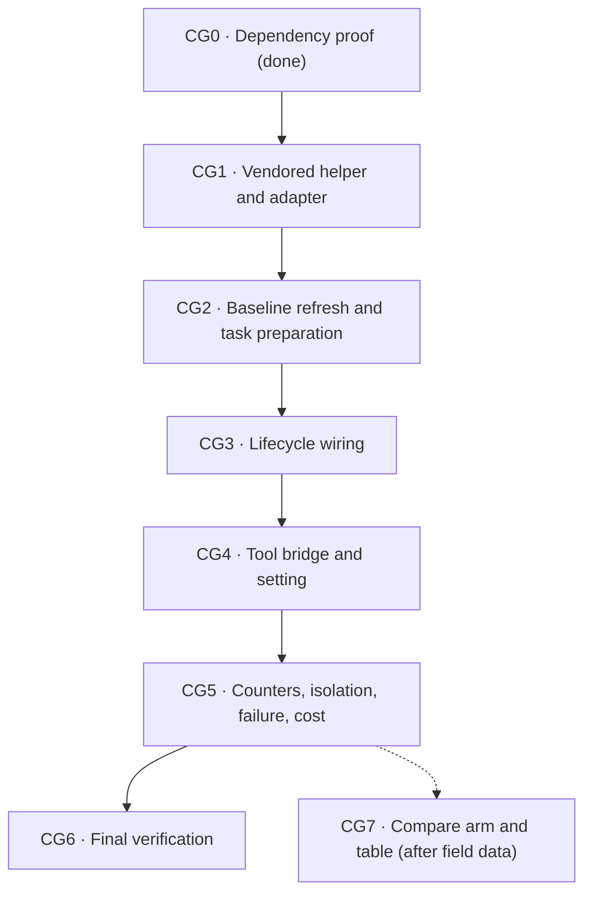

# Code Graph Implementation Checkpoints

> **Temporary implementation tracker.** The canonical behavior is locked in
> [CodeGraph Service](codegraph-service.md). Delete this file only after every
> checkpoint is complete and the canonical design reflects the implementation.

Status: design approved 2026-09-05; CG0 proof recorded below; CG1 in progress.

A checkbox is complete only when the behavior and focused tests exist. A
checkpoint gate must pass before work begins on a dependent checkpoint.

## Outcome

Add one optional, task-scoped CodeGraph capability to managed agent worktrees.
The root agent chooses when structural graph evidence is useful. ByteQuay
provides exactly two bounded tools and managed guidance, keeps one disposable
index per worktree, and continues normally when any graph operation fails.

## Locked first-version decisions (approved 2026-09-05)

- [x] One managed `TaskWorktree` owns one independent external index under its
  task runtime.
- [x] One baseline index per physical repository holds the index of the fetched
  remote default-branch commit. It changes only when a fetch shows that branch
  gained commits; tasks never modify it; a refresh replaces it atomically.
- [x] Task creation clones the baseline into the task runtime on a virtual
  thread and synchronizes it, so a task's first graph call costs the query
  alone when the baseline is current.
- [x] One tool, `codegraph_explore`, synchronizes or rebuilds before every
  query. No refresh tool, no pre-turn refresh.
- [x] Sync versus rebuild is chosen by changed-file count from a last-synced
  `HEAD` sidecar: at most five percent of the indexed files runs `sync`, more
  runs `codegraph index`. Git is consulted for cost only; sync stays unscoped.
- [x] Both lanes reach the tool over the ByteQuay task MCP endpoint; the Codex
  isolation check allows exactly that server.
- [x] Graph relationships are navigation hints. Current source, compiler,
  tests, linters, and runtime evidence remain authoritative.
- [x] Graph failure never changes task, turn, worktree, or provider readiness.
- [x] Managed guidance is supplied by ByteQuay through provider instructions,
  never through `AGENTS.md`, `CLAUDE.md`, global configuration, or disguised
  user text.
- [x] Metrics: an `on`/`off` setting and five per-turn counters. The `compare`
  arm and the Settings comparison table wait for CG7.
- [x] No graph database table, lifecycle/freshness state, watcher, daemon,
  renderer management UI, review behavior, or general tool registry.

## Baseline evidence

- [x] CodeGraph 1.6.0 was exercised against Trino commit
  `ce0884ad4dbc2cc1f7f1e0fb644cd11612e92d0c` on an Apple M4 Max, 16 cores,
  128 GB RAM, and local SSD.
- [x] The isolated Trino clone contained 15,497 tracked files, 10,864 Java
  files, and about 1.93 million Java lines; CodeGraph indexed 11,440 files into
  about 360,000 nodes and 1.13 million edges.
- [x] End-to-end reference timings were about 39–40 seconds for initial
  indexing, 0.49–0.54 seconds for unchanged unscoped sync, and 0.94–1.06
  seconds for one small Java edit.
- [x] The resulting per-worktree index occupied about 1.28 GB.
- [x] These values are a recorded reference, not a cross-machine SLA or a
  brittle CI timing assertion.

## Dependency order



The dependency arrows are implementation gates, not new runtime states.

## [ ] CG0 — Prove the dependency boundary

**Owner:** runtime/integration owner

**Depends on:** nothing

**Visible UI:** no

Purpose: prove that the selected CodeGraph build can satisfy ByteQuay's
storage, packaging, sandbox, and offline requirements before adding product
code.

- [x] Pin one exact CodeGraph source revision and distributable version,
  starting from the benchmarked 1.6.0 release.
- [ ] Record package and platform-artifact checksums, license notice, and
  macOS arm64/x64 provenance.
- [x] Prove a separate canonical source root and external index root. Every
  database, WAL, lock, metadata, and configuration file must remain under
  `<task-runtime>/<task-id>/codegraph`.
- [x] If upstream still writes `.codegraph` below the source root, pin and
  audit the smallest external-storage patch. Do not use a symlink, hidden
  ignore rule, or worktree exception.
- [ ] Freeze a noninteractive helper contract for version/probe, initialize or
  sync, explore, and safe index deletion. The helper must not run an installer
  or edit provider/project configuration.
- [ ] Prove the helper is packaged with ByteQuay and runs without a global
  CodeGraph or Node installation and without a runtime download.
- [x] Disable telemetry and update checks and prove execution succeeds with
  network denied.
- [ ] Prove the process sandbox permits source reads and task-index writes but
  denies source writes, other task runtimes, other worktrees, credentials, and
  network access.
- [ ] Add an executable compatibility fixture for version/probe, initialize,
  unchanged sync, changed sync, query, missing binary, malformed output,
  nonzero exit, timeout, and process termination.
- [x] Prove and record the accepted upstream same-size/same-mtime detection
  limitation. Do not add a full-repository hash manifest or claim stronger
  freshness than the executable proves.

Checkpoint gate:

- [x] Stop implementation if external index storage, offline packaging, or
  the sandbox boundary cannot be proved without a workaround inside the
  worktree.

Primary files:

- Pinned CodeGraph source/package metadata
- New executable compatibility fixture under `backend/app/src/test`
- `frontend/forge.config.ts`

### CG0 evidence (2026-09-04)

Recorded from a scratch run on an Apple M4 Max, 16 cores, 128 GB RAM, macOS
26.5.1, local SSD. Nothing below is product code yet; the patch and helper
environment are the proposal for CG1.

**Pinned artifacts (MIT, registry.npmjs.org):**

| Package | Version | sha512 integrity | Size |
| --- | --- | --- | --- |
| `@colbymchenry/codegraph` | 1.6.0 | `nCN40MqmYxF7gH1QTKqlxJ1d2mzwhw3fzSdGV2wjnQKsymjM3JZnH/5rpGqhBkcUEom0qWq0WjDRvOZh2t8mFA==` | 760,909 B unpacked, 182 files |
| `@colbymchenry/codegraph-darwin-arm64` | 1.6.0 | `usYVM30d7kH2Fm3ZPkiE84J8bWAicPsw/3Kh8LjbwvHkBkU3IlEYRQFkTDAf+HSRLLs8h5w/5WHkx/FvNKRZ/g==` | 57.8 MB tarball, 289,549,278 B unpacked, 941 files |

The main package is only the npm launcher shim; it self-downloads a bundle
from GitHub Releases when the platform package is missing. ByteQuay ships the
platform bundle alone and never the shim. The bundle is self-contained: a
Node 24 runtime (117 MB), the Rust kernel as a Node addon (34 MB), tree-sitter
grammars (65 MB), and `bin/codegraph`, a shell launcher that execs the bundled
`node` on `lib/dist/bin/codegraph.js`. No system Node is required. The x64
bundle was not fetched yet.

**External index root.** `CODEGRAPH_DIR` rejects absolute paths and path
separators by design, so upstream cannot place the index outside the source
root. Every index path in the bundle derives from one function,
`getCodeGraphDir(projectRoot)` in `lib/dist/directory.js`, so the audited
patch is five lines: honor an absolute `CODEGRAPH_DATA_DIR`.

```diff
--- a/lib/dist/directory.js
+++ b/lib/dist/directory.js
@@ -126,6 +126,11 @@
  * Get the .codegraph directory path for a project
  */
 function getCodeGraphDir(projectRoot) {
+    // ByteQuay patch: an absolute CODEGRAPH_DATA_DIR keeps the index outside the source root.
+    const external = process.env.CODEGRAPH_DATA_DIR?.trim();
+    if (external && path.isAbsolute(external)) {
+        return external;
+    }
     return path.join(projectRoot, codeGraphDirName());
 }
 /**
```

Consequence: with the variable set, `isInitialized(anyPath)` is true for
every path, so the helper must always pass the worktree path explicitly and
never rely on the cwd walk-up.

**Helper environment proved offline and silent:** `HOME` pointed at a scratch
directory, `DO_NOT_TRACK=1`, `CODEGRAPH_NO_UPDATE_CHECK=1`,
`CODEGRAPH_NO_DOWNLOAD=1`, `CODEGRAPH_NO_WATCH=1`, `CODEGRAPH_NO_DAEMON=1`,
`NO_COLOR=1`. Across every operation below, zero files were written under the
redirected `HOME`; upstream otherwise writes `~/.codegraph` for its update
check cache, daemon registry, and beta-signup marker. Under a `sandbox-exec`
profile denying `network*` and `file-write*` beneath the worktree, `sync`
exited 0, a `touch` into the worktree was refused, an outbound `fetch` failed
with `ENOTFOUND`, and index writes still succeeded. `sandbox-exec` is
deprecated but functional on this macOS; CG1 chooses the production mechanism.

**Linked worktree, this repository (873 files):**

| Operation | Result |
| --- | ---: |
| `init` on a `git worktree add` checkout | 5.3 s wall; 23,860 nodes, 60,878 edges; index 99 MB |
| `git status` and `.codegraph*` inside the worktree after init | 0 lines, 0 directories |
| `sync`, unchanged | 0.14 s |
| `sync` after one untracked file, one modified file, one deleted file | 0.27 s; all three reflected |
| commit, then clean `git checkout` of an older commit, `sync` | 2.3 s; symbols follow `HEAD` both ways |
| second worktree of the same repository | separate index; neither sees the other's symbols |
| `explore`, three structural questions | 0.23–0.26 s; about 25 KB each |

**Trino `ce0884ad4dbc2cc1f7f1e0fb644cd11612e92d0c` (15,497 files, shared local
clone, external index):**

| Operation | Result |
| --- | ---: |
| `init` | 37.9 s wall; 11,440 files, 359,891 nodes, 1,130,591 edges; 1.28 GB |
| `sync`, unchanged, three runs | 0.48–0.49 s |
| `sync` after one edit to `core/trino-main/.../Session.java`, three runs | 1.77–1.93 s |
| `explore` | 1.62 s; 25 KB |

These match the Section 5 baseline with the patch applied; the one-edit sync
is slower than the recorded 0.94–1.06 s, on a large central file.

**Same-size, same-mtime edits are detected.** An in-place rewrite that kept
the inode, size, and mtime of `TaskMetrics.java` was reflected by the next
`sync`. Version 1.6.0 keeps a per-file content hash and uses `git status` as
a fast path, so the Section 4 caveat did not reproduce. Keep graph results as
hints anyway; nothing depends on this detail.

**Output bound.** `explore` returns about 25 KB regardless of repository
size, roughly 6–7k tokens per call, and accepts `--max-files`. The CG1 adapter
must cap and mark truncation as Section 6 requires.

**Also established:** upstream has no index sharing across worktrees, only a
borrowed-index warning, so the per-worktree model is upstream's own. The
Rust kernel is an N-API addon and Electron 41 ships Node 24.14 with
`node:sqlite`, but running the bundled CLI under `ELECTRON_RUN_AS_NODE`
fails with commander's "unknown command <script>" even with argv, execArgv,
and the Electron version marker normalized; the 117 MB saving is deferred.
The pinned Codex bindings have no dynamic-tool registration method, and Codex
0.152.1 supports streamable-HTTP MCP with bearer headers, so the first
version bridges Codex over the same task MCP endpoint as Claude.

**Redesign 2026-09-04:** the 38 s first call on a Trino-sized repository was
judged unacceptable for the first version. Section 13 of the canonical design
now proposes a per-repository baseline index cloned into each task at
creation, off the request path, so the common first call costs about one
second; CG1–CG4 will be re-cut against it once approved.

**Open in CG0:** x64 bundle provenance, the noninteractive helper contract,
packaging the 278 MB bundle into the app (the current packaged app is
351 MB; the grammar set could be trimmed), the full sandbox matrix, and the
executable compatibility fixture.

### Benefit probe (2026-09-04)

A bounded first answer to "is the graph worth it", run before any product
code. It is evidence for CG7's direction, not a benchmark: one repository,
one model, exploration questions only, two runs per cell.

Method: Claude Code 2.1.260 headless (`claude -p`, `claude-sonnet` alias),
built-in tools pinned to `Read`, `Grep`, and `Glob` so no subagent or shell
could run, against the linked worktree of this repository at `1f6ab2fe2`.
The graph arm added upstream's own MCP server (`codegraph serve --mcp
--no-watch`, only `codegraph_explore` exposed, strict MCP config) and the
Section 7 managed instruction; the other arm had neither. Three questions
asked for cross-file traces with file and line citations: the Claude
permission-prompt MCP registration and driver flags; the Codex
`dynamicToolCall` path to `AgentEventPayload` and the transcript module; and
where `TurnMetrics` are computed, persisted, and displayed. Each answer was
scored against three to five required file or flag anchors. Every one of the
twelve answers scored full marks, so the comparison is about cost, not
correctness. Order alternated between repetitions. Medians per cell:

| Question | Arm | Tool calls | Graph calls | Seconds | Input tokens | Output tokens | Cost |
| --- | --- | ---: | ---: | ---: | ---: | ---: | ---: |
| Q1 | no graph | 3.5 | 0 | 30 | 119k | 2.0k | $0.186 |
| Q1 | graph | 2.5 | 1.0 | 23 | 65k | 1.8k | $0.118 |
| Q2 | no graph | 27.5 | 0 | 72 | 527k | 6.1k | $0.289 |
| Q2 | graph | 10.0 | 2.0 | 42 | 321k | 3.4k | $0.256 |
| Q3 | no graph | 9.5 | 0 | 37 | 174k | 2.8k | $0.144 |
| Q3 | graph | 4.5 | 1.5 | 25 | 139k | 1.8k | $0.145 |
| all six | no graph | 9.5 | 0 | 37 | 174k | 2.8k | $0.186 |
| all six | graph | 4.5 | 1.5 | 25 | 139k | 1.9k | $0.154 |

Total spend for the twelve runs: $2.28.

Reading: the graph arm used one or two graph calls, then verified with
`Read`, and needed about half the tool calls and wall time overall, with the
largest gap on the deepest trace (Q2: 7–13 tool calls against 26–29). Input
tokens fell on two of three questions; Q3 was mixed because one graph run
explored twice. Cost is the noisiest column: Claude's cache accounting prices
first-turn cache creation above later reads, and the two arms have different
prompt prefixes, so cost differences of a few cents are not signal.

Caveats that CG7's in-app comparison must not inherit: upstream's MCP server
also injected a 5,787-character server instruction into the graph arm; each
`codegraph_explore` result was about 25 KB, roughly 6–7k tokens, which
ByteQuay's adapter must cap; and no question required an edit, a test run,
or a second turn. A first probe without the `--tools` pin was discarded
because three of six runs delegated to a background subagent and returned no
answer, which is itself a reason the product bridge is root-agent only.

Raw transcripts, answers, and the summarizer live in the session scratchpad
under `cg0/probe2/`; only these medians are durable.

### Base-branch movement and worktree seeding (2026-09-04)

Two follow-up measurements requested during review, same machine, same
patched 1.6.0 bundle, external index. Neither costs model tokens; the cost
is CPU, disk, and the latency a turn or a first graph call would wait on.

**Case 1: the default branch advanced by N commits and the task branch was
moved onto it.** The index was left at commit `B0−N`, the worktree checked
out `B0` (`ce0884ad4db`), and one unscoped `sync` ran. The reverse direction
was also timed. A `git rebase` onto the new base ends in the same working
tree, so it costs the same.

| Repository | N commits | Files changed | `sync` (s) | Reverse (s) |
| --- | ---: | ---: | ---: | ---: |
| Trino, 11,440 indexed files | 10 | 72 | 9.6 | 12.9 |
| Trino | 50 | 924 | 46.9 | 49.3 |
| Trino | 200 | 1,365 | 59.3 | 59.6 |
| Trino | 1,000 | 3,112 | 89.9 | 91.8 |
| This repository, 873 files | 10 | 168 | 5.1 | 4.4 |
| This repository | 50 | 210 | 4.9 | 3.8 |
| This repository | 200 | 607 | 8.2 | 6.4 |

Full in-place rebuild with `codegraph index`: Trino 42.1 s, this repository
2.6 s. Sync cost grows with the changed set far faster than the one-file
case suggested, and above roughly 3 percent of the indexed files a rebuild is
cheaper: on Trino the crossover sits between 72 and 924 changed files, on
this repository at about 150. Sync also leaves garbage behind: after eight
syncs the Trino index had grown from 1.28 GB to 1.6 GB, and one `index` run
brought it back to 1.3 GB.

**Case 2: a new worktree or branch checkout.** Git copies nothing, because
the index lives outside the worktree and the database stores only relative
paths: zero absolute-root strings were found in the file, and `status` and
`explore` served a copied index from a different worktree path without
complaint. A new worktree therefore starts empty and pays a fresh build:
Trino 38.4 s and 1.3 GB, this repository 2.6–5.3 s and 111 MB. Seeding by
copying an existing index works and was timed:

| Seeding step on Trino | Time | Disk actually used |
| --- | ---: | ---: |
| APFS clone of the 1.3 GB index (`cp -c`) | 0.03 s | 8 MB |
| `sync` on the clone, same commit | 0.81 s | included above |
| `sync` on the clone after 10 commits moved | 10.7 s | 603 MB |
| `sync` on the clone after 200 commits moved | 59.5 s | 1,381 MB |
| plain `cp -R` for reference | 0.65 s | 1,585 MB |

So a clone is free only until its first sync; SQLite rewrites most pages, and
each task ends up owning a full-size index either way. The time saving is
real only when the seed sits at the task's start commit: 0.84 s instead of
38.4 s on Trino, 0.1 s instead of 2.6 s here.

**Consequences proposed for review; the canonical design is unchanged:**

1. Keep `sync` unscoped, but choose between the two correct operations by
   size. ByteQuay writes the `HEAD` it last synced into a sidecar in the index
   directory; before a refresh it counts `git diff --name-only <last> HEAD`
   plus `git status --porcelain` entries, about 0.1 s, and runs `index`
   instead of `sync` above roughly 3 percent of the indexed file count. This
   is a cost choice, not the freshness gate Section 4 forbids. It also caps
   index bloat without a separate compaction rule.
2. Keep the pre-turn refresh off the slow path: run it only when the counted
   delta is below the threshold, otherwise skip it and let the agent's first
   explicit graph call pay the rebuild, which the managed instruction already
   warns about. A 40–90 s pre-turn wait on a large repository is not
   acceptable turn latency.
3. Reconsider the deferred shared baseline for large repositories only: one
   per-repository index kept at the fetched default-branch commit, the same
   commit new task worktrees are cut from, refreshed in the background after
   the existing fetch and cloned into a task runtime on the task's first
   graph call. First graph call on Trino drops from 38 s to about 1 s.
   Storage stays one full index per task plus one baseline. This repository
   gains nothing from it, so it belongs after CG4 as its own gated checkpoint,
   not in V1.

## [x] CG1 — Vendor the helper and build the adapter

**Owner:** backend owner

**Depends on:** CG0

**Visible UI:** no

Purpose: a working `CodeGraphService` for one worktree with no baseline yet,
with the helper packaged deterministically and never downloaded at runtime.

- [x] Vendor the pinned bundle: one script fetches
  `@colbymchenry/codegraph-<platform>@1.6.0` by recorded sha512 integrity into
  a gitignored `frontend/vendor/codegraph/`, refuses on mismatch, applies the
  five-line external-index patch with an assertion that the original text is
  present, and writes a marker so reruns are no-ops. `dev.sh` and
  `forge.config.ts` run it; `extraResource` ships the bundle beside the
  backend jar. Record the x64 bundle's integrity alongside arm64.
- [x] The backend locates the bundle from `bytequay.codegraph.home`, set by
  `dev.sh` and `backendProcess.ts`; an absent or invalid home means the
  service is unavailable, never an error.
- [x] Add `CodeGraphService` and `CodeGraphException` to `agent-core` with
  Section 4 operations `explore` and `deleteIndex`; the baseline operations
  join the port in CG2.
- [x] Add the adapter under `com.bytequay.app.agent.codegraph`: argv execution
  without a shell through the bundled `node` and `lib/dist/bin/codegraph.js`,
  the fixed environment (`HOME` under the runtime, `DO_NOT_TRACK`,
  `CODEGRAPH_NO_UPDATE_CHECK`, `CODEGRAPH_NO_DOWNLOAD`, `CODEGRAPH_NO_WATCH`,
  `CODEGRAPH_NO_DAEMON`, `NO_COLOR`, `CODEGRAPH_DATA_DIR`), bounded stdout,
  stderr, and duration, terminate-and-drain. Redaction happens where a result
  enters an agent event (CG4). The generic `runCommand` on
  `GitCommandRunner` gained an environment overload; its git-specific paths
  are untouched.
- [x] Explore: size rule from the `HEAD` sidecar plus `git diff --name-only`
  and `git status --porcelain`, then `sync` or `index`, then `explore`, then
  a 16 KB cap with a truncation marker.
- [x] The usable-index check rejects partial, corrupt, incompatible, escaped,
  or wrong-path indexes and rebuilds without persisting a state.
- [x] Serialize operations per task; unrelated tasks stay concurrent.
- [x] Map only expected operational failures to `CodeGraphException`.

Checkpoint gate (2026-09-05, nine adapter tests, `mvn verify` green):

- [x] Adapter tests on a real git fixture pass for build, unchanged sync,
  uncommitted, committed, deleted, and checkout changes, the size-rule
  rebuild, cap and truncation, missing bundle, nonzero exit, timeout, drain,
  and two concurrent tasks; `mvn verify` is green.

Primary files:

- `scripts/codegraph-bundle.mjs`
- `frontend/forge.config.ts`, `frontend/src/backendProcess.ts`, `dev.sh`
- `backend/agent-core/src/main/java/com/bytequay/agent/core/CodeGraphService.java`
- `backend/agent-core/src/main/java/com/bytequay/agent/core/CodeGraphException.java`
- `backend/app/src/main/java/com/bytequay/app/agent/codegraph/`
- `backend/app/src/main/java/com/bytequay/app/agent/AgentConfiguration.java`

## [x] CG2 — Baseline refresh and task preparation

**Owner:** backend owner

**Depends on:** CG1

**Visible UI:** no

- [x] Baseline layout `<agent-runtime>/codegraph-baselines/<owner>/<name>/`
  with `codegraph/` and `HEAD`.
- [x] `refreshBaseline`: no-op when `HEAD` matches; otherwise per-repository
  lock, temporary detached checkout under the baseline directory, clone to
  `codegraph.next`, size rule, atomic rename, `HEAD` write, checkout removal;
  a failure keeps the previous baseline.
- [x] `prepare`: wait for a running refresh, APFS clone with plain-copy
  fallback, size-rule sync against the task worktree; without a usable
  baseline it builds the task index directly and never writes a baseline.
- [x] `explore` waits up to 60 s for a running `prepare`, then returns "index
  still building, retry".
- [x] `deleteBaseline`.
- [x] Tests: refresh from none, same commit no-op, ten-commit delta, over five
  percent rebuild, failed refresh keeps the baseline, concurrent refresh and
  prepare, restart during prepare then lazy rebuild. The plain-copy fallback
  is not exercised: forcing a non-APFS volume in a test is not worth a
  fixture.

Checkpoint gate (2026-09-05, eight baseline tests plus the nine adapter tests):

- [x] A real-git fixture proves a second task's `prepare` is a clone plus a
  same-commit sync and never a build.

## [x] CG3 — Wire the lifecycle

**Owner:** agent-core/application owner

**Depends on:** CG2

**Visible UI:** no

- [x] Task creation starts `prepare` on a virtual thread after the task is
  persisted, for interactive, CI Autofix, and cherry-pick tasks.
- [x] After each existing fetch that resolves the default branch, compare the
  commit with the baseline `HEAD` and schedule `refreshBaseline`. The hook
  sits on the workspace code synchronization, which every interactive task
  creation and the app-start refresh run through; the service itself makes
  an unchanged commit a no-op.
- [x] Scheduled job: hourly by property, drive the existing workspace code
  synchronization for every workspace; never on a turn path; silent without
  the helper, without a GitHub account, or in quiet hours. The app-start
  refresh already comes from the workspace service. The per-workspace
  setting gate arrives with the setting in CG4.
- [x] Completion deletes the task index after successful worktree cleanup and
  skips it on refusal; retention covers leftovers.
- [x] Workspace removal deletes the baseline.
- [x] Only `CodeGraphException` is caught at each boundary. `prepare`,
  `deleteIndex`, and `deleteBaseline` are best-effort inside the adapter,
  which logs and swallows their expected failures, because `agent-core` has
  no logging facility by design; `refreshBaseline` and `explore` still throw.

Checkpoint gate (2026-09-05, lifecycle tests in agent-core, refresher and job tests in app):

- [x] No graph outcome can reject, fail, interrupt, recover-block, or retain a
  claim for an otherwise valid task or turn.

## [ ] CG4 — Expose the tool and the setting

**Owner:** provider/runtime owner

**Depends on:** CG3

**Visible UI:** existing tool activity plus one setting

- [ ] Fixed schema for `codegraph_explore(query)`; reject empty or oversized
  queries and every unknown argument.
- [ ] One optional bridge value on `AgentSessionContext` with the task-bound
  callback; no task, path, project, or commit parameter.
- [ ] Claude: add the tool to the task MCP endpoint and the allow rules;
  managed instruction through the system-prompt channel on new and resumed
  sessions.
- [ ] Codex: one `mcp_servers.bytequay` streamable-HTTP entry with the bearer
  header in the isolated per-task config; the isolation check and the
  compatibility fixture assert exactly that server; managed instruction
  through the developer-instruction channel; `mcpToolCall` items map to tool
  activity.
- [ ] Record invocation and bounded result or error through the existing
  `ToolActivity` events.
- [ ] `codegraph` setting, `on` by default; `off` omits the bridge and
  instruction and skips `prepare` and the scheduled job.
- [ ] Preflight omission and the one-time provider retry without the tool.
- [ ] Root agent only.

Checkpoint gate:

- [ ] Provider-independent bridge tests and provider-specific fixtures pass
  without weakening the base task isolation checks.

## [ ] CG5 — Counters, isolation, failure, and cost

**Owner:** backend/frontend owner

**Depends on:** CG4

**Visible UI:** task footer and turn summary counters

- [ ] Fold `toolCalls`, `exploreActions`, `codegraphCalls`, `codegraphMillis`,
  and `codegraphFailures` into `TurnMetrics` at terminal state and into task
  totals; show them in the task footer and finished-turn summaries.
- [ ] Prove two tasks for the same repository use different indexes and see
  only their own symbols.
- [ ] Prove graph files never appear in `git status` and cannot block cleanup.
- [ ] Prove source writes, other task runtimes, other worktrees, credentials,
  and network are denied to the helper.
- [ ] Inject refresh, prepare, explore, bridge, and deletion failures and
  prove every optional boundary fails open.
- [ ] Re-run the opt-in Trino benchmark and record it beside the results.

Checkpoint gate:

- [ ] CodeGraph may be unavailable for an entire task without changing that
  task's lifecycle, correctness, cleanup, or native source tools.

## [ ] CG6 — Full verification and handoff

**Owner:** final integrator

**Depends on:** CG5

- [ ] Run focused adapter, baseline, lifecycle, provider, isolation, and
  failure tests.
- [ ] Run `mvn verify` in `backend/`, `git diff --check`, and the frontend
  gates.
- [ ] Confirm the packaged macOS app contains the pinned bundle and requires
  no runtime installation or download.
- [ ] Confirm no change writes to GitHub or adds a renderer-facing graph API
  beyond the counters and the setting.
- [ ] Reconcile `codegraph-service.md`, `architecture.md`,
  `agent-service.md`, and the design index; delete this file.

## [ ] CG7 — Compare arm and comparison table

**Owner:** backend/frontend owner

**Depends on:** CG5 and observed field usage

- [ ] Add `compare` to the `codegraph` setting and stamp an immutable
  `codegraphArm` on each new task; `compare` assigns at random.
- [ ] Gate the bridge, instruction, and `prepare` on the task arm.
- [ ] Add one read-only per-workspace comparison endpoint and Settings table
  with medians, counts, and the small-sample flag.
- [ ] Test arm stamping, omission on `OFF`, the endpoint, and the contract
  parser.

## Explicitly deferred

- [ ] Live watcher or daemon.
- [ ] `codegraph_refresh` tool.
- [ ] Baseline staleness sweep.
- [ ] Renderer graph management UI.
- [ ] Compare arm and comparison table until field data (CG7).
- [ ] Pull-request review, evidence, anchors, or GitHub comments.
- [ ] Multi-repository graph query.
- [ ] Child-agent tool inheritance.
- [ ] Model-controlled graph configuration.
- [ ] Electron-hosted helper execution (117 MB saving).
