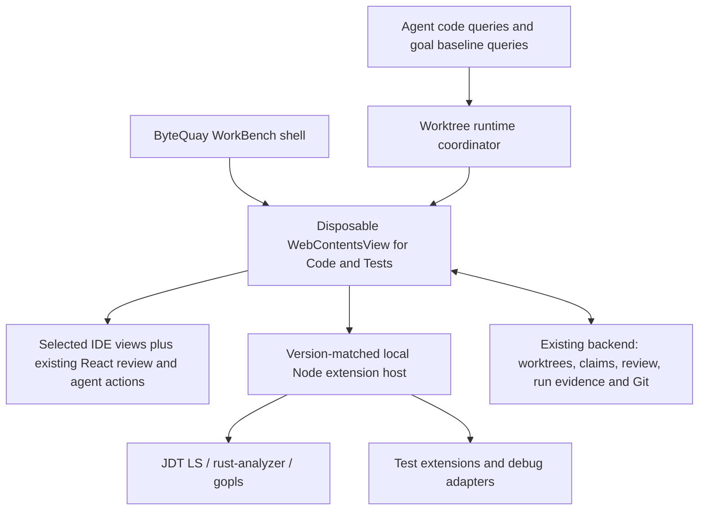

# Code & Tests IDE refactor plan

Status: implementation plan backed by a feasibility prototype. The production
application has not been migrated. [Code & Tests](code-tests.md),
[WorkBench](workbench.md), and [Agent Service](agent-service.md) remain the current
contracts until their replacement steps below land.

## Decision

Keep ByteQuay's shell and product workflows. Replace its hand-built editor and
language navigation with Monaco and selected VS Code services through
`@codingame/monaco-vscode-api`. Pair that frontend with a local, version-matched
Code OSS-compatible Node extension host for Java, Rust, and Go.

The UI is ours: file column, editor, private review cards, and bottom Run, Debug,
Terminal, and Git History panels. We do not adopt the complete VS Code window.
This is a modular integration, not a plan to fork VS Code and remove DOM elements.
The library exposes separate services and workbench parts; its
[views example](https://github.com/CodinGame/monaco-vscode-api/blob/main/demo/src/setup.views.ts)
demonstrates attaching those parts to application containers.

Choose this route subject to the runtime gate below. If that gate needs a
substantial upstream fork or duplicates the language/test/debug engines, stop and
evaluate Theia as the replacement foundation. Do not build two production paths.
Plain Monaco alone would leave too much IDE integration for ByteQuay to maintain.

The intended saving is code that ByteQuay owns. Dependency size, resident memory,
and startup time must be measured separately; this is not a promise to reduce all
three.

## Required experience and ownership

| Area | Reuse | ByteQuay responsibility |
| --- | --- | --- |
| Files and editing | Explorer, editor models/tabs, syntax and semantic highlighting, completion, diagnostics, formatting | Worktree identity, allowed paths, source claims, save conflict checks, review/development edit policy |
| Discovery | File/text search, document/workspace symbols, definitions, references, implementations, incoming/outgoing calls | Compact entry point; precise capability/readiness messages; bounded agent query results |
| Local review | Monaco positioning and decorations | Existing React cards, reply/preview/resolve/retry, anchors, privacy, evidence, review publication |
| Run and tests | Extension test discovery/profiles, test tree, failure details and locations | Launch ownership, durable run history/logs, source identity, cancellation and process cleanup |
| Debug | Debug service and language debug adapters; breakpoints, stepping, variables, watch, stack and console | Run/Debug entry points, task binding, claims, environment and process lifecycle |
| Terminal | Existing xterm and PTY service initially | Session identity, logs, explicit stop, agent selection action; avoid a second PTY implementation |
| Git history | Native SCM history graph and editor diff facilities | Read-only history provider over existing Git services; exact revisions/parents and file history |
| Appearance | Theme and keybinding services | IDEA Light/Darcula-style presets across native views and our cards; app shortcut precedence |

VS Code already supplies debugging UI, but language-specific adapters provide
execution. Tests likewise come from extension controllers; arbitrary command
output does not automatically become a structured test result.
([Debugging](https://code.visualstudio.com/docs/debugtest/debugging),
[Testing API](https://code.visualstudio.com/api/extension-guides/testing))

## Verification findings

The temporary prototype used `@codingame/monaco-vscode-*` **37.3.3**, Vite **5.4.21**,
and ByteQuay's actual React `LocalReviewThreadCard` component and CSS. Its test
controller and debug adapter are deliberately synthetic. The history provider
uses three real commits from a temporary Git repository. No production source,
dependency lockfile, user review, or agent conversation was changed by this probe.

| Check | Observed result | Limit of the evidence |
| --- | --- | --- |
| Partial workbench | Explorer, editor and panel mounted separately; activity bar hidden | Final panel composition and Electron embedding still need integration |
| Existing private card | Real component rendered inside Monaco; reply, Markdown preview, Resolve and Reopen worked | Callbacks used fixture state, not the review backend; full finding/evidence cards and draft recovery still need coverage |
| Test result and custom logs | Test service delivered one deliberate failure, expected/actual, source range and output; selected error text was captured with run/worktree identity | Does not establish Java/Rust/Go test discovery; no real agent message was sent |
| Debug UI | Breakpoint pause, stack, locals, Step Over, console evaluation, and Stop reached the DAP fixture | Does not prove Java/Delve/LLDB launch, debug-test routing, or OS process termination |
| Git graph | Native history view showed the three commits in the bottom panel | Provider is a fixture; real historical file contents, merge parents and rename diffs were not tested |
| IDEA appearance | Light/dark editor and workbench palette switching worked | A complete IDEA-style theme is additional CSS/token work; existing card colors are partly hard-coded |
| Production bundle | Compilation passed; editor, card, test results and history loaded from the built assets | **Blocked:** background TextMate tokenization throws after Vite 5 rewrites a dynamic import; this is not a clean production-runtime pass |

Evidence: [captured UI results](code-tests-ide-verification/ui-results.json),
[production failure](code-tests-ide-verification/production-ui-results.json),
[build notes](code-tests-ide-verification/README.md), and
[prototype screenshot](code-tests-ide-verification/prototype.jpg). This is a
feasibility fixture, not the proposed finished layout. The temporary source and
lockfile are retained at `/tmp/bytequay-modular-ide-probe` for this working session.

Two findings materially affect the implementation:

1. A React card placed directly in a Monaco view zone inherits an inaccessible
   container. The working prototype reserves space with a view zone and mounts
   the interactive card as an overlay widget. Keep one React card, not a duplicate
   HTML rendering. Measure the card content rather than the allocated spacer to
   avoid a resize feedback loop. Verify focus, selection, resizing, folding,
   scrolling and assistive technology in the final integration.
2. This library is not a drop-in dependency for our bundler. The probe required ES
   workers, explicit TextMate-worker routing, an exact `cssValue` resolution alias,
   and the shipped browser-compatible `@xterm/addon-ligatures` entry instead of its
   ESM entry importing `node:diagnostics_channel`. The resulting bundle contains a
   roughly 11.8 MB minified main chunk, about 3.1 MB gzip, before real language
   bundles. Retain a pinned, tested build recipe; do not hide missing browser
   dependencies with fake externals.

The subsequent production smoke test exposed one unresolved issue:
`Cannot destructure property 'applyStateStackDiff' ... as it is undefined`.
Inspecting the built JavaScript shows that Vite 5's dynamic-import preload
transform projects `applyStateStackDiff`/`INITIAL` before the library's
`.then(n => n.main)` runs, leaving `n.main` undefined. Correct worker routing
eliminated an earlier `$init` error; excluding the library from CommonJS conversion
did not fix this separate transform issue. Resolve it with a tested build
configuration or a bounded compatibility correction before adopting the runtime.
Do not upgrade the app's Vite major or disable syntax functionality silently.

Earlier desktop VS Code checks established separate TypeScript definitions in two
worktrees. They did not measure this modular runtime or Java/Rust/Go. In
particular, there is no verified idle-memory number for the proposed integration.

## Runtime structure

Use one lazily started runtime per active worktree identity, shared by the UI and
agent requests. Different worktrees get separate workspace state and language
sessions: a Git worktree shares objects, not necessarily semantic indexes. Do not
open one multi-root workspace containing every task just to share a server.

The editor page lives in a dedicated Electron `WebContentsView`; never use
`webview` or `BrowserView`. Render the private cards inside that page so that they
can interact with the editor DOM. Keep the surrounding WorkBench and task UI in
the current renderer. Bridge only the existing domain actions and required IDE
events, using typed messages and task/worktree/generation validation.

The package initializes once per JavaScript context and cannot simply unload all
services. Destroying a dedicated view gives us a concrete frontend disposal
boundary. This is our architecture choice based on the
[library lifecycle constraint](https://github.com/CodinGame/monaco-vscode-api#sandbox-mode--beta-),
not something the prototype proved about Electron process reclamation.

Desktop language extensions require a Node extension host. A browser-only host
does not suffice. Match frontend/server commit and API versions as described in
the [server integration documentation](https://github.com/CodinGame/monaco-vscode-api/wiki/How-to-install-and-use-VSCode-server-with-monaco%E2%80%90vscode%E2%80%90api).
Use a distributable Code OSS-compatible runtime, bind it to loopback, authenticate
connections, and keep its data/extensions separate from the user's installed IDE.
Do not infer redistribution rights for Microsoft's binary or every Marketplace
extension from the VS Code source license.

For an agent query while the editor is closed, start the same isolated runtime
without attaching its view visibly, answer the bounded query, then release its
lease. This avoids a second language-server stack. Hidden-view startup, background
progress, and full cleanup are explicit runtime-gate tests, not verified features.
Goal planning may use a separate temporary baseline workspace at the required
revision; it must not reuse a different task's dirty semantic state.

## UI and workflow details

- Keep the file structure at the left and code tabs in the center. Offer file,
  symbol and text search plus navigation/back/forward without an activity bar.
  Move test/debug tool views into the bottom area. The fixture demonstrated moving
  the history view; moving every test/debug view is still an integration check.
- Bottom tabs are Run, Debug, Terminal and Git History. Debug contains variables,
  watch, call stack, breakpoints and console. Debugging a test appears next to
  running it; language extensions determine available configurations.
- Offer IDEA Light and Darcula-style presets with one token mapping for editor,
  native panels, private cards, menus, terminal and diagnostics. Theme does not
  imply IDEA's entire layout or exact behavior. Offer a scoped IDEA-like keymap
  separately and test conflicts with ByteQuay/global macOS shortcuts.
- Keep `LocalReviewThreadCard` and `ReviewFindingCard`. Preserve clean-file,
  revision/excerpt-based anchoring and obsolete/unplaced states. Move reply drafts
  out of component-local lifetime before allowing editor suspension; never lose a
  draft on file switch, view disposal or runtime restart.
- Keep the selected-log action in ByteQuay. It prepares context containing the
  selected text, run/session ID, source revision, worktree and test/stack location
  where available, then uses the existing agent routing and user submission flow.
  It must also work on a historical run after the IDE runtime has stopped.

## Languages and execution

| Language | Initial extension/toolchain set | Required real-project proof |
| --- | --- | --- |
| Java | Red Hat Java/JDT LS, Java debugger and Java test runner, project JDK and Maven/Gradle tooling | Multi-module import; overload-aware callers; interface implementations; failing test; debug test and application |
| Go | Go extension/gopls, Go toolchain and Delve | Module/workspace import; references and implementations; package/subtest results; debug test and application |
| Rust | rust-analyzer, Rust/Cargo toolchain and CodeLLDB | Workspace/crate import; traits/macros and callers; Cargo test discovery/output; debug test binary and application |

Java's extension explicitly supports running and debugging tests; Go's debugger
uses Delve. Rust needs extra care: rust-analyzer documents an experimental test
explorer protocol, so uniform Test Explorer behavior must be demonstrated for the
chosen bundle. Do not promise parity based solely on syntax highlighting or a
Run code lens. ([Java tests](https://github.com/microsoft/vscode-java-test),
[Go debugging](https://github.com/golang/vscode-go/wiki/debugging),
[CodeLLDB](https://github.com/vadimcn/codelldb),
[rust-analyzer extensions](https://github.com/rust-lang/rust-analyzer/blob/master/docs/book/src/contributing/lsp-extensions.md))

Start with a curated extension set and audited licenses; a general extension
marketplace is outside this refactor. Show missing tools and project import
failures directly. Do not silently install system JDKs, Rust toolchains or Go.

Route every supported run/debug entry point through the existing worktree claim
and execution policy, including gutter actions, shortcuts, test profiles,
pre-launch tasks and console-triggered evaluation. Hiding buttons alone does not
enforce policy. Paused debugging retains the claim. Stop/disconnect must prove
owned process-tree quiescence before releasing it; a DAP `terminated` event alone
is insufficient. Attaching to arbitrary external processes is outside the first
delivery.

Use VS Code services for execution presentation; preserve ByteQuay's durable
result evidence and task history. Normalize test IDs, outcomes, duration, messages,
locations and output into the existing run domain. Store debug sessions as such;
a successful launch or stop must not masquerade as a passed test. Keep raw logs
and render terminal control sequences correctly while extracting plain selected
text for agent context.

Agent shell/build runs remain command results unless reliable structured reports
exist. Keep existing Maven report ingestion until its consumers have a replacement;
do not treat native Test Explorer as a parser for every external process.

Editor saves and workspace edits must still validate file identity, current
content hash, allowed path and source claims. Review workspaces retain their
restricted edit scope; development workspaces retain theirs. Disable unapproved
format-on-save/automatic fix behavior. Curated extensions can execute Node code and
write directly to disk, so a frontend read-only flag is not a filesystem sandbox.
The runtime gate must verify the chosen extensions' automatic import/build/write
behavior and the execution gate before those extensions are enabled on a claimed
or restricted workspace.

## Git history

Use a bottom Git History panel with commit graph/list, author/message/hash, changed
files, and read-only parent-to-commit diffs. Include history of the current file
and navigation back to the working copy. Handle merges, renames, deleted files,
detached worktrees, pagination and Unicode paths with exact revision identity.
The [native VS Code history UI](https://code.visualstudio.com/docs/sourcecontrol/history)
already has graph and file-history concepts; the probe confirms the graph can live
in our bottom panel.

Feed that graph through a small read-only provider backed by existing ByteQuay Git
reads and snapshot APIs, extending those queries only where necessary. Avoid a
second commit database or PR-enrichment path. The fixture uses the proposed
`scmHistoryProvider` API and an internal view service; pin them behind one small
integration module. Real diff/file-history integration remains to be tested.

Do not enable stock checkout/reset/cherry-pick/push actions merely to obtain the
graph. Commit selection reads snapshots; it does not modify the task worktree or
write to GitHub. Existing user-triggered GitHub actions keep their current owner.

## Retire CodeGraph after replacing all consumers

One language-service session per worktree/language should serve both editor and
agent semantic queries. Retire CodeGraph when that replacement is complete, not
as soon as Monaco renders a file.

The replacement contract covers bounded symbol search, definitions, references,
implementations, incoming/outgoing calls, diagnostics and source locations, with
worktree/revision identity, readiness, cancellation and explicit unsupported
capabilities. IDE indexes are language-specific; they are not automatically a
repository-wide dependency graph or a natural-language architecture search engine.
Use ordinary file/text search and source excerpts for non-semantic discovery; do
not create a new persistent graph database to imitate the old one.

Migrate all of these before deletion:

1. Code & Tests navigation and its current name-matching/Java heuristics.
2. The fixed agent `codegraph_explore` tool, its advertised capabilities and
   prompts, replacing it with the new bounded code-query contract.
3. `GoalPlanner` baseline exploration through `PinnedCodeGraphService`, preserving
   revision-bound evidence and graceful unavailable results.
4. Worktree prepare/cleanup paths, readiness/settings/status surfaces, tests and
   documentation that assume a CodeGraph CLI or cache.

Then remove the CLI packaging/install hooks, bridges, routes, configuration,
metrics and graph-specific state as their last consumers disappear. Remove stale
tool names rather than retaining a compatibility alias. Existing CodeGraph uses
short-lived no-daemon/no-watch execution; deleting it must not be described as
recovering memory from an always-running graph server.

## Worktree memory and disposal

Agent inactivity alone does not make the IDE idle: an open editor, a code query,
project import, terminal job, run or paused debug session can keep it active.
Start language services on demand and keep only the required languages loaded.
When a view is closed/idle and there is no execution or query lease, persist
navigation and drafts, destroy the view and stop its owned extension/language
processes. Disk caches may remain keyed by workspace and runtime version.

Do not suspend a run/debug session or terminate a user's terminal merely because
an agent stopped. Coordinate explicit stop and existing claim ownership first.
Never delete a worktree while its processes can still access it. Broad cache
eviction and existing terminal cleanup improvements remain follow-up work, but
runtime disposal and correct claim release are required for this refactor.

## Delivery sequence and acceptance gates

### 1. Prove the packaged runtime before migration

- Pin an entire compatible frontend/server/extension set. Keep React 19, Vite 5
  and React plugin 4.x; isolate the IDE bundle from the normal app startup path.
- Build and launch in packaged Electron `WebContentsView`, including workers,
  fonts, themes, WASM, extension assets, offline startup and native tool paths.
- First reproduce and resolve the recorded Vite 5/TextMate runtime failure, then
  exercise syntax tokenization after opening, editing and switching files in the
  production bundle. Successful compilation alone does not satisfy this gate.
- Run the Java, Rust and Go proofs above with actual extensions and tools.
  Confirm native test-debug profiles, not only standalone debugging.
- Verify every launch/save gate, automatic extension behavior, two-worktree
  isolation, agent queries without a visible editor and baseline queries.
- Measure cold import, warm reopen, active/idle footprint and process disposal
  against the same repositories. A closed idle runtime must have no remaining
  owned worker/extension/language processes. Record package size and startup cost.
- **Exit gate:** no substantial upstream fork, no alternate indexing stack, no
  bypass of existing write/claim policy, and the packaged three-language path
  works. Otherwise revisit the foundation before removing current features.

### 2. Replace the editor and preserve the ByteQuay UI

- Integrate the selected file/editor/bottom views and navigation/search entry.
- Port review positioning only; keep the existing cards and backend semantics.
- Add draft recovery, conflict-safe saving, theme tokens and scoped keymaps.
- Cover dirty files, external agent edits, stale anchors, file switches, layout
  resizing, keyboard/accessibility and runtime restart. Remove CodeMirror-specific
  code only when its remaining users have migrated.

### 3. Integrate runs, debugging and durable logs

- Connect real test/debug profiles through the launch gate and existing run domain.
- Make Run/Debug available for individual tests and supported configurations.
- Verify failures, stack links, selected-log agent context, cancellation, crashes,
  restart and process-tree cleanup. Preserve historical evidence across shutdown.
- Reuse the current terminal backend and avoid duplicate sessions for the same
  process. Remove obsolete custom test discovery/rendering only after parity.

### 4. Add the Git history panel

- Replace the fixture history provider with existing Git reads and readonly
  snapshot/diff models; add file history and paging.
- Test commits/merge parents, renames/deletions, dirty and detached worktrees, and
  unchanged Git status before/after all history navigation.

### 5. Migrate code queries and remove CodeGraph

- Move UI, agents and goal baseline consumers to the shared runtime contract.
- Test symbol identity across overloads, interfaces/traits, modules/packages and
  two worktrees with intentionally different definitions. Show readiness and
  unsupported results honestly; never substitute text matches for semantic callers.
- Remove CodeGraph and the superseded Java/navigation heuristics. Search the whole
  repository for executable references and update canonical designs, tool docs and
  dependency notices. A short migration sequence is acceptable; permanent dual
  indexes are not.

### 6. Complete the cutover

- Update `code-tests.md`, `code-tests-impl-tmp.md`, `architecture.md`,
  `agent-service.md`, `workbench.md` and the CodeGraph design to match shipped
  behavior; remove obsolete contracts rather than describing both as current.
- Run backend `mvn verify`; frontend `npm run lint`, `npx tsc --noEmit`, `npm test`
  and `npm run package`, followed by packaged native interaction checks.
- Re-run lifecycle and resource measurements after the final composition. Record
  removed owned code separately from added dependency/runtime size.

Completion means all required workflows work through the new runtime, private
review and worktree ownership remain intact, and the superseded engines and UI
implementations have been removed. The feasibility prototype alone is not that
completion condition.
