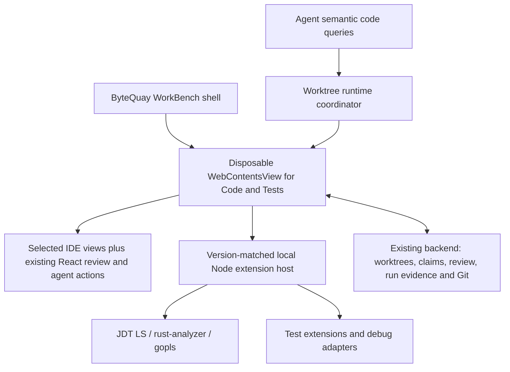

# Code & Tests IDE integration design

This design records the modular IDE foundation and its ownership boundaries.
[Code & Tests](code-tests.md) is the canonical behavior contract, including
current native acceptance limits. [WorkBench](workbench.md) and
[Agent Service](agent-service.md) own the surrounding task and review workflows.

## Decision

Keep ByteQuay's shell and product workflows. Replace its hand-built editor and
language navigation with Monaco and selected VS Code services through
`@codingame/monaco-vscode-api`. Pair that frontend with a local, version-matched
Code OSS-compatible Node extension host for Java, Rust, and Go.

The UI is ours: file column, editor, private review cards, and bottom Run, Debug,
Terminal, and Git History panels. We do not adopt the complete VS Code window.
This is a modular integration, not a plan to fork VS Code and remove DOM elements.
The library exposes separate services and workbench parts; its
[views example](https://github.com/CodinGame/monaco-vscode-api/blob/main/demo/src/setup.views.ts)
demonstrates attaching those parts to application containers.

If this integration requires a substantial upstream fork or duplicates the
language/test/debug engines, reassess the foundation before adding another
production path.
Plain Monaco alone would leave too much IDE integration for ByteQuay to maintain.

The intended saving is code that ByteQuay owns. Dependency size, resident memory,
and startup time must be measured separately; this is not a promise to reduce all
three.

## Required experience and ownership

| Area | Reuse | ByteQuay responsibility |
| --- | --- | --- |
| Files and editing | Editor models/tabs, syntax and semantic highlighting, completion, diagnostics, formatting | Existing compact ByteQuay file tree and icons, worktree identity, allowed paths, source claims, save conflict checks, review/development edit policy |
| Discovery | File/text search, document/workspace symbols, definitions, references, implementations, incoming/outgoing calls | Compact entry point; precise capability/readiness messages; bounded agent query results |
| Local review | Monaco positioning and decorations | Existing React cards, reply/preview/resolve/retry, anchors, privacy, evidence, review publication |
| Run and tests | Extension test discovery/profiles, test tree, failure details and locations | Launch ownership, durable run history/logs, source identity, cancellation and process cleanup |
| Debug | Debug service and language debug adapters; breakpoints, stepping, variables, watch, stack and console | Run/Debug entry points, task binding, claims, environment and process lifecycle |
| Terminal | Existing xterm and PTY service initially | Session identity, logs, explicit stop, agent selection action; avoid a second PTY implementation |
| Git history | Native SCM history graph and editor diff facilities | Read-only history provider over existing Git services; exact revisions/parents and file history |
| Appearance | Theme and keybinding services | IDEA Light/Darcula-style presets across native views and our cards; app shortcut precedence |

VS Code already supplies debugging UI, but language-specific adapters provide
execution. Tests likewise come from extension controllers; arbitrary command
output does not automatically become a structured test result.
([Debugging](https://code.visualstudio.com/docs/debugtest/debugging),
[Testing API](https://code.visualstudio.com/api/extension-guides/testing))

## Integration constraints

Project import can execute build tools and write files. An editor read-only flag
is not an execution boundary; reviews use the actual writable task worktree.

Interactive React review cards use accessible overlay widgets, with Monaco view
zones reserving their space. Measure card content rather than the spacer to
avoid resize feedback. Keep one rendering of each card and verify keyboard,
selection, resizing, folding, and scrolling behavior.

Keep a pinned, tested build recipe for workers, TextMate resources, and
browser-compatible dependencies. The narrow Vite import transformation and its
production-bundle regression test handle the library's dynamic import shape.
Do not hide missing browser dependencies with fake externals, silently upgrade
the app's Vite major, or disable syntax functionality.

## Runtime structure

Use one lazily started runtime per active worktree identity, shared by the UI and
agent requests. Different worktrees get separate workspace state and language
sessions: a Git worktree shares objects, not necessarily semantic indexes. Do not
open one multi-root workspace containing every task just to share a server.

The editor page lives in a dedicated Electron `WebContentsView`; never use
`webview` or `BrowserView`. Render the private cards inside that page so that they
can interact with the editor DOM. Keep the surrounding WorkBench and task UI in
the current renderer. Bridge only the existing domain actions and required IDE
events, using typed messages and task/worktree/generation validation.

The package initializes once per JavaScript context and cannot simply unload all
services. Destroying a dedicated view gives us a concrete frontend disposal
boundary. This is our architecture choice based on the
[library lifecycle constraint](https://github.com/CodinGame/monaco-vscode-api#sandbox-mode--beta-),
not something the prototype proved about Electron process reclamation.

Desktop language extensions require a Node extension host. A browser-only host
does not suffice. Match frontend/server commit and API versions as described in
the [server integration documentation](https://github.com/CodinGame/monaco-vscode-api/wiki/How-to-install-and-use-VSCode-server-with-monaco%E2%80%90vscode%E2%80%90api).
Use a distributable Code OSS-compatible runtime, bind it to loopback, authenticate
connections, and keep its data/extensions separate from the user's installed IDE.
Do not infer redistribution rights for Microsoft's binary or every Marketplace
extension from the VS Code source license.

For an agent query while the editor is closed, start the same isolated runtime
without attaching its view visibly, answer the bounded query, then release its
lease. This avoids a second language-server stack. Hidden-view startup, background
progress, and full cleanup belong to the runtime's acceptance boundary.
Tool-free goal planning uses bounded Git text excerpts at the fetched monitored
baseline commit. It does not start another IDE or create another index. Its
prompts distinguish keyword matches from semantic relationships, identify the
commit and truncation, and fall back to knowledge notes if source is unavailable.
It must not reuse a different task's dirty semantic state.

## UI and workflow details

- Reuse the current ByteQuay file tree, folder/file/test icons, compact package
  grouping and Changed files filter. Keep its IDEA-like spacing and resizable
  file and tool panels; the integration does not replace them with stock VS Code
  chrome. Keep the file structure at the left and code tabs in the center. Offer file,
  symbol and text search plus navigation/back/forward without an activity bar.
  Move test/debug tool views into the bottom area. The fixture demonstrated moving
  the history view; moving every test/debug view is still an integration check.
- Bottom tabs are Run, Debug, Terminal and Git History. Debug contains variables,
  watch, call stack, breakpoints and console. Debugging a test appears next to
  running it; language extensions determine available configurations.
- Offer IDEA Light and Darcula-style presets with one token mapping for editor,
  native panels, private cards, menus, terminal and diagnostics. Theme does not
  imply IDEA's entire layout or exact behavior. Offer a scoped IDEA-like keymap
  separately and test conflicts with ByteQuay/global macOS shortcuts.
- Keep `LocalReviewThreadCard` and `ReviewFindingCard`. Preserve clean-file,
  revision/excerpt-based anchoring and obsolete/unplaced states. Move reply drafts
  out of component-local lifetime before allowing editor suspension; never lose a
  draft on file switch, view disposal or runtime restart.
- Keep the selected-log action in ByteQuay. It prepares context containing the
  selected text, run/session ID, source revision, worktree and test/stack location
  where available, then uses the existing agent routing and user submission flow.
  It must also work on a historical run after the IDE runtime has stopped.

## Languages and execution

| Language | Initial extension/toolchain set | Required real-project proof |
| --- | --- | --- |
| Java | Red Hat Java/JDT LS, Java debugger and Java test runner, project JDK and Maven/Gradle tooling | Multi-module import; overload-aware callers; interface implementations; failing test; debug test and application |
| Go | Go extension/gopls, Go toolchain and Delve | Module/workspace import; references and implementations; package/subtest results; debug test and application |
| Rust | rust-analyzer, Rust/Cargo toolchain and CodeLLDB | Workspace/crate import; traits/macros and callers; Cargo test discovery/output; debug test binary and application |

Java's extension explicitly supports running and debugging tests; Go's debugger
uses Delve. Rust needs extra care: rust-analyzer documents an experimental test
explorer protocol, so uniform Test Explorer behavior must be demonstrated for the
chosen bundle. Do not promise parity based solely on syntax highlighting or a
Run code lens. ([Java tests](https://github.com/microsoft/vscode-java-test),
[Go debugging](https://github.com/golang/vscode-go/wiki/debugging),
[CodeLLDB](https://github.com/vadimcn/codelldb),
[rust-analyzer extensions](https://github.com/rust-lang/rust-analyzer/blob/master/docs/book/src/contributing/lsp-extensions.md))

Start with a curated extension set and audited licenses; a general extension
marketplace is outside this refactor. Show missing tools and project import
failures directly. Do not silently install system JDKs, Rust toolchains or Go.

Route every supported run/debug entry point through the existing worktree claim
and execution policy, including gutter actions, shortcuts, test profiles,
pre-launch tasks and console-triggered evaluation. Hiding buttons alone does not
enforce policy. Paused debugging retains the claim. Stop/disconnect must prove
owned process-tree quiescence before releasing it; a DAP `terminated` event alone
is insufficient. Attaching to arbitrary external processes is outside the first
delivery.

Use VS Code services for execution presentation; preserve ByteQuay's durable
result evidence and task history. Normalize test IDs, outcomes, duration, messages,
locations and output into the existing run domain. Store debug sessions as such;
a successful launch or stop must not masquerade as a passed test. Keep raw logs
and render terminal control sequences correctly while extracting plain selected
text for agent context.

Agent shell/build runs remain command results unless reliable structured reports
exist. Keep existing Maven report ingestion until its consumers have a replacement;
do not treat native Test Explorer as a parser for every external process.

Use the actual task worktree. Active reviews permit editing production code,
tests and project files to reimplement, compare and verify behavior. Remove the
old Code & Tests editor's test-source-only restriction; it is not a restriction
on review agents. Preserve agent permissions, task routing and review experiment
handling. Ended reviews and historical snapshots remain read-only.

Opening or indexing a worktree does not acquire an exclusive mutation claim and
does not prevent agent work. Explicit ByteQuay saves retain existing path,
ownership, content-hash and short-lived mutation checks. Explicit runs/debugging
retain the existing execution coordination. Watch external changes, surface
conflicts with unsaved buffers, and never silently overwrite either side.
Curated language extensions and project import/build tools may write directly to
disk, as in a normal IDE; they do not call the editor save endpoint. Do not
represent editor guards as a sandbox or claim they serialize every extension
write. This refactor adds neither a disposable mirror with edit synchronization
nor an IDE-wide exclusive lease. Leave automatic formatting/fixes off by default
unless the user configures them.

## Git history

Include an optional left editor blame gutter with author/date on each line,
commit details, and navigation to that commit in Git History. Use the actual
file revision and distinguish uncommitted lines; do not present historical blame
against a changed or unsaved buffer. Blame reads work for every text language,
including Java, Go and Rust, and must not change Git state.

Provide a narrow code overview strip on the editor's right. Hovering previews
that section in a syntax-highlighted code card without moving the current
cursor; selecting it jumps to the corresponding lines. Preserve diagnostic
markers and offer the same action by keyboard. This is navigation within the
open document, not an additional semantic index or CodeGraph consumer.

Use a bottom Git History panel with commit graph/list, author/message/hash, changed
files, and read-only parent-to-commit diffs. Include history of the current file
and navigation back to the working copy. Handle merges, renames, deleted files,
detached worktrees, pagination and Unicode paths with exact revision identity.
The [native VS Code history UI](https://code.visualstudio.com/docs/sourcecontrol/history)
already has graph and file-history concepts; the probe confirms the graph can live
in our bottom panel.

Feed that graph through a small read-only provider backed by existing ByteQuay Git
reads and snapshot APIs, extending those queries only where necessary. Avoid a
second commit database or PR-enrichment path. The fixture uses the proposed
`scmHistoryProvider` API and an internal view service; pin them behind one small
integration module. Real diff/file-history integration remains to be tested.

Do not enable stock checkout/reset/cherry-pick/push actions merely to obtain the
graph. Commit selection reads snapshots; it does not modify the task worktree or
write to GitHub. Existing user-triggered GitHub actions keep their current owner.

## Shared semantic queries

One language-service session per worktree/language serves the editor and agent
semantic queries. The contract covers bounded symbol search, definitions,
references, implementations, incoming/outgoing calls, diagnostics, and source
locations, with worktree/revision identity, readiness, cancellation, and explicit
unsupported capabilities. These indexes are not a repository-wide graph or a
natural-language architecture search engine.

Goal planning uses bounded Git source excerpts at the fetched monitored baseline,
with revision identity and explicit unavailable results. It starts no IDE or
separate index. CodeGraph, its tool alias, packaging, hooks, settings, and graph
state are retired; keep no compatibility alias or second persistent graph.

## Worktree memory and disposal

Agent inactivity alone does not make the IDE idle: an open editor, a code query,
project import, terminal job, run or paused debug session can keep it active.
Start language services on demand and keep only the required languages loaded.
When a view is closed/idle and there is no execution or query lease, persist
navigation and drafts, destroy the view and stop its owned extension/language
processes. Disk caches may remain keyed by workspace and runtime version.

Do not suspend a run/debug session or terminate a user's terminal merely because
an agent stopped. Coordinate explicit stop and existing claim ownership first.
Never delete a worktree while its processes can still access it. Broad cache
eviction and existing terminal cleanup improvements remain follow-up work, but
runtime disposal and correct claim release are required for this refactor.

## Acceptance boundaries

Verify worktree isolation, current-source identity, editing and draft recovery,
private-card interactions, native run/debug evidence and cleanup, read-only Git
history, and shared agent/editor queries through the production runtime.
Successful compilation or a feasibility fixture alone does not establish these
contracts. Remaining native language/debug coverage and development-database
constraints are recorded in [Code & Tests](code-tests.md#verification-and-development-data).
