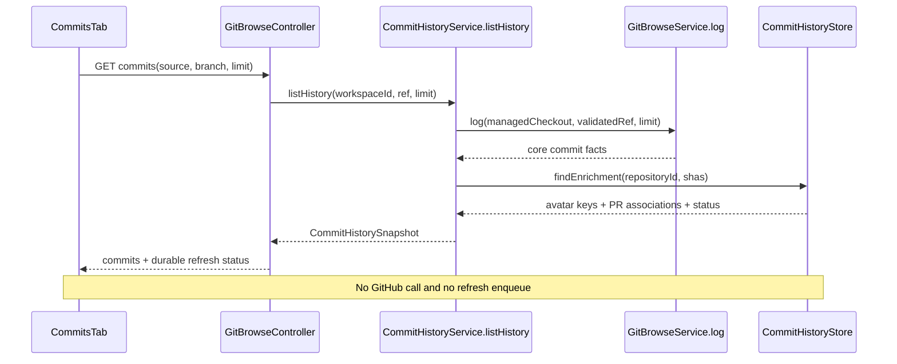
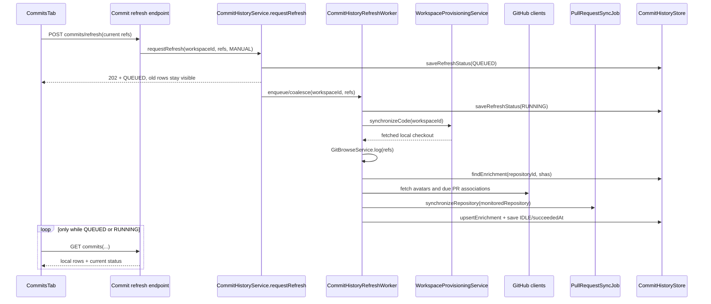
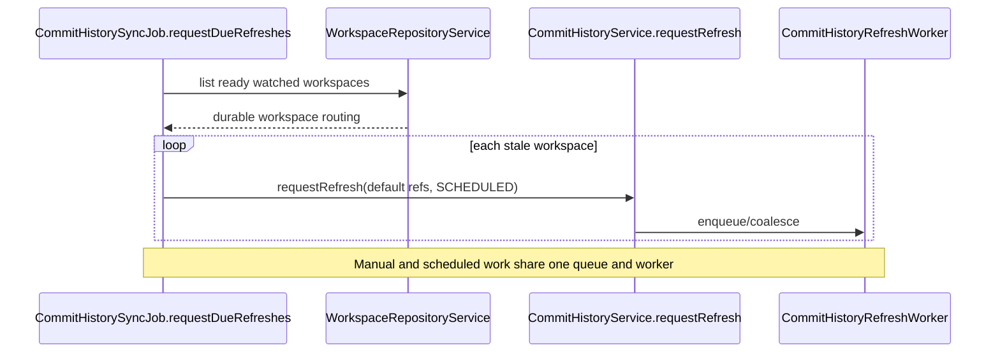

# Commit History and Refresh Design

The Commits tab must be local-first. Opening it reads the managed Git checkout
and SQLite only. GitHub synchronization happens in a backend worker, either on
a schedule or after the user clicks the existing refresh button. A slow or
failed refresh must never blank commit history that was already available.

This document refines the Commits section of
[Watched Repository / Workspace](watched-repo.md). The explicit upstream is a
linked watched workspace; GitHub fork topology does not select it.

## 1. Pre-refactor behavior and the problem

Before this design was implemented, the History request was not local-only:

1. `CommitsTab` calls `gitLog(workspaceId, ref, 300)`.
2. `GitBrowseController.commits(...)` runs local `GitBrowseService.log(...)`.
3. The same request called the commit-avatar provider lookup.
4. It then called the commit-to-PR provider lookup, which could make one
   GitHub request per commit with at most eight requests in flight.
5. `CherryPickPullRequestLookup` caches associations only in memory, so an app
   restart loses them.

The separate `fetchPrs(workspaceId)` call is already local: it reads the
existing SQLite `PullRequestStore`. The PR scheduled job refreshes that store,
but commit-to-PR associations are not persisted. `Avatar` renders a remote URL
and falls back to another `github.com/{login}.png` URL, so the image itself is
not under ByteQuay's local persistence policy.

The old refresh button ran Git fetch only and wrote its displayed
timestamp to renderer `localStorage`. It does not refresh or report completion
of commit enrichment and PR synchronization.

## 2. Required invariants

- `GET .../git/commits` performs no GitHub, `gh`, or other network call.
- Core commit facts and ordering come from the managed Git checkout. Do not
  duplicate Git objects in SQLite.
- SQLite stores commit enrichment: avatar cache key, commit-to-PR association,
  enrichment timestamps, and refresh state.
- Existing pull-request tables and `PullRequestService` remain the only full PR
  projection. Do not create a second PR service or copy PR details into a new
  table.
- Avatar bytes used by commit cards are served from a ByteQuay-owned local
  cache. A missing image renders the existing initial fallback; rendering must
  not silently try GitHub.
- Scheduled and manual refreshes use the same queue, validation, overlap guard,
  synchronization code, and persisted status.
- Existing commits remain visible while refresh is queued, running, or failed.
- The backend owns `lastSucceededAt`; the renderer does not persist sync state.
- A linked upstream is resolved from `upstreamWorkspaceId` and must still be a
  watched workspace. An unlinked workspace never infers an upstream from
  GitHub relationships.
- Commit cards retain both the PR chip/title and author avatar presentation.

## 3. Sources of truth

| Data | Source of truth | Display read |
| --- | --- | --- |
| SHA, title, body, author, authored time, order | managed local Git checkout | local `git log` |
| Commit-to-PR number/title/URL | SQLite commit enrichment | local store lookup |
| Full PR list and detail | existing SQLite `PullRequestStore` and `PrDetailStore` | existing local PR service |
| Commit avatar | application-data file cache, referenced by SQLite key | localhost avatar endpoint |
| Refresh state and timestamps | SQLite | commit history response |
| Changed files and patches | managed local Git checkout | existing local diff endpoints |

Git already durably stores commit information more completely than another
table could. SQLite therefore stores only facts that Git does not contain.
This avoids two commit histories that can disagree after a rebase, reset, or
force-push.

## 4. Local projection

### 4.1 Commit enrichment

Add one projection keyed by the provider's stable repository ID and commit
SHA:

```java
public record CommitEnrichment(
        long repositoryId,
        String sha,
        Optional<String> avatarKey,
        Optional<Integer> pullRequestNumber,
        Optional<String> pullRequestTitle,
        Optional<String> pullRequestUrl,
        Optional<Instant> avatarCheckedAt,
        Optional<Instant> associationCheckedAt,
        Instant lastSeenAt)
{}

public record CommitEnrichmentSnapshot(
        List<CommitEnrichment> commits)
{}
```

`CommitEnrichment`, `CommitEnrichmentSnapshot`, and `CommitRefreshStatus` are
framework-free domain values in `core`, beside the storage port that uses
them. The named snapshot keeps collection shape and indexing choices out of
the storage-port contract.

The repository ID, rather than `owner/repo`, survives repository renames. The
SHA makes the row reusable across branches and workspaces. `lastSeenAt` permits
a later bounded cleanup without storing branch membership in SQLite.

An empty association is also a result: `associationCheckedAt` records that it
was checked. Positive associations are stable and need no periodic lookup.
Recent negative associations may be retried once per day for seven days;
failed requests remain due for the next refresh. This prevents every five
minute sweep from repeating hundreds of negative GitHub requests.

### 4.2 Refresh state

Store one state row per workspace:

```java
public record CommitRefreshStatus(
        String workspaceId,
        State state,
        Optional<Instant> lastAttemptAt,
        Optional<Instant> lastSucceededAt,
        Optional<String> error)
{
    public enum State { IDLE, QUEUED, RUNNING, FAILED }
}
```

The state is small, durable, and sufficient for the toolbar. The error is a
safe user-facing summary with a correlation reference; detailed provider
errors remain in backend logs. Existing enrichment is never deleted when a
refresh fails.

### 4.3 Avatar files

Do not store image blobs in SQLite. During synchronization, cache successful
avatar responses under ByteQuay's application-data directory using a digest of
the source URL as the key. Persist only that key in `CommitEnrichment`.

`GET /api/avatars/{key}` validates the key, serves the local file with a stable
content type and `ETag`, and never downloads on a cache miss. `Avatar` receives
this localhost URL. If no key exists or the local response fails, it renders
the existing initial placeholder without a remote fallback URL.

This makes “stored locally” literal: the commit row, association metadata, and
displayed image remain available after restart and while offline.

## 5. Backend contracts

The application service is the only entry point used by the commit controller
and refresh endpoint:

```java
package com.bytequay.app.git;

public interface CommitHistoryService
{
    /**
     * Builds commit history from the managed Git checkout and joins enrichment
     * from SQLite.
     *
     * <p>This method is display-safe: it must not call GitHub, execute `gh`,
     * enqueue a refresh, or wait for a running refresh.</p>
     *
     * @param workspaceId watched workspace that owns the managed checkout
     * @param ref validated workspace or linked-upstream branch selector
     * @param limit maximum commits to read, capped by the backend
     * @return local commits plus durable refresh status
     */
    CommitHistorySnapshot listHistory(
            String workspaceId,
            CommitHistoryRef ref,
            int limit);

    /**
     * Validates and queues a refresh on the shared application executor.
     *
     * <p>The call returns after persisting `QUEUED`. Repeated requests for an
     * already queued or running workspace are coalesced, not rejected and not
     * run concurrently.</p>
     *
     * @param workspaceId watched workspace to refresh
     * @param refs validated refs requested by the renderer or scheduler
     * @param cause manual or scheduled trigger, used for diagnostics only
     * @return current durable refresh status
     */
    CommitRefreshStatus requestRefresh(
            String workspaceId,
            List<CommitHistoryRef> refs,
            CommitRefreshCause cause);

    /**
     * Returns durable refresh state without reading Git or contacting GitHub.
     *
     * @param workspaceId watched workspace to inspect
     * @return current state and last successful refresh time
     */
    CommitRefreshStatus getRefreshStatus(String workspaceId);
}
```

`CommitHistoryRef` is not a raw repository path or remote name. It is a value
such as `WORKSPACE + branch` or `UPSTREAM + branch`. The service resolves it
through `WorkspaceRepositoryService.requireReadyRepository(...)`, rejects an
upstream selector when no watched upstream workspace is linked, validates the
branch as a Git revision, and derives the provider repository ID internally.

The persistence port belongs in `core`; SQLite implements it:

```java
package com.bytequay.core.store;

public interface CommitHistoryStore
{
    /**
     * Loads enrichment for the requested SHAs in one local query.
     *
     * @param repositoryId stable provider repository ID
     * @param shas commit SHAs returned by local Git
     * @return named local snapshot for the requested SHAs; missing commits are
     * unenriched
     */
    CommitEnrichmentSnapshot findEnrichment(
            long repositoryId,
            Collection<String> shas);

    /**
     * Upserts successful or explicitly checked enrichment without replacing
     * unrelated commits.
     *
     * @param enrichment rows produced by one completed synchronization step
     */
    void upsertEnrichment(Collection<CommitEnrichment> enrichment);

    /**
     * Loads the durable toolbar state for a workspace.
     *
     * @param workspaceId watched workspace ID
     * @return saved status, or an IDLE status when no attempt exists
     */
    CommitRefreshStatus findRefreshStatus(String workspaceId);

    /**
     * Saves one state transition. Implementations must retain
     * `lastSucceededAt` when a later attempt fails.
     *
     * @param status validated next refresh state
     */
    void saveRefreshStatus(CommitRefreshStatus status);
}
```

There is one concrete `CommitHistoryRefreshWorker`, not another public service
interface. It uses existing components:

- `WorkspaceProvisioningService.synchronizeCode(...)` for safe fetch/prune;
- `GitBrowseService.log(...)` for local commit extraction;
- `GitHubRepoClient.fetchCommitAvatarSnapshot(...)` for one named branch-level
  avatar result;
- `CherryPickPullRequestLookup.lookUpResult(...)` only for associations that
  are due;
- `PullRequestSyncJob.synchronizeRepository(...)` for the existing full PR
  projection under its shared overlap guard;
- `CommitHistoryStore` for durable enrichment and status; and
- a concrete `AvatarCache` for local image files.

`CherryPickPullRequestLookup` stops being a display dependency. Its in-memory
cache may remain as a within-run optimization, but SQLite is the durable
answer. `CherryPickPreviewService` also reads persisted associations; missing
associations remain non-load-bearing and produce the existing warning instead
of starting an unbounded remote lookup from the preview request.

## 6. Refresh algorithm

For one accepted workspace request, the worker:

1. Marks the workspace `RUNNING`, preserving the last success time.
2. Resolves the workspace and each requested source through durable workspace
   routing. It never infers an upstream from GitHub.
3. Calls `WorkspaceProvisioningService.synchronizeCode(workspaceId)`. This
   fetches configured remotes without resetting, rebasing, cleaning, or
   changing local files.
4. Reads up to 300 commits per requested ref from local Git.
5. Loads all existing enrichment for those SHAs in one SQLite query.
6. Fetches the branch avatar map once, caches new image bytes, and records local
   avatar keys. A provider failure leaves old keys unchanged.
7. Calls the existing commit-to-PR lookup only for unknown, expired-negative,
   or previously failed associations. Positive associations are reused.
8. Calls the existing guarded PR synchronization once for each distinct
   monitored repository involved in the request.
9. Upserts enrichment and marks the workspace `IDLE` with a new
   `lastSucceededAt` only after the required steps complete.
10. On failure, marks `FAILED`, keeps the last successful timestamp and all
    prior rows, and logs a correlation reference.

The worker owns one pending set and one `AtomicBoolean` drain guard. A request
arriving while work is running adds or merges its refs in the pending set; it
is not silently dropped. Work runs on the existing application executor. No
new executor or dependency is needed.

The first implementation scans the selected workspace branch and, when
linked, the selected upstream branch. The scheduled job uses the workspace and
upstream default branches. A manual refresh supplies the branches currently
selected in the UI. SHAs are shared in the store, so overlapping branches do
not duplicate enrichment rows.

## 7. Scheduler

Add one small `CommitHistorySyncJob`:

```java
@Component
public final class CommitHistorySyncJob
{
    private final WorkspaceRepositoryService workspaces;
    private final CommitHistoryService commits;

    /**
     * Queues default-branch refreshes that have no successful snapshot or
     * whose last success is older than five minutes.
     *
     * <p>The service queue coalesces this request with startup and manual
     * refreshes, so the scheduler never performs synchronization inline.</p>
     */
    @Scheduled(fixedDelay = 60_000)
    public void requestDueRefreshes()
    {
        // List ready workspaces, apply the five-minute freshness check, and
        // call commits.requestRefresh(..., SCHEDULED).
    }
}
```

The one-minute tick is only a due-work check; GitHub and Git fetches happen no
more often than the five-minute freshness interval. A fresh manual success
therefore suppresses the next scheduled refresh. App startup invokes the same
due-work method after persisted workspaces are restored.

The existing `PullRequestSyncJob` remains responsible for the global
account-centric PR dashboard. The commit worker invokes its concrete
`synchronizeRepository(...)` helper, so periodic and commit-history PR work use
the same overlap guard. There is no second PR store, scheduler, or overlap
policy.

## 8. HTTP and Electron bridge

### Local display

```http
GET /api/workspaces/{workspaceId}/git/commits?source=WORKSPACE&branch=master&limit=300
```

returns:

```json
{
  "commits": [
    {
      "sha": "f4627c7...",
      "title": "Update MongoDB image versions in tests",
      "body": "",
      "author": "Example Author",
      "authorAvatarUrl": "http://127.0.0.1:.../api/avatars/5d8...",
      "authoredAt": "2026-08-21T10:00:00Z",
      "pullRequestNumber": 24123,
      "pullRequestTitle": "Update MongoDB image versions in tests"
    }
  ],
  "refresh": {
    "state": "IDLE",
    "lastSucceededAt": "2026-08-22T08:15:00Z",
    "error": null
  }
}
```

The response may contain `null` avatar or PR fields when enrichment has never
succeeded. The commit itself must still render.

### Manual refresh

```http
POST /api/workspaces/{workspaceId}/git/commits/refresh
Content-Type: application/json

{
  "refs": [
    {"source": "WORKSPACE", "branch": "master"},
    {"source": "UPSTREAM", "branch": "master"}
  ]
}
```

returns `202 Accepted` with `CommitRefreshStatus`. The endpoint is a read-side
synchronization request: it may fetch Git and GitHub but never changes a local
branch or writes to GitHub.

The Electron bridge replaces `gitFetch(workspaceId, remotes)` in the Commits
toolbar with `refreshCommitHistory(workspaceId, refs)`. The renderer never
passes filesystem paths, repository IDs, or arbitrary remote names.

## 9. Call flows

### 9.1 Opening or switching History: local only



### 9.2 User clicks refresh



### 9.3 Scheduled refresh



## 10. UI display logic

On mount or branch change, `CommitsTab` calls only the local history endpoint.
It no longer starts a separate `fetchPrs` request for commit cards because the
history snapshot already contains each persisted association and title.

The toolbar follows these states:

- `IDLE` with a timestamp: `synced N ago`;
- `QUEUED` or `RUNNING`: spinner plus `syncing…`, while current rows remain;
- `FAILED`: `sync failed · last synced N ago`, with the same refresh button;
- no successful snapshot: commits still come from local Git, with `not synced
  yet` and initial/avatar/PR fields filled only where already known.

Polling is allowed only after the user clicks refresh and only while the
backend reports `QUEUED` or `RUNNING`. Normal tab navigation does not poll,
enqueue work, or contact GitHub. The scheduler updates SQLite independently;
the next local read observes the newer snapshot.

`HistoryView` keeps the current card anatomy:

- title and short SHA;
- PR chip and title when `pullRequestNumber` is present;
- locally served avatar or fixed-size initial fallback;
- author and authored time; and
- current selection/viewed-row behavior.

The refresh ref list contains the currently selected workspace branch and,
only when `upstreamWorkspaceId` is present, the currently selected upstream
branch. “No upstream linked” continues to open Settings and does not send an
upstream ref.

## 11. Retention, recovery, and safety

- Limit UI and synchronization scans to 300 commits per requested ref, matching
  the current screen.
- Keep enrichment rows seen in an active ref. A later maintenance sweep may
  delete rows not seen for 30 days; no cleanup is required for the first slice.
- Cache avatar files by URL digest so authors shared across commits and
  workspaces share one file. Orphan cleanup may use the same 30-day threshold.
- A failed fetch or GitHub request retains the previous Git refs, PR rows,
  enrichment, avatar files, and successful timestamp.
- Validate `source`, branch, limit, workspace readiness, and linked-upstream
  membership at the controller/service boundary.
- The avatar endpoint accepts only a fixed digest format and resolves files
  below the configured avatar-cache root.
- Git refresh remains fetch/prune only. It must not checkout, reset, clean,
  rebase, merge, push, or modify working-tree files.

## 12. Implementation sequence

1. Add `CommitHistoryStore`, SQLite mappings, refresh state, and store tests.
2. Add the local avatar cache and localhost read endpoint with traversal and
   missing-file tests.
3. Introduce `CommitHistoryService.listHistory(...)`; move all remote work out
   of `GitBrowseController.commits(...)` and verify the controller with GitHub
   clients that fail if called.
4. Add the coalescing refresh worker, scheduler, manual endpoint, and focused
   success/failure/restart tests.
5. Change the Electron bridge and `CommitsTab` to consume
   `CommitHistorySnapshot`, remove renderer `localStorage` sync timestamps, and
   keep old rows during refresh.
6. Remove the separate commit-card `fetchPrs` request and make
   `CherryPickPreviewService` read the same durable associations.
7. Run backend verification and frontend lint, type-check, tests, and package.

## 13. Acceptance criteria

- Opening Commits, changing between already-fetched branches, and reopening the
  app while offline show commit history without any GitHub request.
- Reopening the app does not lose avatar keys or commit-to-PR associations.
- The refresh button returns quickly, keeps current rows visible, and updates
  the backend-owned timestamp after all required work succeeds.
- Scheduled and manual refresh requests never overlap for the same workspace
  and a request arriving during a run is eventually processed.
- Two workspaces that see the same repository SHA reuse one enrichment row and
  one avatar file.
- A GitHub failure shows stale local data and a retryable error; it does not
  clear PR chips or avatars that were previously stored.
- A linked upstream is refreshed and displayed only through the linked watched
  workspace routing. Unlinking immediately removes it from refresh requests.
- Commit-card regression tests assert both the PR chip/title and an avatar
  `` when a local avatar key exists, plus the fixed-size initial fallback
  when it does not.
- The display-path backend test proves that the controller and local history
  service have no `GitHubRepoClient` or `CherryPickPullRequestLookup`
  dependency.
