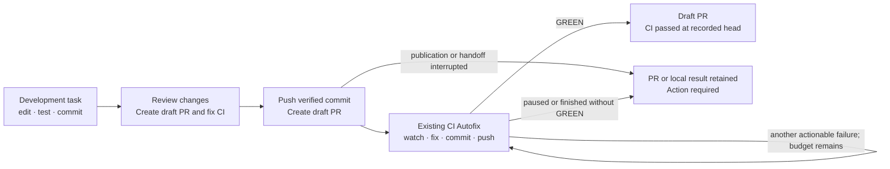

# Development task delivery

Status: proposed design for approval; not implemented. This proposal connects
the current [Agent Service](agent-service.md) to the implemented
[CI Autofix Service](ci-autofix-service.md). It does not restore the deleted
development-flow system or change the locked [Agent Review](agent-review.md)
boundary.

## 1. Product result

A development task should produce a draft pull request whose GitHub Actions
checks pass. The user finishes the local development work, reviews the proposed
publication, and selects **Create draft PR and fix CI** once. ByteQuay then
pushes the committed result, creates a real GitHub draft PR, and starts the
existing bounded CI Autofix run. Each authorized repair is committed and
pushed by the existing CI flow until its green result or a stop condition.

The draft remains a draft when CI passes. Marking ready for review, requesting
review, publishing comments, and merging remain separate user actions.
Finishing a provider turn is not permission to publish: it may be a question,
an intermediate implementation step, or a failed attempt. Review tasks never
enter development delivery.

## 2. Current implementation and gaps

| Capability | Current evidence | Required change |
| --- | --- | --- |
| Local task completion | `AgentController.completeTask` completes a clean task and removes its worktree; `TerminalSummary` shows its retained branch/HEAD | Add development delivery beside local completion and show its PR/CI result |
| Push generated branch | `ManagedWorkspaceGit.pushBranch` validates workspace routing and the expected retained branch SHA | Reuse its authenticated Git boundary with the publication checks below |
| Create PR, then start CI | `DefaultWorkspacePullRequestService.activatePullRequest` already joins cherry-pick delivery to `CiAutofixService.start` | Add the development-task caller without inventing a cherry-pick execution |
| Real GitHub draft | `GitHubPullRequestWriteClient.createPullRequest` sends title/body/head/base; the existing saved `PullRequestDraft` is only text | Send and verify `draft: true`; preserve the existing caller's behavior |
| CI repairs | Implemented for authored, same-repository PRs and a lane enforcing `CI_AUTOFIX` | Select a supported CI lane independently of the development lane |
| Review-comment repairs | Manual thread reads/replies/resolution exist; automated triage and fixing do not | Exclude from this delivery increment |

Codex currently advertises attended `AUTO` only. Claude advertises
`CI_AUTOFIX`. A Codex development task can therefore hand off to Claude CI
Autofix; it cannot silently keep Codex under an unsupported unattended policy.
The selected CI provider and readiness must be visible before publication.

GitHub's [create-PR API](https://docs.github.com/en/rest/pulls/pulls#create-a-pull-request)
has a `draft` boolean. Its
[list-PR API](https://docs.github.com/en/rest/pulls/pulls#list-pull-requests)
supports head, base, and state filters for recovering a lost create response.

## 3. User flow

1. **Develop in the current task.** Keep its conversation, worktree, turns,
   approvals, and queue. Local preparation includes meaningful validation and
   commits. If files remain uncommitted, a visible follow-up turn can prepare
   the commits using the current native agent tools. Never publish by parsing
   an assistant's final message or blindly committing whatever is present.
2. **Finish development.** Show a focused sheet with repository, base branch,
   generated head branch, actual commits/diff, validation information, editable
   title/body, draft status, and the selected ready CI provider. Title/body
   suggestions are editable copy, never orchestration instructions. Use the
   existing task and PR UI styles, Markdown, and diff presentation.
3. **Confirm once.** The action is **Create draft PR and fix CI**. It discloses
   initial publication and the existing CI consent: failed-job reruns, local
   history rewrites, exact-lease pushes, at most three fixes, at most three
   reruns per unchanged head, and eight hours of authorization. A routine fix
   or push within that scope does not ask again.
4. **Observe one delivery result.** Keep the draft PR link, latest observed
   head/checks, CI attempts, and existing CI task activity accessible from the
   original task. Derive Publishing, Waiting for checks, Fixing CI, Action
   required, and CI passed from delivery facts and the linked run. Do not show
   overall delivery success merely because local task completion succeeded.
5. **Stop or recover explicitly.** Reuse CI pause, message, cancel, readiness,
   and retry behavior. A partial publication keeps the branch and any created
   PR visible. Retrying the handoff must not create another PR or reset the
   existing run's budget.

Keep **Complete locally** available for tasks that intentionally have no PR
result. The initial combined delivery is enabled only for an eligible
development task in a writable same-repository workspace. A fork workspace
must show that the combined flow is unavailable; expanding CI's fork support
requires its own approved change. Do not silently create a fork PR and claim
that CI Autofix started.

The backend validates task ownership, not the title, prompt, or button's
visibility. Current interactive tasks are eligible development sources;
workflow-owned CI, cherry-pick, and future review tasks are ineligible. No
generic task-type framework is needed for this boundary.

## 4. Local seal and remote handoff

The application owns a small delivery service. Contracts and durable delivery
facts belong in `core`, orchestration/GitHub/HTTP in `app`, and storage in
`persistence-sqlite`, following [Architecture](architecture.md). Reuse the
existing agent service, authenticated Electron bridge, Git client, PR catalog,
and CI service. Add no module, runner, general workflow engine, or
model-callable publisher.

Before confirmation, resolve the current account, workspace routing, writable
repository, selected base, CI capability/readiness, and actual local diff.
Require at least one deliverable commit and a nonempty PR change. Record the
preview's exact source HEAD, base reference/snapshot, and task version.

On confirmation:

1. Persist an idempotent delivery intent with the confirmed metadata, routing,
   account, expected local HEAD, and bounded consent. An incompatible repeat
   of the same idempotency key is a conflict.
2. Seal the source through `AgentCompletionService` using its existing
   `COMPLETION` claim. Extend that narrow contract to validate the preview's
   expected version/HEAD while holding the claim, before committing terminal
   completion. A check in the controller before `complete` is insufficient.
   Reject active/uncertain execution, live queued inputs, dirty state, open
   Git operations, or changed source facts. Return to local preparation on a
   stale preview without publishing anything. A retry after completion checks
   the stored completion snapshot against the same intent; the current early
   return for an already completed task cannot bypass this comparison.
3. Persist the verified completion result. Publication uses the retained
   generated branch and exact sealed commit from the managed repository. The
   source task is now immutable; subsequent publication retries do not start
   another development turn or silently change its result.
4. Revalidate the confirmed account, routing, target base, and remote branch.
   Push the exact sealed object ID to the task's generated head ref. Never
   overwrite an unrelated existing remote ref. An already matching remote
   head is a reconciled success; a different head requires attention. Enforce
   remote absence as part of the initial Git write, closing the race after
   preflight. The current helper pushes a mutable local ref after checking it;
   the delivery path must push the sealed object ID itself.
5. Create the PR with the confirmed title/body/base/head and `draft: true`.
   Verify the returned/read PR identity, author, draft flag, and exact head,
   persist it, and add it to the existing workspace PR catalog.
6. Call `CiAutofixService.start` with a stable key derived from this delivery,
   its chosen supported lane, expected PR identity/head, and recorded consent.
   Persist the returned CI run ID. Recheck readiness at this boundary; a
   provider outage leaves **Draft PR created; CI setup required**, not a false
   success or a second publication attempt.
7. Use existing non-destructive source-worktree cleanup after the handoff is
   durable. Cleanup failures remain separate and retryable. The generated
   source branch remains, and delivery records survive detailed-log retention.

CI provisions its own task/worktree from the verified published head, as it
does today. It never adopts or shares the development worktree. This allows a
different CI provider and preserves immutable task/worktree ownership. The
source completion summary remains evidence of the original delivered commit;
the PR/CI result shows any later rebased or repaired remote head.

The current process-ownership correction documented in
[Agent Service](agent-service.md#current-implementation) remains a
release dependency for trusting source quiescence. Delivery must not weaken
its checks or claim that the known runtime problem has already been fixed.

## 5. Durable facts, retry, and concurrency

Keep one delivery record per sealed source task, with only the facts needed
for publication recovery and the visible result:

- workspace/source task and confirmed account/repository identities;
- source branch and expected/sealed HEAD, target base, title/body, draft flag;
- consent timestamp/deadline, CI lane/limits, stable operation keys;
- recorded publication attempts and observed remote branch/PR identities;
- optional CI run ID, last actionable error, and optimistic version.

Before sealing, a stale or cancelled intent may be replaced by a new preview
and confirmation. Once sealed, retries retain that exact result. Do not add
Publishing/Watching/Fixing states to `AgentTask`; those are projections of
these operation facts and the existing CI run.

Persist each remote-write intent before sending it. A timeout is uncertain,
not proof that GitHub rejected the write. Recovery first reads the exact ref
or PR; it never blindly replays PR creation. Find candidate PRs using the
confirmed repository/head/base across open and closed states, then verify
their full identity, author, draft state, and head SHA. A unique matching PR
reconciles the result; a changed, closed, ambiguous, or uninspectable candidate
requires attention. Do not create a replacement automatically.

A failed initial push cannot leave the UI claiming a PR exists. A successful
PR create followed by CI-start failure keeps the PR result and retries only
CI setup with the same key. Existing CI journaling and lease checks own every
later repair/push; the development publisher must never push the sealed old
head again after CI has advanced it.

Preserve CI start's idempotency lookup before fresh-start validation. If its
response was lost, first resolve the stable key, verify that the stored run's
original scope/consent matches this delivery, and attach it. That run may
already have advanced the branch or reached a terminal result. Do not apply
new-allocation head, deadline, or provider-readiness checks to this recovery
path, restart the run, or republish its original head.

CI start currently snapshots whichever head GitHub returns and creates an
eight-hour window at start time. The integrated caller needs a narrow expected
head/identity guard and the original consent deadline, checked before
allocation. A delayed retry cannot adopt somebody else's intervening head or
silently grant another eight hours. Existing direct CI callers keep their
current behavior. Renewing expired authority is a new explicit user action.

Serialize delivery attempts per source task and retain the existing one-run
per-PR-head-branch CI constraint. No two delivery attempts may race different
metadata or produce separate CI runs for the same sealed source. On restart,
reconcile recorded operations before continuing within unexpired authority;
retain an actionable error whenever the result cannot be established.

## 6. What counts as finished

Use the CI service's authoritative `GREEN` outcome, including its final
fixup-position validation, for the exact recorded remote head. Agent prose,
local tests alone, and an empty check list cannot establish that result.
Current CI scope is GitHub Actions; passing it does not imply approval,
mergeability, or completion of every third-party check.

No jobs means **Waiting for checks**, not success. A repository may configure
its workflows so draft PRs do not run the necessary jobs. Show the observed
facts and the existing authorization deadline; do not automatically mark the
PR ready or modify workflows to manufacture a green result. GitHub documents
the configurable PR event types in its
[workflow trigger reference](https://docs.github.com/en/actions/reference/workflows-and-actions/events-that-trigger-workflows#pull_request).

`MAX_ATTEMPTS`, `AUTHORIZATION_EXPIRED`, `STALE_HEAD`, `ERROR`, cancellation,
authentication loss, or a paused unsafe Git result retain the PR/local result
with their actual outcome and available recovery action. “Until green” is a
bounded effort, not an endless agent loop. A later external push makes an
earlier green receipt historical; show current checks without automatically
starting a new authorized run.

## 7. Review comments

Existing GitHub thread readers and manual reply/resolve actions do not form a
review-comment repair loop. The proposed Agent Review service investigates PRs
and produces private findings; its worktree is never pushed, and its initial
scope explicitly defers automatic commit/push. Neither should be relabeled as
an implemented repair capability.

Leave review-comment fixing out of this increment. A later author-side action
could select current unresolved comments, apply fixes in a development-owned
worktree, publish a verified new head, and rerun CI. It needs separate design
for comment/head identity, author consent, conflicting or stale requests,
repair budgets, and coordination with an active CI run. GitHub replies and
thread resolution would require their own authorized scope. Do not add an
empty hook or reserved workflow state now.

## 8. Delivery and verification

Implement in three cohesive increments after this design is approved:

1. Verified local publication preparation, source sealing, durable delivery,
   exact-SHA branch publication, and recoverable real draft-PR creation.
2. Existing CI handoff with supported-provider selection, unchanged bounds,
   expected-head/deadline validation, and durable links.
3. Task finish/result UI, current CI controls/activity, and recovery journeys.

Required behavior checks cover the ordinary draft-to-green journey, Codex
development to Claude CI, dirty/active/review/fork rejection before any write,
stale preview races, no-op development, absent/failed provider readiness,
lost push/create responses, duplicate confirmation/restart, PR-created but
CI-not-started recovery, a lost CI-start response after the run advances its
head, changed remote heads, deadline preservation, no-check
waiting, attempt exhaustion, and clean-only worktree cleanup. Verify that the
PR remains draft at green and no automated review comments or merge occur.

Run the repository's backend and frontend verification gates for the material
implementation. This proposal itself changes documentation only.
