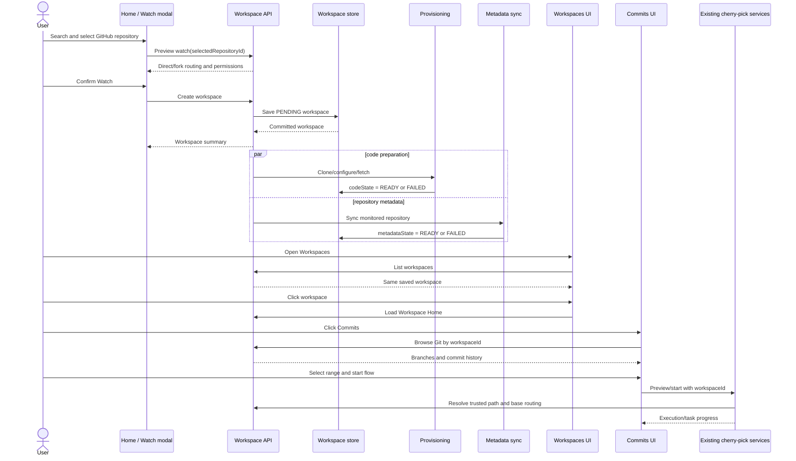

# Watched Repository / Workspace Design

Status: implemented through Checkpoint 8. Verification and handoff progress is tracked in
[watched-repo-impl-tmp.md](watched-repo-impl-tmp.md).

This design connects the existing watched-repository entry point to the existing workspace
commits and cherry-pick experience. A watched GitHub repository becomes a durable ByteQuay
workspace; Home and Workspaces are two views of the same backend record.

## Scope

The first complete vertical slice is:

1. Search GitHub repositories from Home.
2. Preview and confirm how the selected repository will be watched.
3. Save the workspace immediately.
4. Clone and synchronize the repository in the background.
5. Fetch the repository metadata used by workspace features.
6. Show the saved workspace in the Workspaces tab.
7. Open Workspace Home, then Commits.
8. Use the existing commit browser and cherry-pick flow.

The workspace shell also contains Tasks, Pull Requests, Issues, Memory, and Settings. This
design gives those features a stable workspace identity and repository routing context, but it
does not require all of them to be completed before the commits vertical slice ships.

## Starting point before implementation

The repository currently has:

- a Home watched-repository grid and an Add Repository modal;
- GitHub repository search and a small persisted `WatchedRepo` model;
- a Workspaces tab and workspace shell with Home, Commits, Tasks, Pull Requests, Issues,
  Memory, and Settings tabs;
- a renderer-local workspace model backed by `localStorage` and a user-selected checkout path;
- local Git overview, branch, history, diff, status, fetch, commit, reword, and squash APIs;
- the commits History, Changes, Flow, Tasks, and Progress views;
- cherry-pick preview, execution, worktree creation, persistence, progress reporting, and the
  conflict-resolution agent flow.

The handoff and cherry-pick implementation is described by
[design_handoff_cherry_pick_flow/README.md](design_handoff_cherry_pick_flow/README.md) and
[cherry-pick-range.md](cherry-pick-range.md).

## Original implementation gaps

Before this design was implemented, the existing pieces did not form one product flow:

- Home watched a repository but did not create a workspace.
- Workspaces were stored separately in renderer `localStorage`.
- Users had to choose an existing checkout instead of ByteQuay cloning the watched repository.
- Git and cherry-pick APIs accepted a renderer-provided filesystem path rather than a workspace
  ID resolved by the backend.
- The persisted watched-repository record did not contain stable GitHub identity, fork
  topology, permissions, clone state, paths, or sync state;
- Pull requests were synchronized from account-centric queries rather than from the repository
  monitored by a workspace;
- Repository issues and contributors were not synchronized for workspace use;
- Push and pull-request creation for the generated cherry-pick branch were deferred until
  Checkpoint 8.

## Core decision

`Workspace` is the durable aggregate. “Watch repository” is the command that creates it.

There must not be a watched-repository database model plus an unrelated renderer workspace
model. The Home grid and Workspaces list query the same workspace records:

- Home presents them as repositories the user watches.
- Workspaces presents their richer state and opens the workspace shell.
- Workspace tabs use the workspace ID to obtain repository and metadata context.

The existing `WatchedRepo` table can be migrated in place or replaced, but there is only one
authoritative persisted identity after migration. Renderer `localStorage` is not authoritative.

Checkpoint 1 uses a replacement `workspaces` table so Hibernate never has to add required routing
columns to an existing SQLite table. On the first workspace list, each legacy `watched_repos` row
is resolved through GitHub to obtain its stable repository ID and direct/fork routing. ByteQuay
inserts or finds the idempotent workspace with the retained `displayOrder`, then deletes that
legacy row only after the workspace exists. A failed lookup leaves the legacy row intact and the
migration retries on a later list. The renderer no longer reads or writes
`bytequay.workspaces`; stale localStorage data is ignored rather than imported because its
user-selected paths are outside the managed-checkout ownership model.

### Repository identity and upstream cardinality

These are persistence invariants, not UI conventions:

- A GitHub repository can be watched only once. `selectedRepositoryId` has a database unique
  constraint. A repeated watch returns the existing workspace instead of creating another one.
- A repository has zero or one upstream repository. Direct repositories have none; fork
  repositories persist exactly one canonical upstream repository.
- One upstream repository can be referenced by any number of watched forks. The upstream foreign
  key is deliberately not unique.
- A nested fork still resolves to one canonical upstream for ByteQuay routing. The watch preview
  shows that choice before save; ByteQuay does not attach multiple upstreams to one repository.

For example, forks A, B, and C may all link to upstream X, but A cannot simultaneously link to X
and Y. Watching X directly is also allowed because X and each fork have different stable GitHub
repository IDs.

## User flow

### 1. Watch from Home

1. The user clicks **Watch repository** in the “Repos you watch” section.
2. The modal searches repositories available through the connected GitHub account.
3. The user selects a result.
4. ByteQuay loads a watch preview containing:
   - repository owner and name;
   - default branch;
   - direct or fork topology;
   - upstream repository when it is a fork;
   - monitored repository;
   - development base remote;
   - push destination and whether it is writable;
   - pull-request base repository.
5. The user confirms **Watch**.
6. The backend saves the workspace and returns it immediately with provisioning states.
7. Clone/code synchronization and metadata synchronization start after the transaction commits.
8. Home shows the workspace card immediately and updates its progress.

Saving first is intentional. A slow clone or GitHub request must not make it unclear whether the
watch action succeeded. Failed background work remains visible and retryable.

### 2. Open the workspace

1. The user clicks **Workspaces** in the application navigation.
2. The Workspaces page lists the same backend workspaces created from Home.
3. The user clicks a workspace.
4. The app routes to `/workspaces/:workspaceId` and opens Workspace Home.
5. Workspace Home shows repository topology, clone location, code sync state, metadata sync
   state, default branch, last successful sync, and any retryable error.

### 3. Browse commits and start cherry-pick

1. The user clicks the workspace **Commits** tab.
2. The frontend calls workspace-scoped Git endpoints using `workspaceId`.
3. The backend resolves the trusted local path and remote routing from the workspace.
4. The existing commits History view displays branches and commits.
5. The user selects an ordered commit range and starts the existing Flow view.
6. The preview is computed against the workspace development base:
   - direct repository: `origin/<target-branch>`;
   - fork repository: `upstream/<target-branch>`.
7. On confirmation, the existing execution service creates its worktree and applies the
   cherry-pick plan.
8. Tasks and Progress continue to show the execution and any conflict-resolution agent run.

## Repository topology and routing

Fork behavior is a routing policy, not a special workspace type with a separate implementation.
Permissions are verified from GitHub instead of inferred only from the `fork` flag.

| Purpose | Direct repository | Selected repository is a fork |
| --- | --- | --- |
| Selected repository | repository | user's selected fork |
| `origin` remote | selected repository | selected fork |
| `upstream` remote | absent | fork parent/source repository |
| Monitored issues/PRs | selected repository | upstream repository |
| Contributors | selected repository | upstream repository |
| Development base | `origin/<branch>` | `upstream/<branch>` |
| Work branch push | `origin` | `origin` when writable |
| Pull-request base | selected repository | upstream repository |

For a fork, ByteQuay clones the selected fork as `origin`, adds the canonical source repository as
`upstream`, fetches both, and creates development worktrees from `upstream/<target-branch>`.
The resulting branch is pushed to the fork and proposed back to the upstream repository.

If the configured push destination is not writable, browsing, local worktrees, and local
cherry-pick execution remain available. Push and pull-request actions are disabled with an
actionable permission message. ByteQuay must not silently push to another remote.

The canonical upstream should be the GitHub repository identified for the fork relationship.
If GitHub returns both parent and source for a nested fork, the preview must show the chosen
canonical repository and persist its stable GitHub repository ID.

## Durable model

The exact persistence representation may use the project's existing JPA and store conventions.
The domain record needs these concepts:

```text
Workspace
  id                         ByteQuay workspace ID
  name                       user-facing name
  selectedRepositoryId       stable GitHub repository ID
  selectedOwner/name         selected repository coordinates
  upstreamRepositoryId       nullable; one canonical upstream for FORK
  upstreamOwner/name          nullable for DIRECT
  monitoredRepositoryId      repository used for issues/PRs/contributors
  monitoredOwner/name
  topology                   DIRECT | FORK
  defaultBranch
  originCloneUrl
  upstreamCloneUrl           nullable for DIRECT
  localRepositoryPath        backend-owned path
  codeState                  PENDING | CLONING | READY | SYNCING | FAILED
  metadataState              PENDING | SYNCING | READY | FAILED
  lastCodeSyncAt
  lastMetadataSyncAt
  codeError                  nullable, sanitized
  metadataError              nullable, sanitized
  createdAt / updatedAt
```

Permission details can be refreshed because GitHub access may change. Persist enough routing
identity to recover safely, but do not persist credentials or access tokens in workspace rows.

Workspace names need not be globally unique. Watching the same stable selected GitHub repository
twice is idempotent for the first version: return the existing workspace instead of cloning a
duplicate.

The database enforces the important cardinality rather than relying only on service checks:

```text
UNIQUE(workspace.selected_repository_id)
workspace.upstream_repository_id is a stable GitHub ID, nullable and not unique
DIRECT => upstream_repository_id is null
FORK   => upstream_repository_id is not null
FORK   => monitored_repository_id = upstream_repository_id
DIRECT => monitored_repository_id = selected_repository_id
```

Repository-scoped cached data is keyed by the stable monitored repository ID, not by workspace.
This means several watched forks that point at the same upstream share one local metadata cache
instead of fetching and storing the same contributors, labels, and topics repeatedly.

## Filesystem ownership

ByteQuay owns repositories created by this flow. A representative layout is:

```text
<ByteQuay application data>/workspaces/<workspace-id>/repository
<ByteQuay application data>/workspaces/<workspace-id>/worktrees/<execution-id>
```

The renderer never chooses or submits these paths. All Git and cherry-pick requests carry a
workspace ID. The backend resolves the path and verifies that it remains inside the ByteQuay
workspace root before invoking Git.

An existing mismatched directory must never be deleted or recloned automatically. Mark the
workspace failed and require a safe repair action. Existing local-checkout workspaces can be a
later explicit import flow; they are not part of the watched-repository first slice.

## Service boundaries

The service interfaces below are application boundaries. Implementations may use existing stores,
GitHub clients, `GitBrowseService`, and cherry-pick services directly. Additional one-method
layers are not required.

### WorkspaceRepositoryService

This is the renderer-facing workspace lifecycle service and the single entry point for watch,
list, open, synchronize, and unwatch operations.

```java
package com.bytequay.app.workspace;

import java.util.List;

public interface WorkspaceRepositoryService
{
    /**
     * Searches repositories visible to the connected GitHub account.
     *
     * <p>Results include stable GitHub identity, fork information, default branch,
     * clone URL, and the permissions needed to construct a watch preview. This
     * method does not create a workspace or mutate a repository.</p>
     *
     * @param query owner/name or free-text repository query
     * @param limit maximum number of results to return
     * @return matching repositories ordered by the provider's relevance
     */
    List<RepositorySearchResult> searchRepositories(String query, int limit);

    /**
     * Resolves the repository topology and routing that will be persisted by watch.
     *
     * <p>For a fork, the preview identifies the selected fork as {@code origin},
     * the canonical source as {@code upstream}, the upstream repository as the
     * metadata monitor and pull-request base, and the writable push destination.</p>
     *
     * @param selectedRepositoryId stable GitHub ID of the selected repository
     * @return confirmation data shown before the user watches the repository
     * @throws RepositoryNotFoundException if the repository is no longer visible
     */
    WatchRepositoryPreview previewWatch(long selectedRepositoryId);

    /**
     * Creates a durable workspace for a confirmed repository watch.
     *
     * <p>The workspace is committed before background clone and metadata work is
     * scheduled. Repeating this command for the same selected GitHub repository
     * returns the existing workspace.</p>
     *
     * @param command confirmed repository identity and optional workspace name
     * @return the saved workspace with its current provisioning states
     * @throws WatchPreviewChangedException if topology or identity changed since preview
     */
    Workspace watch(WatchRepositoryCommand command);

    /**
     * Lists all durable workspaces for the Workspaces page and Home watch grid.
     *
     * @return summaries ordered by the user's display order and creation time
     */
    List<WorkspaceSummary> listWorkspaces();

    /**
     * Loads workspace home data, including routing and independent sync states.
     *
     * @param workspaceId ByteQuay workspace ID
     * @return workspace details suitable for Workspace Home
     * @throws WorkspaceNotFoundException if the workspace does not exist
     */
    WorkspaceDetails getWorkspace(String workspaceId);

    /**
     * Resolves the trusted repository path and routing for a code operation.
     *
     * <p>Git and cherry-pick controllers use this method instead of accepting a
     * filesystem path from the renderer.</p>
     *
     * @param workspaceId ByteQuay workspace ID
     * @return a ready repository context containing path, remotes, and base refs
     * @throws WorkspaceNotReadyException if clone/provisioning is not ready
     */
    WorkspaceRepositoryContext requireReadyRepository(String workspaceId);

    /**
     * Requests asynchronous code and metadata synchronization.
     *
     * <p>The request is idempotent while an equivalent synchronization is already
     * active. The returned workspace exposes the accepted state immediately.</p>
     *
     * @param workspaceId ByteQuay workspace ID
     * @return workspace state after the request is accepted
     */
    Workspace requestSync(String workspaceId);

    /**
     * Stops watching and removes a workspace from ByteQuay.
     *
     * <p>The first version refuses removal while a cherry-pick execution is active.
     * Managed repository and worktree directories are removed only after ownership
     * and path checks succeed.</p>
     *
     * @param workspaceId ByteQuay workspace ID
     * @throws WorkspaceBusyException if active work still references the workspace
     */
    void unwatch(String workspaceId);
}
```

### WorkspaceProvisioningService

This service owns managed clone creation, remote configuration, fetch, and recovery. It is called
after watch commit and during explicit code synchronization.

```java
package com.bytequay.app.workspace;

public interface WorkspaceProvisioningService
{
    /**
     * Creates or recovers the managed checkout for a saved workspace.
     *
     * <p>The operation clones the selected repository as {@code origin}; for a fork
     * it also configures and fetches {@code upstream}. It records state transitions
     * and a sanitized failure without deleting an unknown directory.</p>
     *
     * @param workspaceId saved workspace to provision
     * @return the final provisioning result
     */
    WorkspaceProvisioningResult provision(String workspaceId);

    /**
     * Fetches and prunes the configured remotes for a ready workspace.
     *
     * <p>This operation never resets a branch, discards local changes, rebases,
     * force-pushes, or changes the selected pull-request base.</p>
     *
     * @param workspaceId ready workspace to synchronize
     * @return remote update summary and resulting code state
     */
    WorkspaceCodeSyncResult synchronizeCode(String workspaceId);
}
```

### WorkspaceMetadataService

Reference metadata synchronization is independent from code provisioning and from active issue/PR
refresh. A GitHub API failure should not make an otherwise ready local repository unusable.

```java
package com.bytequay.app.workspace;

public interface WorkspaceMetadataService
{
    /**
     * Synchronizes low-volatility repository reference metadata from the
     * workspace's monitored repository.
     *
     * <p>For a direct workspace the monitored repository is the selected repository.
     * For a fork workspace it is the persisted upstream repository. Contributors,
     * labels, and repository topics/tags are stored locally by stable repository ID.
     * A normal call refreshes only projections whose fixed freshness interval has
     * expired and records a sanitized sync error.</p>
     *
     * @param workspaceId workspace whose metadata should be refreshed
     * @return counts, freshness timestamps, and completion state for the refresh
     */
    WorkspaceMetadataSyncResult synchronize(String workspaceId);

    /**
     * Returns the latest persisted repository metadata snapshot without contacting
     * GitHub.
     *
     * @param workspaceId workspace to query
     * @return the latest contributor, label, and topic/tag projection summary
     */
    WorkspaceMetadataSnapshot getSnapshot(String workspaceId);
}
```

The first implementation uses fixed cache intervals rather than a new settings system:

- contributor accounts: refresh when absent or older than seven days;
- labels and repository topics/tags: refresh when absent or older than thirty days;
- always serve the latest local snapshot while a refresh runs or fails.

Store the provider's stable IDs and use upserts rather than destructive replacement. A lightweight
periodic sweep or workspace access may request refresh, but the service checks the timestamp so
multiple workspaces linked to the same upstream do not multiply GitHub calls.

Issues and pull requests are active repository data, not part of this slow reference-metadata
cache. They keep their own sync policy. Pull requests reuse the existing implementation as
described below; Issues remains a separate workspace feature.

### WorkspacePullRequestService

Workspace pull requests are a repository-scoped view of the existing global pull-request feature,
not a second implementation. Reuse:

- `PullsScreen`, `PullOverview`, `PullChanges`, existing row/filter models, and their tests;
- the existing `PullRequestService`, controller behavior, GitHub read/write clients, detail cache,
  and pull-request stores;
- the same detail, comment, review, merge, checks, diff, and refresh behavior.

The minimal additions are a repository-filtered local query/sync path and an optional repository
scope passed to `PullsScreen`. The workspace controller resolves `workspaceId` to the monitored
repository slug and delegates to the existing pull-request service. For a fork, that slug is the
one persisted upstream. The workspace tab must never show PRs from another repository, while the
global Pull Requests page remains unchanged and continues to show its complete account-centric
list.

The existing pull-request scheduled job is the single synchronization coordinator. Its periodic
cycle refreshes the account-centric dashboard and then each distinct monitored workspace
repository under one overlap guard. Watch, application startup, and manual refresh request that
same coordinator. Opening `PullsScreen` reads the local projection without triggering another
GitHub refresh.

`WorkspacePullRequestService` below owns only the delivery routing for a cherry-pick work branch.
Its implementation delegates to existing pull-request/GitHub write code wherever the operation
already exists. Push and pull-request creation remain explicit user actions and shipped after the
watch-to-local-cherry-pick vertical slice in Checkpoint 8.

```java
package com.bytequay.app.workspace;

public interface WorkspacePullRequestService
{
    /**
     * Reads current write permission and any persisted delivery result without writing remotely.
     *
     * @param workspaceId workspace that owns the execution
     * @param executionId completed cherry-pick execution
     * @return permission, resolved routing, push result, and pull-request result
     */
    DeliveryStatus getStatus(String workspaceId, CherryPickExecutionId executionId);

    /**
     * Pushes an already-created workspace branch to the configured writable remote.
     *
     * <p>Direct workspaces push to {@code origin}. Fork workspaces push to their
     * selected fork at {@code origin}. The method does not force-push and does not
     * choose a different remote when permission is missing.</p>
     *
     * @param command workspace ID, execution ID, and explicit confirmation
     * @return pushed remote and head reference
     */
    WorkspacePushResult push(WorkspacePushCommand command);

    /**
     * Creates a pull request from a previously pushed workspace branch.
     *
     * <p>The base repository and branch are resolved from persisted routing. For a
     * fork they target upstream; for a direct repository they target the selected
     * repository. This is an explicit GitHub write and requires user confirmation.</p>
     *
     * @param command workspace ID, execution ID, and a second explicit confirmation
     * @return provider identity and URL of the created pull request
     */
    WorkspacePullRequestResult createPullRequest(WorkspacePullRequestCommand command);
}
```

The write commands do not accept a renderer-provided remote, branch, base, title, or body. The
service loads the completed execution and workspace, rechecks the selected repository by stable
GitHub ID, then derives every write parameter from persisted routing and the saved PR draft. The
read-only delivery status endpoint supports an actionable disabled state without turning execution
polling into repeated GitHub permission requests.

## Application orchestration

`watch` performs only the synchronous work needed to validate and persist:

1. Load the repository again by stable GitHub ID.
2. Recompute routing and compare it with the confirmed preview/version.
3. Insert or return the durable workspace.
4. Commit.
5. Schedule provisioning and metadata synchronization independently.

The first implementation can use the existing Spring async facilities rather than introducing a
new queue. On application startup, a recovery component reschedules workspaces left in `PENDING`,
`CLONING`, or `SYNCING`. State transitions and idempotent filesystem checks make this safe.

Code readiness and metadata readiness are separate:

- Commits is enabled when `codeState == READY`.
- Pull Requests uses the existing locally persisted PR data filtered to the monitored repository.
- Contributor, label, and topic/tag lookup uses the latest locally stored reference snapshot and
  refreshes only when its weekly/monthly freshness interval expires.
- Issues uses its own workspace projection.
- Workspace Home can be opened in every state.

## HTTP contract

The precise DTO names may follow existing controller conventions. The intended boundary is:

```text
GET    /api/repository-search?q=...&limit=...
POST   /api/workspaces/watch-preview
POST   /api/workspaces
GET    /api/workspaces
GET    /api/workspaces/{workspaceId}
POST   /api/workspaces/{workspaceId}/sync
DELETE /api/workspaces/{workspaceId}

GET    /api/workspaces/{workspaceId}/metadata
GET    /api/workspaces/{workspaceId}/issues
POST   /api/workspaces/{workspaceId}/issues/sync
GET    /api/workspaces/{workspaceId}/pull-requests
POST   /api/workspaces/{workspaceId}/pull-requests/sync
GET    /api/workspaces/{workspaceId}/contributors

GET    /api/workspaces/{workspaceId}/git/overview
GET    /api/workspaces/{workspaceId}/git/branches
GET    /api/workspaces/{workspaceId}/git/commits
GET    /api/workspaces/{workspaceId}/git/diff
GET    /api/workspaces/{workspaceId}/git/status
POST   /api/workspaces/{workspaceId}/git/fetch
POST   /api/workspaces/{workspaceId}/git/commit
POST   /api/workspaces/{workspaceId}/git/reword
POST   /api/workspaces/{workspaceId}/git/squash

POST   /api/workspaces/{workspaceId}/cherry-pick/preview
POST   /api/workspaces/{workspaceId}/cherry-pick/executions
POST   /api/workspaces/{workspaceId}/cherry-pick/executions/{executionId}/cancel
GET    /api/workspaces/{workspaceId}/cherry-pick/executions/{executionId}/delivery
POST   /api/workspaces/{workspaceId}/cherry-pick/executions/{executionId}/push
POST   /api/workspaces/{workspaceId}/cherry-pick/executions/{executionId}/pull-request
```

Existing Git browse and cherry-pick endpoints may be retained temporarily for compatibility, but
the workspace UI must use workspace-scoped endpoints. New renderer requests must not contain
`repositoryPath` or `worktreeParent`.

The workspace pull-request list endpoint returns the existing `PullRequest` DTO filtered by the
workspace's monitored repository. Existing detail/diff/comment/review/merge code remains the
implementation behind workspace interactions; do not create parallel workspace PR DTOs, tables,
or detail components unless an actual incompatible requirement appears.

### Error shape

Workspace endpoints should return a stable error code plus a safe user message, for example:

```json
{
  "code": "WORKSPACE_CODE_NOT_READY",
  "message": "Repository clone is still in progress.",
  "retryable": true
}
```

Logs may contain an internal correlation ID. Responses and persisted display errors must not
contain tokens, authenticated clone URLs, or arbitrary command output with secrets.

## Frontend design

### Home

- Reuse the existing watched-repository grid and Add Repository modal.
- Search results show owner/name, visibility, default branch, and fork marker.
- Selecting a result loads the confirmation preview before enabling Watch.
- The confirmation explicitly names upstream monitoring and PR routing for a fork.
- After save, close the modal and insert the returned workspace card immediately.
- Cards show `Preparing`, `Ready`, `Syncing`, or `Needs attention`, with retry when appropriate.

### Workspaces

- Replace the `localStorage` workspace list with `GET /api/workspaces`.
- Remove the local-folder picker from the watched-repository path.
- A workspace row is clickable in every state.
- Clicking it routes to the existing workspace shell and Workspace Home.

### Workspace Home

Show:

- selected repository and topology;
- monitored upstream for a fork;
- default branch and development base ref;
- code and metadata state independently;
- last successful sync times;
- safe errors and retry actions;
- disabled feature explanations while required data is not ready.

The current coded Workspace Home is the starting point. Keep its task counts, PR count, recent
cherry-pick activity, and Commits shortcut. Replace local-path discovery with durable workspace
state and add topology/provisioning/freshness/error information rather than replacing the page.

### Pull Requests

- Reuse the existing global `PullsScreen` and PR detail experience.
- Pass the workspace's monitored repository as a scope.
- Query/sync only that repository for the workspace list.
- Show the monitored repository in the workspace tab header, especially for a fork.
- Keep existing PR actions and detail views; only the list scope differs from the global page.
- Provide repository-specific loading, empty, stale, and error states.

### Commits

Reuse the existing Commits tab and views. Change their data source from a local path stored by the
renderer to the route workspace ID. Keep the current selection, preview, execution, Tasks, and
Progress behavior.

The Flow view no longer asks for `worktreeParent`. The backend derives the managed worktree root.
The target base defaults from routing, while the user still chooses the target branch where the
current cherry-pick design permits it.

## UI implementation and mockup status

There are no standalone mockup artifacts yet for the watched-repository workspace flow. Several
surfaces already exist as working React code, so they should be evolved instead of redrawn from
scratch:

| Surface | Current state | Design still needed |
| --- | --- | --- |
| Home watched repositories | Implemented | Watch preview/confirmation, duplicate-watch result, clone and metadata progress/error states |
| Workspaces list | Implemented for renderer-local checkouts | Backend workspace cards, preparation states, retry, remove local-folder-first copy |
| Workspace shell/navigation | Implemented | Readiness rules and badges only |
| Workspace Home | Implemented in `WorkspaceShell.tsx` | Direct/fork topology, independent code/metadata state, freshness, failure/retry states |
| Commits and cherry-pick | Implemented | Workspace-ID data source and managed-base messaging |
| Workspace Pull Requests | Global `PullsScreen` is already mounted | Repository-scoped header/list, empty/stale/error states; reuse all detail UI |
| Workspace Tasks | Implemented for cherry-pick executions | Replace path-derived scope with workspace ID |
| Workspace Settings | Implemented against localStorage/local remotes | Durable name/routing display, sync controls, guarded unwatch |
| Workspace Issues | Placeholder only | Complete list/detail/filter interaction design and implementation |
| Workspace Memory | Placeholder only | Future design; not required for watched-repo/commits delivery |
| Contributor/label/tag picker | Not implemented as a workspace surface | Design when an issue/PR assignment or creation flow consumes the local cache |

Before frontend implementation, create or approve focused state mockups for four changed surfaces:

1. Watch repository preview plus preparing/failed states.
2. Workspaces list cards in pending, ready, syncing, and failed states.
3. Workspace Home for direct and fork repositories.
4. Workspace Pull Requests with monitored-repository scope and empty/error states.

Commits, PR detail, Tasks, and the workspace shell do not need replacement mockups unless their
existing interaction changes beyond the scoped additions above.

## End-to-end sequence



## Consistency and recovery rules

- Workspace persistence is committed before background work starts.
- Only one clone/provisioning operation runs per workspace.
- Clone recovery validates the repository identity and configured remotes before reuse.
- Fetch never resets, rebases, cleans, or discards user work.
- Metadata sync uses stable provider IDs and records the last successful snapshot.
- Reference metadata is cached by monitored repository ID, so many fork workspaces sharing one
  upstream share one contributors/labels/topics snapshot.
- Contributor refresh is no more frequent than weekly and label/topic refresh is no more frequent
  than monthly unless a future explicit force-refresh requirement is approved.
- A metadata failure does not downgrade ready code.
- A code failure does not delete usable metadata.
- Repository renames are reconciled by stable GitHub ID and update displayed coordinates/remotes
  only through an explicit, validated sync path.
- Deleted or inaccessible repositories remain visible with a recoverable/authentication state.
- Unwatch is blocked while an active execution or worktree depends on the workspace.

## Security and write policy

- Credentials stay in the existing GitHub authentication mechanism.
- Clone URLs stored in the database must not embed credentials.
- Renderer-provided filesystem paths are not accepted for managed workspaces.
- Every managed path is resolved and checked beneath the ByteQuay workspace root.
- Search, clone, fetch, and metadata refresh are reads.
- Push and pull-request creation are explicit GitHub writes and require a user action.
- No operation force-pushes, deletes a remote branch, or changes a PR base implicitly.

## Delivery order

1. Introduce the durable workspace model and migrate existing watched repositories.
2. Enrich GitHub search/preview with stable identity, topology, clone URLs, and permissions.
3. Implement managed clone, remote configuration, fetch, state transitions, and recovery.
4. Connect Home and Workspaces to the same workspace endpoints.
5. Change Git browse and commits UI calls from filesystem path to workspace ID.
6. Change cherry-pick preview/start to resolve path, worktree root, and base routing by workspace.
7. Add repository-scoped metadata projections and sync.
8. Add explicit push and pull-request creation using the persisted routing policy.

The first shippable gate is step 6: a user can watch, open, browse commits, and complete the local
cherry-pick flow. Metadata synchronizes alongside that work, while Checkpoint 8 adds push/PR
delivery as a separate explicit gate.

## Acceptance criteria

- Watching a direct repository creates exactly one durable workspace and managed clone.
- Repeating watch for the same stable repository returns that workspace; it never creates a second
  workspace or clone.
- Watching a fork shows and persists its upstream routing before clone begins.
- Every fork has exactly one persisted upstream, while one upstream can serve any number of watched
  forks.
- Home and Workspaces display the same saved workspace and provisioning state.
- Clicking the workspace opens Workspace Home even while preparation is in progress or failed.
- Commits becomes available when code is ready and uses no renderer-supplied repository path.
- Direct-repository history and cherry-pick bases resolve from `origin`.
- Fork-repository history/target bases resolve from `upstream`, push resolves to writable
  `origin`, and the pull request resolves back to upstream.
- The existing commit range selection, preview, worktree execution, Tasks, Progress, and conflict
  flow continue to work.
- Issues, pull requests, and contributors are read from the monitored upstream for a fork.
- The workspace PR tab reuses the global PR UI/backend and displays only the monitored repository's
  PRs; the global Pull Requests page remains unfiltered.
- Contributors, labels, and topics/tags are served from a shared local repository cache with the
  declared weekly/monthly refresh cadence.
- Clone and GitHub failures are visible, sanitized, retryable, and do not create duplicate
  workspaces.
- Push and pull-request creation never occur without explicit user confirmation.
