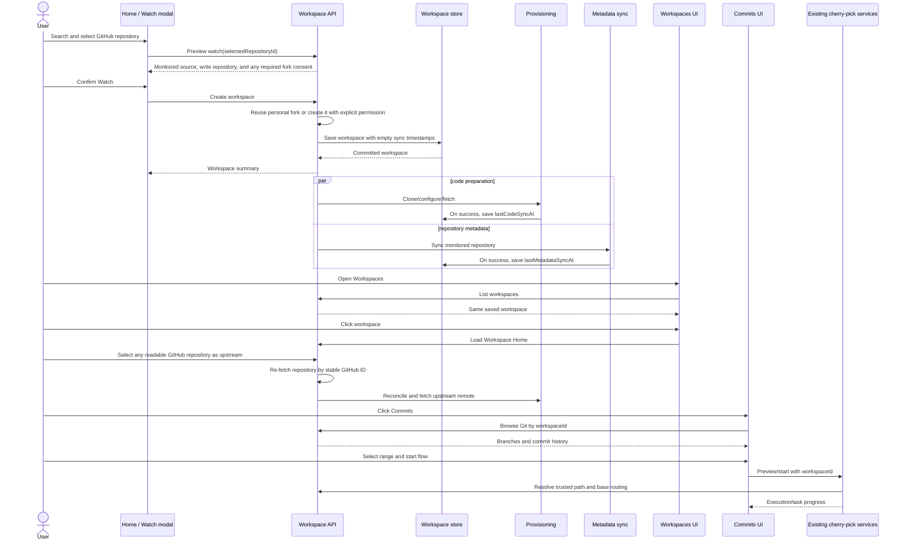

# Watched Repository / Workspace Design

Status: implemented through Checkpoint 8, with fork-first watch routing approved.

This design connects the existing watched-repository entry point to the existing workspace
commits and cherry-pick experience. A watched GitHub repository becomes a durable ByteQuay
workspace; Home and Workspaces are two views of the same backend record.

## Scope

The first complete vertical slice is:

1. Search GitHub repositories from Home.
2. Preview and confirm how the selected repository will be watched.
3. Save the workspace immediately.
4. Clone and synchronize the repository in the background.
5. Fetch the repository metadata used by workspace features.
6. Show the saved workspace in the Workspaces tab.
7. Open Workspace Home, then Commits.
8. Use the existing commit browser and cherry-pick flow.

The workspace shell also contains Tasks, Pull Requests, Issues, Memory, and Settings. This
design gives those features a stable workspace identity and repository routing context, but it
does not require all of them to be completed before the commits vertical slice ships.

## Starting point before implementation

The repository currently has:

- a Home watched-repository grid and an Add Repository modal;
- GitHub repository search and a small persisted `WatchedRepo` model;
- a Workspaces tab and workspace shell with Home, Commits, Tasks, Pull Requests, Issues,
  Memory, and Settings tabs;
- a renderer-local workspace model backed by `localStorage` and a user-selected checkout path;
- local Git overview, branch, history, diff, status, fetch, commit, reword, and squash APIs;
- the commits History, Changes, Flow, Tasks, and Progress views;
- cherry-pick preview, execution, worktree creation, persistence, progress reporting, and the
  conflict-resolution agent flow.

The handoff and cherry-pick implementation is described by
[design_handoff_cherry_pick_flow/README.md](design_handoff_cherry_pick_flow/README.md) and
[cherry-pick-range.md](cherry-pick-range.md).

## Original implementation gaps

Before this design was implemented, the existing pieces did not form one product flow:

- Home watched a repository but did not create a workspace.
- Workspaces were stored separately in renderer `localStorage`.
- Users had to choose an existing checkout instead of ByteQuay cloning the watched repository.
- Git and cherry-pick APIs accepted a renderer-provided filesystem path rather than a workspace
  ID resolved by the backend.
- The persisted watched-repository record did not contain stable GitHub identity, fork
  topology, permissions, clone state, paths, or sync state;
- Pull requests were synchronized from account-centric queries rather than from the repository
  monitored by a workspace;
- Repository issues and contributors were not synchronized for workspace use;
- Push and pull-request creation for the generated cherry-pick branch were deferred until
  Checkpoint 8.

## Core decision

`Workspace` is the durable aggregate. “Watch repository” is the command that creates it.

There must not be a watched-repository database model plus an unrelated renderer workspace
model. The Home grid and Workspaces list query the same workspace records:

- Home presents them as repositories the user watches.
- Workspaces presents their richer state and opens the workspace shell.
- Workspace tabs use the workspace ID to obtain repository and metadata context.

The existing `WatchedRepo` table can be migrated in place or replaced, but there is only one
authoritative persisted identity after migration. Renderer `localStorage` is not authoritative.

Checkpoint 1 uses a replacement `workspaces` table so Hibernate never has to add required routing
columns to an existing SQLite table. On the first workspace list, each legacy `watched_repos` row
is resolved through GitHub to obtain its stable repository ID and topology hint. ByteQuay
inserts or finds the idempotent workspace with the retained `displayOrder`, then deletes that
legacy row only after the workspace exists. A failed lookup leaves the legacy row intact and the
migration retries on a later list. The renderer no longer reads or writes
`bytequay.workspaces`; stale localStorage data is ignored rather than imported because its
user-selected paths are outside the managed-checkout ownership model.

### Repository identity and upstream cardinality

These are persistence invariants, not UI conventions:

- A physical write repository can have only one workspace. `selectedRepositoryId` has a database
  unique constraint. Watching either an upstream or a fork resolves to the same personal-fork
  workspace; a repeated watch returns that workspace instead of creating another clone.
- A workspace has zero or one user-managed upstream GitHub repository.
- An upstream candidate can be any repository readable through the connected GitHub account and
  cannot be the workspace's selected repository.
- The upstream is identified by its stable GitHub repository ID. Any number of workspaces may use
  the same upstream repository without requiring a separate watched workspace.
- Watching a fork uses GitHub's canonical source repository as the initial upstream. Watching a
  repository owned by another account resolves the same source and the signed-in user's fork,
  even when the user can push to that source. An owned non-fork repository stays direct.
- Workspace Settings remains an explicit override: users can later link, change, or unlink the
  upstream. Background synchronization never chooses a new upstream from GitHub topology.
- A user-configured extra remote may carry the same stable identity when its GitHub URL matches a
  selected or upstream repository already known in local workspace routing. It remains an extra
  remote and never becomes the workspace upstream implicitly.

For example, watched workspaces A, B, and C may all use repository X as upstream even when X is
not watched. A cannot simultaneously use X and Y. The repositories do not need a GitHub fork
relationship.

## User flow

### 1. Watch from Home

1. The user clicks **Watch repository** in the “Repos you watch” section.
2. The modal searches repositories available through the connected GitHub account.
3. The user selects a result.
4. ByteQuay loads a watch preview containing:
   - repository owner and name;
   - default branch;
   - direct or fork topology;
   - canonical GitHub source when it is a fork;
   - monitored repository;
   - development base remote;
   - push destination and whether it is writable;
   - pull-request base repository.
5. The user confirms **Watch**. If a personal fork is missing, the preview asks for explicit
   permission to create it as part of this action. An existing personal fork is reused.
6. The backend resolves or creates the confirmed write repository, saves the workspace, and
   returns it with provisioning states. Personal-fork workspaces start linked to the canonical
   upstream; owned non-fork workspaces start direct.
7. Clone/code synchronization and metadata synchronization start after the transaction commits.
8. Home shows the workspace card immediately and updates its progress.

Saving before cloning is intentional. Fork creation, when explicitly authorized, happens before
the workspace is saved; clone and metadata work happen afterward. Background failures leave
last-success timestamps unchanged and are retried when the data is still stale.

### 2. Open the workspace

1. The user clicks **Workspaces** in the application navigation.
2. The Workspaces page lists the same backend workspaces created from Home.
3. The user clicks a workspace.
4. The app routes to `/workspaces/:workspaceId` and opens Workspace Home.
5. Workspace Home shows repository topology, clone location, default branch, and last successful
   code and metadata sync times.

### 3. Browse commits and start cherry-pick

1. The user clicks the workspace **Commits** tab.
2. The frontend calls workspace-scoped Git endpoints using `workspaceId`.
3. The backend resolves the trusted local path and remote routing from the workspace.
4. The existing commits History view displays branches and commits.
5. The user selects an ordered commit range and starts the existing Flow view.
6. Cherry-pick requires an upstream repository and is computed against
   `upstream/<target-branch>`.
7. On confirmation, the existing execution service creates its worktree and applies the
   cherry-pick plan.
8. Tasks and Progress continue to show the execution and any conflict-resolution agent run.

## Repository topology and routing

The preview's selected repository is the search result the user chose. The persisted workspace's
selected repository is the physical write repository cloned as `origin`: the signed-in user's
personal fork for another account's project, or the user's own non-fork repository. Upstream and
fork search results therefore converge on the same write repository. The canonical source becomes
`upstream`, and all monitored issues, pull requests, contributors, and activity use it. The user
may later select any GitHub-readable repository as an explicit upstream override in Settings.

| Purpose | No upstream linked | Upstream repository linked |
| --- | --- | --- |
| Selected repository | workspace repository | workspace repository |
| `origin` remote | selected repository | selected repository |
| `upstream` remote | absent | selected upstream repository |
| Monitored issues/PRs | selected repository | selected upstream repository |
| Repository names, owner avatars, and reference metadata | selected repository | selected upstream repository |
| Contributors | selected repository | selected upstream repository |
| Development base | `origin/<branch>` | `upstream/<upstream-default-branch>` |
| Work branch push | `origin` when writable | `origin` when writable |
| Pull-request base | selected repository | selected upstream repository |

Repository displays on Home, workspace cards, the sidebar, and the confirmed watch preview use
the monitored repository's identity and default branch. User avatars describe the authors and
participants returned for that repository. The fork's identity is retained for physical checkout
ownership, origin configuration, push permissions, and explicit local-data deletion. A user-chosen
workspace name remains a local label. Selecting a fork in repository search does not make that
fork the source of the confirmed workspace's display metadata.

Needs attention includes an author's saved PR-detail avatar URL when available, using a local
batch lookup rather than fetching full PR details for each displayed row. Missing images keep a
fallback, and avatar components retry when their owner, user, or image source changes.

Linking configures and fetches the source repository as `upstream`. Unlinking removes that remote
and returns monitoring to the selected repository. Git uses `remote.pushDefault=origin`; ByteQuay
branch delivery and the task's draft-PR action explicitly push to `origin`. The draft targets the
monitored repository's default branch and names a linked head as `<fork-owner>:<branch>`.

Interactive tasks and the CodeGraph baseline start from the fetched monitored default branch:
`upstream/<upstream-default-branch>` when linked, otherwise `origin/<default-branch>`. Their
physical worktree identity remains the selected repository, so a stale fork default branch does
not become the task's development base.

Existing workspaces and task worktree identities are not rewritten. Watching a previously watched
foreign direct repository resolves a new or existing personal-fork workspace, preserving the old
workspace and its tasks. A confirmed watch of an existing personal-fork workspace can restore its
canonical upstream through the existing guarded upstream-setting operation.

If the configured push destination is not writable, browsing, local worktrees, and local
cherry-pick execution remain available. Push and pull-request actions are disabled with an
actionable permission message. ByteQuay must not silently push to another remote.

The upstream is resolved by stable GitHub repository ID. ByteQuay re-fetches it with the connected
credential when the user saves the selection and during synchronization. Its coordinates, default
branch, and clone URL are stored in the workspace routing snapshot so local reads remain available
between refreshes.

Extra remotes are stored independently by workspace name and URL. Their provider repository ID and
canonical coordinates are nullable. `RepositoryEnrichmentService` resolves an identityless GitHub
HTTPS URL only against selected and upstream identities already stored in local workspace rows,
then persists a match. This lets the same repository reuse commit avatars and PR associations
without a second enrichment cache or an identification request to GitHub. Unmatched and non-GitHub
remotes remain valid Git-only sources and show Git names with initial avatars. Recognition never
links an upstream or changes push routing. Once remembered, the stable ID remains authoritative;
URL matching applies only to identityless rows.

## Durable model

The exact persistence representation may use the project's existing JPA and store conventions.
The domain record needs these concepts:

```text
Workspace
  id                         ByteQuay workspace ID
  name                       user-facing name
  selectedRepositoryId       stable GitHub repository ID
  selectedOwner/name         selected repository coordinates
  upstreamRepositoryId       nullable; stable ID of the selected upstream repository
  upstreamOwner/name          nullable when unlinked
  monitoredRepositoryId      repository used for issues/PRs/contributors
  monitoredOwner/name
  topology                   DIRECT | FORK
  defaultBranch
  originCloneUrl
  upstreamDefaultBranch      nullable when unlinked
  upstreamCloneUrl           nullable when unlinked
  localRepositoryPath        backend-owned path
  lastCodeSyncAt             nullable until the first successful clone/fetch
  lastMetadataSyncAt         nullable until the first successful metadata refresh
  createdAt / updatedAt

RemoteSource
  workspaceId
  name                       configured Git remote name
  url
  repositoryId               nullable stable provider repository ID
  repositoryOwner/name       nullable canonical coordinates; present with repositoryId
```

Permission details can be refreshed because GitHub access may change. Persist enough routing
identity to recover safely, but do not persist credentials or access tokens in workspace rows.

Workspace names need not be globally unique. Watching the same stable selected GitHub repository
twice is idempotent for the first version: return the existing workspace instead of cloning a
duplicate.

The database enforces the important cardinality rather than relying only on service checks:

```text
UNIQUE(workspace.selected_repository_id)
workspace.upstream_repository_id is a stable GitHub ID, nullable and not unique
upstream_repository_id is null => all upstream fields are null
upstream_repository_id is null => monitored_repository_id = selected_repository_id
upstream_repository_id is present => monitored_repository_id = upstream_repository_id
upstream_repository_id is present => upstream_repository_id != selected_repository_id
```

Repository-scoped cached data is keyed by the stable monitored repository ID, not by workspace.
This means several workspaces that link to the same upstream share one local metadata cache
instead of fetching and storing the same contributors, picker users, labels, and topics repeatedly.
Commit enrichment uses the same stable-ID rule. A custom remote with a recognized identity reads
and writes the same enrichment projection as any workspace or upstream view of that repository.

## Filesystem ownership

ByteQuay owns repositories created by this flow. A representative layout is:

```text
<ByteQuay application data>/workspaces/<workspace-id>/repository
<ByteQuay application data>/workspaces/<workspace-id>/worktrees/<task-id>
```

The renderer never chooses or submits these paths. All Git and agent-backed
workflow requests carry a workspace ID. The backend resolves the path and
verifies that it remains inside the ByteQuay workspace root before invoking
Git. Interactive tasks, cherry-pick, and CI Autofix share the
[Managed Worktree Service](worktree-service.md); each task receives a distinct
generated branch/worktree, and its owning task or workflow persists the
immutable returned worktree facts. The service has no separate allocation
state machine or allocation table.

An existing mismatched directory must never be deleted or recloned automatically. Mark the
workspace failed and require a safe repair action. Existing local-checkout workspaces can be a
later explicit import flow; they are not part of the watched-repository first slice.

## Service boundaries

The service interfaces below are application boundaries. Implementations may use existing stores,
GitHub clients, `GitBrowseService`, and cherry-pick services directly. Additional one-method
layers are not required.

Commit-enrichment persistence is the exception with an explicit shared boundary:
`RepositoryEnrichmentService` owns batched enrichment reads and writes plus local custom-remote
identity reuse. History display, refresh, and cherry-pick preview call that service; they do not
read or upsert enrichment through `CommitHistoryStore` directly. Refresh-outcome metadata remains
owned by the commit-history refresh flow. See [Commit History and Refresh Design](commits.md).

### WorkspaceRepositoryService

This is the renderer-facing workspace lifecycle service and the single entry point for watch,
list, open, synchronize, and unwatch operations.

```java
package com.bytequay.app.workspace;

import java.util.List;
import java.util.Optional;

public interface WorkspaceRepositoryService
{
    /**
     * Searches repositories visible to the connected GitHub account.
     *
     * <p>Results include stable GitHub identity, fork information, default branch,
     * clone URL, and the permissions needed to construct a watch preview. This
     * method does not create a workspace or mutate a repository.</p>
     *
     * @param query owner/name or free-text repository query
     * @param limit maximum number of results to return
     * @return matching repositories ordered by the provider's relevance
     */
    List<RepositorySearchResult> searchRepositories(String query, int limit);

    /**
     * Resolves the repository identity and topology hint that will be persisted by watch.
     *
     * <p>The preview separates the chosen search result from the resolved write repository and
     * monitored upstream. A missing personal fork requires explicit creation permission.</p>
     *
     * @param selectedRepositoryId stable GitHub ID of the selected repository
     * @return confirmation data shown before the user watches the repository
     * @throws RepositoryNotFoundException if the repository is no longer visible
     */
    WatchRepositoryPreview previewWatch(long selectedRepositoryId);

    /**
     * Creates a durable workspace for a confirmed repository watch.
     *
     * <p>The workspace is committed before background clone and metadata work is
     * scheduled. Repeating this command for the same selected GitHub repository
     * returns the existing workspace.</p>
     *
     * @param command confirmed repository identity and optional workspace name
     * @return the saved workspace with its current provisioning states
     * @throws WatchPreviewChangedException if topology or identity changed since preview
     */
    Workspace watch(WatchRepositoryCommand command);

    /**
     * Lists all durable workspaces for the Workspaces page and Home watch grid.
     *
     * @return summaries ordered by the user's display order and creation time
     */
    List<WorkspaceSummary> listWorkspaces();

    /**
     * Loads workspace home data, including routing and independent sync states.
     *
     * @param workspaceId ByteQuay workspace ID
     * @return workspace summary suitable for Workspace Home
     * @throws WorkspaceNotFoundException if the workspace does not exist
     */
    WorkspaceSummary getWorkspace(String workspaceId);

    /**
     * Resolves the trusted repository path and routing for a code operation.
     *
     * <p>Git and cherry-pick controllers use this method instead of accepting a
     * filesystem path from the renderer. If the checkout has never synchronized,
     * the method attempts synchronous provisioning before returning.</p>
     *
     * @param workspaceId ByteQuay workspace ID
     * @return a ready repository context containing path, remotes, and base refs
     * @throws WorkspaceNotReadyException if clone/provisioning is not ready
     */
    WorkspaceRepositoryContext requireReadyRepository(String workspaceId);

    /**
     * Requests asynchronous code and metadata synchronization.
     *
     * <p>The request is idempotent while an equivalent synchronization is already
     * active. The returned workspace exposes the accepted state immediately.</p>
     *
     * @param workspaceId ByteQuay workspace ID
     * @return workspace state after the request is accepted
     */
    Workspace requestSync(String workspaceId);

    /**
     * Links or unlinks a GitHub-readable repository as the read-only upstream.
     *
     * <p>The service re-fetches a supplied stable repository ID with the connected
     * credential before saving its routing snapshot.</p>
     *
     * @param workspaceId workspace whose routing changes
     * @param upstreamRepositoryId stable GitHub repository ID, or empty to unlink
     * @return accepted workspace state while routing synchronization begins
     */
    Workspace setUpstream(String workspaceId, Optional<Long> upstreamRepositoryId);

    /**
     * Hides a workspace from watched repositories while retaining its local data.
     *
     * <p>Tasks, checkout, settings, and cached history remain available by workspace ID.
     * Watching again reruns preview validation and routing setup for the retained workspace.</p>
     *
     * @param workspaceId ByteQuay workspace ID
     */
    void unwatch(String workspaceId);
}
```

### WorkspaceProvisioningService

This service owns managed clone creation, remote configuration, fetch, and recovery. It is called
after watch commit and during explicit code synchronization.

```java
package com.bytequay.app.workspace;

public interface WorkspaceProvisioningService
{
    /**
     * Creates the managed checkout when needed, otherwise fetches and prunes the configured remotes.
     *
     * <p>Creating clones the selected repository as {@code origin}; when an upstream repository is
     * selected it also configures and fetches {@code upstream}. A failure leaves the last
     * successful synchronization timestamp unchanged and never deletes an unknown directory.
     * This operation never resets a branch, discards local changes, rebases,
     * force-pushes, or changes the selected pull-request base.</p>
     *
     * @param workspaceId saved workspace to synchronize
     * @return success, the last successful synchronization time, and failed optional remotes
     */
    WorkspaceCodeSyncResult synchronizeCode(String workspaceId);
}
```

### WorkspaceMetadataService

Reference metadata synchronization is independent from code provisioning and from active issue/PR
refresh. A GitHub API failure should not make an otherwise ready local repository unusable.

```java
package com.bytequay.app.workspace;

public interface WorkspaceMetadataService
{
    /**
     * Synchronizes low-volatility repository reference metadata from the
     * workspace's monitored repository.
     *
     * <p>For an unlinked workspace the monitored repository is the selected repository.
     * For a linked workspace it is the selected upstream repository. Contributors,
     * assignable picker users, labels, and repository topics/tags are stored locally by stable
     * repository ID. Picker avatar images are stored in the local avatar cache.
     * A normal call refreshes only projections whose fixed freshness interval has
     * expired. Failure leaves the cached snapshot and last-success timestamp unchanged.</p>
     *
     * @param workspaceId workspace whose metadata should be refreshed
     * @return success, counts, and freshness timestamps for the refresh
     */
    WorkspaceMetadataSyncResult synchronize(String workspaceId);

    /**
     * Returns the latest persisted repository metadata snapshot without contacting
     * GitHub.
     *
     * @param workspaceId workspace to query
     * @return the latest contributor, picker-user, label, and topic/tag projection summary
     */
    WorkspaceMetadataSnapshot getSnapshot(String workspaceId);

    /** Returns local metadata when the repository is watched, without contacting GitHub. */
    Optional<WorkspaceMetadataSnapshot> findSnapshot(RepoRef repository);
}
```

The first implementation uses fixed cache intervals rather than a new settings system:

- repository overview, description, stars, and languages: refresh when absent or older than one hour;
- contributor accounts: refresh when absent or older than seven days;
- assignable picker users and newly discovered avatars: refresh when absent or older than seven days;
- labels and repository topics/tags: refresh when absent or older than thirty days;
- always serve the latest local snapshot while a refresh runs or fails.

Store the provider's stable IDs. Contributor history uses upserts; assignable picker users use a
full replacement after a successful GitHub response so users who lose eligibility disappear. The
existing periodic repository sweep requests refresh, but the service checks the timestamp so
multiple workspaces linked to the same upstream do not multiply GitHub calls.

Metadata refresh persists no lifecycle state or error. A successful freshness check or refresh
advances `lastMetadataSyncAt`; failure leaves the previous timestamp and cached snapshot unchanged.
The caller owns any temporary spinner. Each projection's timestamp is checked independently; a
fresh workspace or picker timestamp cannot suppress an expired overview or a missing upstream
projection. Picker reads use the saved snapshot and
localhost avatar URLs; opening a reviewer or assignee picker does not contact GitHub.

Issues and pull requests are active repository data, not part of this slow reference-metadata
cache. They keep their own refresh policy. `WorkspaceIssueRefreshService` refreshes the open-issue
projection for scheduled and explicit requests and refreshes one selected issue's activity and
type data on explicit request. Both snapshots are persisted before they are returned. Normal
issue list and detail GETs read SQLite only; direct comment and metadata writes update the relevant
local projection. Pull requests reuse the existing implementation as described below.

### WorkspacePullRequestService

Workspace pull requests are a repository-scoped view of the existing global pull-request feature,
not a second implementation. Reuse:

- `PullsScreen`, `PullOverview`, `PullChanges`, existing row/filter models, and their tests;
- the existing `PullRequestService`, controller behavior, GitHub read/write clients, detail cache,
  and pull-request stores;
- the same detail, comment, review, merge, checks, diff, and refresh behavior.

The minimal additions are a repository-filtered local query/sync path and an optional repository
scope passed to `PullsScreen`. The workspace controller resolves `workspaceId` to the monitored
repository slug and delegates to the existing pull-request service. When linked, that slug is the
persisted upstream snapshot. The workspace tab must never show PRs from another repository. The
global Pull Requests page combines its account-centric rows with the projections for repositories
monitored by current workspaces.

`PullRequestRefreshService` is the single synchronous refresh boundary. Its dashboard and
repository methods paginate discovery and persist all discovered PR cards through the existing
`PullRequestService` and stores before optional enrichment. Card refresh batches compact CI, review,
head, count, and activity facts. Only the newest 30 PRs per repository warm full histories and diffs
through the existing conditional refresh; personal discovery does not add another warm allowance
for watched repositories. Omitted rows remain cached; older monitored and notified PRs retain
summary coverage. Handled reviews with new activity may read reply metadata to preserve their
needs-review status. Enrichment failures do not discard successfully discovered rows. One process-local lock prevents
overlapping PR refreshes; there is no refresh queue or persisted in-progress state.
Workspace refresh captures watched membership and repository routing under the
workspace lock, then releases it before waiting for the PR refresh lock or GitHub.
The resulting cache is repository-scoped and touches no workspace files or
lifecycle records; concurrent deletion or routing changes cannot recreate or
retarget a workspace. Slow PR synchronization must not block local context saves.
`PullRequestSnapshotService` owns the local detail and diff snapshot boundary, including the
remote fetch-and-persist operations used by refresh. `PullRequestSyncJob` owns the periodic timer,
quiet-hours policy, and iteration over distinct monitored repositories. The scheduled thread calls
the same refresh methods synchronously and handles failure per scope. A frontend refresh endpoint
waits for the requested refresh and persistence to complete; the renderer then reloads the first
page through the normal SQLite-backed display endpoint.
Opening `PullsScreen`, PR detail, checks, activity, and diff views reads the local projection
without triggering another GitHub refresh. The default diff snapshot refreshes with changed PR
detail. A user-selected commit range or expanded full file body is an explicit refresh request;
the refresh service persists it before the frontend displays it. Viewer write permission is part
of the stored detail snapshot, so even action availability does not require a display-time GitHub
call.

`WorkspacePullRequestService` owns delivery routing for a cherry-pick work branch and the
post-create handoff. Its implementation delegates to existing pull-request/GitHub write code,
exact-fetches the created PR into the workspace projection, and, for a direct same-repository PR,
starts the idempotent CI Autofix watch covered by the same confirmation. Push and pull-request
creation remain explicit user actions and shipped after the watch-to-local-cherry-pick vertical
slice in Checkpoint 8.

```java
package com.bytequay.app.workspace;

public interface WorkspacePullRequestService
{
    /**
     * Reads current write permission and any persisted delivery result without writing remotely.
     *
     * @param workspaceId workspace that owns the execution
     * @param executionId completed cherry-pick execution
     * @return permission, resolved routing, persisted delivery, and CI-watch result
     */
    DeliveryStatus getStatus(String workspaceId, CherryPickExecutionId executionId);

    /**
     * Pushes an already-created workspace branch to the configured writable remote.
     *
     * <p>Every workspace pushes to its selected repository at {@code origin}. The method does not force-push and does not
     * choose a different remote when permission is missing.</p>
     *
     * @param command workspace ID, execution ID, and explicit confirmation
     * @return pushed remote and head reference
     */
    WorkspacePushResult push(WorkspacePushCommand command);

    /**
     * Creates a pull request from a previously pushed workspace branch.
     *
     * <p>The base repository and branch are resolved from persisted routing. A linked
     * workspace targets upstream; an unlinked workspace targets the selected repository.
     * This is an explicit GitHub write and requires user confirmation. For a direct
     * same-repository PR, that confirmation also authorizes the bounded CI Autofix watch.</p>
     *
     * @param command workspace ID, execution ID, and a second explicit confirmation
     * @return provider identity and URL of the created pull request
     */
    WorkspacePullRequestResult createPullRequest(WorkspacePullRequestCommand command);
}
```

The write commands do not accept a renderer-provided remote, branch, base, title, or body. The
service loads the completed execution and workspace, rechecks the selected repository by stable
GitHub ID, then derives every write parameter from persisted routing and the saved PR draft. The
created PR is exact-fetched and saved through the repository-sync projection instead of waiting for
GitHub search indexing. A direct PR starts CI Autofix with a stable idempotency key; a linked-fork
delivery does not because CI Autofix is intentionally same-repository only. The
read-only delivery status endpoint supports an actionable disabled state without turning execution
polling into repeated GitHub permission requests. If the workspace has no successful code timestamp,
delivery first attempts the same synchronous provisioning path used by code refresh.

## Application orchestration

`watch` performs the synchronous work needed to establish the confirmed routing and persist:

1. Load the repository again by stable GitHub ID.
2. Recompute routing and compare it with the confirmed preview/version.
3. Reuse the signed-in user's fork, or create it only with explicit permission when required.
4. Insert or restore the durable workspace for the resolved write repository and canonical source.
   An unwatched workspace retains its ID, checkout, tasks, settings, and history. It must pass a
   fresh watch preview and routing resolution before becoming watched again. Rewatch forces code
   synchronization and schedules the usual metadata and pull-request refreshes.
5. Commit.
6. Schedule provisioning and metadata synchronization independently.

The implementation uses the existing Spring async facilities rather than introducing a new queue.
Active work is deduplicated in process. On application startup, a recovery component provisions a
workspace with no code timestamp and refreshes code or metadata whose last-success timestamp is
older than its freshness interval. Idempotent filesystem checks make retries safe.

Code availability and metadata freshness are separate:

- Commits is enabled after `lastCodeSyncAt` is present.
- Pull Requests uses the existing locally persisted PR data filtered to the monitored repository.
- Contributor, label, and topic/tag lookup uses the latest locally stored reference snapshot and
  refreshes only when its weekly/monthly freshness interval expires.
- Issues uses its own workspace projection.
- Workspace Home can be opened in every state.

## HTTP contract

The precise DTO names may follow existing controller conventions. The intended boundary is:

```text
GET    /api/repository-search?q=...&limit=...
POST   /api/workspaces/watch-preview
POST   /api/workspaces
GET    /api/workspaces
GET    /api/workspaces/retired
GET    /api/workspaces/{workspaceId}
POST   /api/workspaces/{workspaceId}/sync
PUT    /api/workspaces/{workspaceId}/upstream
DELETE /api/workspaces/{workspaceId}
DELETE /api/workspaces/{workspaceId}/data

GET    /api/workspaces/{workspaceId}/metadata
GET    /api/workspaces/{workspaceId}/issues
POST   /api/workspaces/{workspaceId}/issues/refresh
GET    /api/workspaces/{workspaceId}/issues/{issueNumber}/detail
POST   /api/workspaces/{workspaceId}/issues/{issueNumber}/detail/refresh
GET    /api/workspaces/{workspaceId}/pull-requests
POST   /api/workspaces/{workspaceId}/pull-requests/sync
GET    /prs/users?repo={owner/repo}[&workspaceId={workspaceId}]

GET    /api/workspaces/{workspaceId}/git/overview
GET    /api/workspaces/{workspaceId}/git/branches
GET    /api/workspaces/{workspaceId}/git/commits
GET    /api/workspaces/{workspaceId}/git/diff
GET    /api/workspaces/{workspaceId}/git/status
POST   /api/workspaces/{workspaceId}/git/commit
POST   /api/workspaces/{workspaceId}/git/reword
POST   /api/workspaces/{workspaceId}/git/squash

POST   /api/workspaces/{workspaceId}/cherry-pick/preview
POST   /api/workspaces/{workspaceId}/cherry-pick/executions
POST   /api/workspaces/{workspaceId}/cherry-pick/executions/{executionId}/cancel
GET    /api/workspaces/{workspaceId}/cherry-pick/executions/{executionId}/delivery
POST   /api/workspaces/{workspaceId}/cherry-pick/executions/{executionId}/push
POST   /api/workspaces/{workspaceId}/cherry-pick/executions/{executionId}/pull-request
```

Repository-user lookup validates and uses the explicit workspace when supplied. Without one, it
still resolves a watched repository to the shared local snapshot; only genuinely unwatched
repositories use the live GitHub fallback.

The upstream request body is `{"upstreamRepositoryId": 123}` or
`{"upstreamRepositoryId": null}` to unlink. The backend re-fetches a non-null ID through the
connected GitHub credential before persisting it; renderer-provided coordinates, branches, and
clone URLs are never trusted.

Existing Git browse and cherry-pick endpoints may be retained temporarily for compatibility, but
the workspace UI must use workspace-scoped endpoints. New renderer requests must not contain
`repositoryPath` or `worktreeParent`.

The workspace pull-request list endpoint returns the existing `PullRequest` DTO filtered by the
workspace's monitored repository. Its refresh endpoint waits for remote synchronization and
persistence, returns no body, and is followed by a normal local list request. Existing
detail/diff/comment/review/merge code remains the
implementation behind workspace interactions; do not create parallel workspace PR DTOs, tables,
or detail components unless an actual incompatible requirement appears.

### Error shape

Workspace endpoints should return a stable error code plus a safe user message, for example:

```json
{
  "code": "WORKSPACE_CODE_NOT_READY",
  "message": "Repository clone is still in progress.",
  "retryable": true
}
```

Logs may contain an internal correlation ID. Responses and persisted display errors must not
contain tokens, authenticated clone URLs, or arbitrary command output with secrets.

## Frontend design

### Home

- Reuse the existing watched-repository grid and Add Repository modal.
- Search results show owner/name, visibility, default branch, and fork marker.
- Selecting a result loads the confirmation preview before enabling Watch.
- The confirmation shows the monitored source, personal write fork, development base, and PR
  destination. A missing fork requires an explicit **Create fork and watch** confirmation.
- After save, close the modal and insert the returned workspace card immediately.
- Cards show `Preparing`, `Ready`, `Syncing`, or `Needs attention`, with retry when appropriate.

### Workspaces

- Replace the `localStorage` workspace list with `GET /api/workspaces`.
- **Watched** uses `GET /api/workspaces`; **Retired** uses `GET /api/workspaces/retired`.
  Both are local reads; listing retired workspaces never schedules synchronization or changes
  watched membership. Home continues to use the watched-only list.
- Retired rows expose Open, Watch again, and Delete. Open keeps the saved workspace ID, so its
  tasks, files, history, and settings remain accessible while unwatched. Watch again uses the
  normal preview/confirmation flow; Delete uses the same two-stage local cleanup confirmation.
- Rewatch moves the retained row back only if it resolves to that same physical workspace. An
  older direct upstream checkout stays accessible in Retired when watching creates or opens a
  different personal-fork workspace. No implicit task migration occurs.
- Remove the local-folder picker from the watched-repository path.
- A workspace row is clickable in every state.
- Clicking it routes to the existing workspace shell and Workspace Home.
- Unwatch opens one **Cancel** / **Unwatch** confirmation describing retained local data,
  access from Retired, and watching again to rerun setup. Workspace Settings uses the same confirmation.
- Delete remains separate and requires the disclosure and typed final confirmation described below.

### Workspace Home

Show:

- selected repository and topology;
- selected upstream repository, when present;
- default branch and development base ref;
- last successful sync times;
- whether the local data is fresh or due for refresh;
- disabled feature explanations until the first required synchronization succeeds.

The current coded Workspace Home is the starting point. Keep its task counts, PR count, recent
cherry-pick activity, and Commits shortcut. Replace local-path discovery with durable workspace
timestamps and add topology/provisioning/freshness information rather than replacing the page.

### Pull Requests

- Reuse the existing global `PullsScreen` and PR detail experience.
- Pass the workspace's monitored repository as a scope.
- Query/sync only that repository for the workspace list.
- Show the monitored repository in the workspace tab header, especially when linked.
- Keep existing PR actions and detail views; only the list scope differs from the global page.
- Provide repository-specific loading, empty, stale, and error states.

### Commits

Reuse the existing Commits tab and views. Change their data source from a local path stored by the
renderer to the route workspace ID. Keep the current selection, preview, execution, Tasks, and
Progress behavior.

The Flow view no longer asks for `worktreeParent`. The backend derives the managed worktree root.
The target base defaults from routing, while the user still chooses the target branch where the
current cherry-pick design permits it.

The first branch control displays this destination: `upstream/<branch>` for a linked fork,
and the branch name for a direct repository. Normal visits initially show its history; the
separate source control selects commits to apply. The target selector reads branches from its
destination remote. An explicit target selection is temporary for that visit.

When no upstream is linked, the repository chip says **No upstream linked** and opens Workspace
Settings. Existing commit cards retain their pull-request association and avatar presentation.

### Workspace Settings

- **Commits default target branch** saves a branch-only workspace override and offers Reset to
  automatic. The automatic branch is the linked upstream default or the direct repository
  default; routing always determines the destination repository. The resolved target is returned
  in workspace settings and read before history or cherry-pick preview becomes available.
- The setting is stored through `AppSettingsStore` in `app_settings` at
  `workspace.commitsTargetBranch.<workspaceId>`. Unwatch retains it, Delete removes it, and later
  setting changes never retarget an existing frozen preview or execution.
- Reuse repository search to list repositories readable by the connected GitHub account.
- Save `None` to unlink or a stable GitHub repository ID to link.
- Exclude the workspace's selected repository and show the current upstream even when it is not
  otherwise watched by ByteQuay.
- Never list raw Git remotes or infer the selection from GitHub topology. User-managed
  extra remote sources are a separate Workspace Settings card and never become the upstream.
- Extra remotes may display a locally recognized GitHub repository identity. If no selected or
  upstream workspace snapshot matches, keep the remote Git-only; opening History must not trigger
  an identity lookup.
- Show safe validation errors for the selected repository, inaccessible repositories, unsafe
  routing, and active work.

## UI implementation and mockup status

There are no standalone mockup artifacts yet for the watched-repository workspace flow. Several
surfaces already exist as working React code, so they should be evolved instead of redrawn from
scratch:

| Surface | Current state | Design still needed |
| --- | --- | --- |
| Home watched repositories | Implemented | Watch preview/confirmation, duplicate-watch result, and timestamp freshness |
| Workspaces list | Implemented for renderer-local checkouts | Backend workspace cards and removal of local-folder-first copy |
| Workspace shell/navigation | Implemented | Readiness rules and badges only |
| Workspace Home | Implemented in `WorkspaceShell.tsx` | Explicit upstream routing and code/metadata freshness timestamps |
| Commits and cherry-pick | Implemented | Workspace-ID data source and managed-base messaging |
| Workspace Pull Requests | Global `PullsScreen` is already mounted | Repository-scoped header/list, empty/stale/error states; reuse all detail UI |
| Workspace Tasks | Implemented for cherry-pick executions | Replace path-derived scope with workspace ID |
| Workspace Settings | Implemented | Searchable GitHub-repository upstream selector, Unwatch, and confirmed Delete |
| Workspace Issues | Placeholder only | Complete list/detail/filter interaction design and implementation |
| Workspace Memory | Placeholder only | Future design; not required for watched-repo/commits delivery |
| Reviewer/assignee picker | Implemented | Reads the weekly local assignable-user and avatar snapshot |

Before frontend implementation, create or approve focused state mockups for four changed surfaces:

1. Watch repository preview plus preparing/failed states.
2. Workspaces list cards in pending, ready, syncing, and failed states.
3. Workspace Home for unlinked and linked repositories.
4. Workspace Pull Requests with monitored-repository scope and empty/error states.

Commits, PR detail, Tasks, and the workspace shell do not need replacement mockups unless their
existing interaction changes beyond the scoped additions above.

## End-to-end sequence



## Consistency and recovery rules

- Workspace persistence is committed before background work starts.
- Only one clone/provisioning operation runs per workspace.
- Clone recovery validates the repository identity and configured remotes before reuse.
- Fetch never resets, rebases, cleans, or discards user work.
- Metadata sync uses stable provider IDs and records the last successful snapshot.
- Reference metadata is cached by monitored repository ID, so many workspaces sharing one upstream
  repository share one contributors/picker-users/labels/topics snapshot.
- Contributor and picker-user refreshes are no more frequent than weekly, and label/topic refresh
  is no more frequent than monthly unless a future explicit force-refresh requirement is approved.
- A metadata failure does not downgrade ready code.
- A code failure does not delete usable metadata.
- Repository renames are reconciled by stable GitHub ID and update displayed coordinates/remotes
  only through an explicit, validated sync path.
- Deleted or inaccessible repositories remain visible with a recoverable/authentication state.
- Unwatch requires one UI confirmation with **Cancel** and **Unwatch** actions, explaining that
  local data is accessible from Retired and watching again reruns setup. Opening or cancelling the
  dialog makes no change; watched membership changes only after the confirmed request succeeds.
  It moves the workspace from Watched to Retired and excludes its repository-only PRs from Home,
  without losing local data or stopping active tasks.
  Queued automatic refreshes skip unwatched workspaces; an already running refresh may finish.
- Delete is a separate local-data action. The UI first explains the loss, then requires typing the
  exact write repository name in a second dialog. The backend requires both confirmation and the
  matching name. `DELETE /api/workspaces/{workspaceId}/data` accepts
  `{confirmed: true, repositoryName: "owner/repo"}`.
- Delete refuses active tasks/workflows or unverified directories/worktrees. It uses the existing
  task deletion path for owned worktrees, branches, task history, logs, and attachments, then removes
  the managed checkout, workspace settings, remote sources, workflow history, and workspace record.
  Filesystem failures retain the record for retry.
- Repository caches are removed only when no other retained workspace or extra remote references
  that repository. Dashboard/explicitly monitored PR data and independent review drafts survive.
  GitHub repositories/forks and provider-owned session history/global settings are outside local
  workspace deletion.

## Security and write policy

- Credentials stay in the existing GitHub authentication mechanism.
- Clone URLs stored in the database must not embed credentials.
- Renderer-provided filesystem paths are not accepted for managed workspaces.
- Every managed path is resolved and checked beneath the ByteQuay workspace root.
- Search, clone, fetch, and metadata refresh are reads.
- Creating a personal fork is a GitHub write and occurs only through the disclosed watch action.
- Push and pull-request creation are explicit GitHub writes and require a user action.
- Initial delivery never force-pushes, deletes a remote branch, or changes a PR base implicitly.
  A separately disclosed CI Autofix watch may later push with an exact remote-head lease.

## Delivery order

1. Introduce the durable workspace model and migrate existing watched repositories.
2. Enrich GitHub search/preview with stable identity, topology, clone URLs, and permissions.
3. Implement managed clone, remote configuration, fetch, state transitions, and recovery.
4. Connect Home and Workspaces to the same workspace endpoints.
5. Change Git browse and commits UI calls from filesystem path to workspace ID.
6. Change cherry-pick preview/start to resolve path, worktree root, and base routing by workspace.
7. Add repository-scoped metadata projections and sync.
8. Add explicit push and pull-request creation using the persisted routing policy.

The first shippable gate is step 6: a user can watch, open, browse commits, and complete the local
cherry-pick flow. Metadata synchronizes alongside that work, while Checkpoint 8 adds push/PR
delivery as a separate explicit gate.

## Acceptance criteria

- Watching a foreign repository or any of its forks resolves a personal-fork workspace that
  monitors the canonical source, regardless of the user's source push permission.
- Watching an owned non-fork repository creates a direct workspace.
- Repeating watch through either the source or a fork returns the same resolved write workspace.
- A missing personal fork is created only after explicit consent; an existing fork is reused.
- Existing direct workspace tasks retain their recorded physical repository and worktree identity.
- Upstream candidates are repositories readable through the connected GitHub account, whether or
  not they are watched; users can search, link, change, and unlink them in Settings.
- Selecting the workspace repository itself, an inaccessible repository, or unsafe repository
  routing is rejected.
- Any number of workspaces can share the same upstream repository without depending on another
  ByteQuay workspace.
- Home and Workspaces display the same saved workspace and provisioning state.
- Clicking the workspace opens Workspace Home even while preparation is in progress or failed.
- Commits becomes available when code is ready and uses no renderer-supplied repository path.
- Unlinked history resolves from `origin`, and cherry-pick creation directs the user to select an
  upstream repository.
- Linked history and cherry-pick bases resolve from `upstream`; push resolves to writable `origin`,
  and the pull request resolves against the selected upstream repository.
- The existing commit range selection, preview, worktree execution, Tasks, Progress, and conflict
  flow continue to work.
- Issues, pull requests, and contributors are read from the linked upstream when present and the
  selected repository otherwise.
- The workspace PR tab reuses the global PR UI/backend and displays only the monitored repository's
  PRs; the global Pull Requests page remains unfiltered.
- Contributors, labels, and topics/tags are served from a shared local repository cache with the
  declared weekly/monthly refresh cadence.
- Clone and GitHub failures are visible, sanitized, retryable, and do not create duplicate
  workspaces.
- Push and pull-request creation never occur without explicit user confirmation.
