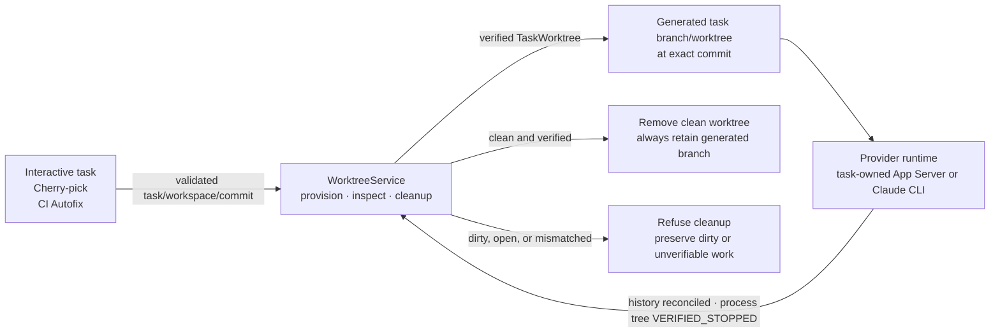

# Managed Worktree Service

> **Status: implemented and verified for every agent-backed workflow.**
> This document records the separate-worktree decision for every
> agent-backed workflow. It replaces flow-specific worktree creation and the
> former existing-checkout lease model.

## 1. Decision

Every repository-scoped agent task runs in one ByteQuay-created Git worktree.
Interactive development tasks, cherry-pick executions, and CI Autofix runs all
obtain that worktree through one `WorktreeService`. Branch Rebase borrows its
caller's task worktree and never creates or removes another one.

The service is synchronous and stateless. It creates a worktree, verifies an
existing worktree, or removes a verified clean worktree. A successful method
return is the result; there is no worktree lifecycle enum, recovery endpoint,
allocation table, cleanup disposition, or cleanup authority model.

The owning task may record when removal succeeds so its workflow monitor can
retry an interrupted cleanup. That timestamp is a durable operation fact in
the task record, not worktree-service state; a workflow authorizes cleanup only
after its own terminal result is durable. A failed attempt advances the task's
existing `updatedAt`, and policy monitors apply a one-minute retry cutoff. This
provides backoff and fair candidate selection without a worktree lifecycle or
dedicated retry field.

An interactive create request supplies a client-generated task ID used for
idempotent creation and a workspace ID, never a repository path, worktree
parent, or worktree path. The backend validates that ID, resolves the managed
repository, freezes an exact starting commit, and asks the service to provision
that task's worktree before any provider turn starts. Trusted internal
workflows generate their own task IDs. The owning task or workflow persists the
returned immutable `TaskWorktree` facts.



## 2. Boundary

`WorktreeService` is an `agent-core` contract. Its one production
`ManagedWorktreeService` implementation lives in `app`, where ByteQuay already
owns workspace resolution, `WorkspacePaths`, and Git execution. This is a
module boundary, not a provider or workflow framework.

The service replaced both:

- `AgentWorkspaceService`, which leased an existing caller-provided path
  without creating or deleting it; and
- `CherryPickWorkspace`, which implemented a private cherry-pick-only worktree
  lifecycle.

The service does not fetch, push, choose a base, interpret agent messages,
decide a workflow result, delete a branch, or expose a path to the renderer.
Each caller first resolves and fetches its exact commit using its existing
workflow rules. Non-repository helpers that do not create a durable agent task
or mutate Git, such as the Better Words text rewrite, keep their isolated
runtime scratch and do not manufacture a Git worktree.

## 3. Contract

```java
package com.bytequay.agent.core;

public interface WorktreeService
{
    /** Creates and verifies the deterministic worktree owned by one task. */
    TaskWorktree provision(ProvisionWorktreeCommand command);

    /** Reads verified current Git facts for a persisted task worktree. */
    WorktreeSnapshot inspect(TaskWorktree worktree);

    /** Removes one verified clean worktree without deleting its branch. */
    void cleanup(TaskWorktree worktree);
}
```

`ProvisionWorktreeCommand` follows the existing `agent-core` convention for a
validated input to a state-changing service method. It contains only:

- `TaskId taskId`;
- trusted `workspaceId`;
- `RepositoryIdentity physicalRepository`, equal to the workspace's selected
  repository/`origin`;
- an exact commit object ID already fetched into the managed repository; and
- the generated branch frozen by the application before provisioning.

The service derives the worktree path from the full task ID:

```text
<workspace-root>/worktrees/<task-id>
```

For new tasks, the application uses `TaskBranches` to generate:

```text
<authenticated-github-login>/bytequay/<description-slug>-<first-eight-task-id-characters>
```

The login comes from the user's authenticated GitHub identity, independently of
the selected repository owner. Interactive tasks use the initial message's
first plain-text line before UI-title truncation; workflows use their initial
descriptive label. The generator removes common conversational request lead-ins
such as “let's,” “please,” and “could you,” then makes a lowercase slug with
hyphen-separated words. It keeps at most four words and 32 characters, cuts at
a whole-word boundary where possible, and removes dangling function words.
It uses `task` when no usable description remains. This is deterministic text
cleanup, not model-generated summarization or grammatical rewriting. For
example, “Let's refactor nits in Delta Lake” produces
`refactor-nits-in-delta`. Generation is synchronous and does not wait for the
optional task-title helper.

The application freezes the branch once and passes it through task creation
and provisioning. The renderer cannot submit an arbitrary branch. Existing
task and workflow records remain authoritative: retries, resumed work, later
title changes, and a changed GitHub login never rename a recorded branch.
The full task UUID remains the internal identity and worktree directory name.

`TaskWorktree` contains only the immutable facts needed to use and revalidate
that result:

```java
public record TaskWorktree(
        TaskId taskId,
        String workspaceId,
        RepositoryIdentity physicalRepository,
        Path canonicalWorktree,
        String generatedBranch,
        String startCommit) {}
```

`WorktreeSnapshot` contains the persisted `TaskWorktree`, exact current HEAD,
dirty flag, open-Git-operation flag, and uncommitted flag. The dirty flag also
counts ignored files, which removing the worktree deletes; the uncommitted flag
does not, so build output alone is no uncommitted work. `inspect(...)` either
returns those facts for an existing verified worktree or throws; it does not
represent absence with another state or optional HEAD.

The contract accepts only lowercase 40- or 64-character Git object IDs for the
exact start commit and observed HEAD. Generated branches must match the strict
login/`bytequay`/slug format and this task's eight-character ID suffix. Exact
previously recorded `bytequay/task/<full-task-id>` names remain valid for their
owning task. Validation rejects arbitrary refs and unsafe Git-ref characters.
The normalized absolute path has the full task ID as its basename. The
application implementation additionally proves containment
beneath the selected workspace's `worktrees` root and verifies symlink and Git
ownership.

The physical identity is deliberately distinct from a workflow's logical
monitored/upstream repository. Cherry-pick and CI retain those logical
identities in their own records; the worktree service verifies only the clone
that physically owns the Git worktree.

## 4. Synchronous behavior

### Provision

`provision(...)`:

1. Resolves the trusted workspace and selected managed repository.
2. Verifies the supplied physical repository identity and that the exact start
   object exists as a commit.
3. Derives the task path and validates the application's frozen generated branch.
4. Runs the equivalent of
   `git worktree add --quiet -b <branch> <path> <start-commit>`.
5. Verifies the canonical path, common Git directory, origin, branch, exact
   HEAD, clean index/worktree, and absence of an open Git operation.
6. Returns `TaskWorktree` only after every check succeeds.

Repeating the same command may return an already-created worktree only when all
of those exact facts match and it is still clean. A conflicting path, branch,
repository, or Git state is preserved and reported rather than adopted or
deleted. If distinct tasks produce the same short-ID branch name, provisioning
reports a collision without overwriting the branch or silently choosing another
name.

The method may make a best-effort non-force removal after a definite local
failure when it can still prove that the just-created worktree is exact and
clean. If ByteQuay stops during `git worktree add`, a path or branch may remain.
The next explicit provision or workspace inspection reports it. ByteQuay does
not guess, force-remove it, or introduce a worktree recovery state machine.
Recovery automation can be designed later if observed failures demonstrate a
real need.

### Inspect

`inspect(...)` re-resolves the workspace from `workspaceId` and rejects the
worktree unless all persisted ownership facts still agree with the filesystem
and Git metadata. It verifies the canonical non-symlinked task path, workspace
root containment, common Git directory, selected repository origin, generated
branch, and current HEAD before reporting dirty or open-operation facts.

Callers inspect before every provider session that will mutate the worktree and
again before completion or cleanup. A missing or mismatched worktree is a normal
operation failure for the owning task/workflow; it is not converted into a
second worktree lifecycle.

### Changes

`changes(...)` reports, for a workspace's listed task checkouts, whether each
holds uncommitted files (ignored files excluded) and how many commits it has
made since its recorded start commit. It verifies the managed repository once
and each checkout's ownership as `inspect(...)` does. Because it only reads, it
takes no workspace lock, asks Git for no optional index lock, and reads a few
checkouts in parallel. A checkout that fails verification or disappears
mid-read is left out rather than reported as clean.

### Cleanup

`cleanup(...)`:

1. Repeats the same exact ownership checks as `inspect(...)`.
2. Refuses a dirty worktree, staged or untracked files, ignored files that
   removal would delete, an open cherry-pick, rebase, merge, or other Git
   operation.
3. Runs non-force `git worktree remove` for that exact path.
4. Verifies that Git no longer registers the worktree.
5. Leaves the recorded generated branch in the managed repository as the local
   result.

Cleanup never runs `--force` and never deletes the generated branch. Therefore
it needs no discard mode, remote-handoff mode, or authority token. If removal
fails, it throws and leaves the worktree and branch for the caller to display
or retry. A repeated call may succeed for an already-absent exact worktree only
when Git no longer registers the path and the generated result branch still
exists.

Deleting uncommitted work, a generated branch, or a branch after remote
handoff is outside this contract. Add a separate explicit operation and its
concrete user/handoff authority only when the product actually needs that
destructive behavior.

## 5. Caller ownership

The worktree service owns no allocation database. The owning durable task or
workflow stores the returned `TaskWorktree` fields and supplies that value to
later `inspect(...)` and `cleanup(...)` calls. Task and completion responses may
expose the safe generated branch name and verified HEAD as local-result facts,
but never the internal path.

### Interactive agent task

For a new task, the application synchronously fetches the workspace remotes,
requires a successful synchronization, then resolves the monitored repository's default branch:
`refs/remotes/upstream/<upstream-default-branch>^{commit}` when linked, otherwise
`refs/remotes/origin/<default-branch>^{commit}`. It validates the interactive
client-generated task ID, freezes the branch from the authenticated GitHub login
and initial message, provisions its worktree, and stores the returned
facts with the task. The selected write repository remains the physical worktree
identity in both cases. Fetch leaves local branches and existing worktrees
unchanged. A failed fetch prevents new task allocation; a replayed creation
request or later turn reuses its recorded worktree and starting commit without
fetching or choosing another base. Each active Codex turn gets a
task-owned App Server in that worktree. Its immutable model snapshot selects
the `NONE`, V1, or V2 launch profile; no execution environment or loopback
executor is registered, and `experimentalApi` is true only for the
background-terminal methods. Complete is allowed only after recursive item
history and background-terminal reconciliation finishes, the provider process
tree is `VERIFIED_STOPPED`, and `inspect(...)` reports no uncommitted work and
no open Git operation. Cleanup removes the worktree and retains the generated
branch; a worktree holding ignored build output is kept for inspection instead.

### Cherry-pick range

The execution freezes its generated branch in the existing execution record
before task creation and passes that exact branch when provisioning its task
worktree at the synchronized frozen target. It stores the returned facts with
the execution before the first cherry-pick. Repeated starts and recovery use
the recorded branch rather than reconstructing it from the task ID or current
GitHub login.
The sequencer and conflict turns use that one worktree. A successful range
verifies a clean generated branch, removes the worktree, and retains the branch
for delivery from the managed repository.

Cancellation does not silently discard generated work. A clean cancelled
worktree may use normal cleanup and retains its branch; dirty or open work is
preserved for inspection. A future destructive discard requires its own direct
user action and design.

### CI Autofix

CI Autofix provisions a fresh task worktree at the verified PR head and stores
the returned facts with the run/task. It never adopts the preceding
cherry-pick worktree. Its Branch Rebase instance borrows the same worktree.

The worktree remains while the run is active or paused. After any clean,
quiescent terminal result, cleanup removes the worktree and retains its local
branch, including after a verified push. Dirty or uncertain work remains for
inspection; this contract has no discard operation.

### Branch Rebase

Branch Rebase receives the owner's `TaskWorktree`, inspects it, and uses it. It
never provisions, transfers, or cleans a worktree. Its caller keeps ownership
until the full top-level workflow has settled.

## 6. Safety invariants

- One backend-validated full task ID deterministically names one path. Its
  generated branch is frozen from the authenticated login, initial description,
  and short task ID; interactive IDs are client-generated idempotency values,
  not paths.
- A task is published only after `provision(...)` returns a verified clean
  worktree at the exact starting commit.
- Provider readiness failure creates no task worktree.
- Renderer and HTTP values never contain a worktree or repository path.
- Every operation re-resolves the workspace and revalidates path containment,
  symlink safety, common Git directory, origin, and generated branch.
- Worktree add/remove operations are serialized per managed repository; work
  inside different provisioned worktrees remains concurrent.
- Cleanup requires provider quiescence from the caller: recursive Codex item
  history and background-terminal reconciliation must finish before the
  task-owned process tree is `VERIFIED_STOPPED`. Cleanup independently refuses
  dirty or open Git state.
- Cleanup uses non-force worktree removal and always retains the generated
  branch.
- A mismatch or interrupted operation is preserved and reported, never
  force-repaired or deleted by inference.
- Workspace removal is blocked while a persisted task/workflow references a
  worktree or the managed worktree root is non-empty.

## 7. Acceptance criteria

1. Interactive creation validates its client-generated idempotent task ID and
   workspace ID; interactive, cherry-pick, and CI Autofix creation accepts no
   renderer-controlled filesystem path.
2. All three provision through the same service and receive distinct generated
   branches/worktrees under their workspace.
3. Provision returns only an exact, clean, task-derived worktree and preserves
   every mismatch for inspection.
4. Inspect rejects a missing, symlinked, escaped, wrong-repository, or
   wrong-branch worktree.
5. Cleanup rejects dirty files and open Git operations without changing them.
6. Successful cleanup removes only the verified worktree, without force, and
   retains its generated branch and commits.
7. Branch Rebase uses its caller's worktree and creates no nested worktree.
8. An interrupted provision is reported safely; no startup recovery state
   machine or destructive orphan cleanup is required for the first release.
