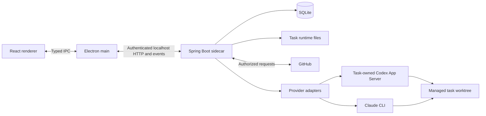

# Architecture

ByteQuay has one desktop shell, one local application backend, one SQLite
application database, and provider processes scoped to agent work. Module
boundaries are dependency boundaries, not additional services.

## Runtime



The renderer receives typed application projections. Electron main owns native
windows, browser surfaces, authenticated backend requests, and reconnecting
streams. The backend resolves workspace identities and filesystem authority;
the renderer cannot submit arbitrary checkout paths.

The sidecar listens on `127.0.0.1`, preferring port `9527` and reporting an
OS-assigned fallback when needed. An operating-system lock ensures only one
backend owns the database regardless of the selected port.

Embedded browsing uses `WebContentsView`. Browser lifecycle and website sessions
remain separate from backend credentials and the privileged IPC bridge.

## Backend modules

| Module | Owns |
| --- | --- |
| `core` | Shared immutable domain values and feature storage ports. |
| `agent-spi` | Provider/session contracts, capabilities, readiness, normalized events, and shared permission scope. |
| `agent-core` | Tasks, turns, worktree contracts, approvals, queues, event sequencing, lifecycle rules, and agent storage ports. |
| `agent-cli` | Codex and Claude protocols, binary discovery, provider event mapping, and owned-process supervision. |
| `persistence-sqlite` | JPA mappings, repositories, converters, encrypted credential storage, and implementations of storage ports. |
| `app` | Spring composition, HTTP and event endpoints, GitHub and Jira clients, application workflows, Git/worktree operations, scheduling, and packaging. |

Dependencies point toward framework-free contracts:

```text
app -> core, persistence-sqlite, agent-core, agent-cli
persistence-sqlite -> core, agent-core
agent-core -> agent-spi
agent-cli -> agent-spi
```

No module depends on `app`. The application is the only executable and chooses
its adapters. JPA entities never cross public storage ports; provider adapters
never own the database or publish desktop event streams. Single-consumer feature
orchestration stays in `app` rather than becoming speculative extra modules.

## Data ownership

SQLite stores durable application facts: repository and PR snapshots, settings,
source associations, planning outcomes, task and turn state, approvals, and input
and event-delivery records. A state change and its matching event become durable
together before publication.

Task-owned files hold detailed runtime history, attachments, and bounded output.
Structural indexes are disposable derived data outside working copies. Local
Git supplies commits, branches, patches, and worktree state.

Display reads cached state, while independent refresh paths contact GitHub and
persist results. Exact-item cache misses and visible stale views can request
refresh without making every render a network operation. Partial or failed
refreshes preserve usable data and never claim complete coverage.

Hibernate manages the current schema. ByteQuay does not add migration-history
machinery before it has a real released-data migration contract.

## Agent and workflow composition

The [agent service](agent-service.md) owns execution independently of the feature
that requested it. Reviews, spec checks, issue development, CI repair, delivery,
and backports reuse those tasks and existing application coordinators.

A shared stateless worktree service provisions, inspects, and cleans separate
worktrees. Callers retain immutable ownership facts; rebase borrows the caller's
worktree. There is no second worktree-allocation lifecycle or generic workflow
engine.

Feature-specific provider tools are narrow, task-bound capabilities, such as
repository context, review reporting, CI evidence, and authorized publication.
They do not imply a general tool registry or grant broader remote-write powers.

Planning separates Goal intent, accepted WorkItem outcomes, source identity, and
execution attempts. Repository memories provide sourced context. Private
comments, discussions, and learning records remain application data unless the
user explicitly publishes or promotes them.

## External services

GitHub and selected model providers remain network dependencies. Jira supports
personal API tokens and an optional separately hosted OAuth broker in
`services/jira-auth`; the broker owns OAuth secrets and rotating grants.
Both authentication paths reuse the desktop's Jira services and local cache.

Provider login profiles live outside repositories. Backend credentials never
become agent prompt context or ambient task secrets. Native process permissions,
application authorization, and same-user filesystem access are distinct
boundaries; see [trust and safety](security.md).

## Tradeoffs

A separate SQLite adapter localizes schema and transaction ownership. Shared
provider contracts let the app present coherent tasks without pretending that
providers have identical capabilities. The extra modules are justified by those
real boundaries; a connector framework, parser module, or separate service per
feature would add costs without a current consumer.
