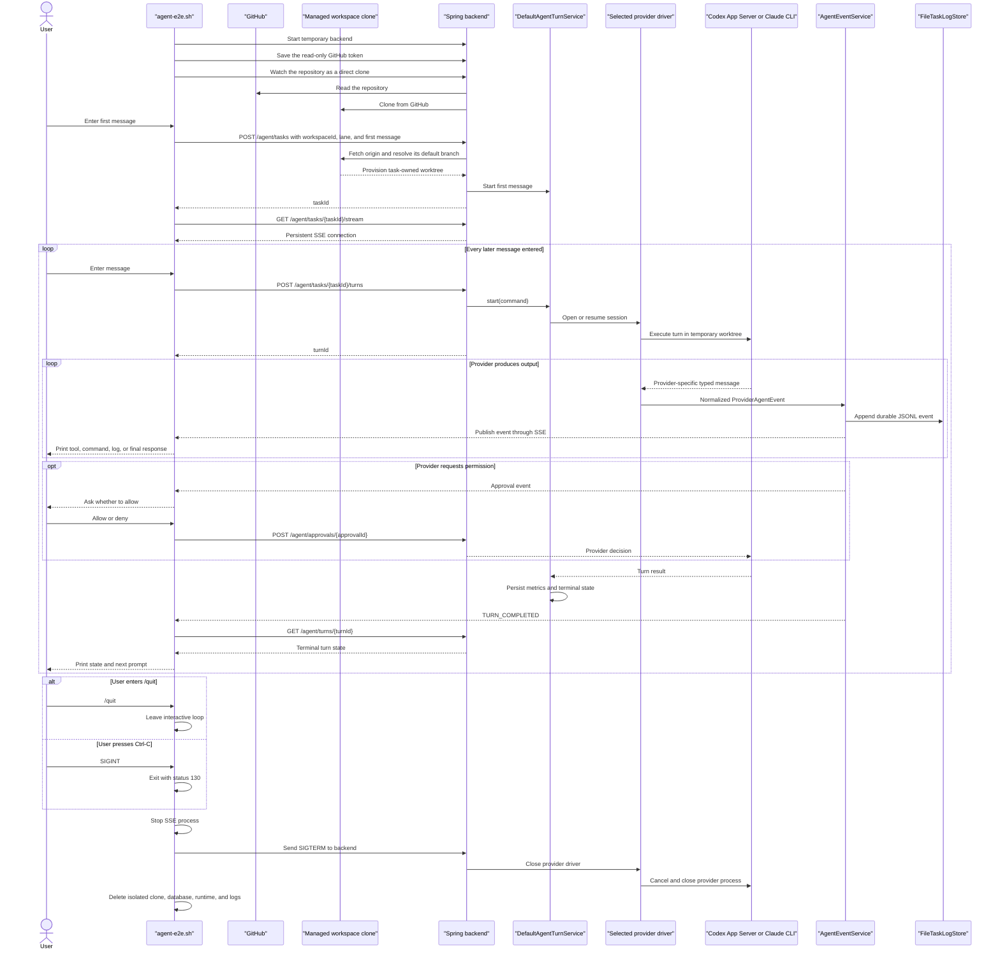

# Agent Shell End-to-End Test

> **Current behavior:** the script watches the GitHub repository you name
> through the same workspace endpoints the app uses and submits only the
> resulting workspace ID. The backend clones the repository and provisions the
> task worktree through the shared
> [agent execution boundary](../docs/architecture.md#agent-execution). Choose either the `codex` or
> `claude` public lane; the temporary backend enables only that lane.

The agent shell exercises the selected real provider through the public backend
path. The shell sends GitHub token, workspace, task, turn, approval, event, and
status requests only to the temporary Spring Boot backend. The backend owns the
provider process and converts its output into provider-neutral agent events.

## Run the shell

Starting a task clones and fetches the workspace repository from GitHub, so the
shell needs a repository and a token that can read it:

- Choose a repository with at least one commit on its default branch. An empty
  repository has no commit to start a task from.
- Create a fine-grained personal access token limited to that repository, with
  **Contents: Read-only**. GitHub adds **Metadata: Read-only** itself. Because
  the token can only read, GitHub refuses any write, even a mistaken one.

Run from the repository root. The selected CLI must already be installed and
authenticated. The script also requires `curl`, `git`, `java`, `jq`, Maven,
and `uuidgen`. Codex is the default lane:

```bash
./scripts/agent-e2e.sh --interactive --repository owner/name
```

The script asks for the token without echoing it, or reads
`BYTEQUAY_AGENT_E2E_GITHUB_TOKEN` when that is set.

Codex runs from ByteQuay's own Codex home, `~/Library/Application
Support/ByteQuay/codex-home` unless `BYTEQUAY_AGENT_E2E_CODEX_HOME` names
another, so the shell needs the login ByteQuay holds there rather than the one
in `~/.codex`.

To exercise Claude instead:

```bash
./scripts/agent-e2e.sh --interactive --repository owner/name --provider claude
```

Claude runs from ByteQuay's own Claude profile, `~/Library/Application
Support/ByteQuay/claude-home` unless `BYTEQUAY_AGENT_E2E_CLAUDE_HOME` names
another, so it reuses the account ByteQuay signed in there. Its login lives in
the macOS keychain, which Claude finds through `HOME`. With `HOME` set to a
scratch folder, Claude reads as signed out, while Codex keeps working because
its login sits in `CODEX_HOME`. The script therefore moves ByteQuay's own files
with `-Duser.home` and leaves `HOME` alone; do the same for any scratch
backend. The driver still supplies empty inherited setting sources, strict MCP
configuration, and generated task-local sandbox settings; changing the home
does not opt into its ordinary settings. Override a selected executable with
`BYTEQUAY_AGENT_E2E_CODEX_EXECUTABLE` or
`BYTEQUAY_AGENT_E2E_CLAUDE_EXECUTABLE`.
The task defaults come from that lane's own model-catalog entry; optional
`BYTEQUAY_AGENT_E2E_MODEL` and `BYTEQUAY_AGENT_E2E_EFFORT` values override the
selection for a targeted smoke test and are still validated by the backend.

The shell never asks for or copies a provider token. It generates an independent
temporary backend session secret, passes it to the backend through the process
environment, and keeps the matching request header in an owner-only temporary
curl configuration rather than process arguments. The GitHub token, user
messages, and approval decisions also reach curl over standard input, not its
argument list. The temporary backend keeps the token encrypted in its temporary
database. Its own `user.home` holds the credential key and single-backend lock,
so the shell can run while ByteQuay is open and never reads that app's key. Normal
output contains normalized backend events and typed readiness. The explicit
`/backend-log` diagnostic is capped at 30 lines and 32 KiB, then secondarily
scrubs the session secret, the GitHub token, and credential-shaped environment
values; provider drivers remain responsible for redacting their diagnostics
before logging. The shell deletes its curl configuration, database, clone,
runtime, and logs at exit. Provider credentials remain owned by the selected CLI.

The backend clones the repository into an isolated ByteQuay workspace and
creates a task-owned worktree from its default branch. The shell turns
automation off for the task, so finished turns commit only to that temporary
clone and never push, open a draft pull request, or start a CI fix.

The first prompt creates the task and its first turn through `POST /agent/tasks`.
After that, enter as many messages as needed. Each prompt waits for the current
turn to finish, prints its events and final response, and then accepts the next
message. Available commands are:

- `/events` — print all persisted normalized events for the task.
- `/backend-log` — print the bounded, scrubbed tail of the backend log.
- `/help` — print the shell help.
- `/quit` — exit; `Ctrl-C`, `quit`, and `exit` also stop the shell.

The shell intentionally has no deterministic mode. Automated HTTP, replay,
SSE, idempotency, completion, and cleanup coverage lives in the
`TestAgent*HttpApi` classes; this script exercises a real provider only. It
is a credentialed diagnostic, not evidence that a packaged release journey
passed.

## Message and shutdown flow



The shell does not simulate renderer reload and has no cancel or Complete
command. Exiting the test shell does not call
`POST /agent/tasks/{taskId}/complete`. Its exit trap removes the isolated test
environment immediately, so shell shutdown does not exercise completion
summaries or seven-day retention cleanup.

The fixture owns and removes its outer temporary application-data root, but it
does not create or submit the agent worktree itself. It watches the repository
through the public workspace endpoints and creates the task with
`workspaceId`. Normal completion and shared worktree cleanup shipped in CP3
and are covered by backend tests; the shell must not pretend that deleting its
isolated outer fixture exercises that product path.
